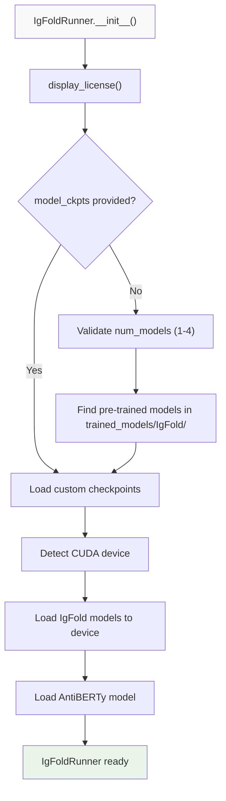
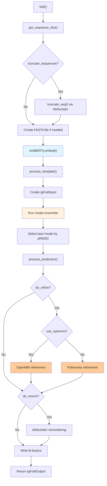
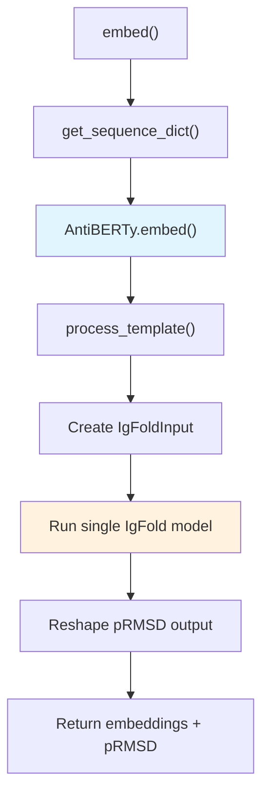
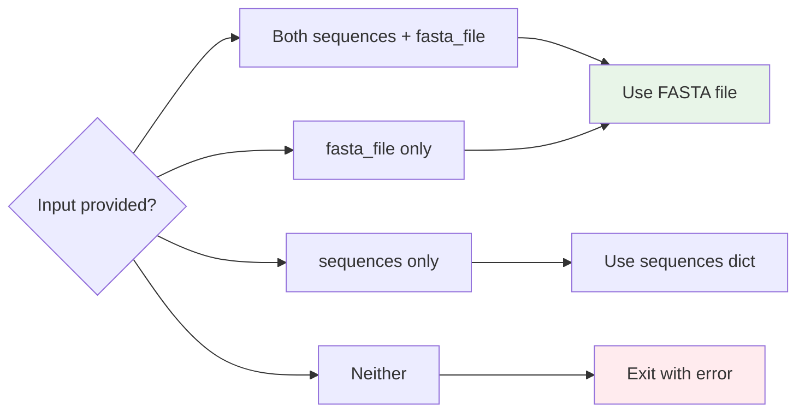

# IgFoldRunner API

<details>
<summary>Relevant source files</summary>

The following files were used as context for generating this wiki page:

- [igfold/IgFoldRunner.py](igfold/IgFoldRunner.py)
- [igfold/utils/embed.py](igfold/utils/embed.py)
- [igfold/utils/folding.py](igfold/utils/folding.py)

</details>


The `IgFoldRunner` class provides the primary programmatic interface for antibody structure prediction and embedding generation using IgFold. This API encapsulates model loading, sequence processing, and prediction workflows in a convenient Python interface.

This documentation covers the core API methods `fold()` and `embed()` and their parameters. For interactive usage through Jupyter notebooks, see [Jupyter Notebook Interface](#4.2). For details on input data formats, see [Input Formats and Data Preparation](#4.3).

## Class Initialization

The `IgFoldRunner` class manages multiple pre-trained IgFold models and the AntiBERTy embedding model required for predictions.

### Constructor Parameters

| Parameter | Type | Default | Description |
|-----------|------|---------|-------------|
| `num_models` | `int` | `4` | Number of pre-trained IgFold models to load (1-4) |
| `model_ckpts` | `List[str]` | `None` | Custom model checkpoint paths (overrides `num_models`) |
| `try_gpu` | `bool` | `True` | Whether to attempt GPU usage for acceleration |

### Initialization Process



Sources: [igfold/IgFoldRunner.py:26-76]()

## Core API Methods

### fold() Method

The `fold()` method performs complete antibody structure prediction, including coordinate generation, refinement, and PDB output.

#### Method Signature

```python
def fold(
    self,
    pdb_file,
    fasta_file=None,
    sequences=None,
    template_pdb=None,
    ignore_cdrs=None,
    ignore_chain=None,
    skip_pdb=False,
    do_refine=True,
    use_openmm=False,
    do_renum=True,
    truncate_sequences=False,
) -> IgFoldOutput
```

#### Parameters

| Parameter | Type | Default | Description |
|-----------|------|---------|-------------|
| `pdb_file` | `str` | Required | Output PDB file path |
| `fasta_file` | `str` | `None` | Input FASTA file containing sequences |
| `sequences` | `Dict[str, str]` | `None` | Dictionary mapping chain IDs to sequences |
| `template_pdb` | `str` | `None` | Template PDB file for structure guidance |
| `ignore_cdrs` | `List[str]` or `str` or `bool` | `None` | CDR regions to ignore in template |
| `ignore_chain` | `str` | `None` | Chain to ignore in template ("H" or "L") |
| `skip_pdb` | `bool` | `False` | Skip PDB file writing and processing |
| `do_refine` | `bool` | `True` | Perform structure refinement |
| `use_openmm` | `bool` | `False` | Use OpenMM instead of PyRosetta for refinement |
| `do_renum` | `bool` | `True` | Renumber output PDB using AbNumber |
| `truncate_sequences` | `bool` | `False` | Truncate sequences to antibody variable domains |

#### Processing Pipeline



Sources: [igfold/IgFoldRunner.py:77-124](), [igfold/utils/folding.py:153-231]()

### embed() Method

The `embed()` method generates structural embeddings without full coordinate prediction, useful for analysis and feature extraction.

#### Method Signature

```python
def embed(
    self,
    model_idx=0,
    fasta_file=None,
    sequences=None,
    template_pdb=None,
    ignore_cdrs=None,
    ignore_chain=None,
) -> IgFoldOutput
```

#### Parameters

| Parameter | Type | Default | Description |
|-----------|------|---------|-------------|
| `model_idx` | `int` | `0` | Index of loaded model to use for embedding |
| `fasta_file` | `str` | `None` | Input FASTA file containing sequences |
| `sequences` | `Dict[str, str]` | `None` | Dictionary mapping chain IDs to sequences |
| `template_pdb` | `str` | `None` | Template PDB file for structure guidance |
| `ignore_cdrs` | `List[str]` or `str` or `bool` | `None` | CDR regions to ignore in template |
| `ignore_chain` | `str` | `None` | Chain to ignore in template ("H" or "L") |

#### Embedding Pipeline



Sources: [igfold/IgFoldRunner.py:126-158](), [igfold/utils/embed.py:7-53]()

## Parameter Details

### CDR Specification

The `ignore_cdrs` parameter accepts multiple formats:

- `False`: No CDRs ignored (include all)
- `List[str]`: Specific CDRs to ignore (e.g., `["h1", "h3", "l2"]`)
- `str`: Single CDR to ignore (e.g., `"h3"`)
- Default `None`: Uses default CDR masking

Valid CDR identifiers: `["h1", "h2", "h3", "l1", "l2", "l3"]`

### Input Source Priority

When both `sequences` and `fasta_file` are provided, the FASTA file takes precedence:



Sources: [igfold/utils/folding.py:13-27]()

## Return Values

Both methods return an `IgFoldOutput` object containing:

| Attribute | Type | Description |
|-----------|------|-------------|
| `coords` | `torch.Tensor` | Predicted 3D coordinates |
| `prmsd` | `torch.Tensor` | Per-residue predicted RMSD values |
| `embeddings` | `torch.Tensor` | Structural embeddings (when requested) |
| Additional model outputs | Various | Intermediate representations and predictions |

## Usage Examples

### Basic Structure Prediction

```python
from igfold import IgFoldRunner

# Initialize runner
igfold = IgFoldRunner(num_models=2)

# Predict structure from sequences
sequences = {
    "H": "QVQLVQSGAEVKKPGASVKVSCKASGYTFT...",
    "L": "DIQMTQSPSSLSASVGDRVTITC..."
}

result = igfold.fold(
    pdb_file="antibody.pdb",
    sequences=sequences,
    do_refine=True,
    do_renum=True
)
```

### Template-Guided Prediction

```python
# Use template structure for guidance
result = igfold.fold(
    pdb_file="predicted.pdb",
    fasta_file="input.fasta",
    template_pdb="template.pdb",
    ignore_cdrs=["h3", "l3"],  # Ignore hypervariable regions
    do_refine=False
)
```

Sources: [igfold/IgFoldRunner.py:77-158]()

---