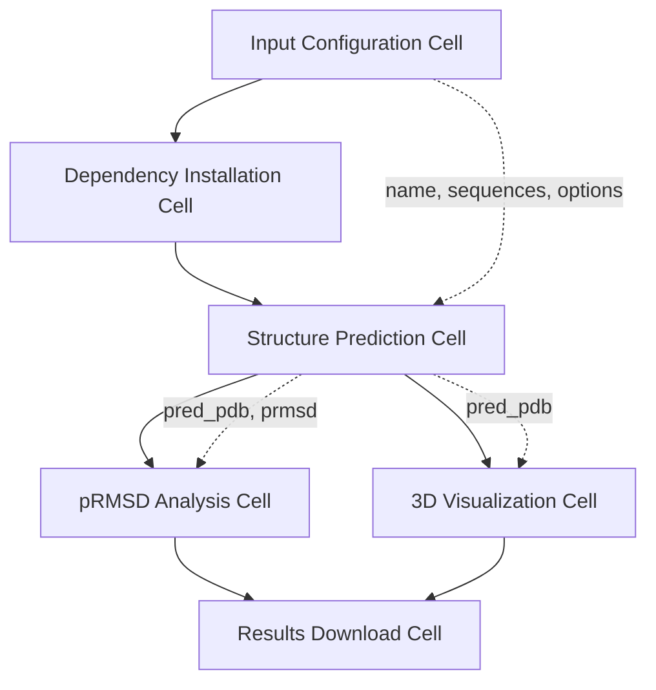
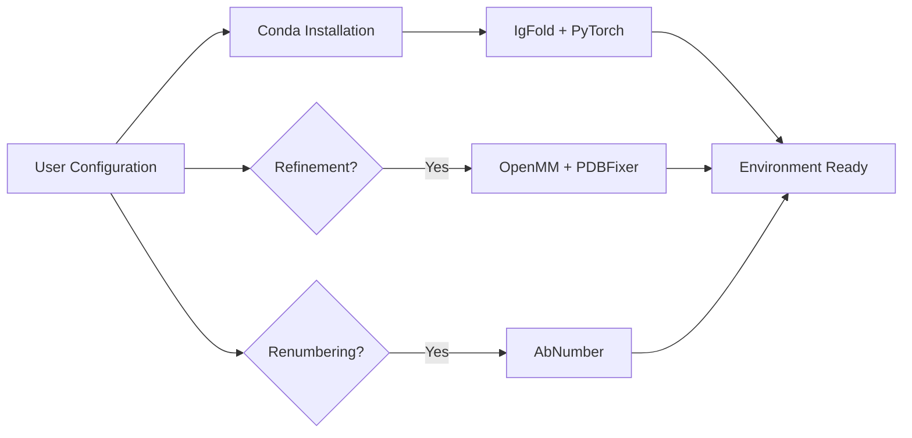
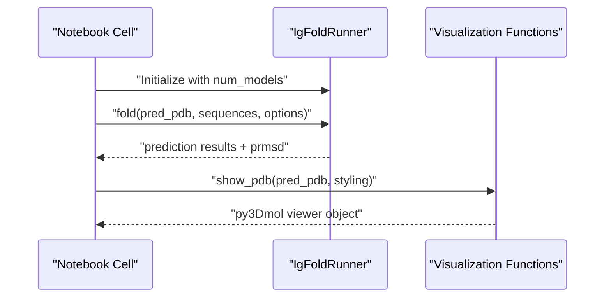
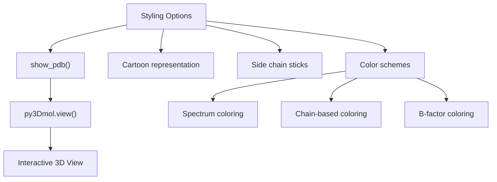
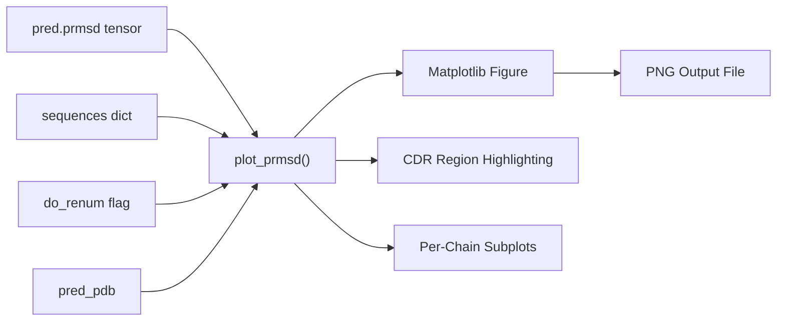
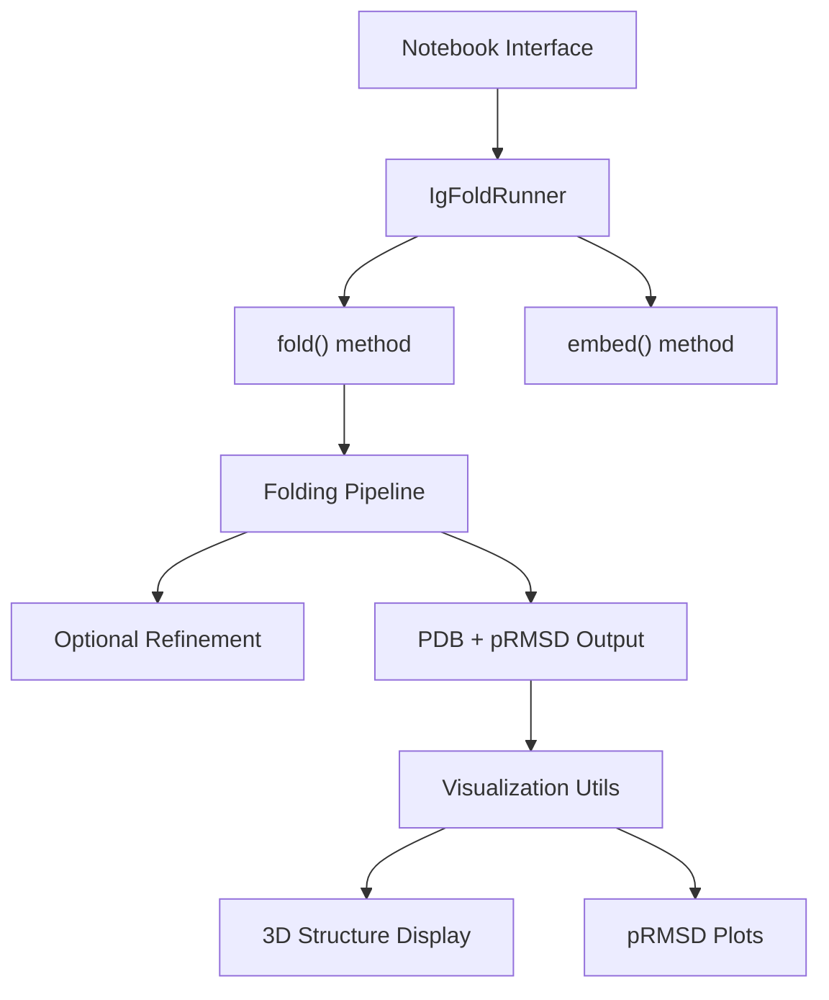

# Jupyter Notebook Interface

<details>
<summary>Relevant source files</summary>

The following files were used as context for generating this wiki page:

- [IgFold.ipynb](IgFold.ipynb)
- [igfold/utils/visualize.py](igfold/utils/visualize.py)

</details>


The Jupyter Notebook Interface provides an interactive web-based environment for antibody structure prediction with integrated 3D visualization and analysis tools. This interface is designed for users who want immediate visual feedback and interactive exploration of prediction results. For programmatic access to IgFold functionality, see [IgFoldRunner API](#4.1).

## Notebook Structure and Workflow

The main IgFold notebook consists of six sequential cells that guide users through the complete structure prediction workflow:



**Cell Execution Workflow**
Sources: [IgFold.ipynb:1-199]()

### Input Configuration Cell

Users configure their prediction job through form-based input widgets:

| Parameter | Type | Description |
|-----------|------|-------------|
| `name` | string | Prediction job name and output directory |
| `heavy_sequence` | string | Heavy chain amino acid sequence |
| `light_sequence` | string | Light chain amino acid sequence |
| `do_refine` | boolean | Enable OpenMM structural refinement |
| `do_renum` | boolean | Apply AbNumber renumbering scheme |
| `single_model` | boolean | Use single model vs ensemble prediction |

The notebook builds a `sequences` dictionary from the provided heavy and light chain sequences [IgFold.ipynb:38-42]().

Sources: [IgFold.ipynb:23-49]()

### Dependency Installation Cell

The notebook automatically handles dependency installation based on user configuration:



**Dependency Installation Flow**

The installation process creates marker files (`CONDA_READY`, `CODE_READY`, `AMBER_READY`, `ABNUMBER_READY`) to avoid redundant installations [IgFold.ipynb:65-89]().

Sources: [IgFold.ipynb:61-89]()

## Interactive Structure Prediction

### Core Prediction Workflow

The notebook interfaces with the core `IgFoldRunner` API to perform structure prediction:



**Prediction and Visualization Integration**

The prediction cell creates an `IgFoldRunner` instance and calls the `fold()` method with user-specified parameters [IgFold.ipynb:109-119]():

```python
igfold = IgFoldRunner(num_models=num_models)
pred = igfold.fold(
    pred_pdb,
    sequences=sequences,
    do_refine=do_refine,
    use_openmm=True,
    do_renum=do_renum,
)
```

Sources: [IgFold.ipynb:101-120]()

## Visualization Capabilities

### 3D Structure Visualization

The notebook provides interactive 3D structure viewing through the `show_pdb()` function from [igfold/utils/visualize.py:13-28]():



**3D Visualization Architecture**

| Visualization Mode | Color Scheme | Purpose |
|-------------------|--------------|---------|
| `rainbow` | Spectrum | Chain topology overview |
| `chain` | Per-chain colors | Multi-chain distinction |
| `b` | B-factor gradient | Confidence visualization |

The notebook displays structures with side chain sticks enabled and configurable backbone representation [IgFold.ipynb:120]().

Sources: [igfold/utils/visualize.py:13-138](), [IgFold.ipynb:120](), [IgFold.ipynb:151]()

### Per-Residue Confidence Analysis

The notebook generates predicted RMSD plots using the `plot_prmsd()` function:



**pRMSD Plotting Workflow**

The plotting function [igfold/utils/visualize.py:141-184]() processes the predicted RMSD tensor, splits it by chain, and optionally overlays CDR region annotations when renumbering is enabled.

Sources: [igfold/utils/visualize.py:141-184](), [IgFold.ipynb:132-135]()

## Configuration Options and Parameters

### Model Ensemble Control

The notebook supports both ensemble and single model predictions through the `single_model` parameter:

| Mode | `num_models` | Prediction Quality | Speed |
|------|-------------|-------------------|-------|
| Ensemble | 4 | Higher accuracy | Slower |
| Single | 1 | Good accuracy | Faster |

This parameter directly controls the `IgFoldRunner` initialization [IgFold.ipynb:109-110]().

### Refinement Options

| Option | Module | Purpose | Requirements |
|--------|--------|---------|-------------|
| `do_refine` | OpenMM | Energy minimization | OpenMM installation |
| `do_renum` | AbNumber | CDR identification | AbNumber installation |
| `use_openmm` | OpenMM | Refinement backend | Hardcoded to `True` |

### Output Management

The notebook automatically creates output directories and manages file naming [IgFold.ipynb:31-32]():
- Creates directory with `name` parameter
- Generates PDB files as `{name}.pdb`
- Creates pRMSD plots as `{name}_prmsd.png`

Sources: [IgFold.ipynb:31-32](), [IgFold.ipynb:112](), [IgFold.ipynb:134]()

## Integration with Core Components

### IgFoldRunner Interface

The notebook directly uses the `IgFoldRunner` class as its primary interface to the prediction system:



**Core API Integration**

The notebook leverages the same APIs documented in [IgFoldRunner API](#4.1), specifically using the `fold()` method with the same parameter interface.

### Visualization Utilities

The notebook imports visualization functions from `igfold.utils.visualize` [IgFold.ipynb:106]():

```python
from igfold.utils.visualize import *
from igfold import IgFoldRunner
```

This provides access to:
- `show_pdb()` - Interactive 3D structure viewing
- `show_pdbs()` - Multi-structure grid display  
- `plot_prmsd()` - Confidence analysis plotting

Sources: [IgFold.ipynb:106-107](), [igfold/utils/visualize.py:1-184]()

## Results Download and Export

The notebook provides automated result packaging through Google Colab's file download system [IgFold.ipynb:163-172](). Results are compressed into a zip file containing:

- Predicted PDB structure file
- pRMSD confidence plot (PNG format)
- Any intermediate files generated during processing

This download mechanism ensures users can easily retrieve all prediction outputs for further analysis or publication.

Sources: [IgFold.ipynb:163-172]()

---