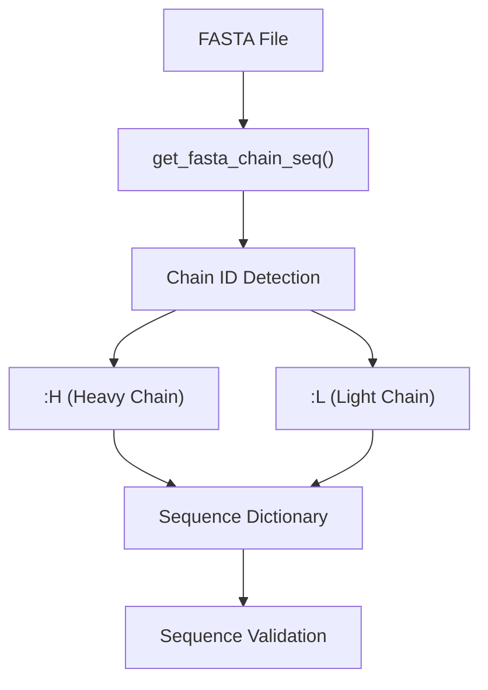
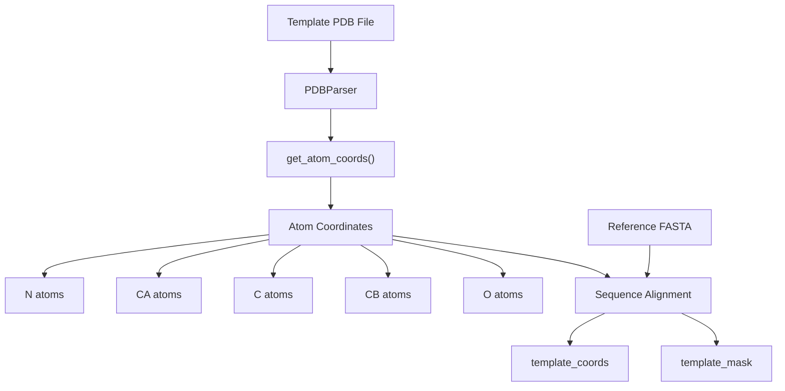
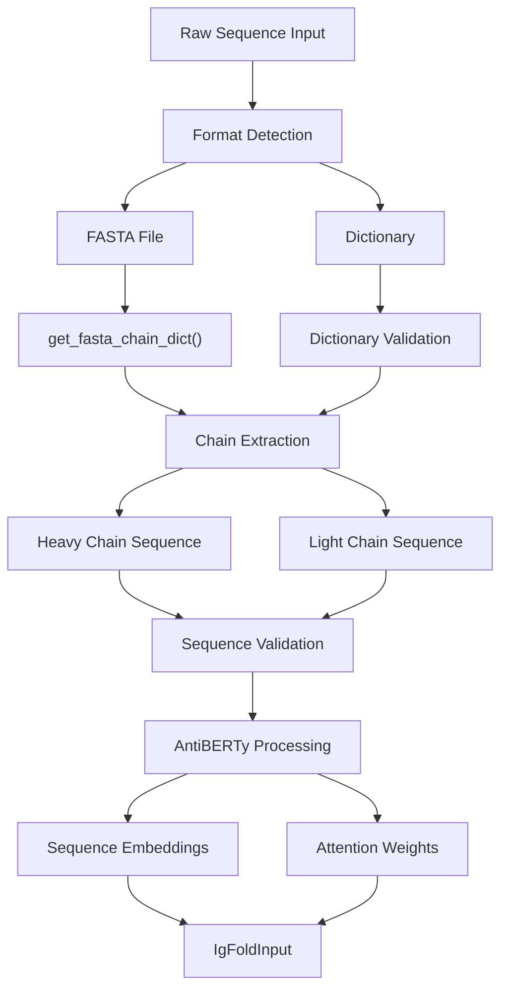
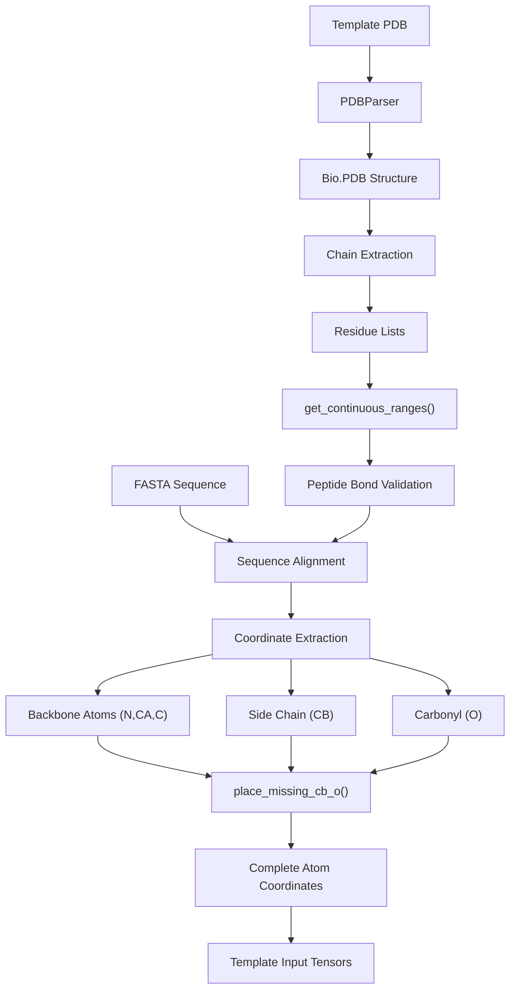
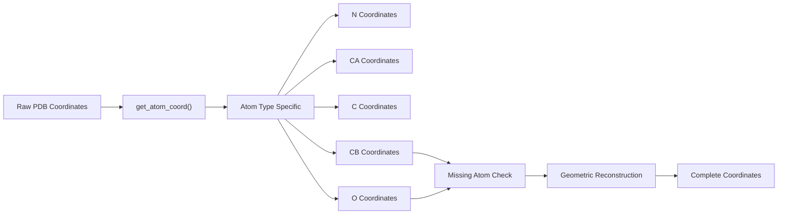
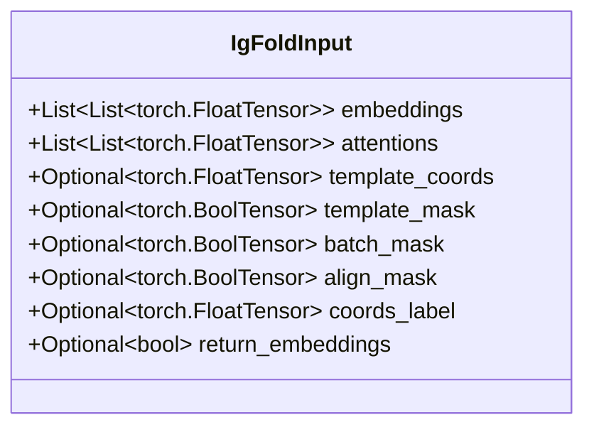
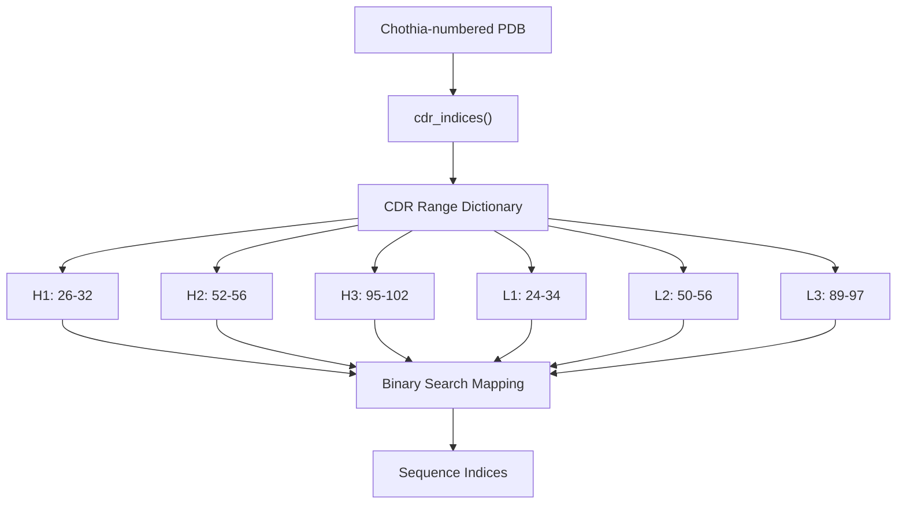
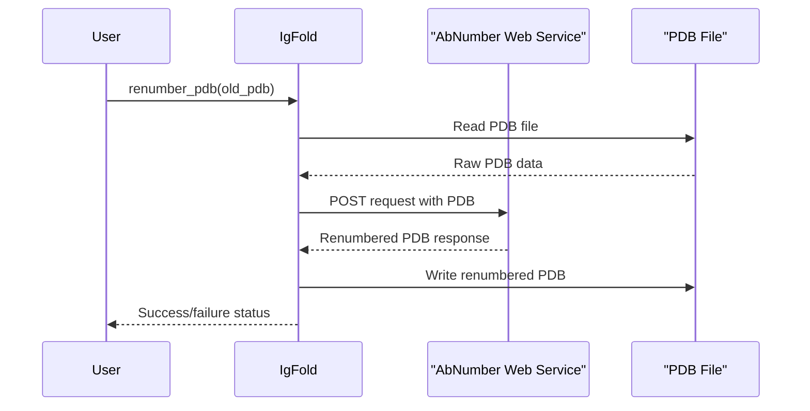

# Input Formats and Data Preparation

Relevant source files

The following files were used as context for generating this wiki page:

- [igfold/model/interface.py](igfold/model/interface.py)
- [igfold/utils/fasta.py](igfold/utils/fasta.py)
- [igfold/utils/pdb.py](igfold/utils/pdb.py)

This page documents the input formats accepted by IgFold and the data preparation steps required for antibody structure prediction. It covers sequence input requirements, template structure usage, and the processing pipeline that converts raw inputs into the standardized format required by the IgFold model.

For information about using the processed data with the main API, see [IgFoldRunner API](#4.1). For details about the internal model input structure, see [Core Architecture](#5).

## Supported Input Formats

IgFold accepts antibody sequences in multiple formats and provides utilities to process template structures for enhanced prediction accuracy.

### Sequence Input Formats

#### FASTA Format
The primary input format for antibody sequences is FASTA, with specific chain identification conventions:

**FASTA Chain Identification**
- Heavy chain sequences must include `:H` in the sequence identifier
- Light chain sequences must include `:L` in the sequence identifier
- Example header format: `>antibody_name:H` or `>antibody_name:L`

#### Dictionary Format
Sequences can also be provided as Python dictionaries:

| Key | Value | Description |
|-----|--------|-------------|
| `"H"` | `str` | Heavy chain amino acid sequence |
| `"L"` | `str` | Light chain amino acid sequence (optional) |

Sources: [igfold/utils/fasta.py:4-18]()

### Template Structure Input

Template PDB structures can be provided to improve prediction accuracy through structural templating:

**Supported Template Features:**
- Standard PDB format with ATOM records
- Multi-chain antibody structures
- Automatic missing atom placement for CB and O atoms
- Chain reordering and renumbering capabilities

Sources: [igfold/utils/pdb.py:194-252](), [igfold/utils/pdb.py:160-192]()

## Sequence Requirements and Validation

### Amino Acid Sequences
IgFold expects standard single-letter amino acid codes. The system handles:

- **Heavy chains**: Typically 110-130 residues for antibody variable domains
- **Light chains**: Typically 105-115 residues for antibody variable domains  
- **Standard amino acids**: All 20 canonical amino acids supported
- **Non-standard residues**: Converted or flagged during processing

### Chain Processing Pipeline

Sources: [igfold/utils/fasta.py:13-18](), [igfold/model/interface.py:7-20]()

## Template Structure Processing

When template structures are provided, IgFold performs sophisticated alignment and coordinate extraction:

### PDB Processing Workflow

**Key Processing Functions:**
- `get_atom_coords()`: Extracts atomic coordinates from PDB structures
- `get_continuous_ranges()`: Identifies continuous peptide segments 
- `place_missing_cb_o()`: Reconstructs missing CB and O atoms using geometric constraints

Sources: [igfold/utils/pdb.py:139-157](), [igfold/utils/pdb.py:194-251]()

## Data Processing Utilities

### PDB Manipulation Functions

| Function | Purpose | Input | Output |
|----------|---------|--------|---------|
| `pdb2fasta()` | Convert PDB to FASTA | PDB file path | FASTA string |
| `get_pdb_chain_seq()` | Extract chain sequence | PDB file, chain ID | Amino acid sequence |
| `renumber_pdb()` | AbNumber renumbering | PDB file path | Renumbered PDB |
| `reorder_pdb_chains()` | Reorder chains | PDB file, chain order | Reordered PDB |
| `count_pdb_chains()` | Count chains | PDB file path | Integer count |

### Coordinate Processing

**Coordinate Tensors:**
- All coordinates stored as PyTorch tensors
- Shape: `[num_residues, 3]` for each atom type
- Automatic masking for missing atoms
- Geometric reconstruction for standard missing atoms

Sources: [igfold/utils/pdb.py:120-137](), [igfold/utils/pdb.py:254-265]()

## IgFoldInput Data Structure

The processed input data is consolidated into the `IgFoldInput` dataclass:

**Field Descriptions:**
- `embeddings`: AntiBERTy sequence embeddings per layer
- `attentions`: Multi-head attention weights per layer  
- `template_coords`: Template structure coordinates (optional)
- `template_mask`: Mask indicating valid template positions
- `batch_mask`: Mask for batch processing
- `align_mask`: Alignment mask between sequence and template

Sources: [igfold/model/interface.py:6-20]()

## CDR Loop Processing

IgFold includes specialized utilities for CDR (Complementarity-Determining Region) identification and processing:

### CDR Identification Pipeline

**CDR Processing Functions:**
- `cdr_indices()`: Maps Chothia numbering to sequence indices
- `get_cdr_range_dict()`: Returns all CDR ranges for a structure
- `h3_indices()`: Specialized H3 loop identification

Sources: [igfold/utils/pdb.py:314-403]()

## AbNumber Integration

IgFold integrates with the AbNumber web service for antibody renumbering:

### Renumbering Workflow

**Renumbering Features:**
- Automatic retry logic for network failures
- Chothia numbering scheme by default
- Heavy and light chain processing
- Error handling and validation

Sources: [igfold/utils/pdb.py:21-59]()

---