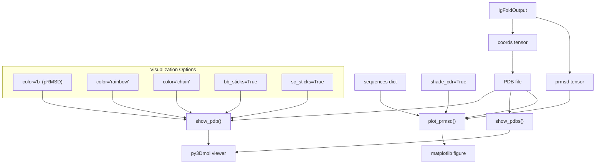
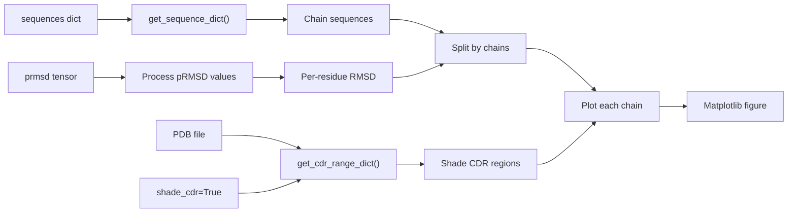
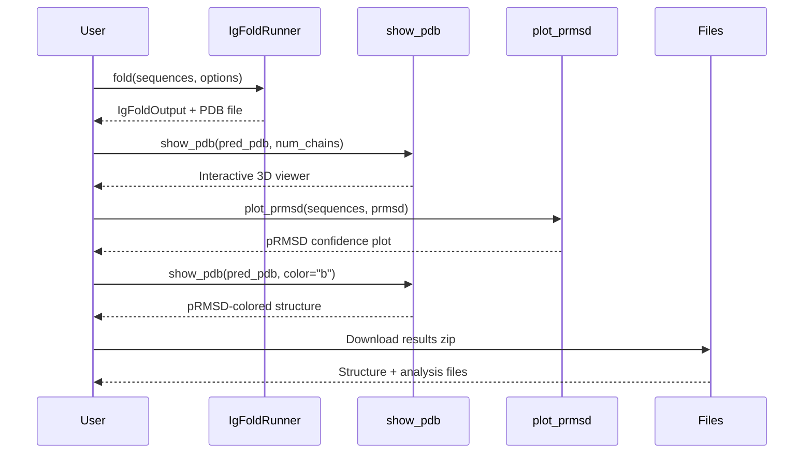

# Output Analysis and Visualization

<details>
<summary>Relevant source files</summary>

The following files were used as context for generating this wiki page:

- [IgFold.ipynb](IgFold.ipynb)
- [igfold/model/interface.py](igfold/model/interface.py)
- [igfold/utils/visualize.py](igfold/utils/visualize.py)

</details>


This page covers understanding and analyzing IgFold prediction outputs, including PDB structure files, predicted RMSD (pRMSD) values, and using the built-in visualization tools for structure analysis and quality assessment.

For information about input preparation and formats, see [Input Formats and Data Preparation](#4.3). For details about the core model architecture that generates these outputs, see [IgFold Model](#5.1).

## Understanding IgFold Outputs

IgFold generates structured predictions containing both 3D coordinates and confidence estimates. The primary outputs include predicted protein structures in PDB format and per-residue predicted RMSD values that indicate local structure confidence.

### Output Data Structure

The `IgFoldOutput` dataclass defines the complete set of model outputs:

```mermaid
classDiagram
    class IgFoldOutput {
        +torch.FloatTensor coords
        +torch.FloatTensor prmsd
        +torch.FloatTensor translations
        +torch.FloatTensor rotations
        +Optional[torch.FloatTensor] coords_loss
        +Optional[torch.FloatTensor] torsion_loss
        +Optional[torch.FloatTensor] bondlen_loss
        +Optional[torch.FloatTensor] prmsd_loss
        +Optional[torch.FloatTensor] loss
        +Optional[torch.FloatTensor] bert_embs
        +Optional[torch.FloatTensor] bert_attn
        +Optional[torch.FloatTensor] gt_embs
        +Optional[torch.FloatTensor] structure_embs
    }
    
    class "Primary Outputs" {
        coords: "3D atom coordinates"
        prmsd: "Per-residue predicted RMSD"
        translations: "Translation vectors"
        rotations: "Rotation matrices"
    }
    
    class "Training Outputs" {
        coords_loss: "Coordinate loss"
        torsion_loss: "Torsion angle loss"
        bondlen_loss: "Bond length loss"
        prmsd_loss: "pRMSD prediction loss"
        loss: "Total loss"
    }
    
    class "Optional Embeddings" {
        bert_embs: "BERT embeddings"
        bert_attn: "BERT attention weights"
        gt_embs: "Graph transformer embeddings"
        structure_embs: "Structure embeddings"
    }
    
    IgFoldOutput --> "Primary Outputs"
    IgFoldOutput --> "Training Outputs"
    IgFoldOutput --> "Optional Embeddings"
```

**Key Output Components:**

| Field | Type | Purpose |
|-------|------|---------|
| `coords` | `torch.FloatTensor` | 3D atomic coordinates for all atoms |
| `prmsd` | `torch.FloatTensor` | Per-residue predicted RMSD confidence scores |
| `translations` | `torch.FloatTensor` | Translation vectors for structure positioning |
| `rotations` | `torch.FloatTensor` | Rotation matrices for structure orientation |

Sources: [igfold/model/interface.py:22-40]()

## Visualization Pipeline

IgFold provides integrated visualization tools that work seamlessly with prediction outputs to create interactive 3D structure viewers and analysis plots.



Sources: [igfold/utils/visualize.py:13-184](), [IgFold.ipynb:120-135]()

## 3D Structure Visualization

### Basic Structure Display

The `show_pdb()` function creates interactive 3D structure viewers using py3Dmol:

**Basic Usage:**
```python
from igfold.utils.visualize import show_pdb

# Display structure with default settings
show_pdb("my_antibody.pdb", num_sequences=2)
```

**Function Parameters:**

| Parameter | Type | Purpose |
|-----------|------|---------|
| `pdb_filename` | `str` | Path to PDB structure file |
| `num_sequences` | `int` | Number of chains in structure |
| `bb_sticks` | `bool` | Show backbone as sticks |
| `sc_sticks` | `bool` | Show sidechains as sticks |
| `color` | `str` | Color scheme: `"b"`, `"rainbow"`, `"chain"` |
| `view_size` | `tuple` | Viewer dimensions `(width, height)` |

### Color Schemes

**pRMSD Coloring (`color="b"`):**
- Colors structure from blue (low pRMSD/high confidence) to red (high pRMSD/low confidence)
- Uses B-factor field in PDB to store pRMSD values
- Gradient range: 0.5 Å (blue) to 1.5 Å (red)

**Rainbow Coloring (`color="rainbow"`):**
- Colors structure from N-terminus (blue) to C-terminus (red)
- Useful for visualizing overall structure topology

**Chain Coloring (`color="chain"`):**
- Assigns distinct colors to each chain
- Supports up to 8 chains with predefined colors: lime, cyan, magenta, yellow, salmon, white, blue, orange

Sources: [igfold/utils/visualize.py:13-84](), [IgFold.ipynb:120-151]()

### Multiple Structure Comparison

The `show_pdbs()` function displays multiple structures in a grid layout:

```python
# Compare multiple predictions
show_pdbs(
    ["model1.pdb", "model2.pdb", "model3.pdb"], 
    num_sequences=2,
    view_size=(800, 800)
)
```

The function automatically calculates optimal grid dimensions using `math.ceil(math.sqrt(len(pdb_filenames)))` for width and height.

Sources: [igfold/utils/visualize.py:36-138]()

## Predicted RMSD Analysis

### Understanding pRMSD Values

Predicted RMSD (pRMSD) values provide per-residue confidence estimates for structural predictions:

- **Low pRMSD (< 1.0 Å):** High confidence regions, typically well-structured domains
- **Medium pRMSD (1.0-2.0 Å):** Moderate confidence, may include flexible loops
- **High pRMSD (> 2.0 Å):** Low confidence regions, often highly flexible or disordered

### pRMSD Plotting

The `plot_prmsd()` function generates per-residue confidence plots:



**Key Features:**
- Separate subplot for each chain (Heavy, Light)
- Optional CDR region highlighting when `shade_cdr=True`
- Residue numbering starts from 1 for each chain
- Gray shaded regions indicate CDR loops when AbNumber renumbering is used

**Function Parameters:**

| Parameter | Type | Purpose |
|-----------|------|---------|
| `sequences` | `dict` | Chain sequences dictionary |
| `prmsd` | `torch.Tensor` | pRMSD predictions from model |
| `out_file` | `str` | Output file path for saving plot |
| `shade_cdr` | `bool` | Highlight CDR regions |
| `pdb_file` | `str` | PDB file for CDR identification |

Sources: [igfold/utils/visualize.py:141-184](), [IgFold.ipynb:132-135]()

### CDR Region Analysis

When `shade_cdr=True` and a PDB file is provided, the plotting function automatically identifies and highlights CDR regions:

1. Uses `get_cdr_range_dict()` to identify CDR boundaries
2. Handles different antibody formats:
   - Heavy chain only (`heavy_only=True`)
   - Light chain only (`light_only=True`) 
   - Heavy-Light pairs
3. Applies gray shading (`alpha=0.5`) to CDR regions
4. Requires AbNumber renumbering for accurate CDR identification

Sources: [igfold/utils/visualize.py:154-174]()

## Jupyter Notebook Integration

The main IgFold notebook demonstrates the complete output analysis workflow:



**Typical Analysis Workflow:**
1. **Initial Structure View:** Rainbow-colored structure showing overall topology
2. **Confidence Analysis:** pRMSD plot identifying reliable vs. uncertain regions  
3. **Confidence Visualization:** Structure colored by pRMSD values
4. **Results Export:** Download PDB files and analysis plots

Sources: [IgFold.ipynb:101-172]()

## Advanced Visualization Options

### Structure Representation Options

**Sidechain Display (`sc_sticks=True`):**
- Shows sidechain atoms as sticks with 0.2 Å radius
- Special handling for Glycine (sphere representation) and Proline
- Uses WhiteCarbon color scheme for chemical intuition

**Backbone Display (`bb_sticks=True`):**
- Displays backbone atoms (C, O, N, CA) as sticks
- 0.3 Å radius for visibility
- Useful for detailed structural analysis

### Viewer Configuration

**Grid Layout for Multiple Structures:**
- Automatic grid calculation: `math.ceil(math.sqrt(num_structures))`
- Each structure gets individual viewer in grid
- Synchronized zoom and rotation controls

**View Size Options:**
- Default single structure: 500×500 pixels
- Default multiple structures: 800×800 pixels
- Customizable via `view_size` parameter

Sources: [igfold/utils/visualize.py:84-138]()

---