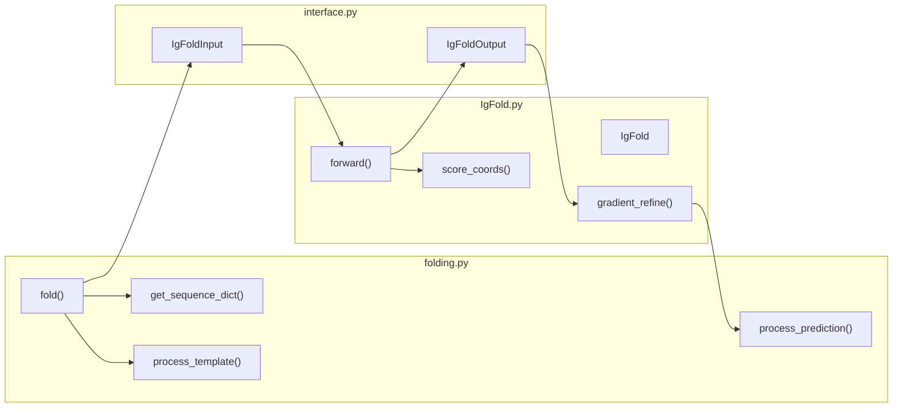
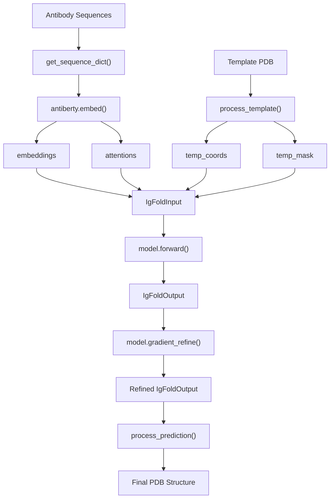
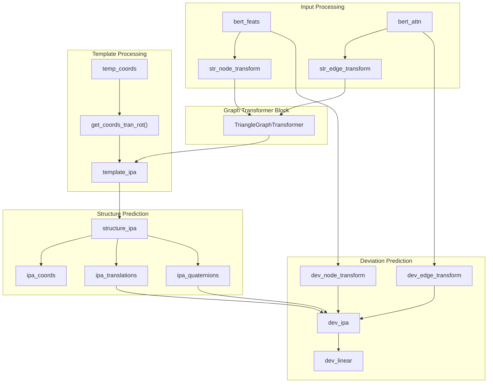

# Core Architecture

<details>
<summary>Relevant source files</summary>

The following files were used as context for generating this wiki page:

- [igfold/model/IgFold.py](igfold/model/IgFold.py)
- [igfold/utils/folding.py](igfold/utils/folding.py)

</details>


This page provides a technical overview of IgFold's internal architecture, focusing on the core system components, data flow patterns, and model structure that enable fast and accurate antibody structure prediction. For detailed information about specific model components, see [IgFold Model](#5.1). For implementation details of the processing pipeline, see [Processing Pipeline](#5.2). For utilities and data handling specifics, see [Data Processing Utilities](#5.3).

## System Overview

IgFold implements a deep learning architecture that transforms antibody sequences into 3D protein structures through a multi-stage processing pipeline. The system is built around three main architectural layers: input processing, neural network prediction, and output refinement.

**High-Level Architecture**
```mermaid
graph TB
    subgraph "Input_Layer" ["Input Processing Layer"]
        SEQ_PROC["get_sequence_dict()"]
        TEMP_PROC["process_template()"]
        ANTIBERTY["AntiBERTy Embedding"]
    end
    
    subgraph "Model_Layer" ["Neural Network Layer"]  
        IGFOLD_INPUT["IgFoldInput"]
        IGFOLD_MODEL["IgFold"]
        IGFOLD_OUTPUT["IgFoldOutput"]
    end
    
    subgraph "Processing_Layer" ["Processing Components"]
        TRIANGLE_GT["TriangleGraphTransformer"]
        TEMPLATE_IPA["IPAEncoder (Template)"]
        STRUCTURE_IPA["IPATransformer (Structure)"]
        DEV_IPA["IPAEncoder (Deviation)"]
    end
    
    subgraph "Output_Layer" ["Output Processing Layer"]
        GRADIENT_REF["gradient_refine()"]
        PROCESS_PRED["process_prediction()"]
        REFINEMENT["Structure Refinement"]
    end
    
    SEQ_PROC --> ANTIBERTY
    TEMP_PROC --> IGFOLD_INPUT
    ANTIBERTY --> IGFOLD_INPUT
    
    IGFOLD_INPUT --> IGFOLD_MODEL
    IGFOLD_MODEL --> TRIANGLE_GT
    IGFOLD_MODEL --> TEMPLATE_IPA  
    IGFOLD_MODEL --> STRUCTURE_IPA
    IGFOLD_MODEL --> DEV_IPA
    
    IGFOLD_MODEL --> IGFOLD_OUTPUT
    IGFOLD_OUTPUT --> GRADIENT_REF
    GRADIENT_REF --> PROCESS_PRED
    PROCESS_PRED --> REFINEMENT
```

Sources: [igfold/utils/folding.py:13-231](), [igfold/model/IgFold.py:19-488]()

## Core Components

The IgFold architecture consists of several key components that work together to transform sequence inputs into structural predictions:

| Component | Class/Function | Purpose | Location |
|-----------|----------------|---------|----------|
| **Main Model** | `IgFold` | Core neural network implementing structure prediction | [igfold/model/IgFold.py:19]() |
| **Input Interface** | `IgFoldInput` | Standardized input data container | [igfold/model/interface.py]() |
| **Output Interface** | `IgFoldOutput` | Structured output with coordinates and metadata | [igfold/model/interface.py]() |
| **Folding Pipeline** | `fold()` | Main entry point orchestrating the prediction process | [igfold/utils/folding.py:153-231]() |
| **Sequence Processing** | `get_sequence_dict()` | Input sequence standardization and validation | [igfold/utils/folding.py:13-27]() |
| **Template Processing** | `process_template()` | Template structure preprocessing and alignment | [igfold/utils/folding.py:30-75]() |

**Core Component Relationships**


Sources: [igfold/utils/folding.py:153-231](), [igfold/model/IgFold.py:19-488]()

## Data Flow Architecture

The system processes data through a well-defined pipeline that transforms sequence inputs into 3D structural coordinates:

**Data Flow Through Core Pipeline**


Sources: [igfold/utils/folding.py:168-231](), [igfold/model/IgFold.py:196-488]()

The data transformation occurs in several key stages:

1. **Input Standardization**: [igfold/utils/folding.py:168-189]() - Raw sequences converted to standardized dictionary format
2. **Embedding Generation**: [igfold/utils/folding.py:190-195]() - AntiBERTy produces sequence embeddings and attention matrices
3. **Template Processing**: [igfold/utils/folding.py:197-202]() - Optional template structures processed and aligned
4. **Neural Network Prediction**: [igfold/model/IgFold.py:196-370]() - Core model predicts 3D coordinates and confidence scores
5. **Gradient Refinement**: [igfold/model/IgFold.py:427-488]() - Iterative optimization improves structural quality
6. **Output Processing**: [igfold/utils/folding.py:221-231]() - Final coordinates converted to PDB format with optional refinement

## Model Architecture Overview

The `IgFold` neural network implements a sophisticated transformer-based architecture specifically designed for protein structure prediction:

**Neural Network Architecture**


Sources: [igfold/model/IgFold.py:50-275]()

### Model Components

The architecture consists of several specialized neural network components:

- **Node/Edge Transformers**: [igfold/model/IgFold.py:50-65]() - Convert AntiBERTy embeddings to model internal representation
- **TriangleGraphTransformer**: [igfold/model/IgFold.py:67-75]() - Processes sequence relationships using graph attention
- **Template IPA**: [igfold/model/IgFold.py:76-81]() - Incorporates template structural information via invariant point attention
- **Structure IPA**: [igfold/model/IgFold.py:83-88]() - Predicts 3D coordinates using invariant point attention
- **Deviation IPA**: [igfold/model/IgFold.py:103-112]() - Estimates prediction confidence (pRMSD values)

## Key Interfaces and Abstractions

IgFold uses several key data structures that define the interfaces between system components:

### IgFoldInput Structure
The `IgFoldInput` class serves as the primary interface for providing data to the neural network. Key fields include:
- `embeddings`: Sequence embeddings from AntiBERTy
- `attentions`: Attention matrices from AntiBERTy  
- `template_coords`: Optional template structure coordinates
- `template_mask`: Mask indicating valid template positions
- `batch_mask`: Mask for valid sequence positions
- `coords_label`: Ground truth coordinates (training only)

Sources: [igfold/model/interface.py](), [igfold/model/IgFold.py:203-208]()

### IgFoldOutput Structure  
The `IgFoldOutput` class contains all prediction results:
- `coords`: Predicted 3D coordinates for all atoms
- `prmsd`: Per-residue confidence estimates
- `translations`/`rotations`: Rigid body transformations
- Loss terms for training: `coords_loss`, `bondlen_loss`, `prmsd_loss`
- Optional embeddings: `bert_embs`, `gt_embs`, `structure_embs`

Sources: [igfold/model/interface.py](), [igfold/model/IgFold.py:355-368]()

### Processing Functions Interface
The main `fold()` function provides the primary API for structure prediction:

```python
def fold(
    antiberty,           # AntiBERTy model instance
    models,             # List of IgFold model instances  
    pdb_file,           # Output PDB file path
    fasta_file=None,    # Input FASTA file
    sequences=None,     # Input sequences dictionary
    template_pdb=None,  # Optional template structure
    # ... additional parameters
)
```

Sources: [igfold/utils/folding.py:153-167]()

This interface abstracts away the complexity of the neural network pipeline while providing flexible options for different use cases, from simple sequence-to-structure prediction to template-guided modeling with structure refinement.

---