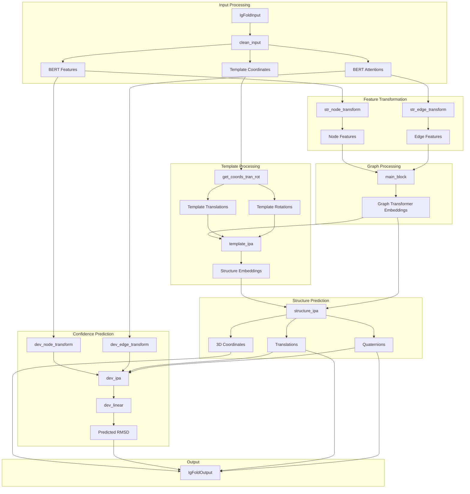
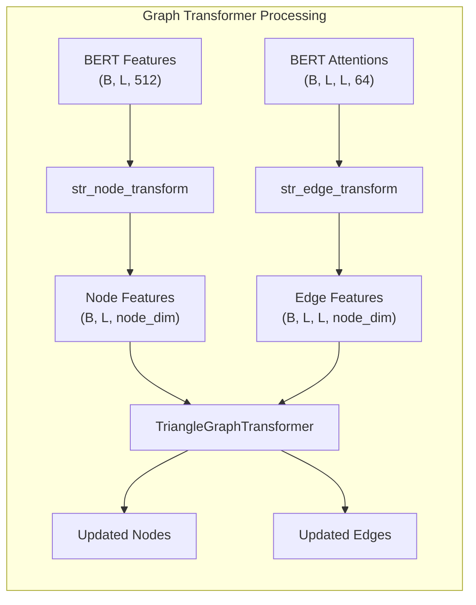
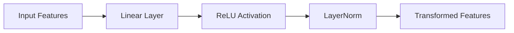
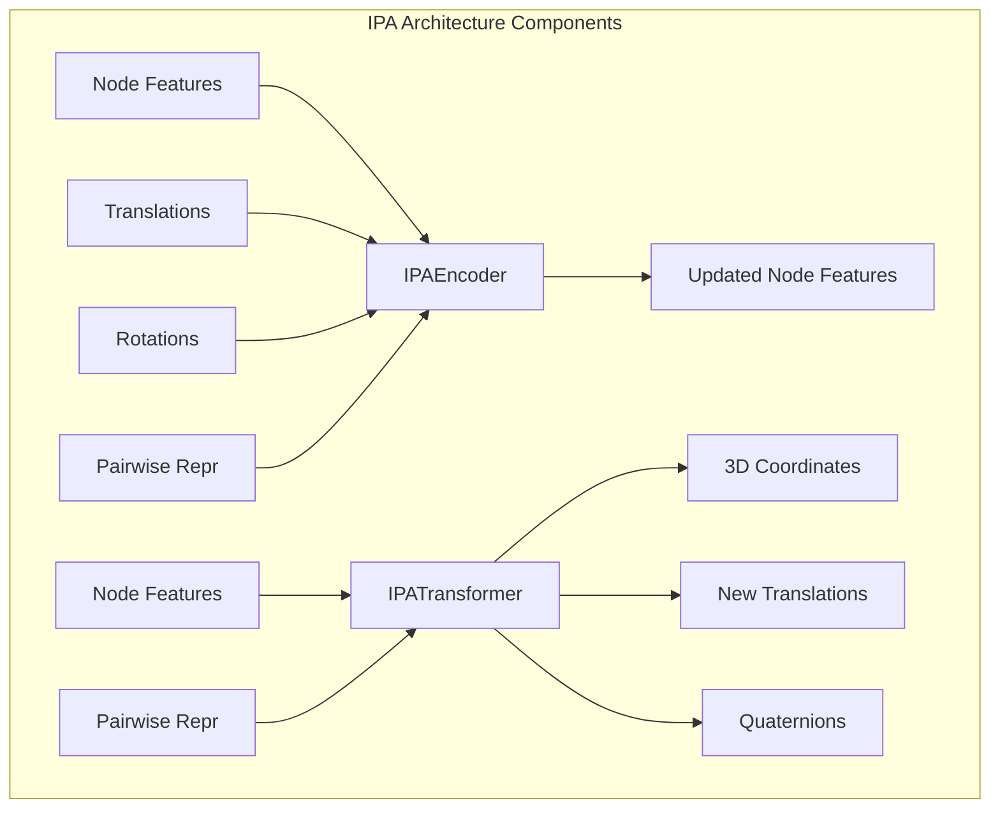
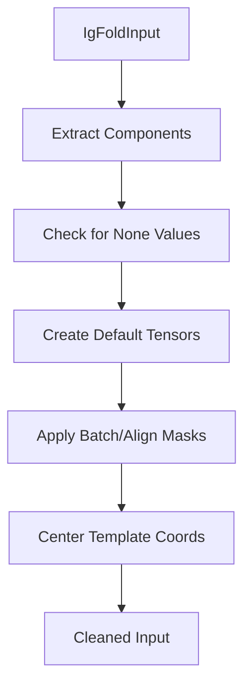
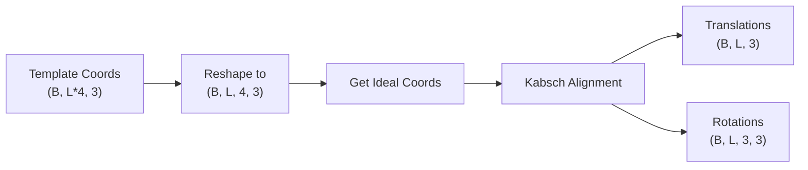
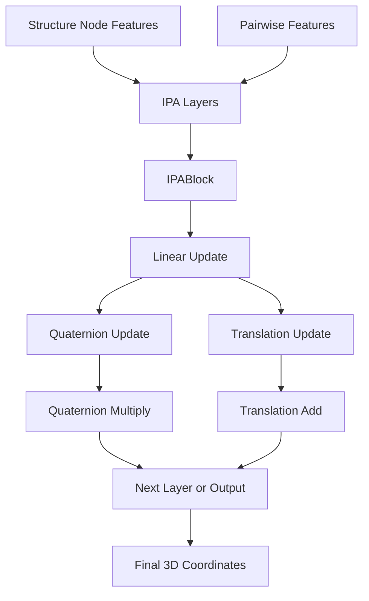
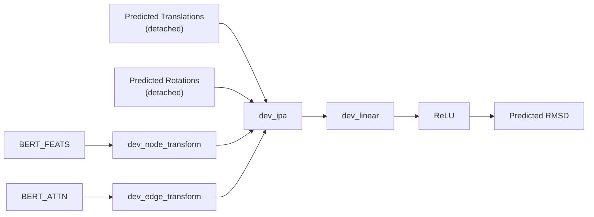
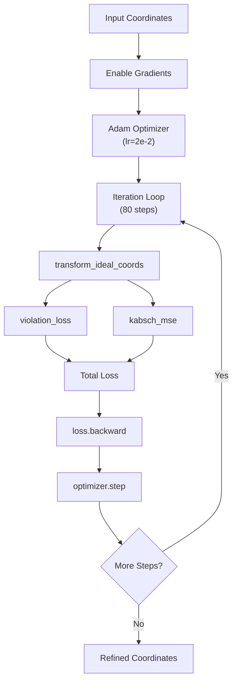

# IgFold Model

Relevant source files

The following files were used as context for generating this wiki page:

- [igfold/model/IgFold.py](igfold/model/IgFold.py)
- [igfold/model/components/IPABlock.py](igfold/model/components/IPABlock.py)
- [igfold/model/components/IPATransformer.py](igfold/model/components/IPATransformer.py)
- [igfold/model/interface.py](igfold/model/interface.py)
- [igfold/utils/transforms.py](igfold/utils/transforms.py)

The IgFold model is the core deep learning architecture for antibody structure prediction. This document covers the neural network components, forward pass flow, and architectural design of the main prediction model. For information about the processing pipeline that feeds into this model, see [Processing Pipeline](#5.2). For details about training and optimization, see [Training and Loss Functions](#7.2).

## Architecture Overview

The IgFold model follows a multi-stage architecture that combines sequence embeddings, template information, and geometric constraints to predict 3D antibody structures. The model is implemented as a PyTorch Lightning module in the `IgFold` class.

Sources: [igfold/model/IgFold.py:19-488]()

## Input and Output Interfaces

The model uses structured dataclasses to define its input and output specifications.

### IgFoldInput

| Field | Type | Description |
|-------|------|-------------|
| `embeddings` | `List[List[torch.FloatTensor]]` | BERT embeddings for each chain |
| `attentions` | `List[List[torch.FloatTensor]]` | BERT attention matrices |
| `template_coords` | `Optional[torch.FloatTensor]` | Template structure coordinates |
| `template_mask` | `Optional[torch.BoolTensor]` | Mask for valid template positions |
| `batch_mask` | `Optional[torch.BoolTensor]` | Mask for valid sequence positions |
| `align_mask` | `Optional[torch.BoolTensor]` | Mask for alignment during training |
| `coords_label` | `Optional[torch.FloatTensor]` | Ground truth coordinates for training |
| `return_embeddings` | `Optional[bool]` | Whether to return intermediate embeddings |

### IgFoldOutput

| Field | Type | Description |
|-------|------|-------------|
| `coords` | `torch.FloatTensor` | Predicted 3D coordinates |
| `prmsd` | `torch.FloatTensor` | Predicted RMSD confidence scores |
| `translations` | `torch.FloatTensor` | Rigid body translations |
| `rotations` | `torch.FloatTensor` | Rigid body rotations |
| `coords_loss` | `Optional[torch.FloatTensor]` | Coordinate prediction loss |
| `bondlen_loss` | `Optional[torch.FloatTensor]` | Bond length constraint loss |
| `prmsd_loss` | `Optional[torch.FloatTensor]` | Confidence prediction loss |
| `loss` | `Optional[torch.FloatTensor]` | Total training loss |

Sources: [igfold/model/interface.py:1-40]()

## Core Components

### Graph Transformer Block

The `main_block` is a `TriangleGraphTransformer` that processes sequence-level features extracted from BERT embeddings and attentions.

The transformations use linear layers followed by ReLU activation and LayerNorm:

Sources: [igfold/model/IgFold.py:50-75](), [igfold/model/IgFold.py:239-245]()

### Invariant Point Attention (IPA) Components

The model employs three different IPA modules for different purposes:

1. **Template IPA** (`template_ipa`): Processes template structural information
2. **Structure IPA** (`structure_ipa`): Predicts 3D coordinates with rigid body transformations  
3. **Deviation IPA** (`dev_ipa`): Estimates confidence scores

Sources: [igfold/model/IgFold.py:76-88](), [igfold/model/IgFold.py:103-108](), [igfold/model/components/IPATransformer.py:16-174]()

## Forward Pass Flow

The model's forward pass follows a structured pipeline:

### 1. Input Processing and Cleaning

The `clean_input` method processes raw inputs, handling missing values and ensuring proper tensor shapes and masks.

Sources: [igfold/model/IgFold.py:144-194]()

### 2. Feature Processing

BERT embeddings and attentions are concatenated and transformed into the model's internal feature space.

| Configuration Parameter | Default Value | Description |
|------------------------|---------------|-------------|
| `bert_feat_dim` | 512 | BERT feature dimension |
| `bert_attn_dim` | 64 | BERT attention dimension |
| `node_dim` | configurable | Internal node feature dimension |

Sources: [igfold/model/IgFold.py:32-36](), [igfold/model/IgFold.py:223-245]()

### 3. Template Coordinate Processing

Template coordinates are processed using Kabsch alignment to extract rigid body transformations:

Sources: [igfold/model/IgFold.py:114-142](), [igfold/model/IgFold.py:233-237]()

### 4. Structure Prediction

The `structure_ipa` (`IPATransformer`) predicts final coordinates by iteratively refining translations and quaternions:

Sources: [igfold/model/IgFold.py:256-263](), [igfold/model/components/IPATransformer.py:83-174]()

### 5. Confidence Prediction

A separate deviation pathway predicts per-residue confidence using the `dev_ipa`:

Sources: [igfold/model/IgFold.py:265-275]()

## Loss Functions

During training, multiple loss components are computed:

| Loss Component | Function | Purpose |
|---------------|----------|---------|
| `coords_loss` | `kabsch_mse` | Coordinate prediction accuracy |
| `bondlen_loss` | `bond_length_l1` | Bond length constraints |
| `prmsd_loss` | `bb_prmsd_l1` | Confidence prediction accuracy |

Sources: [igfold/model/IgFold.py:287-346]()

## Advanced Features

### Coordinate Scoring

The `score_coords` method allows re-evaluation of confidence scores for given coordinates without full forward pass:

Sources: [igfold/model/IgFold.py:372-403]()

### Gradient Refinement

The `gradient_refine` method performs iterative optimization of predicted structures using violation constraints:

Sources: [igfold/model/IgFold.py:427-488]()

## Model Configuration

Key hyperparameters control the model architecture:

| Parameter | Description | Typical Range |
|-----------|-------------|---------------|
| `depth` | Main transformer depth | 4-8 |
| `gt_depth` | Graph transformer depth | 2-4 |
| `gt_heads` | Graph transformer heads | 8-16 |
| `temp_ipa_depth` | Template IPA depth | 2-4 |
| `str_ipa_depth` | Structure IPA depth | 4-8 |
| `dev_ipa_depth` | Deviation IPA depth | 2-4 |

Sources: [igfold/model/IgFold.py:37-48]()

---