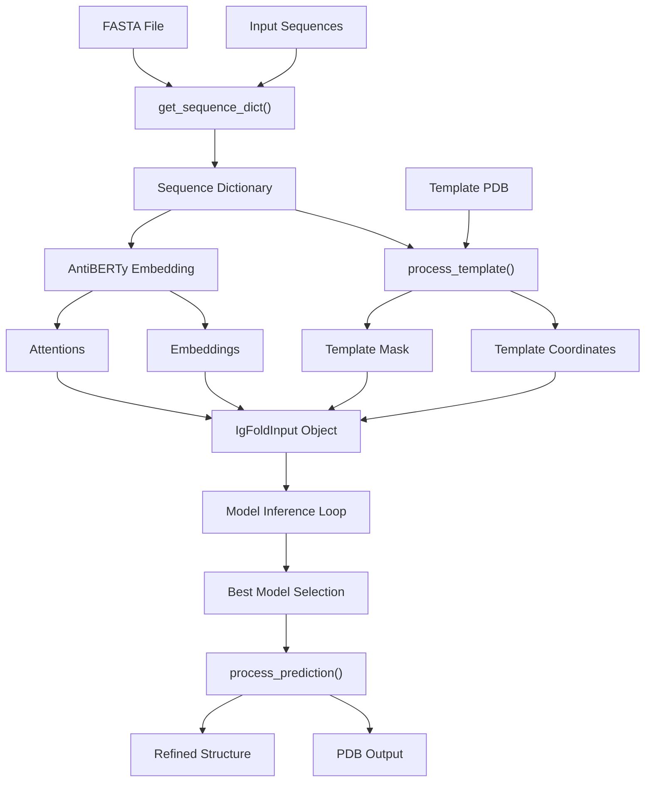
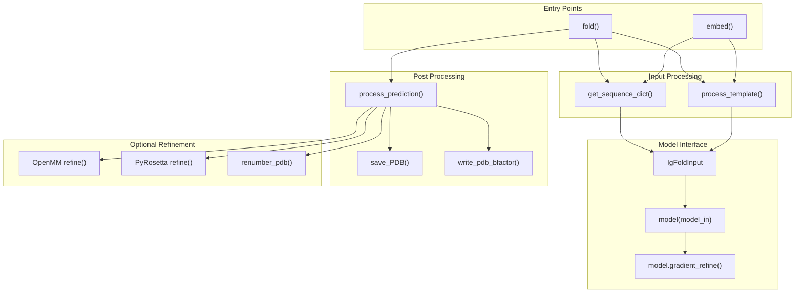
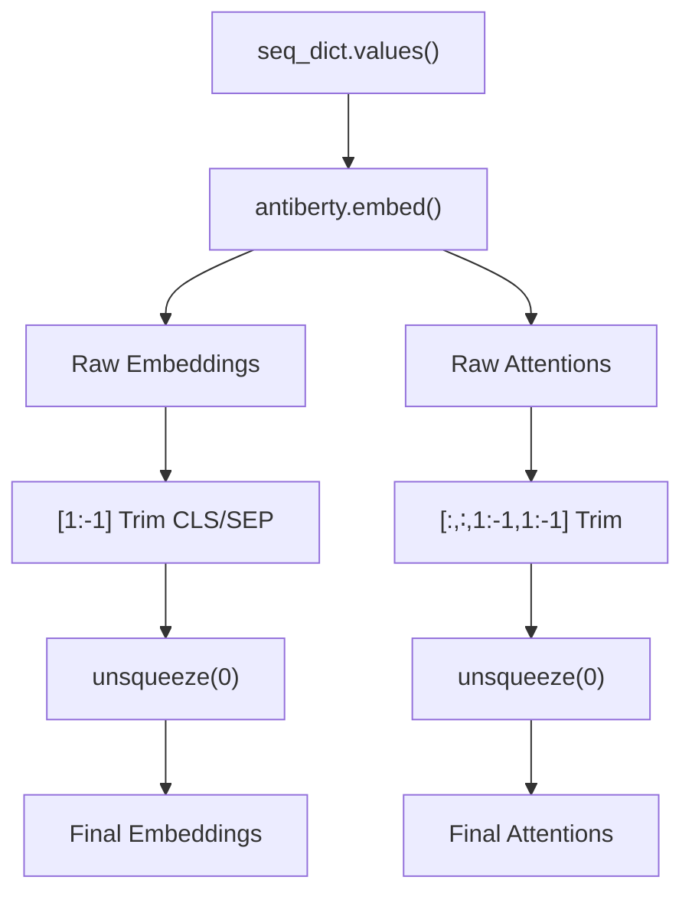
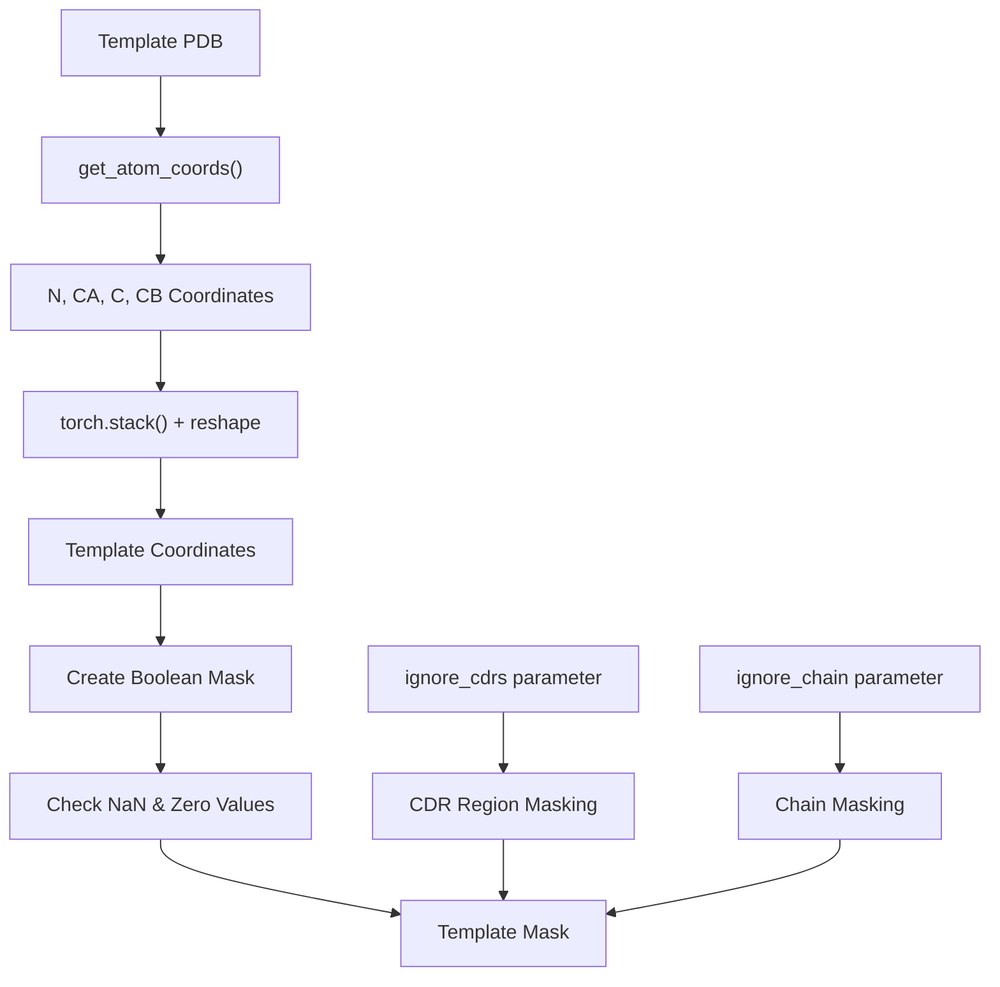
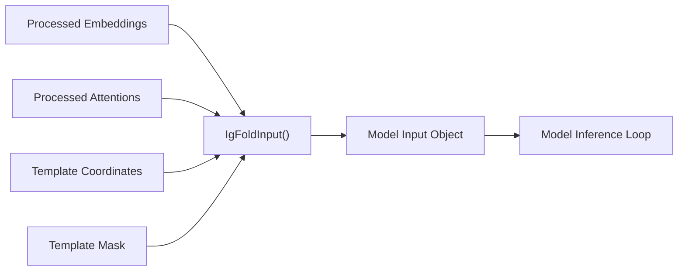
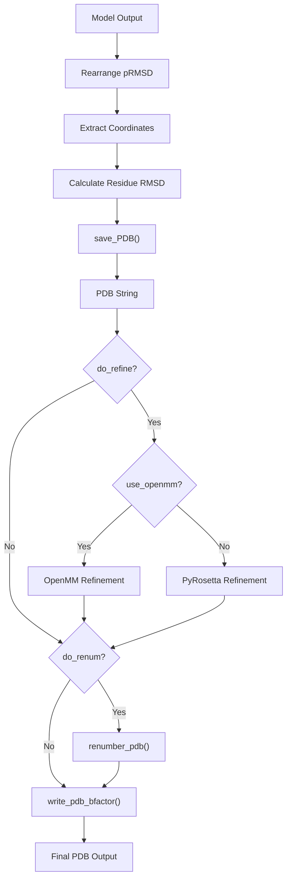

# Processing Pipeline

Relevant source files

The following files were used as context for generating this wiki page:

- [igfold/utils/embed.py](igfold/utils/embed.py)
- [igfold/utils/folding.py](igfold/utils/folding.py)

This document covers IgFold's structure prediction pipeline, detailing the sequence of operations that transform antibody sequences into predicted 3D structures. The pipeline orchestrates input processing, sequence embeddings, model inference, and output generation through a series of well-defined stages.

For information about the neural network model components used within this pipeline, see [IgFold Model](#5.1). For details about the data processing utilities that support the pipeline, see [Data Processing Utilities](#5.3).

## Pipeline Overview

The IgFold processing pipeline consists of two main entry points: the `fold()` function for complete structure prediction and the `embed()` function for embedding generation only. Both pipelines share common input processing stages but differ in their outputs and post-processing steps.

### Main Pipeline Flow

*Sources: [igfold/utils/folding.py:153-231](), [igfold/utils/embed.py:7-53]()*

### Function-Level Architecture

*Sources: [igfold/utils/folding.py:13-232](), [igfold/utils/embed.py:7-53]()*

## Input Processing

The pipeline begins with sequence input processing through the `get_sequence_dict()` function, which handles multiple input formats and validates the provided data.

### Sequence Input Handling

| Input Type | Processing Method | Output |
|------------|-------------------|--------|
| Direct sequences | Use provided dictionary | `seq_dict` |
| FASTA file | Parse via `get_fasta_chain_dict()` | `seq_dict` |
| Both provided | Prioritize FASTA file with warning | `seq_dict` |
| Neither provided | Exit with error | - |

The function implements a priority system where FASTA files take precedence over direct sequence input when both are provided [igfold/utils/folding.py:13-27]().

### Optional Sequence Truncation

When `truncate_sequences=True`, the pipeline utilizes AbNumber integration to trim sequences to their canonical regions:

This feature requires AbNumber installation and processes each sequence through the `truncate_seq()` function [igfold/utils/folding.py:173-179]().

*Sources: [igfold/utils/folding.py:13-27](), [igfold/utils/folding.py:173-179]()*

## Embedding Generation

The pipeline generates sequence embeddings and attention maps using the AntiBERTy model through a standardized interface.

### AntiBERTy Processing

The embedding process strips special tokens (`[CLS]` and `[SEP]`) and adds batch dimensions to prepare data for model input [igfold/utils/folding.py:190-195]().

*Sources: [igfold/utils/folding.py:190-195](), [igfold/utils/embed.py:22-27]()*

## Template Processing

Optional template PDB files are processed through the `process_template()` function, which extracts coordinates and applies masking based on user specifications.

### Template Coordinate Extraction

### Template Masking Options

The pipeline supports selective template masking through two parameters:

- **CDR Masking**: `ignore_cdrs` parameter accepts boolean, string, or list values to mask specific CDR regions [igfold/utils/folding.py:54-66]()
- **Chain Masking**: `ignore_chain` parameter masks entire heavy ("H") or light ("L") chains [igfold/utils/folding.py:67-73]()

*Sources: [igfold/utils/folding.py:30-75]()*

## Model Inference

The core prediction phase involves creating an `IgFoldInput` object and running inference through an ensemble of models.

### Model Input Construction

### Ensemble Prediction Loop

The pipeline runs multiple models and selects the best prediction based on quantile scoring:

| Step | Operation | Output |
|------|-----------|--------|
| 1 | Forward pass: `model(model_in)` | Raw predictions |
| 2 | Gradient refinement: `model.gradient_refine()` | Refined coordinates |
| 3 | Score calculation: `prmsd.quantile(0.9)` | Quality score |
| 4 | Best model selection: `min(scores)` | Final prediction |

The scoring mechanism uses the 90th percentile of predicted RMSD values to identify the most confident prediction [igfold/utils/folding.py:211-220]().

*Sources: [igfold/utils/folding.py:203-220](), [igfold/utils/embed.py:35-44]()*

## Post-Processing and Output

The `process_prediction()` function handles model output formatting, structure refinement, and file generation.

### Output Processing Flow

### Refinement Options

The pipeline supports two refinement backends:

- **OpenMM**: Physics-based energy minimization [igfold/utils/folding.py:118-123]()
- **PyRosetta**: Rosetta-based structure optimization [igfold/utils/folding.py:125-131]()

Both refinement methods require separate installation and are imported dynamically with error handling for missing dependencies.

### Output File Generation

The pipeline generates several output files:

| File Type | Content | Function |
|-----------|---------|----------|
| PDB | 3D coordinates with atoms N, CA, C, CB, O | `save_PDB()` |
| FASTA | Sequence information (auto-generated if needed) | Direct file writing |
| B-factor PDB | Structure with confidence scores | `write_pdb_bfactor()` |

*Sources: [igfold/utils/folding.py:78-150]()*

## Pipeline Variants

The system provides two main pipeline variants optimized for different use cases:

### Structure Prediction Pipeline (`fold()`)
- Complete structure prediction workflow
- Optional template integration
- Ensemble model scoring
- Structure refinement and renumbering
- Full PDB output generation

### Embedding Pipeline (`embed()`)
- Embeddings and attention extraction only
- Minimal post-processing
- Returns `IgFoldOutput` with embedding data
- Useful for downstream analysis or custom modeling

The embedding pipeline shares input processing with the full pipeline but bypasses refinement and file generation steps [igfold/utils/embed.py:7-53]().

*Sources: [igfold/utils/folding.py:153-231](), [igfold/utils/embed.py:7-53]()*

---