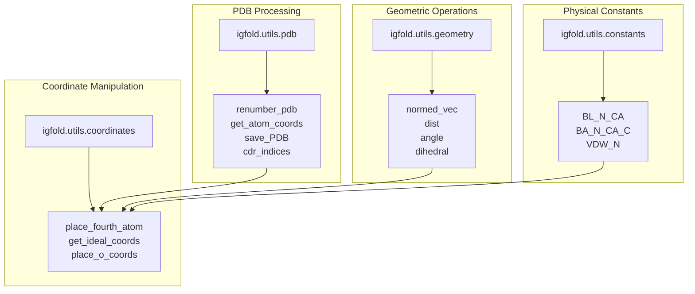
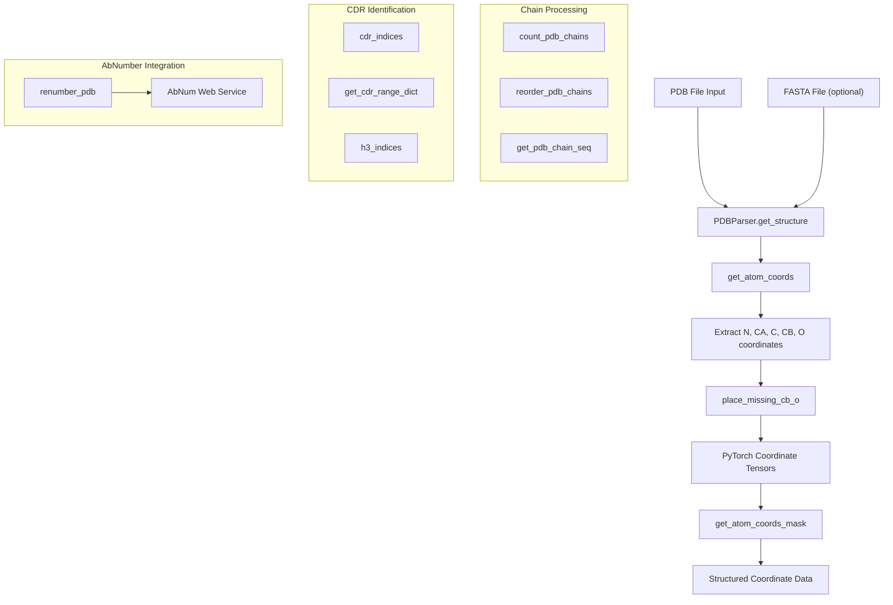
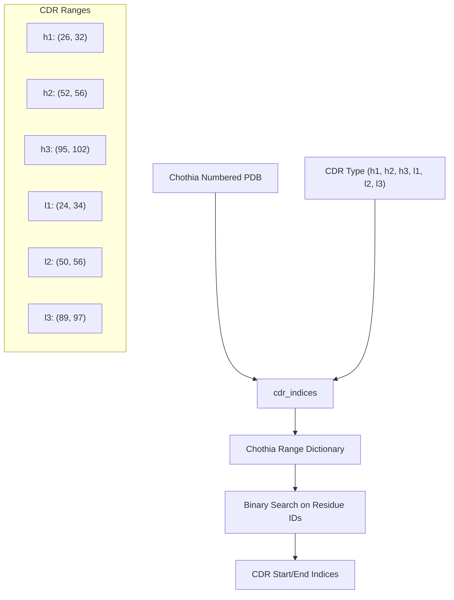
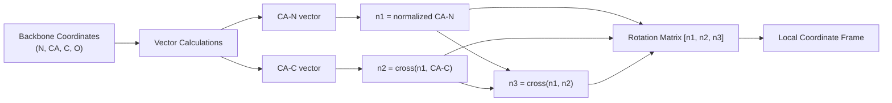
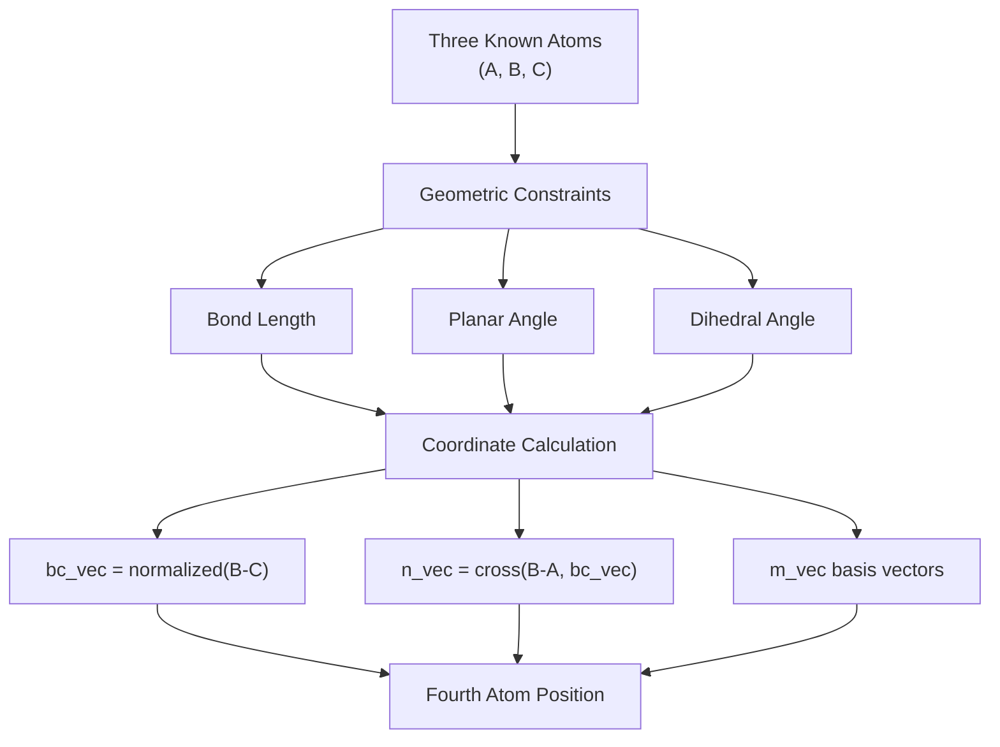
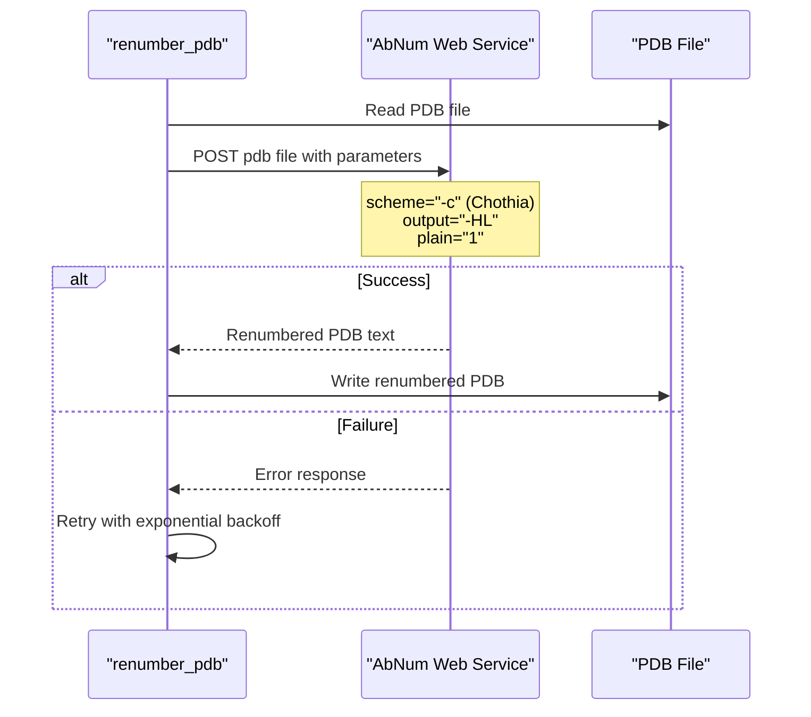

# Data Processing Utilities

Relevant source files

The following files were used as context for generating this wiki page:

- [igfold/utils/constants.py](igfold/utils/constants.py)
- [igfold/utils/coordinates.py](igfold/utils/coordinates.py)
- [igfold/utils/geometry.py](igfold/utils/geometry.py)
- [igfold/utils/pdb.py](igfold/utils/pdb.py)

This document covers IgFold's core data processing utilities that handle PDB files, coordinate extraction, geometric calculations, and antibody-specific processing. These utilities form the foundation layer that supports the structure prediction pipeline and refinement components.

For information about the overall processing pipeline workflow, see [Processing Pipeline](#5.2). For details about neural network model components, see [IgFold Model](#5.1).

## Overview

The data processing utilities are organized into four main modules that work together to handle structural data:

**Sources:** [igfold/utils/pdb.py:1-515](), [igfold/utils/geometry.py:1-77](), [igfold/utils/coordinates.py:1-76](), [igfold/utils/constants.py:1-22]()

## PDB File Processing

The `igfold.utils.pdb` module provides comprehensive tools for reading, writing, and manipulating PDB files. The main data flow processes raw PDB files into structured coordinate tensors:

**Sources:** [igfold/utils/pdb.py:194-251](), [igfold/utils/pdb.py:21-59](), [igfold/utils/pdb.py:314-378]()

### Coordinate Extraction

The primary function `get_atom_coords` extracts backbone and side-chain coordinates from PDB files:

| Function | Purpose | Input | Output |
|----------|---------|--------|--------|
| `get_atom_coords` | Extract all atom coordinates | PDB file, optional FASTA | Dict of coordinate tensors |
| `get_atom_coord` | Get single atom coordinate | Residue, atom type | 3D coordinate array |
| `get_cb_or_ca_coord` | Get CB coordinate (CA fallback) | Residue | 3D coordinate array |
| `place_missing_cb_o` | Fill missing CB and O atoms | Coordinate dict | Updated coordinates |

**Sources:** [igfold/utils/pdb.py:194-251](), [igfold/utils/pdb.py:120-137](), [igfold/utils/pdb.py:160-192]()

### Chain Management

Chain processing functions handle multi-chain antibody structures:

- `count_pdb_chains`: Returns the number of chains in a PDB file [igfold/utils/pdb.py:61-68]()
- `reorder_pdb_chains`: Reorders chains according to specified sequence [igfold/utils/pdb.py:71-117]()
- `get_pdb_chain_seq`: Extracts amino acid sequence from specific chain [igfold/utils/pdb.py:294-311]()

### CDR Loop Identification

Antibody-specific processing includes CDR (Complementarity Determining Region) identification using Chothia numbering:

**Sources:** [igfold/utils/pdb.py:314-378](), [igfold/utils/pdb.py:381-402]()

## Geometric Calculations

The `igfold.utils.geometry` module provides fundamental geometric operations for structural calculations:

| Function | Purpose | Formula |
|----------|---------|---------|
| `normed_vec` | Vector normalization | `vec / ||vec||` |
| `dist` | Euclidean distance | `sqrt(sum((x1-x2)²))` |
| `angle` | Bond angle | `arccos(a·b)` |
| `dihedral` | Dihedral angle | `atan2(y, x)` using cross products |
| `coords_to_frame` | Local coordinate frame | N-CA-C backbone frame |

**Sources:** [igfold/utils/geometry.py:7-77]()

### Reference Frame Calculations

The `coords_to_frame` function converts backbone coordinates into local reference frames for structural analysis:

**Sources:** [igfold/utils/geometry.py:61-77]()

## Coordinate Manipulation

The `igfold.utils.coordinates` module handles precise atom placement and coordinate transformations:

### Fourth Atom Placement

The `place_fourth_atom` function uses geometric constraints to determine atom positions:

**Sources:** [igfold/utils/coordinates.py:4-30]()

### Ideal Coordinates

Standard backbone geometry is provided through `get_ideal_coords` with ideal bond lengths and angles:

- N: `[0, 0, -1.458]`
- CA: `[0, 0, 0]` (reference point)
- CB: `[0, 1.426, 0.531]`
- C: Calculated using `place_fourth_atom`

**Sources:** [igfold/utils/coordinates.py:33-54]()

## Physical Constants

The `igfold.utils.constants` module defines standard structural parameters from Engh and Huber:

| Constant Type | Examples | Value (Å or degrees) |
|---------------|----------|---------------------|
| Bond Lengths | `BL_N_CA`, `BL_CA_C`, `BL_C_N` | 1.459, 1.525, 1.336 |
| Bond Angles | `BA_N_CA_C`, `BA_CA_C_N` | 111.0°, 117.2° |
| VdW Radii | `VDW_N`, `VDW_C` | 1.55, 1.7 |

**Sources:** [igfold/utils/constants.py:1-22]()

## AbNumber Integration

PDB renumbering uses the AbNumber web service for consistent antibody numbering:

**Sources:** [igfold/utils/pdb.py:21-59]()

## Structure Output

The `save_PDB` function writes coordinate tensors back to standard PDB format:

| Parameter | Purpose | Type |
|-----------|---------|------|
| `coords` | Atom coordinates | `torch.Tensor` |
| `seq` | Amino acid sequence | `str` |
| `chains` | Chain identifiers | `List[str]` |
| `error` | B-factor values | `torch.Tensor` |
| `delim` | Chain boundaries | `List[int]` |

The function handles chain assignment, residue numbering, and proper PDB formatting including TER and END records.

**Sources:** [igfold/utils/pdb.py:428-478]()

---