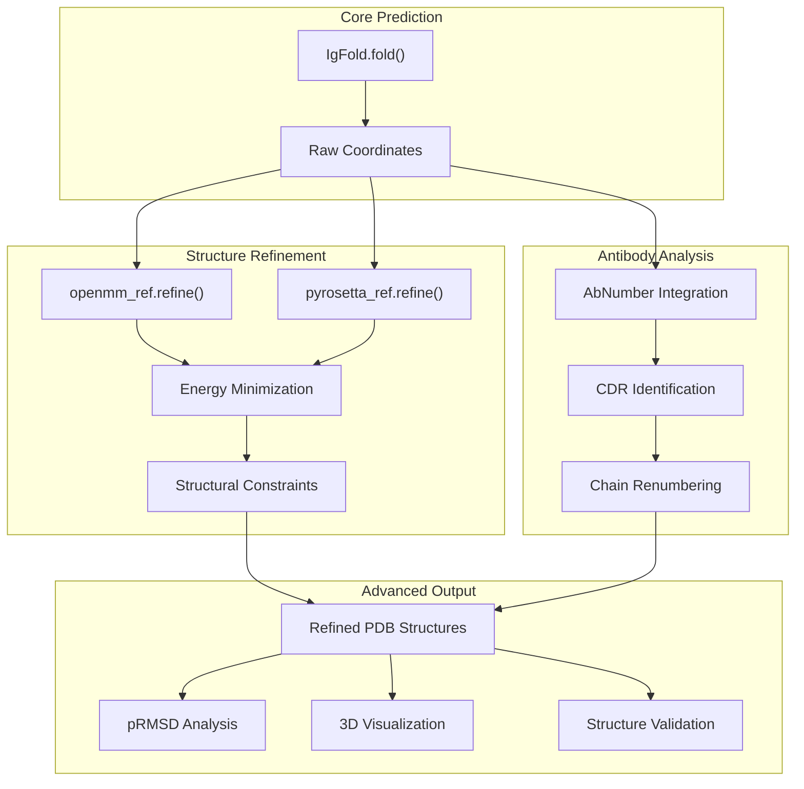
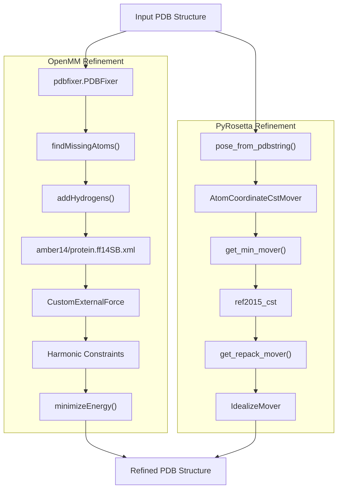
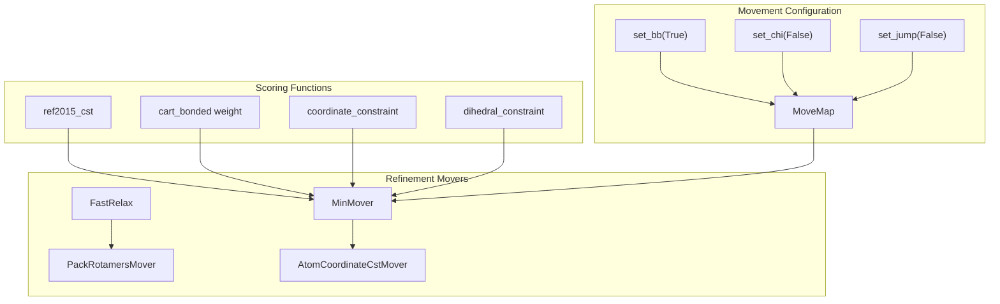
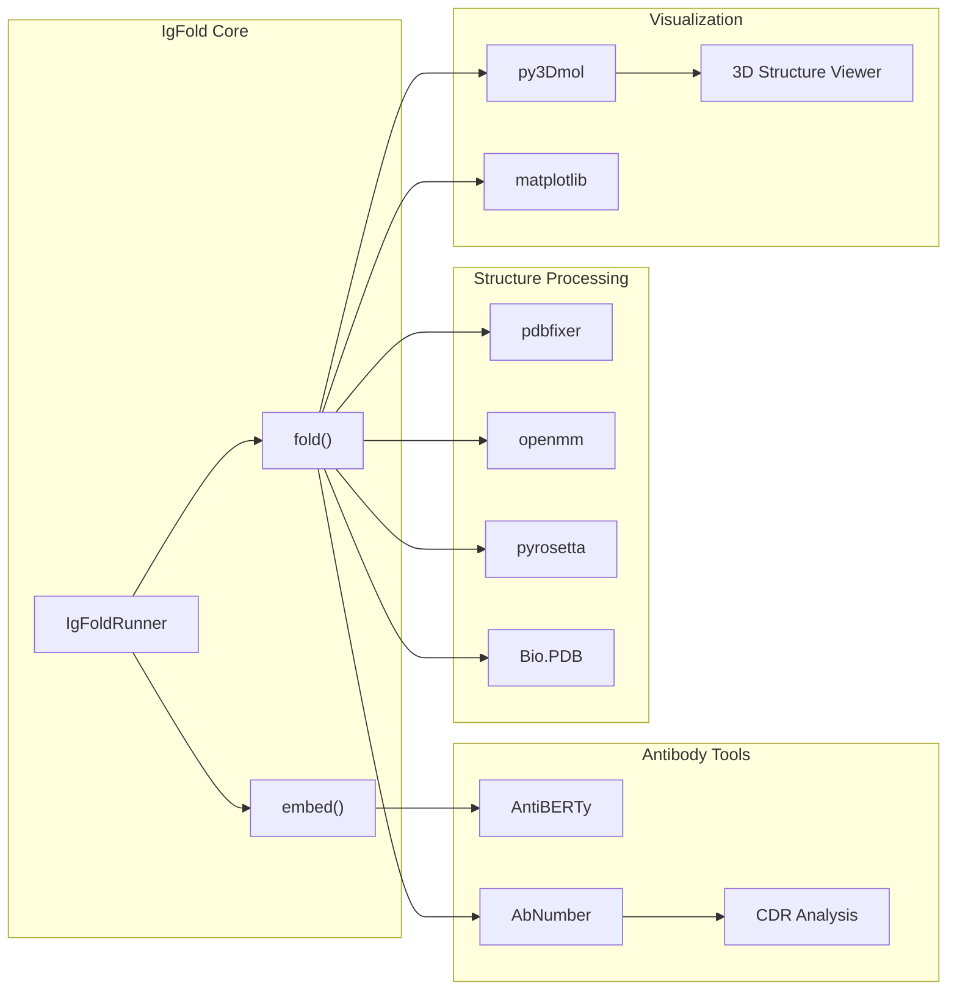

# Advanced Features

Relevant source files

The following files were used as context for generating this wiki page:

- [igfold/__init__.py](igfold/__init__.py)
- [igfold/refine/openmm_ref.py](igfold/refine/openmm_ref.py)
- [igfold/refine/pyrosetta_ref.py](igfold/refine/pyrosetta_ref.py)

This page documents IgFold's advanced capabilities beyond basic structure prediction, including post-prediction refinement methods, specialized antibody analysis tools, and integration with external bioinformatics software. These features enable enhanced structure quality, domain-specific analysis, and customized workflows for specialized research applications.

For basic structure prediction workflows, see [Quick Start Guide](#3) and [User Guide](#4). For technical details on the core model architecture, see [Core Architecture](#5).

## Overview

IgFold provides several advanced features that extend beyond standard structure prediction:

- **Structure Refinement**: Post-prediction optimization using molecular dynamics and energy minimization
- **Antibody-Specific Tools**: Integration with specialized antibody analysis software
- **Advanced Analysis**: Enhanced metrics, validation, and visualization capabilities
- **External Tool Integration**: Seamless workflow integration with established bioinformatics tools

Sources: [igfold/refine/openmm_ref.py:1-44](), [igfold/refine/pyrosetta_ref.py:1-125](), [igfold/__init__.py:1-3]()

## Structure Refinement Pipeline

IgFold supports two primary refinement backends that can be applied after initial structure prediction to improve geometric quality and energy profiles.

### Refinement Workflow

Sources: [igfold/refine/openmm_ref.py:7-44](), [igfold/refine/pyrosetta_ref.py:92-125]()

### Refinement Configuration Options

Both refinement backends provide configurable parameters for customizing the refinement process:

| Backend | Key Parameters | Description |
|---------|----------------|-------------|
| OpenMM | `stiffness` | Harmonic constraint strength (default: 10.0) |
| OpenMM | `tolerance` | Energy minimization tolerance (default: 2.39) |
| OpenMM | `use_gpu` | Enable GPU acceleration (default: False) |
| PyRosetta | `minimization_iter` | Maximum minimization iterations (default: 100) |
| PyRosetta | `constrain` | Apply coordinate constraints (default: True) |
| PyRosetta | `idealize` | Apply geometry idealization (default: False) |

### PyRosetta Refinement Components

The PyRosetta refinement system uses several specialized movers and scoring functions:

Sources: [igfold/refine/pyrosetta_ref.py:12-54](), [igfold/refine/pyrosetta_ref.py:57-89]()

## External Tool Integration

IgFold integrates with several external bioinformatics tools to provide specialized antibody analysis capabilities and enhanced structure processing.

### Integration Architecture

Sources: [igfold/refine/openmm_ref.py:1-3](), [igfold/refine/pyrosetta_ref.py:1-1]()

## Advanced Configuration

Advanced users can customize IgFold's behavior through various configuration options and programmatic interfaces.

### Refinement Method Selection

The refinement backend can be selected and configured through the main API:

- **OpenMM Backend**: Molecular dynamics-based refinement with GPU acceleration support
- **PyRosetta Backend**: Rosetta-based refinement with advanced scoring functions
- **No Refinement**: Direct output of predicted coordinates

### Scoring and Constraint Configuration

PyRosetta refinement allows fine-tuning of scoring function weights:

| Score Term | Default Weight | Purpose |
|------------|----------------|---------|
| `cart_bonded` | 1.0 | Cartesian bonded geometry |
| `pro_close` | 0.0 | Proline closure (disabled) |
| `coordinate_constraint` | 1.0 | Position constraints |
| `dihedral_constraint` | 1.0 | Dihedral angle constraints |

### Minimization Parameters

Both backends support customizable minimization settings:

- **Iteration Limits**: Control computational cost vs. convergence
- **Constraint Strengths**: Balance refinement vs. structure preservation
- **Move Maps**: Specify which degrees of freedom to optimize

For detailed information on structure refinement methods, see [Structure Refinement](#6.1). For antibody-specific analysis tools and integrations, see [Antibody-Specific Tools](#6.2).

Sources: [igfold/refine/pyrosetta_ref.py:12-54](), [igfold/refine/openmm_ref.py:7-44]()

---