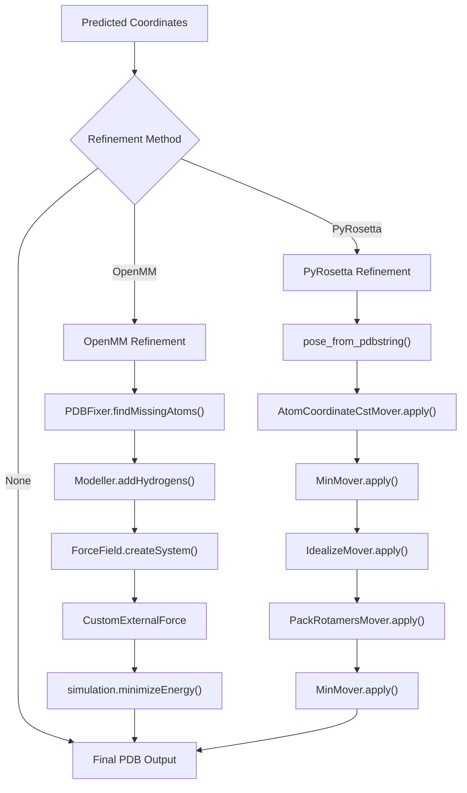
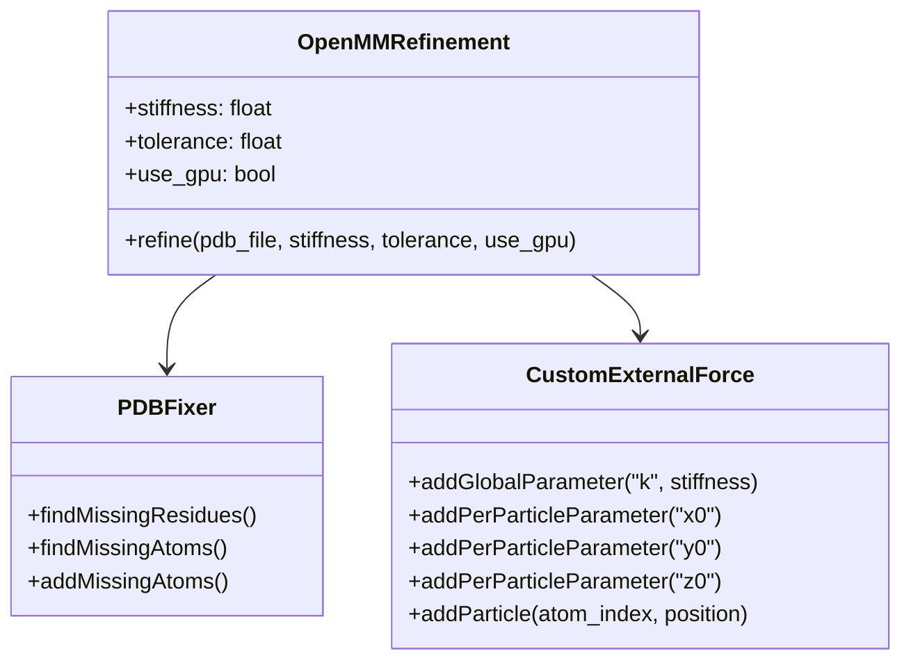
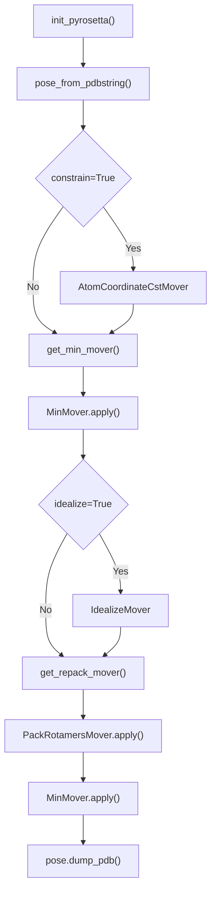
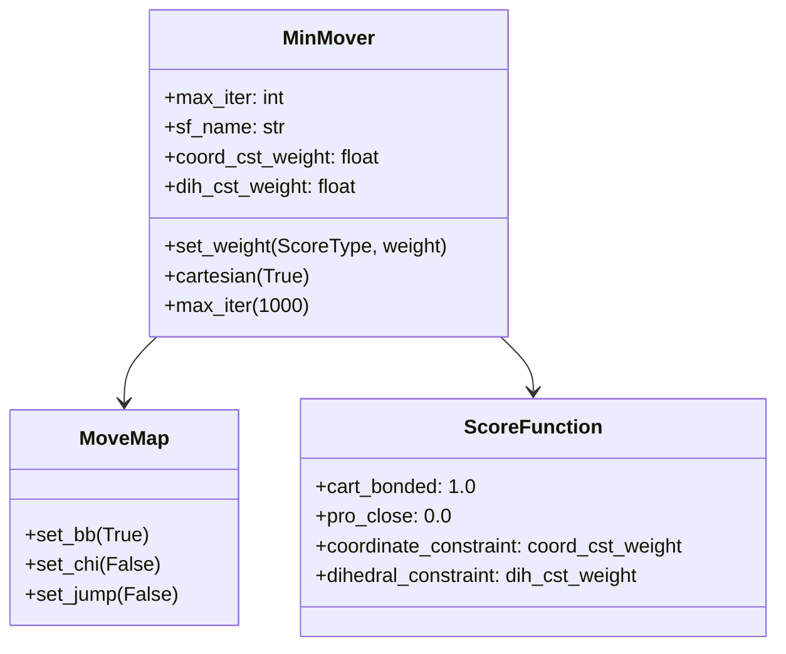
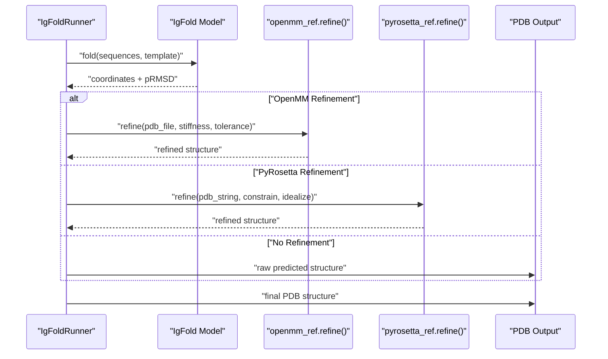

# Structure Refinement

Relevant source files

The following files were used as context for generating this wiki page:

- [igfold/__init__.py](igfold/__init__.py)
- [igfold/refine/openmm_ref.py](igfold/refine/openmm_ref.py)
- [igfold/refine/pyrosetta_ref.py](igfold/refine/pyrosetta_ref.py)

This document covers the post-prediction structure refinement capabilities in IgFold. Structure refinement is an optional post-processing step that applies physics-based energy minimization to improve the quality of predicted antibody structures. For information about the core structure prediction pipeline, see [5.2 Processing Pipeline](#5.2).

IgFold provides two refinement backends: OpenMM for lightweight constraint-based minimization and PyRosetta for comprehensive full-atom refinement with advanced molecular mechanics protocols.

## Overview

Structure refinement in IgFold addresses limitations inherent in neural network-based structure prediction by applying established computational biology methods to relax steric clashes, optimize side chain conformations, and improve overall geometric quality of predicted structures.

## Refinement Workflow

The refinement process operates as a post-processing step in the IgFold pipeline, taking predicted 3D coordinates and applying physics-based optimization:

Sources: [igfold/refine/openmm_ref.py:1-44](), [igfold/refine/pyrosetta_ref.py:92-125]()

## OpenMM Refinement

OpenMM refinement provides lightweight structure optimization focused on resolving steric clashes while maintaining the overall predicted fold. The `refine` function in the OpenMM module implements constraint-based energy minimization.

### OpenMM Refinement Process

| Step | Function | Purpose |
|------|----------|---------|
| Structure Preparation | `pdbfixer.PDBFixer()` | Add missing atoms and residues |
| Hydrogen Addition | `modeller.addHydrogens()` | Add hydrogen atoms for complete structure |
| Force Field Setup | `ForceField.createSystem()` | Initialize AMBER14 force field |
| Constraint Application | `CustomExternalForce()` | Apply harmonic constraints to backbone atoms |
| Energy Minimization | `simulation.minimizeEnergy()` | Optimize structure geometry |

### OpenMM Configuration

The OpenMM refinement accepts several parameters:

The harmonic constraints are applied to backbone atoms N, CA, C, and CB with force constant `k = stiffness * ENERGY / LENGTH²`. Default stiffness is 10 kcal/mol/Ų and tolerance is 2.39 kcal/mol.

Sources: [igfold/refine/openmm_ref.py:7-44]()

## PyRosetta Refinement

PyRosetta refinement provides comprehensive full-atom structure optimization using Rosetta's advanced molecular mechanics protocols. This backend offers more sophisticated refinement capabilities including side chain optimization and geometric idealization.

### PyRosetta Refinement Components

### PyRosetta Movers and Score Functions

| Component | Class | Configuration | Purpose |
|-----------|-------|---------------|---------|
| Minimizer | `MinMover` | L-BFGS-Armijo, Cartesian | Backbone optimization |
| Score Function | `ref2015_cst` | Coordinate/dihedral constraints | Energy evaluation |
| Relaxer | `FastRelax` | Full-atom relax protocol | Comprehensive optimization |
| Packer | `PackRotamersMover` | Restrict to repacking | Side chain optimization |

The `get_min_mover` function creates a minimization mover with customizable constraint weights:

Sources: [igfold/refine/pyrosetta_ref.py:12-54](), [igfold/refine/pyrosetta_ref.py:92-125]()

## Refinement Integration

Structure refinement integrates with the main IgFold prediction pipeline as an optional post-processing step. The refinement choice is typically specified through the `IgFoldRunner` interface, which coordinates the refinement process after structure prediction is complete.

### Refinement Pipeline Integration

### Refinement Method Selection

The refinement backend selection depends on the intended use case and available computational resources:

| Method | Computational Cost | Use Case | Key Features |
|--------|-------------------|----------|--------------|
| None | Minimal | Fast prediction, analysis | Raw neural network output |
| OpenMM | Low-Medium | Production use, moderate quality | Constraint-based minimization |
| PyRosetta | High | High-quality structures, detailed analysis | Full-atom optimization, side chain packing |

Both refinement methods preserve the overall fold predicted by the IgFold neural network while improving local geometry and reducing energy.

Sources: [igfold/refine/openmm_ref.py:1-44](), [igfold/refine/pyrosetta_ref.py:1-125]()

---