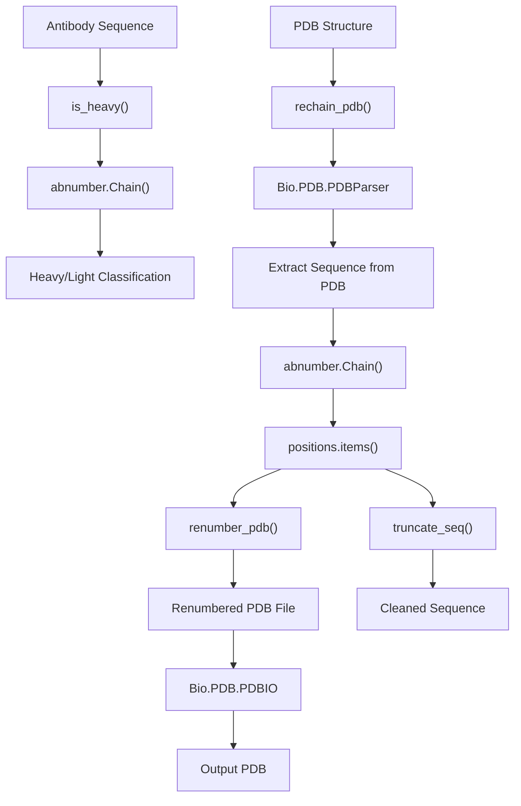
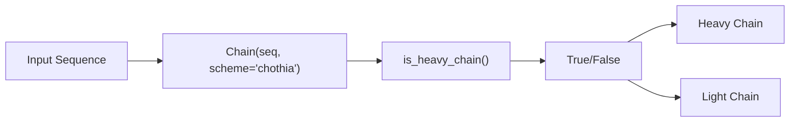
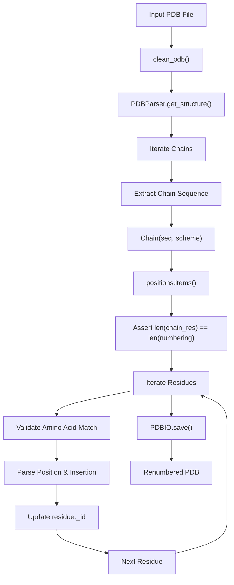
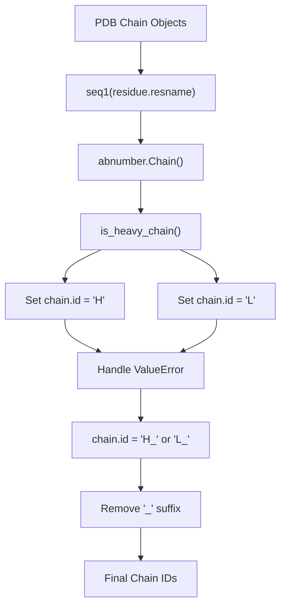
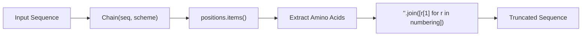
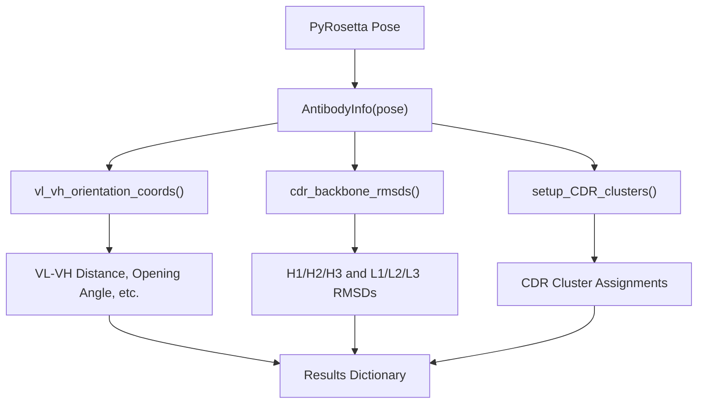
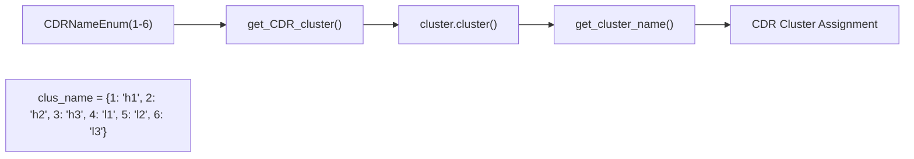
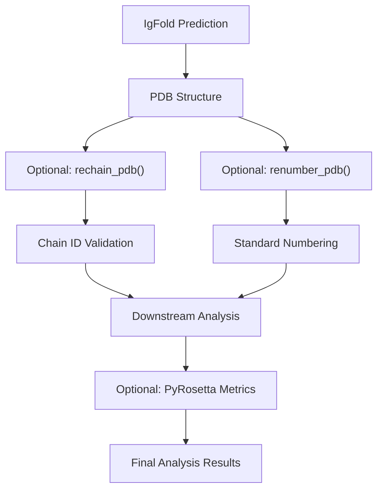

# Antibody-Specific Tools

Relevant source files

The following files were used as context for generating this wiki page:

- [igfold/utils/ab_metrics.py](igfold/utils/ab_metrics.py)
- [igfold/utils/abnumber_.py](igfold/utils/abnumber_.py)

This section covers IgFold's integration with specialized antibody analysis tools, primarily the AbNumber library for antibody numbering and CDR identification, as well as PyRosetta-based metrics for structural analysis. These tools provide antibody-specific functionality beyond the core structure prediction capabilities.

For core structure prediction capabilities, see [IgFoldRunner API](#4.1). For general structure refinement options, see [Structure Refinement](#6.1).

## AbNumber Integration Architecture

IgFold integrates with the AbNumber library to provide standardized antibody numbering schemes, chain type identification, and CDR region analysis. The integration is primarily handled through utility functions that process both sequences and structures.

**AbNumber Processing Pipeline**

Sources: [igfold/utils/abnumber_.py:9-88]()

## Chain Type Identification

The `is_heavy()` function determines whether an antibody sequence corresponds to a heavy or light chain using AbNumber's classification system.

**Chain Identification Process**

The function uses the Chothia numbering scheme by default and leverages AbNumber's built-in heavy chain detection algorithms.

| Function | Purpose | Returns |
|----------|---------|---------|
| `is_heavy(seq)` | Classify chain type | Boolean (True=Heavy, False=Light) |
| `Chain(seq, scheme='chothia')` | Create AbNumber chain object | AbNumber Chain instance |
| `is_heavy_chain()` | AbNumber classification method | Boolean classification |

Sources: [igfold/utils/abnumber_.py:9-12]()

## PDB Structure Renumbering

The renumbering system provides two main capabilities: chain ID assignment and residue renumbering according to standard antibody numbering schemes.

**PDB Renumbering Workflow**

**Chain Re-identification Process**

| Function | Parameters | Purpose |
|----------|------------|---------|
| `rechain_pdb(pdb_file)` | PDB file path | Assigns H/L chain IDs |
| `renumber_pdb(in_pdb_file, out_pdb_file, scheme)` | Input PDB, output PDB, numbering scheme | Renumbers residues |
| `truncate_seq(seq, scheme)` | Sequence, numbering scheme | Truncates sequence to numbered positions |

Sources: [igfold/utils/abnumber_.py:15-88]()

## Sequence Processing Functions

The sequence processing utilities handle antibody-specific sequence manipulations that align with standard numbering conventions.

### Truncation Function

The `truncate_seq()` function processes sequences to include only positions that have valid AbNumber assignments:

This ensures that processed sequences contain only residues with valid numbering positions, removing any terminal extensions or non-standard regions.

Sources: [igfold/utils/abnumber_.py:83-88]()

## PyRosetta-based Antibody Analysis

The `ab_metrics.py` module provides advanced structural analysis capabilities using PyRosetta's antibody-specific tools.

**PyRosetta Antibody Analysis Pipeline**

### Structural Metrics

| Function | Returns | Metrics |
|----------|---------|---------|
| `get_vh_vl_orientation(pose)` | Dictionary | VL-VH distance, opening angle, opposite angle, packing angle |
| `get_ab_metrics(pose1, pose2)` | Dictionary | OCD, FRH/FRL RMSD, H1/H2/H3 RMSD, L1/L2/L3 RMSD |
| `get_pose_cdr_clusters(pose)` | Dictionary | CDR cluster assignments (H1-H3, L1-L3) |

### CDR Analysis Details

Sources: [igfold/utils/ab_metrics.py:1-60]()

## Integration with IgFold Pipeline

These antibody-specific tools integrate with IgFold's main prediction pipeline through optional post-processing steps and validation utilities.

**Pipeline Integration Points**

The integration typically occurs during the refinement phase, where structures can be automatically renumbered and validated before final output.

### Configuration Options

When using these tools with IgFold, several parameters control the antibody-specific processing:

| Parameter | Options | Purpose |
|-----------|---------|---------|
| `scheme` | 'chothia', 'kabat', 'imgt' | Numbering scheme for renumbering |
| `rechain` | Boolean | Whether to reassign chain IDs |
| `renumber` | Boolean | Whether to renumber residues |

Sources: [igfold/utils/abnumber_.py:37-88](), [igfold/utils/ab_metrics.py:1-60]()

---