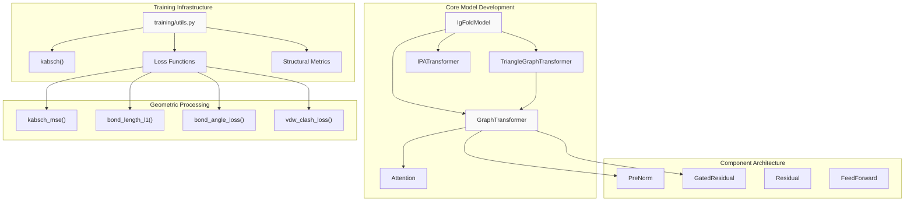
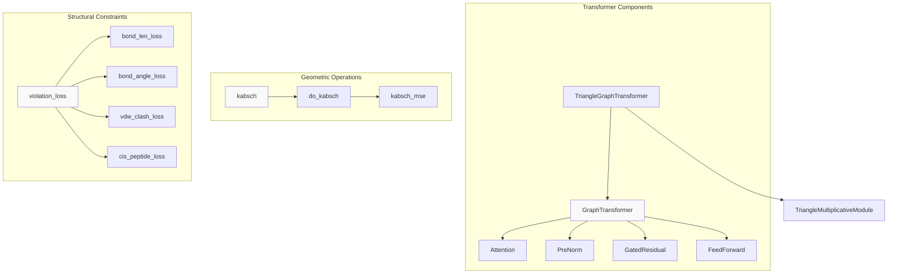
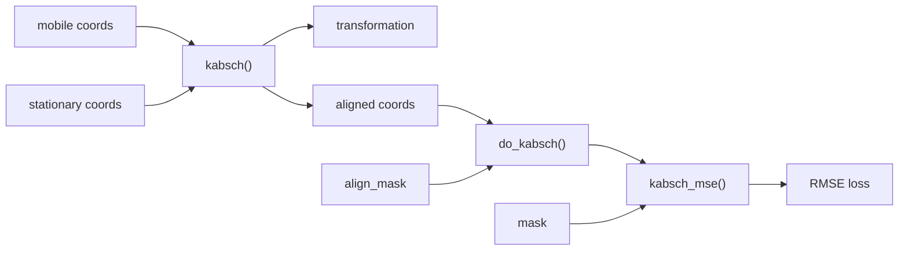
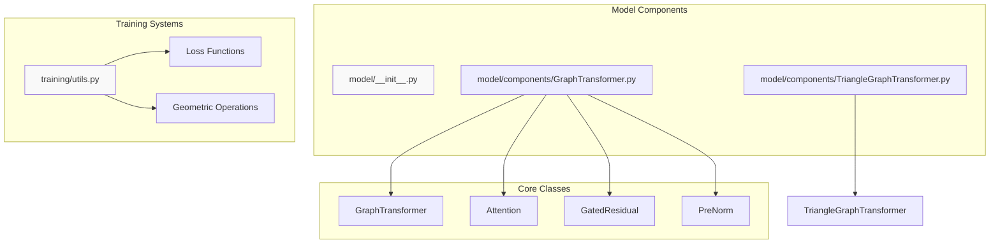

# Developer Documentation

<details>
<summary>Relevant source files</summary>

The following files were used as context for generating this wiki page:

- [igfold/model/__init__.py](igfold/model/__init__.py)
- [igfold/model/components/GraphTransformer.py](igfold/model/components/GraphTransformer.py)
- [igfold/model/components/TriangleGraphTransformer.py](igfold/model/components/TriangleGraphTransformer.py)
- [igfold/training/utils.py](igfold/training/utils.py)

</details>


This document provides technical documentation for developers working on IgFold's internal architecture, model components, training systems, and extensibility. It covers the core neural network implementations, training utilities, loss functions, and package organization from a developer perspective.

For user-facing API documentation, see [User Guide](#4). For high-level architecture concepts, see [Core Architecture](#5). For specific neural network component details, see [Model Components](#7.1). For training system specifics, see [Training and Loss Functions](#7.2).

## Development Architecture Overview

IgFold's development architecture centers around modular neural network components, training utilities, and a structured package hierarchy that enables extensibility and experimentation.



**Sources:** [igfold/training/utils.py:1-287](), [igfold/model/components/GraphTransformer.py:1-255](), [igfold/model/components/TriangleGraphTransformer.py:1-63]()

## Core Neural Network Components

The model architecture implements a hierarchical transformer design with geometric constraints and structural loss functions. Key components follow a modular pattern enabling easy modification and extension.



**Sources:** [igfold/model/components/GraphTransformer.py:187-255](), [igfold/model/components/TriangleGraphTransformer.py:8-63](), [igfold/training/utils.py:277-286]()

### Key Component Classes

| Component | File Location | Purpose |
|-----------|---------------|---------|
| `GraphTransformer` | [igfold/model/components/GraphTransformer.py:187-255]() | Multi-head attention over graph nodes with edge features |
| `TriangleGraphTransformer` | [igfold/model/components/TriangleGraphTransformer.py:8-63]() | Combines graph attention with triangle multiplicative updates |
| `Attention` | [igfold/model/components/GraphTransformer.py:70-177]() | Multi-head attention with edge incorporation |
| `GatedResidual` | [igfold/model/components/GraphTransformer.py:50-65]() | Learned gating for residual connections |
| `PreNorm` | [igfold/model/components/GraphTransformer.py:14-36]() | Layer normalization before operations |

## Training and Loss Function Systems

The training system implements geometric loss functions that enforce protein structural constraints while enabling gradient-based optimization of 3D coordinates.

### Geometric Loss Functions

The training utilities provide several specialized loss functions for structural validation:

| Function | Purpose | Key Parameters |
|----------|---------|----------------|
| `kabsch_mse()` | Optimal alignment RMSE | `align_mask`, `clamp`, `sqrt` |
| `bond_len_loss()` | Bond length constraints | `seq_lens`, `mask` |
| `bond_angle_loss()` | Bond angle constraints | `seq_lens`, `mask` |
| `vdw_clash_loss()` | Van der Waals clash detection | `tol=1.5` |
| `violation_loss()` | Combined structural violations | `seq_lens`, `mask` |

The `violation_loss()` function [igfold/training/utils.py:277-286]() combines all structural constraints:

```python
def violation_loss(pred, seq_lens, mask, eps=EPS):
    bl_loss = bond_len_loss(pred, seq_lens, mask, eps=eps)
    ba_loss = bond_angle_loss(pred, seq_lens, mask, eps=eps)
    vdw_loss = vdw_clash_loss(pred, mask)
    cis_loss = cis_peptide_loss(pred, seq_lens, mask, eps=eps)
    loss = bl_loss + ba_loss + vdw_loss + cis_loss
    return loss
```

**Sources:** [igfold/training/utils.py:194-286]()

### Kabsch Alignment System

The Kabsch algorithm implementation [igfold/training/utils.py:11-76]() provides optimal superposition for structure comparison:



**Sources:** [igfold/training/utils.py:11-136]()

## Development Workflow

### Model Component Development

1. **Transformer Components**: Extend `GraphTransformer` [igfold/model/components/GraphTransformer.py:187-255]() for new attention mechanisms
2. **Loss Functions**: Add new structural constraints to [igfold/training/utils.py]()
3. **Geometric Operations**: Modify Kabsch alignment in [igfold/training/utils.py:11-98]()

### Testing and Validation

Key functions for structural validation:
- `kabsch_mse()` for alignment quality [igfold/training/utils.py:100-136]()
- `violation_loss()` for structural constraints [igfold/training/utils.py:277-286]()
- `bb_prmsd_l1()` for predicted RMSD validation [igfold/training/utils.py:159-192]()

## Code Organization for Developers

### Package Structure



**Sources:** [igfold/model/__init__.py:1](), [igfold/model/components/GraphTransformer.py:1-255](), [igfold/training/utils.py:1-287]()

### Extension Points

For developers extending IgFold:

1. **New Attention Mechanisms**: Inherit from `Attention` class [igfold/model/components/GraphTransformer.py:70-177]()
2. **Custom Loss Functions**: Add to training utilities [igfold/training/utils.py]()
3. **Geometric Constraints**: Extend violation functions [igfold/training/utils.py:194-286]()
4. **Transformer Variants**: Modify `GraphTransformer` parameters [igfold/model/components/GraphTransformer.py:187-255]()

For detailed component specifications, see [Model Components](#7.1). For training system details, see [Training and Loss Functions](#7.2). For package organization, see [Package Structure and Utilities](#7.3).

**Sources:** [igfold/model/components/GraphTransformer.py:1-255](), [igfold/model/components/TriangleGraphTransformer.py:1-63](), [igfold/training/utils.py:1-287]()

---