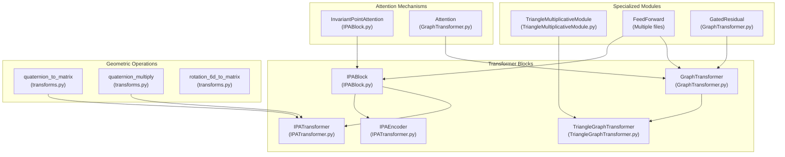
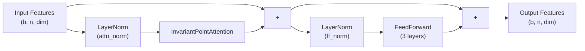
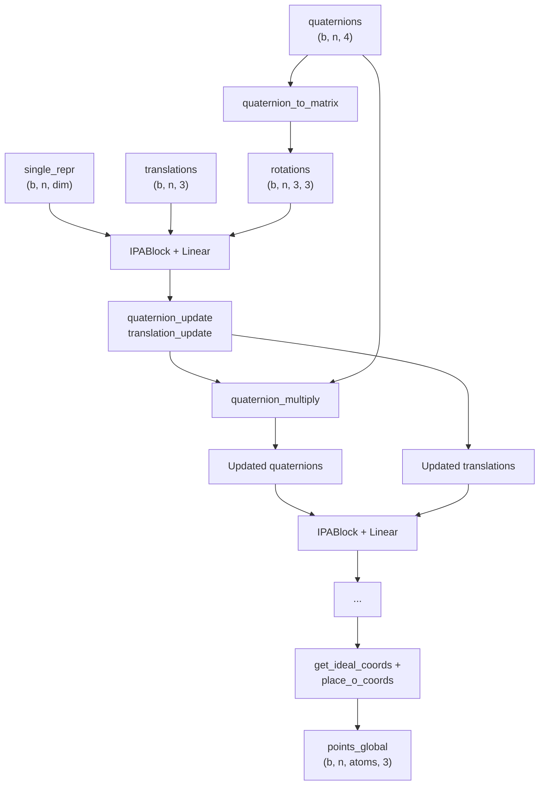
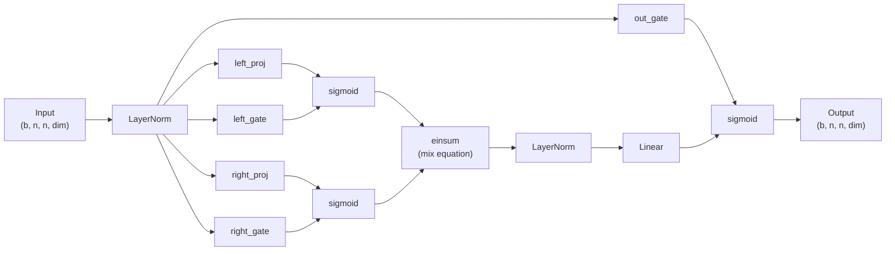
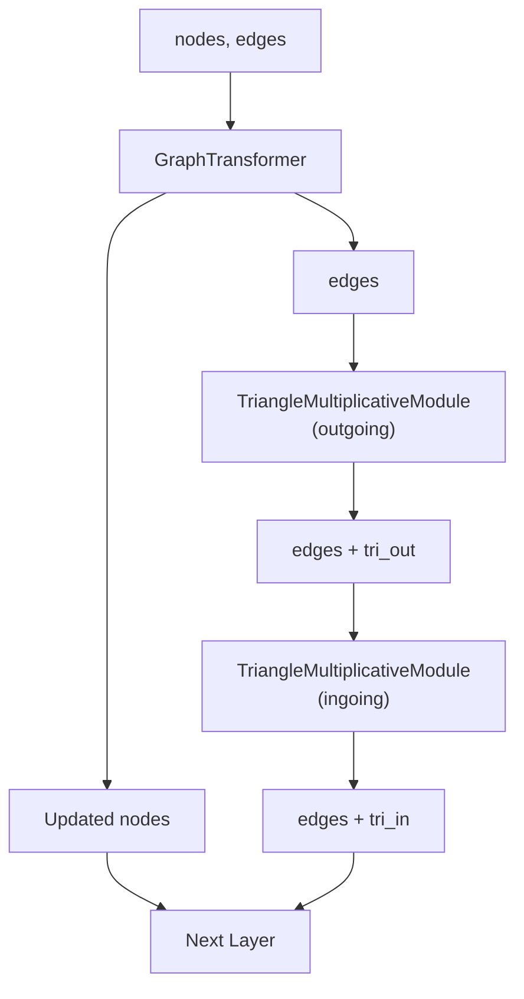
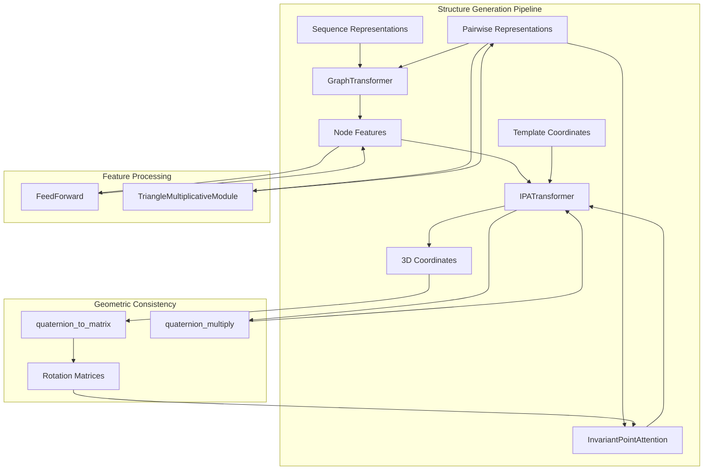

# Model Components

<details>
<summary>Relevant source files</summary>

The following files were used as context for generating this wiki page:

- [igfold/model/__init__.py](igfold/model/__init__.py)
- [igfold/model/components/GraphTransformer.py](igfold/model/components/GraphTransformer.py)
- [igfold/model/components/IPABlock.py](igfold/model/components/IPABlock.py)
- [igfold/model/components/IPATransformer.py](igfold/model/components/IPATransformer.py)
- [igfold/model/components/TriangleGraphTransformer.py](igfold/model/components/TriangleGraphTransformer.py)
- [igfold/model/components/TriangleMultiplicativeModule.py](igfold/model/components/TriangleMultiplicativeModule.py)
- [igfold/utils/transforms.py](igfold/utils/transforms.py)

</details>


This document provides detailed technical documentation of the neural network architectural components that form the core of the IgFold deep learning system. These components implement specialized attention mechanisms, transformer architectures, and geometric operations designed for protein structure prediction.

For information about the overall IgFold model architecture and how these components integrate into the full prediction pipeline, see [IgFold Model](#5.1). For training and optimization details, see [Training and Loss Functions](#7.2).

## Component Architecture Overview

The IgFold model is built from several key neural network components that work together to process antibody sequences and predict 3D structures:



Sources: [igfold/model/components/IPABlock.py:1-248](), [igfold/model/components/IPATransformer.py:1-175](), [igfold/model/components/GraphTransformer.py:1-255](), [igfold/model/components/TriangleGraphTransformer.py:1-63](), [igfold/model/components/TriangleMultiplicativeModule.py:1-109](), [igfold/utils/transforms.py:1-521]()

## Invariant Point Attention (IPA)

The core innovation of IgFold is the Invariant Point Attention mechanism, which processes both sequence representations and 3D geometric information while maintaining rotational and translational invariance.

### InvariantPointAttention Class

The `InvariantPointAttention` class implements a specialized attention mechanism that operates in both sequence space and 3D coordinate space:

| Parameter | Purpose | Default |
|-----------|---------|---------|
| `dim` | Input feature dimension | Required |
| `heads` | Number of attention heads | 8 |
| `scalar_key_dim` | Dimension for scalar attention keys | 16 |
| `scalar_value_dim` | Dimension for scalar attention values | 16 |
| `point_key_dim` | Dimension for point attention keys | 4 |
| `point_value_dim` | Dimension for point attention values | 4 |
| `pairwise_repr_dim` | Pairwise representation dimension | `dim` |

The attention computation combines three types of logits:
- **Scalar attention**: Standard dot-product attention on sequence features
- **Point attention**: Distance-based attention in 3D coordinate space  
- **Pairwise attention**: Bias from pairwise sequence representations

Sources: [igfold/model/components/IPABlock.py:34-196]()

### IPABlock Architecture

The `IPABlock` combines `InvariantPointAttention` with feedforward layers and normalization:



Sources: [igfold/model/components/IPABlock.py:219-248]()

## Transformer Architectures

### IPATransformer

The `IPATransformer` is the primary structure-generating component that iteratively refines 3D coordinates through multiple IPA layers:



The key operations include:
- Converting quaternions to rotation matrices via `quaternion_to_matrix`
- Updating poses through `quaternion_multiply` and translation updates
- Generating final atomic coordinates with `get_ideal_coords` and `place_o_coords`

Sources: [igfold/model/components/IPATransformer.py:55-175]()

### GraphTransformer

The `GraphTransformer` processes node and edge representations using standard attention mechanisms:

| Component | Class | Purpose |
|-----------|-------|---------|
| `Attention` | Graph attention layer | Processes nodes with edge bias |
| `FeedForward` | MLP with GELU activation | Node feature transformation |
| `GatedResidual` | Gated residual connection | Adaptive residual weighting |
| `PreNorm` | Layer normalization | Input normalization |

The attention mechanism incorporates edge information by adding edge features to keys and values:

```python
# From GraphTransformer.py lines 140-141
k = k + ek  # Add edge features to keys
v = v + ev  # Add edge features to values
```

Sources: [igfold/model/components/GraphTransformer.py:70-255]()

## Specialized Modules

### TriangleMultiplicativeModule

This module implements the triangle multiplicative update from AlphaFold, which updates pairwise representations through multiplicative interactions:



The module supports two mixing patterns:
- **Outgoing**: `'... i k d, ... j k d -> ... i j d'`
- **Ingoing**: `'... k j d, ... k i d -> ... i j d'`

Sources: [igfold/model/components/TriangleMultiplicativeModule.py:12-109]()

### TriangleGraphTransformer

Combines graph attention with triangle multiplicative updates in alternating layers:



Sources: [igfold/model/components/TriangleGraphTransformer.py:8-62]()

## Geometric Transformations

The model relies heavily on quaternion-based rotations and geometric transformations for maintaining 3D structure consistency:

### Core Transform Functions

| Function | Input | Output | Purpose |
|----------|-------|--------|---------|
| `quaternion_to_matrix` | `(*, 4)` | `(*, 3, 3)` | Convert quaternions to rotation matrices |
| `quaternion_multiply` | `(*, 4)`, `(*, 4)` | `(*, 4)` | Compose rotations |
| `matrix_to_quaternion` | `(*, 3, 3)` | `(*, 4)` | Convert rotation matrices to quaternions |
| `rotation_6d_to_matrix` | `(*, 6)` | `(*, 3, 3)` | Convert 6D rotation representation |
| `quaternion_apply` | `(*, 4)`, `(*, 3)` | `(*, 3)` | Apply rotation to 3D points |

### Quaternion Operations

The quaternion operations maintain numerical stability and standard form:

```python
# From transforms.py lines 331-345
def quaternion_multiply(a: torch.Tensor, b: torch.Tensor) -> torch.Tensor:
    """Multiply quaternions representing rotations with standardization"""
    ab = quaternion_raw_multiply(a, b)
    return standardize_quaternion(ab)  # Ensure non-negative real part
```

Sources: [igfold/utils/transforms.py:37-521]()

## Component Integration Patterns

The model components follow several key integration patterns:



Key design principles:
- **Geometric consistency**: All operations preserve rotational/translational invariance
- **Iterative refinement**: Multiple layers progressively improve structure predictions  
- **Multi-scale processing**: Combines local (attention) and global (geometric) information
- **Residual connections**: Enable stable deep architectures with gradient flow

Sources: [igfold/model/components/IPATransformer.py:55-175](), [igfold/model/components/GraphTransformer.py:187-255](), [igfold/model/components/TriangleGraphTransformer.py:45-62]()

---