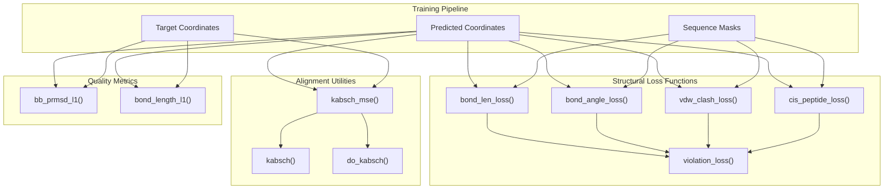
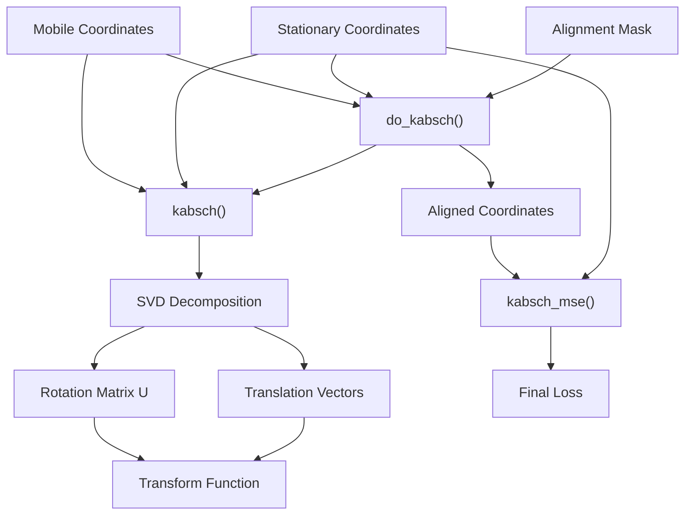
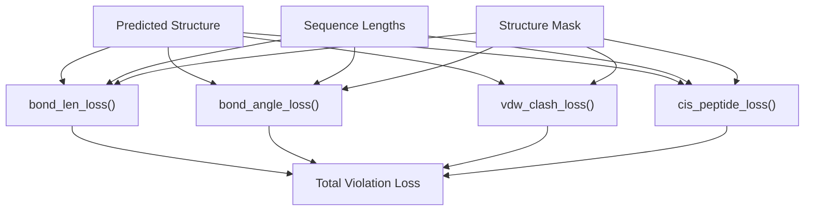
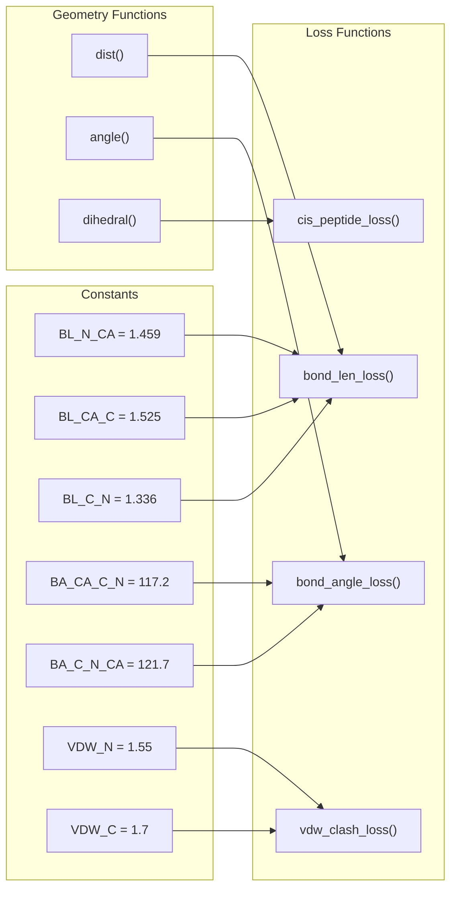

# Training and Loss Functions

<details>
<summary>Relevant source files</summary>

The following files were used as context for generating this wiki page:

- [igfold/model/components/IPABlock.py](igfold/model/components/IPABlock.py)
- [igfold/model/components/IPATransformer.py](igfold/model/components/IPATransformer.py)
- [igfold/training/utils.py](igfold/training/utils.py)
- [igfold/utils/constants.py](igfold/utils/constants.py)
- [igfold/utils/geometry.py](igfold/utils/geometry.py)
- [igfold/utils/transforms.py](igfold/utils/transforms.py)

</details>


This document covers the training utilities, loss functions, and structural validation metrics used in IgFold's deep learning pipeline. These components are responsible for optimizing the neural network models during training and evaluating the quality of predicted protein structures against ground truth data.

For information about the core model architecture that these loss functions train, see [Model Components](#7.1). For the overall processing pipeline, see [Processing Pipeline](#5.2).

## Overview of Training Components

IgFold's training system incorporates specialized loss functions designed for protein structure prediction, focusing on geometric constraints, structural validity, and alignment-based metrics. The training utilities handle the complex requirements of 3D protein structure optimization.



Sources: [igfold/training/utils.py:1-287]()

## Core Loss Functions

### Kabsch-Based Alignment Loss

The primary loss function for structure prediction uses Kabsch alignment to optimally superpose predicted and target structures before computing the mean squared error.

| Function | Purpose | Key Parameters |
|----------|---------|----------------|
| `kabsch()` | Optimal rigid-body alignment | `mobile`, `stationary`, `return_translation_rotation` |
| `do_kabsch()` | Apply Kabsch transformation | `mobile`, `stationary`, `align_mask` |
| `kabsch_mse()` | MSE loss after alignment | `pred`, `target`, `align_mask`, `clamp`, `sqrt` |



The `kabsch()` function implements the Kabsch algorithm using SVD decomposition to find the optimal rotation and translation matrices. For PyTorch versions prior to 1.8, it handles the transpose requirement for the W matrix from `torch.svd()`.

Sources: [igfold/training/utils.py:11-76](), [igfold/training/utils.py:78-98](), [igfold/training/utils.py:100-137]()

### Structural Validation Losses

IgFold incorporates multiple structural validation loss functions that enforce protein geometry constraints:

#### Bond Length Loss
```python
bond_len_loss(pred, seq_lens, mask, eps=EPS)
```
Enforces ideal bond lengths for backbone atoms (N-CA, CA-C, C-N bonds) using literature values from Engh and Huber constants.

#### Bond Angle Loss  
```python
bond_angle_loss(pred, seq_lens, mask, eps=EPS)
```
Validates backbone bond angles, specifically CA-C-N and C-N-CA angles, using cosine-based loss functions.

#### Van der Waals Clash Loss
```python
vdw_clash_loss(pred, mask, tol=1.5, eps=EPS)  
```
Prevents atomic clashes by penalizing violations of van der Waals radii with a specified tolerance.

#### Cis-Peptide Loss
```python
cis_peptide_loss(pred, seq_lens, mask, eps=EPS)
```
Enforces trans-peptide bond geometry by penalizing deviations from the expected π dihedral angle.

Sources: [igfold/training/utils.py:194-219](), [igfold/training/utils.py:221-241](), [igfold/training/utils.py:243-261](), [igfold/training/utils.py:263-275]()

### Combined Violation Loss

The `violation_loss()` function combines all structural validation losses into a single comprehensive metric:



Sources: [igfold/training/utils.py:277-287]()

## Quality Metrics and Evaluation

### Predicted RMSD Loss

The `bb_prmsd_l1()` function evaluates the accuracy of predicted per-residue RMSD values against actual structural deviations:

```python
bb_prmsd_l1(pdev, pred, target, align_mask=None, mask=None)
```

This function compares predicted deviation values (`pdev`) with actual backbone deviations computed after Kabsch alignment, using L1 loss for robustness.

### Bond Length Validation

The `bond_length_l1()` function provides detailed bond length validation with configurable offset analysis:

```python
bond_length_l1(pred, target, mask, offsets=[1, 2])
```

This evaluates bond lengths at different sequence separations (1-bond, 2-bond distances) using L1 loss.

Sources: [igfold/training/utils.py:159-193](), [igfold/training/utils.py:139-157]()

## Geometric Utilities Integration

The training system leverages geometric calculation utilities for loss computation:

| Utility Function | Purpose | Source Module |
|------------------|---------|---------------|
| `dist()` | Euclidean distance | `igfold.utils.geometry` |
| `angle()` | Bond angle calculation | `igfold.utils.geometry` |  
| `dihedral()` | Dihedral angle calculation | `igfold.utils.geometry` |
| Constants (BL_*, BA_*, VDW_*) | Literature geometry values | `igfold.utils.constants` |



Sources: [igfold/utils/geometry.py:23-28](), [igfold/utils/geometry.py:38-44](), [igfold/utils/geometry.py:46-58](), [igfold/utils/constants.py:1-22]()

## Model Integration

These loss functions operate on the output of IgFold's neural network components, particularly the coordinate predictions from the `IPATransformer` and related modules:

- **IPATransformer**: Produces final 3D coordinates (`points_global`) that serve as input to loss functions
- **IPABlock**: Provides intermediate representations used in deviation prediction
- **Structural Outputs**: Include translations, quaternions, and per-atom coordinates that are validated against geometric constraints

The training system expects predictions in the format `(batch, length, atoms, dimensions)` where atoms typically represent the backbone atoms N, CA, C, CB for each residue.

Sources: [igfold/model/components/IPATransformer.py:154-174](), [igfold/training/utils.py:194-287]()

---