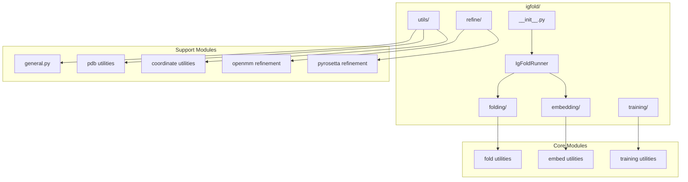
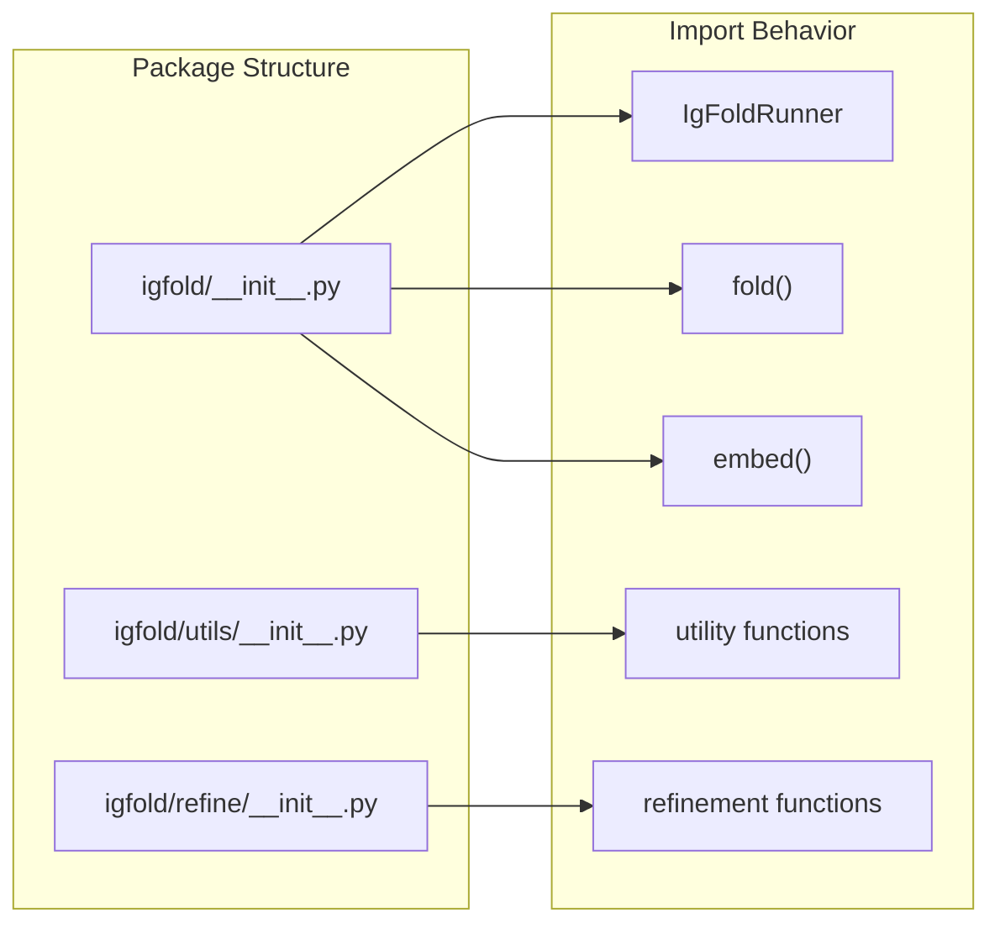
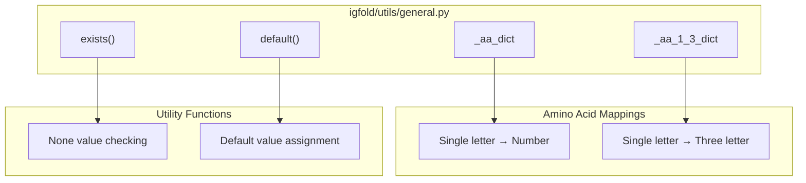
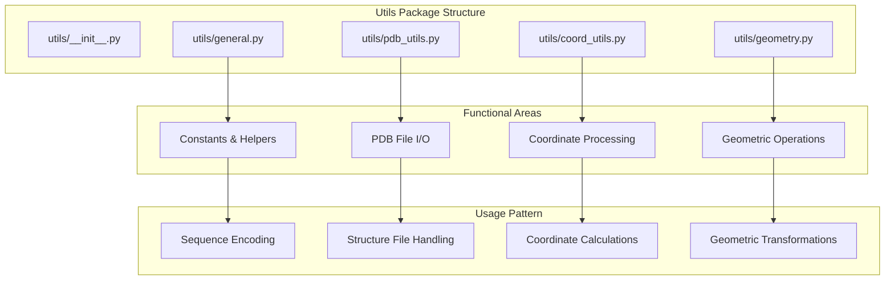
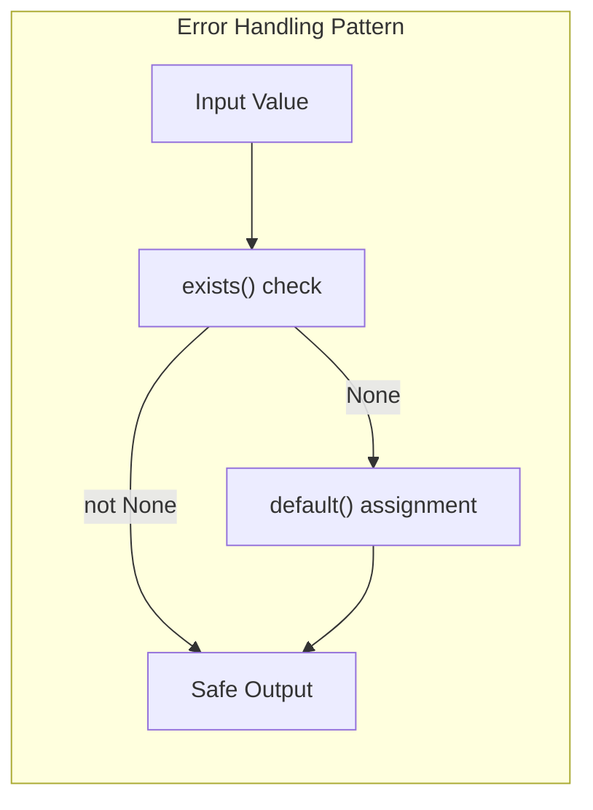
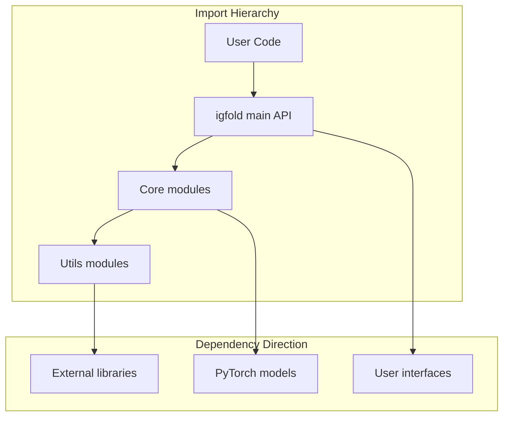

# Package Structure and Utilities

Relevant source files

The following files were used as context for generating this wiki page:

- [igfold/refine/__init__.py](igfold/refine/__init__.py)
- [igfold/utils/__init__.py](igfold/utils/__init__.py)
- [igfold/utils/general.py](igfold/utils/general.py)

This document provides an overview of IgFold's package organization, initialization files, utility modules, and development infrastructure. It covers the codebase structure, common utility functions, and setup considerations for developers working on IgFold internals.

For information about the core neural network components, see [Model Components](#7.1). For training-related utilities and metrics, see [Training and Loss Functions](#7.2).

## Package Organization

IgFold follows a modular package structure that separates core functionality, utilities, and optional components into distinct modules. The codebase is organized to support both end-user interfaces and internal development workflows.

### Top-Level Package Structure

**Sources:** [igfold/refine/__init__.py:1](), [igfold/utils/__init__.py:1]()

### Module Hierarchy

The package structure reflects the logical separation of concerns in the IgFold system:

| Module | Purpose | Key Components |
|--------|---------|----------------|
| `igfold/` | Main package entry point | `IgFoldRunner`, core APIs |
| `igfold/folding/` | Structure prediction pipeline | Folding utilities, model interfaces |
| `igfold/embedding/` | Sequence embedding functionality | AntiBERTy integration, embeddings |
| `igfold/training/` | Model training components | Loss functions, training loops |
| `igfold/utils/` | General utilities | Data processing, constants, helpers |
| `igfold/refine/` | Structure refinement | OpenMM, PyRosetta integration |

## Initialization Files

The package uses `__init__.py` files to define module boundaries and control import behavior. These files are typically minimal, focusing on exposing the primary interfaces from each module.

### Package Initialization Pattern

The initialization files follow a consistent pattern:
- **Empty initialization files** - Most `__init__.py` files are empty, serving only as package markers
- **Selective exports** - Main package exposes primary user-facing APIs
- **Lazy loading** - Heavy dependencies loaded only when needed

**Sources:** [igfold/refine/__init__.py:1](), [igfold/utils/__init__.py:1]()

## Utility Modules

The `utils` package contains shared functionality used across the IgFold system, including data processing utilities, constants, and helper functions.

### General Utilities

The `general.py` module provides fundamental constants and utility functions used throughout the codebase:

#### Amino Acid Constants

The module defines standard amino acid mappings used for sequence processing:

- **`_aa_dict`** - Maps single-letter amino acid codes to numeric representations [igfold/utils/general.py:1-22]()
- **`_aa_1_3_dict`** - Maps single-letter codes to three-letter codes [igfold/utils/general.py:24-46]()

These dictionaries support 20 standard amino acids plus a gap character, providing consistent encoding across the system.

#### Helper Functions

Core utility functions provide common functionality:

- **`exists(x)`** - Checks if a value is not None [igfold/utils/general.py:49-50]()
- **`default(val, d)`** - Returns value if it exists, otherwise returns default [igfold/utils/general.py:53-57]()

**Sources:** [igfold/utils/general.py:1-57]()

### Utility Module Structure

**Sources:** [igfold/utils/__init__.py:1](), [igfold/utils/general.py:1-57]()

## Common Functionality Patterns

### Data Type Conventions

IgFold follows consistent patterns for data representation and processing:

| Data Type | Representation | Usage |
|-----------|---------------|-------|
| Amino Acids | Single-letter codes | Primary sequence representation |
| Coordinates | NumPy arrays | 3D structure coordinates |
| Sequences | Dictionary format | Multi-chain sequence input |
| Templates | PDB format | Structure templates |

### Error Handling Utilities

The utility functions support robust error handling throughout the system:

**Sources:** [igfold/utils/general.py:49-57]()

## Development Setup Considerations

### Package Dependencies

The modular structure allows for flexible dependency management:

- **Core utilities** - Minimal dependencies for basic functionality
- **Refinement modules** - Optional heavy dependencies (OpenMM, PyRosetta)
- **Visualization** - Optional display dependencies (py3Dmol, matplotlib)

### Import Organization

The package structure supports clean imports and minimal coupling:

### Testing and Validation

The package structure supports systematic testing:
- **Unit tests** for utility functions
- **Integration tests** for module interfaces  
- **End-to-end tests** for complete workflows

**Sources:** [igfold/refine/__init__.py:1](), [igfold/utils/__init__.py:1](), [igfold/utils/general.py:1-57]()