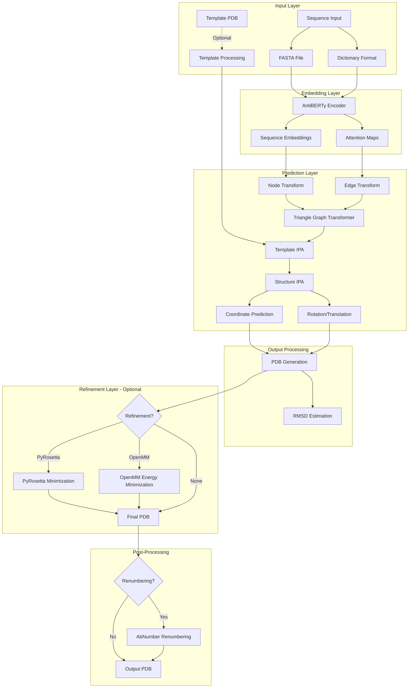

IgFold is a deep learning framework for fast, accurate antibody structure prediction, trained on a massive dataset of natural antibody sequences. The project enables researchers and developers to predict three-dimensional antibody structures from amino acid sequences in seconds, with optional refinement using PyRosetta or OpenMM to improve structural quality. IgFold leverages graph-based neural networks and invariant point attention (IPA) mechanisms to achieve state-of-the-art performance in computational antibody modeling.

Sources: [README.md](README.md#L1-L10), [IgFold.py](igfold/model/IgFold.py#L1-L100)

## What IgFold Does

IgFold addresses the critical challenge in antibody engineering and drug discovery: predicting antibody structures from sequence data alone. Traditional methods like X-ray crystallography and NMR spectroscopy are expensive and time-consuming, while computational approaches often require extensive computational resources. IgFold bridges this gap by providing:

- **Rapid Structure Prediction**: Generate antibody 3D structures from sequence in seconds using deep learning models trained on over 1.3 million natural antibody sequences from Observed Antibody Space and human donor studies
- **Multi-Format Support**: Handle paired heavy/light chain antibodies, single chains, nanobodies, and single-chain variable fragments (scFvs)
- **Template Integration**: Optionally incorporate known structural templates to improve prediction accuracy
- **Built-in Refinement**: Apply PyRosetta or OpenMM-based refinement to improve stereochemistry and reduce structural artifacts
- **Antibody Renumbering**: Automatically renumber predicted structures using Chothia numbering scheme via AbNumber integration
- **Quality Estimation**: Provide per-residue RMSD predictions stored in PDB B-factor columns for confidence assessment
- **Sequence Embeddings**: Extract rich antibody sequence representations for machine learning applications

Sources: [README.md](README.md#L1-L10), [README.md](README.md#L180-L220), [IgFoldRunner.py](igfold/IgFoldRunner.py#L38-L120)

## Project Architecture

IgFold follows a modular architecture that separates sequence embedding, structure prediction, and refinement into distinct components. The system integrates graph transformer networks with invariant point attention for coordinate prediction, leveraging AntiBERTy as the sequence encoder.



The architecture flow begins with sequence input, which can be provided as FASTA files or Python dictionaries containing heavy and light chain sequences. Sequences are embedded using AntiBERTy, producing both sequence embeddings and attention attention maps. These embeddings undergo transformation through graph transformer layers that capture both node-level and edge-level features. Template structures can be incorporated through IPA encoder blocks to improve prediction quality. The structure IPA module then generates final 3D coordinates through rotation and translation predictions. Optional refinement improves structural quality, and renumbering standardizes residue numbering for downstream applications.

Sources: [IgFold.py](igfold/model/IgFold.py#L1-L100), [interface.py](igfold/model/interface.py#L1-L40), [IgFoldRunner.py](igfold/IgFoldRunner.py#L38-L120), [folding.py](igfold/utils/folding.py#L153-L232)

## Project Structure

The IgFold codebase is organized into logical modules that separate concerns and maintain clear interfaces:


```
igfold/
├── IgFoldRunner.py           # Main prediction interface and model orchestration
├── model/
│   ├── IgFold.py             # Core PyTorch Lightning model implementation
│   ├── interface.py          # Input/output dataclass definitions
│   └── components/           # Neural network components
│       ├── IPATransformer.py # Invariant Point Attention modules
│       ├── TriangleGraphTransformer.py
│       ├── GraphTransformer.py
│       └── TriangleMultiplicativeModule.py
├── refine/
│   ├── pyrosetta_ref.py      # PyRosetta-based refinement
│   └── openmm_ref.py         # OpenMM-based refinement
├── utils/
│   ├── embed.py              # Sequence embedding utilities
│   ├── folding.py            # Prediction pipeline orchestration
│   ├── coordinates.py        # Coordinate geometry operations
│   ├── pdb.py                # PDB file I/O
│   ├── fasta.py              # FASTA file handling
│   ├── abnumber_.py          # Antibody renumbering
│   ├── transforms.py         # Geometric transformations
│   └── visualize.py          # Visualization utilities
└── training/
    └── utils.py              # Training utilities
```

The modular design allows developers to:
- Use `IgFoldRunner` for high-level predictions without worrying about internal details
- Import individual components for custom prediction pipelines
- Extend functionality through inheritance of base classes
- Access utility functions for coordinate manipulation, PDB processing, and sequence operations

Sources: [__init__.py](igfold/__init__.py#L1-L3), [IgFoldRunner.py](igfold/IgFoldRunner.py#L1-L100), [utils/](igfold/utils/)

## Key Features and Capabilities

IgFold provides comprehensive functionality for antibody structure prediction and analysis, with each feature designed for specific use cases in antibody engineering and research.

| Feature | Description | Use Case | Files |
|---------|-------------|----------|-------|
| **Structure Prediction** | Generate 3D coordinates from sequence using deep learning | Rapid antibody modeling, virtual screening | [IgFoldRunner.py](igfold/IgFoldRunner.py#L75-L158), [IgFold.py](igfold/model/IgFold.py#L1-L100) |
| **Template Integration** | Incorporate known structures to guide predictions | Homology modeling with limited templates | [folding.py](igfold/utils/folding.py#L30-L76) |
| **PyRosetta Refinement** | Energy minimization using Rosetta force fields | High-precision structural refinement | [pyrosetta_ref.py](igfold/refine/pyrosetta_ref.py#L92-L125) |
| **OpenMM Refinement** | Molecular mechanics-based structure optimization | GPU-accelerated refinement | [openmm_ref.py](igfold/refine/openmm_ref.py#L1-L44) |
| **Antibody Renumbering** | Standardize residue numbering with Chothia scheme | Downstream analysis and comparison | [abnumber_.py](igfold/utils/abnumber_.py) |
| **RMSD Estimation** | Per-residue confidence metrics via B-factors | Quality assessment and filtering | [interface.py](igfold/model/interface.py#L25-L40) |
| **Sequence Embeddings** | Extract rich feature representations | Machine learning applications | [embed.py](igfold/utils/embed.py#L7-L53) |
| **Multi-Model Ensemble** | Average predictions across multiple models | Improved robustness and accuracy | [IgFoldRunner.py](igfold/IgFoldRunner.py#L38-L68) |

Sources: [README.md](README.md#L30-L100), [IgFoldRunner.py](igfold/IgFoldRunner.py#L38-L158), [interface.py](igfold/model/interface.py#L1-L40)

## Supported Antibody Formats

IgFold supports multiple antibody and antibody-like formats, making it versatile for various research and engineering applications.

| Format | Input Specification | Example | Processing Notes |
|--------|---------------------|---------|------------------|
| **Paired Antibody** | Dictionary with "H" and "L" keys | `{"H": heavy_seq, "L": light_seq}` | Heavy and light chains predicted together with inter-chain orientation |
| **Nanobody** | Single "H" chain | `{"H": nanobody_seq}` | Predicts single-domain antibody structure |
| **Heavy Chain Only** | Single "H" chain | `{"H": heavy_seq}` | Useful for Fab heavy chain studies |
| **Light Chain Only** | Single "L" chain | `{"L": light_seq}` | For light chain analysis and engineering |
| **scFv** | Linked V<sub>H</sub>-V<sub>L</sub> | `{"H": linker_sequence}` | Requires proper linker specification |
| **FASTA Input** | Multi-chain FASTA file | File with H and L chain entries | Automatically parsed and processed |

> [!TIP]
> When predicting paired antibodies, ensure both heavy and light chains are provided simultaneously. IgFold optimizes the orientation and packing between chains during prediction, which improves accuracy over predicting chains independently.

> [!TIP]
> For large-scale predictions (thousands of antibodies), use the batch processing capabilities by passing multiple sequences in separate calls. The models are loaded once and reused, making sequential predictions efficient.

Sources: [README.md](README.md#L48-L85), [folding.py](igfold/utils/folding.py#L13-L28)

## Installation and Dependencies

IgFold provides flexible installation options depending on your use case and refinement requirements.

### Core Dependencies

| Dependency | Version | Purpose | Required |
|------------|---------|---------|----------|
| PyTorch | ≥1.7.1 | Deep learning framework | Yes |
| PyTorch Lightning | 1.5.10-<1.9.0 | Model training utilities | Yes |
| AntiBERTy | ≥0.1.1 | Sequence embedding encoder | Yes |
| BioPython | ≥1.79 | PDB and FASTA processing | Yes |
| einops | ≥0.3.0 | Tensor manipulation | Yes |
| PyRosetta | Latest | Structure refinement | Optional |
| OpenMM | 7.7.0 | Alternative refinement | Optional |
| AbNumber | Latest | Antibody renumbering | Optional |

### Installation Methods

The recommended installation approach depends on whether you need refinement capabilities and the scale of your predictions:

**Basic Installation (Sequence Prediction Only)**
```bash
pip install igfold
```
Suitable for quick predictions without refinement, perfect for prototyping and initial exploration.

**Development Installation (Latest Features)**
```bash
git clone https://github.com/Graylab/IgFold.git
pip install -e ./IgFold
```
Provides access to the latest code and development features, ideal for contributors and advanced users.

**Full Installation with PyRosetta Refinement**
```bash
pip install igfold
# Follow PyRosetta installation instructions
conda install -c bioconda abnumber
```
Recommended for production applications requiring high-quality structures with proper stereochemistry.

**OpenMM Refinement Path**
```bash
pip install igfold
conda install -c conda-forge openmm==7.7.0 pdbfixer
conda install -c bioconda abnumber
```
Alternative to PyRosetta, useful when PyRosetta license restrictions apply.

Sources: [README.md](README.md#L14-L30), [setup.cfg](setup.cfg#L1-L15), [pyrosetta_ref.py](igfold/refine/pyrosetta_ref.py#L6-L11), [openmm_ref.py](igfold/refine/openmm_ref.py#L1-L10)

## Performance and Scalability

IgFold is designed for both single predictions and large-scale structure generation, with computational requirements that scale appropriately with usage patterns.

**Prediction Speed**
- Single antibody: ~1-2 seconds on GPU, ~10-15 seconds on CPU
- Nanobodies: Faster due to shorter sequences (~0.5-1 second)
- Batch processing: Nearly linear scaling after initial model loading

**Memory Requirements**
- GPU memory: ~2-4 GB per model (up to 4 models in ensemble)
- System RAM: ~8 GB recommended for refinement operations
- Model storage: ~100 MB for pre-trained checkpoints

**Scalability Examples**
The project demonstrates proven capability for large-scale predictions:
- 104K non-redundant paired antibodies from Observed Antibody Space
- 1.3M unique paired antibodies from human donor studies

These datasets, totaling over 1.4 million structures, demonstrate IgFold's ability to handle production-scale antibody structure prediction workflows.

Sources: [README.md](README.md#L180-L220), [IgFoldRunner.py](igfold/IgFoldRunner.py#L38-L68)

## Getting Started with IgFold

To begin using IgFold, you can start with a basic antibody structure prediction using minimal code:

```python
from igfold import IgFoldRunner

# Initialize the prediction runner (loads models automatically)
igfold = IgFoldRunner()

# Define antibody sequences
sequences = {
    "H": "EVQLVQSGPEVKKPGTSVKVSCKASGFTFMSSAVQWVRQARGQRLEWIGWIVIGSGNTNYAQKFQERVTITRDMSTSTAYMELSSLRSEDTAVYYCAAPYCSSISCNDGFDIWGQGTMVTVS",
    "L": "DVVMTQTPFSLPVSLGDQASISCRSSQSLVHSNGNTYLHWYLQKPGQSPKLLIYKVSNRFSGVPDRFSGSGSGTDFTLKISRVEAEDLGVYFCSQSTHVPYTFGGGTKLEIK"
}

# Predict structure
result = igfold.fold(
    pdb_file="my_antibody.pdb",
    sequences=sequences,
    do_refine=False,  # Skip refinement for quick prediction
    do_renum=False    # Skip renumbering for initial exploration
)

# Access predicted RMSD estimates
print(f"Per-residue RMSD estimates: {result.prmsd.shape}")
```

This example demonstrates the core workflow: initialization, sequence specification, prediction execution, and result access. For production applications, you would enable refinement and renumbering for higher-quality outputs.

Sources: [README.md](README.md#L48-L85), [IgFoldRunner.py](igfold/IgFoldRunner.py#L75-L158)

## Next Steps in Your IgFold Journey

This overview provides the foundation for understanding IgFold's capabilities and architecture. To deepen your knowledge and practical skills, follow this logical progression through the documentation:

**Immediate Next Steps**
- [Quick Start](2-quick-start): Hands-on tutorial with runnable examples for your first predictions
- [Installation and Environment Setup](3-installation-and-environment-setup): Detailed guide for configuring your development environment with all optional dependencies

**Core Functionality**
- [Basic Antibody Structure Prediction](4-basic-antibody-structure-prediction): Comprehensive guide to paired antibody predictions with refinement and renumbering
- [Predicting Nanobody and Single Chain Structures](5-predicting-nanobody-and-single-chain-structures): Specialized workflows for alternative antibody formats

**Deep Technical Understanding**
- [IgFold Model Architecture](6-igfold-model-architecture): In-depth exploration of the neural network architecture and design principles
- [Graph Transformer Components](7-graph-transformer-components): Details on the graph-based attention mechanisms
- [Invariant Point Attention (IPA) Implementation](8-invariant-point-attention-ipa-implementation): Mathematical foundations of the coordinate prediction system

**Advanced Applications**
- [Sequence Input and Embedding Pipeline](9-sequence-input-and-embedding-pipeline): Understanding how sequences are processed and embedded
- [PyRosetta Refinement Method](13-pyrosetta-refinement-method) and [OpenMM Refinement Method](14-openmm-refinement-method): Comparing refinement strategies
- [Antibody Sequence Embeddings for ML](16-antibody-sequence-embeddings-for-ml): Using IgFold representations for machine learning tasks
