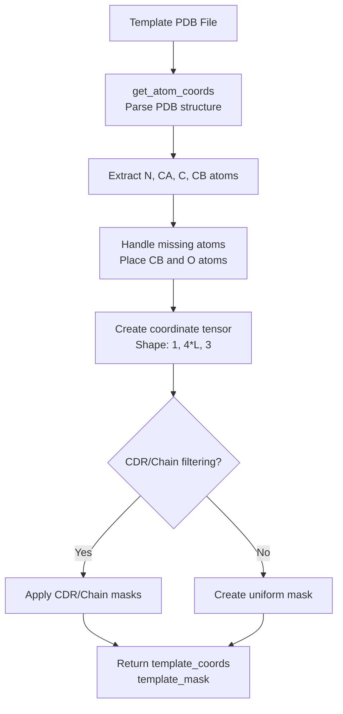
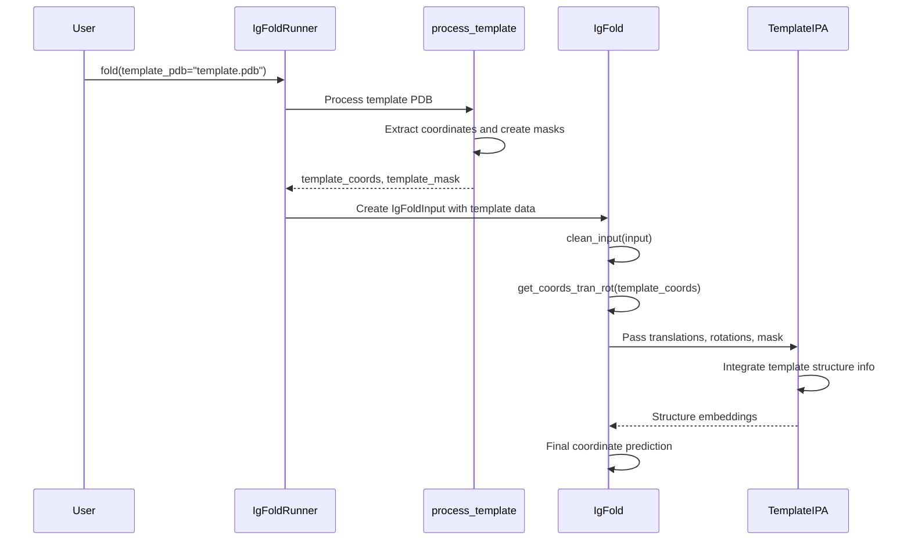

Template-based structure prediction in IgFold leverages known antibody structures as reference templates to guide the prediction of novel antibody structures. This approach combines the flexibility of deep learning with the structural constraints provided by homologous or related antibodies, improving prediction accuracy when suitable templates are available.

## Template Processing Pipeline

The template processing pipeline converts PDB template files into structured coordinate data that can be consumed by the IgFold model. This process involves parsing PDB files, extracting atom coordinates, handling missing atoms, and generating appropriate masks for template integration.



The `process_template()` function in `igfold/utils/folding.py` orchestrates this pipeline, accepting a PDB file path and optional filtering parameters [sources: igfold/utils/folding.py#L30-L75](igfold/utils/folding.py#L30-L75).

### Coordinate Extraction

Templates are parsed using BioPython's PDBParser to extract atomic coordinates. For each residue in the template, four key backbone atoms are extracted: N (nitrogen), CA (alpha carbon), C (carbonyl carbon), and CB (beta carbon) [sources: igfold/utils/pdb.py#L194-L251](igfold/utils/pdb.py#L194-L251). These coordinates are stacked into a tensor with shape `(batch_size, 4*seq_len, 3)`, where the 4 atoms per residue are flattened in N, CA, C, CB order [sources: igfold/utils/folding.py#L42-L48](igfold/utils/folding.py#L42-L48).

> [!TIP]
> Missing CB atoms in glycine residues and O atoms are automatically reconstructed using geometric constraints. The `place_missing_cb_o()` function places these atoms based on standard backbone bond lengths and angles [sources: igfold/utils/pdb.py#L160-L192](igfold/utils/pdb.py#L160-L192).

### Template Masking

Template masks control which regions of the template structure provide structural guidance to the model. The mask is a boolean tensor where `True` indicates valid template atoms and `False` indicates positions to ignore [sources: igfold/utils/folding.py#L50-L73](igfold/utils/folding.py#L50-L73). Two types of filtering are supported:

| Filter Type | Parameter | Description | Example Usage |
|-------------|-----------|-------------|---------------|
| CDR Filtering | `ignore_cdrs` | Ignore specific CDR loops | `ignore_cdrs=["h3", "l1"]` or `ignore_cdrs="h3"` or `ignore_cdrs=False` |
| Chain Filtering | `ignore_chain` | Ignore entire chains | `ignore_chain="H"` or `ignore_chain="L"` |

When CDR regions are masked, the model relies more heavily on sequence information and learned patterns rather than template coordinates for those regions. This is particularly useful when predicting antibodies with divergent CDR loops compared to their template [sources: igfold/utils/folding.py#L54-L66](igfold/utils/folding.py#L54-L66).

## Template Integration in Model Architecture

Template coordinates are integrated into the IgFold model through the Template IPA (Invariant Point Attention) layer, which incorporates structural priors from the template while allowing flexibility for novel regions.



### Template Coordinate Preprocessing

The `clean_input()` method in the IgFold class handles template coordinate preprocessing before model forward pass [sources: igfold/model/IgFold.py#L144-L194](igfold/model/IgFold.py#L144-L194). When no template is provided, zero-initialized coordinates and masks are created as placeholders [sources: igfold/model/IgFold.py#L158-L170](igfold/model/IgFold.py#L158-L170). For valid templates, coordinates are centered by subtracting the mean coordinate for each batch element [sources: igfold/model/IgFold.py#L186-L187](igfold/model/IgFold.py#L186-L187).

The `get_coords_tran_rot()` method applies the Kabsch algorithm to extract rotational and translational components from template coordinates by aligning them to ideal residue geometry [sources: igfold/model/IgFold.py#L114-L142](igfold/model/IgFold.py#L114-L142). This yields:

- **Translations**: Per-residue translation vectors with shape `(batch_size, seq_len, 3)`
- **Rotations**: Per-residue rotation matrices derived from Kabsch alignment

The ideal coordinates represent a canonical residue geometry centered at the CA atom, providing a reference frame for each residue [sources: igfold/utils/coordinates.py#L33-L54](igfold/utils/coordinates.py#L33-L54).

### Template IPA Integration

During the forward pass, template information is injected at a specific stage of the model architecture. After initial graph transformer layers process sequence embeddings, the Template IPA layer incorporates template translations, rotations, and the template mask [sources: igfold/model/IgFold.py#L247-L253](igfold/model/IgFold.py#L247-L253).

The Template IPA uses the template structural information as a prior while attending over pairwise representations. This enables the model to:

1. **Preserve conserved regions** that are structurally similar to the template
2. **Guide prediction** for residues with valid template coordinates
3. **Flexibly diverge** in masked regions (e.g., CDR loops) based on sequence information

The output of Template IPA creates structure embeddings that encode both sequence-derived features and template-derived structural priors, which are then used for final coordinate prediction [sources: igfold/model/IgFold.py#L254-L262](igfold/model/IgFold.py#L254-L262).

## Usage Patterns

### Basic Template Usage

To use a template for structure prediction, provide the `template_pdb` parameter to the `fold()` method:

```python
from igfold import IgFoldRunner
from igfold.refine.pyrosetta_ref import init_pyrosetta

init_pyrosetta()

sequences = {
    "H": "EVQLVQSGPEVKKPGTSVKVSCKASGFTFMSSAVQWVRQARGQRLEWIGWIVIGSGNTYYAQKFQERVTITRDMSTSTAYMELSSLRSEDTAVYYCAAPYCSSISCNDGFDIWGQGTMVTVS",
    "L": "DVVMTQTPFSLPVSLGDQASISCRSSQSLVHSNGNTYLHWYLQKPGQSPKLLIYKVSNRFSGVPDRFSGSGSGTDFTLKISRVEAEDLGVYFCSQSTHVPYTFGGGTKLEIK"
}

igfold = IgFoldRunner()
igfold.fold(
    "predicted_antibody.pdb",
    sequences=sequences,
    template_pdb="template_structure.pdb",  # Template structure
    do_refine=True,
    do_renum=True,
)
```

### CDR-Specific Template Usage

When predicting antibodies with divergent CDR loops, you may want to use template information only for framework regions:

```python
igfold.fold(
    "predicted_antibody.pdb",
    sequences=sequences,
    template_pdb="template_structure.pdb",
    ignore_cdrs=["h1", "h2", "h3", "l1", "l2", "l3"],  # Ignore all CDRs
    do_refine=True,
)
```

Alternatively, ignore specific CDRs selectively:

```python
# Ignore only CDR-H3 (most variable region)
igfold.fold(
    "predicted_antibody.pdb",
    sequences=sequences,
    template_pdb="template_structure.pdb",
    ignore_cdrs="h3",
    do_refine=True,
)
```

### Chain-Specific Template Usage

When predicting single-chain antibodies or when template quality varies between chains, you can filter by chain:

```python
# Use only light chain from template
igfold.fold(
    "predicted_antibody.pdb",
    sequences=sequences,
    template_pdb="template_structure.pdb",
    ignore_chain="H",  # Ignore heavy chain template
    do_refine=True,
)
```

## Template Input Interface

Template coordinates and masks are passed to the model through the `IgFoldInput` dataclass defined in `igfold/model/interface.py` [sources: igfold/model/interface.py#L6-L19](igfold/model/interface.py#L6-L19):

| Field | Type | Description |
|-------|------|-------------|
| `template_coords` | `Optional[torch.FloatTensor]` | Template coordinates with shape `(batch_size, 4*seq_len, 3)` |
| `template_mask` | `Optional[torch.BoolTensor]` | Boolean mask indicating valid template atoms |
| `batch_mask` | `Optional[torch.BoolTensor]` | Overall mask for batch elements |
| `align_mask` | `Optional[torch.BoolTensor]` | Mask used for alignment during training |

The `IgFoldInput` dataclass also contains sequence embeddings and attention maps, enabling the model to jointly process sequence and template information [sources: igfold/model/IgFold.py#L196-L208](igfold/model/IgFold.py#L196-L208).

## Template Coordinate Transformations

Template coordinates undergo several transformations during model processing to enable effective integration with the learned structural representations.

### Kabsch Alignment

The Kabsch algorithm is applied to align ideal residue geometry to template coordinates. This involves [sources: igfold/model/IgFold.py#L132-L136](igfold/model/IgFold.py#L132-L136):

1. Computing the optimal rotation matrix that minimizes RMSD between ideal and template coordinates
2. Computing the translation vector that aligns the rotated ideal coordinates to the template center

The resulting rotation and translation parameters encode the local frame of each residue in the template structure, which is then used by the Template IPA layer.

### Ideal Coordinate Transformation

The `transform_ideal_coords()` method applies the extracted rotations and translations to ideal residue coordinates to reconstruct the template structure in the model's coordinate frame [sources: igfold/model/IgFold.py#L405-L425](igfold/model/IgFold.py#L405-L425). This transformation:

1. Broadcasts ideal coordinates across batch and sequence dimensions
2. Applies per-residue rotations using matrix multiplication
3. Applies per-residue translations

This enables the model to represent template structures in a local reference frame that is invariant to global rotation and translation, which is crucial for learning robust structural representations.

> [!TIP]
> The use of local coordinate frames (translations + rotations) rather than global coordinates is a key design choice that enables the model to learn transferable structural patterns independent of absolute position and orientation in 3D space.

## Template Quality Considerations

When using templates for structure prediction, several quality factors should be considered:

1. **Sequence Identity**: Templates with higher sequence identity to the target generally provide better structural guidance, particularly for framework regions.

2. **Structural Quality**: High-resolution X-ray structures or high-quality cryo-EM structures are preferred templates over low-resolution or modeled structures.

3. **Coverage**: Templates should provide good coverage of the target sequence. Regions with gaps or missing residues will rely more on sequence-based prediction.

4. **CDR Similarity**: CDR loops vary significantly between antibodies, even in closely related sequences. Masking divergent CDRs often improves prediction quality.

The template masking options allow you to control which regions of the template are used, enabling you to leverage high-quality template information for conserved regions while relying on the model's learned patterns for variable regions.

## Next Steps

Understanding template-based structure prediction provides context for the overall coordinate generation process. Continue to:

- **[Coordinate Prediction and RMSD Estimation](12-coordinate-prediction-and-rmsd-estimation)** - Learn how the model generates final atomic coordinates and confidence estimates
- **[Antibody Renumbering with AbNumber](11-antibody-renumbering-with-abnumber)** - Understand the standardized numbering scheme used for antibody structures
- **[Ideal Coordinate Transformation](25-ideal-coordinate-transformation)** - Explore the mathematical details of local coordinate frame transformations