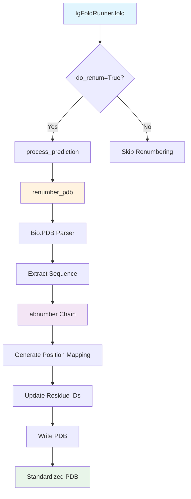
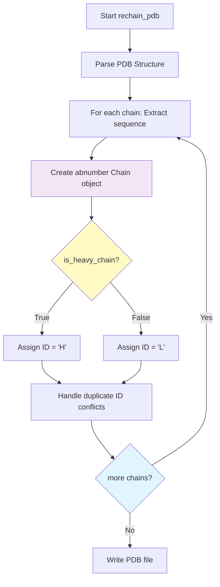
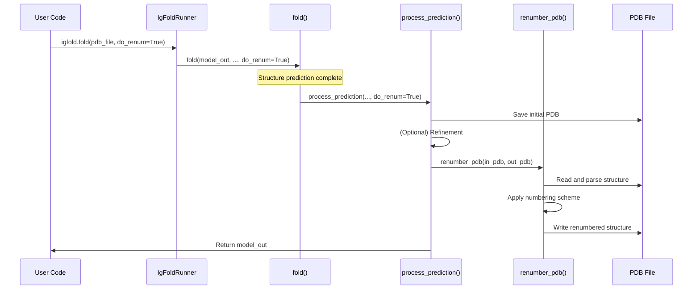

Antibody renumbering is a critical preprocessing step in computational structural biology that standardizes residue numbering according to established immunoglobulin numbering schemes. IgFold integrates AbNumber to convert PDB files from arbitrary numbering to standardized formats, enabling consistent analysis, comparison, and structural modeling of antibody sequences. This documentation explores the architectural implementation, workflow integration, and practical usage of renumbering functionality within the IgFold ecosystem.

Sources: [abnumber_.py](igfold/utils/abnumber_.py#L1-L88), [folding.py](igfold/utils/folding.py#L133-L142)

## Architecture and Integration

The renumbering functionality operates as a modular utility layer that interfaces between raw PDB structures and standardized antibody representations. The architecture leverages two external libraries: `abnumber` for scheme-specific numbering logic and BioPython's PDB module for structural manipulation.



The core renumbering system consists of four interconnected functions with distinct responsibilities:

| Function | Purpose | Dependencies |
|----------|---------|--------------|
| `is_heavy()` | Determines if a sequence is a heavy chain | abnumber.Chain |
| `rechain_pdb()` | Reassigns chain IDs (H/L) based on sequence type | Bio.PDB.PDBParser, abnumber |
| `renumber_pdb()` | Applies residue numbering scheme to PDB | Bio.PDB.PDBParser, abnumber, clean_pdb |
| `truncate_seq()` | Extracts structured sequence using numbering | abnumber.Chain |

Sources: [abnumber_.py](igfold/utils/abnumber_.py#L9-L87)

## Core Renumbering Functionality

### Residue Numbering Transformation

The primary renumbering operation transforms arbitrary residue IDs into standardized positions using the specified numbering scheme. The process begins with PDB file cleaning and parsing, then extracts the amino acid sequence from residue names, applies the numbering scheme, and finally reconstructs the structure with updated residue identifiers.

The implementation validates sequence consistency between the PDB structure and the numbering scheme, raising exceptions if mismatches occur. Position parsing handles both regular positions (e.g., 27) and insertion codes (e.g., 27A), which are critical for maintaining structural integrity in CDR regions with non-sequential numbering.

Sources: [abnumber_.py](igfold/utils/abnumber_.py#L37-L81)

### Chain Identification and Reassignment

Chain type identification leverages the abnumber library's `is_heavy_chain()` method, which analyzes sequence patterns characteristic of immunoglobulin heavy chains. The `rechain_pdb()` function systematically examines all chains in a structure, determines their type, and reassigns chain IDs to "H" for heavy chains and "L" for light chains.



When duplicate chain IDs exist (e.g., two heavy chains), the system temporarily appends an underscore to resolve conflicts, then performs a second pass to remove these temporary markers. This ensures unique chain identifiers while preserving structural information.

Sources: [abnumber_.py](igfold/utils/abnumber_.py#L15-L35)

### Sequence Truncation and Validation

The `truncate_seq()` function extracts structured sequences by removing non-standard residues and applying numbering scheme constraints. This is particularly useful for preprocessing sequences before structural prediction, ensuring that only canonical antibody regions are included in the folding pipeline.

Sources: [abnumber_.py](igfold/utils/abnumber_.py#L83-L88)

## Integration with IgFold Pipeline

Renumbering integrates seamlessly into the IgFold workflow through a two-stage process controlled by the `do_renum` parameter. The integration occurs in both the high-level API and the internal processing logic.

### Pipeline Flow



### Parameters and Configuration

The renumbering functionality accepts configuration parameters at multiple levels of the API hierarchy:

| API Level | Parameter | Type | Default | Description |
|-----------|-----------|------|---------|-------------|
| `IgFoldRunner.fold()` | `do_renum` | bool | `True` | Enable/disable renumbering |
| `renumber_pdb()` | `scheme` | str | `"chothia"` | Numbering scheme to apply |
| `renumber_pdb()` | `in_pdb_file` | str | Required | Input PDB file path |
| `renumber_pdb()` | `out_pdb_file` | str | Same as input | Output PDB file path |

Sources: [IgFoldRunner.py](igfold/IgFoldRunner.py#L88-L89), [folding.py](igfold/utils/folding.py#L165)

### Error Handling and Dependencies

The renumbering system includes robust error handling for missing dependencies. When `do_renum=True` is specified but the abnumber library is not installed, the system gracefully exits with a clear installation instruction.

```python
if do_renum:
    try:
        from igfold.utils.abnumber_ import renumber_pdb
    except:
        exit("AbNumber not installed. Please install AbNumber to use renumbering.")
```

This pattern ensures that users receive actionable feedback when dependencies are missing, preventing cryptic runtime errors during structural prediction workflows.

Sources: [folding.py](igfold/utils/folding.py#L133-L142)

## Numbering Schemes and Implementation Details

### Supported Schemes

The abnumber integration supports multiple established numbering schemes through the `scheme` parameter. While IgFold defaults to the Chothia scheme, the underlying library supports various conventions:

| Scheme | Description | Use Case |
|--------|-------------|----------|
| Chothia | Historical scheme based on structural analysis | Traditional antibody modeling |
| IMGT | International ImMunoGeneTics database standard | Immunogenetics research |
| Kabat | First widely-adopted numbering scheme | Legacy databases |
| AHo | Extended scheme for comprehensive coverage | Detailed structural analysis |

The scheme parameter propagates through the abnumber Chain object, which internally manages position mapping and insertion code assignment according to the specified convention.

Sources: [abnumber_.py](igfold/utils/abnumber_.py#L40-L40)

### Position Mapping Mechanism

Position mapping uses abnumber's `.positions.items()` dictionary, which maps residue positions to amino acids according to the scheme. The implementation iterates over these mappings in parallel with PDB residues, ensuring one-to-one correspondence.

For each position, the system extracts the base position number and insertion code:

```python
pos = str(pos)[1:]  # Remove scheme prefix
if not pos[-1].isnumeric():
    ins = pos[-1]    # Insertion code (e.g., 'A' in 27A)
    pos = int(pos[:-1])  # Base position (e.g., 27)
else:
    pos = int(pos)    # Regular position (e.g., 27)
    ins = ' '         # No insertion code
```

This parsing logic handles the full complexity of antibody numbering, including CDR regions with multiple insertion positions (e.g., 31A, 31B, 31C).

Sources: [abnumber_.py](igfold/utils/abnumber_.py#L65-L75)

### Validation Mechanisms

The renumbering process includes rigorous validation to ensure data integrity. Before applying numbering changes, the system verifies that the amino acid sequence extracted from the PDB structure matches the sequence recognized by the numbering scheme. This validation occurs residue-by-residue:

```python
for pdb_r, (pos, aa) in zip(chain_res, numbering):
    if aa != seq1(pdb_r.get_resname()):
        raise Exception(f"Failed to renumber PDB file {in_pdb_file}")
```

This prevents silent corruption of structural data when sequence discrepancies exist between the input PDB and the numbering scheme's expectations.

Sources: [abnumber_.py](igfold/utils/abnumber_.py#L65-L68)

## Practical Usage Examples

### Basic Renumbering Workflow

The most common use case involves automatic renumbering during antibody structure prediction:

```python
from igfold import IgFoldRunner

sequences = {
    "H": "EVQLVQSGPEVKKPGTSVKVSCKASGFTFMSSAVQWVRQARGQRLEWIG",
    "L": "DVVMTQTPFSLPVSLGDQASISCRSSQSLVHSNGNTYLHWYLQKPGQSPKLL"
}

igfold = IgFoldRunner()
igfold.fold(
    "output.pdb",
    sequences=sequences,
    do_renum=True  # Enable Chothia numbering
)
```

This workflow automatically renumbers the output PDB file to the Chothia scheme after structure prediction and any refinement steps.

Sources: [README.md](README.md#L77-L89)

### Direct Renumbering Access

For advanced use cases requiring direct access to renumbering functionality without full structure prediction:

```python
from igfold.utils.abnumber_ import renumber_pdb

# Renumber existing PDB file
renumber_pdb(
    in_pdb_file="input.pdb",
    out_pdb_file="renumbered.pdb",
    scheme="chothia"
)
```

This enables standalone renumbering operations on pre-existing structures from external sources.

Sources: [abnumber_.py](igfold/utils/abnumber_.py#L37-L81)

### Chain Type Analysis

The chain identification utilities can be used independently for sequence analysis:

```python
from igfold.utils.abnumber_ import is_heavy, rechain_pdb

# Analyze sequence type
heavy_chain = "EVQLVQSGPEVKKPGTSVKVSCKASGFTFMSSAVQWVRQARGQRLEWIG"
print(f"Is heavy chain: {is_heavy(heavy_chain)}")

# Reassign chain IDs in existing structure
rechain_pdb("mixed_ids.pdb")
```

These utilities are particularly valuable when working with PDB files from diverse sources that use inconsistent chain naming conventions.

Sources: [abnumber_.py](igfold/utils/abnumber_.py#L9-L35)

### Sequence Preprocessing

The truncation function prepares sequences for structural modeling:

```python
from igfold.utils.abnumber_ import truncate_seq

raw_sequence = "EVQLVQSGPEVKKPGTSVKVSCKASGFTFMSSAVQWVRQARGQRLEWIGWIVIGSGNTNYAQKFQERVTITRDMSTSTAYMELSSLRSEDTAVYYCAAPYCSSISCNDGFDIWGQGTMVTVS"
structured_seq = truncate_seq(raw_sequence, scheme="chothia")
print(f"Structured length: {len(structured_seq)}")
```

This extracts only the residues recognized by the numbering scheme, removing non-standard positions that may interfere with structural prediction.

Sources: [abnumber_.py](igfold/utils/abnumber_.py#L83-L88)

## Installation and Dependencies

### Required Packages

Antibody renumbering functionality requires the abnumber library for scheme implementation and BioPython for PDB file manipulation:

```bash
# Install AbNumber for numbering schemes
conda install -c bioconda abnumber

# BioPython is typically installed as a dependency
pip install biopython
```

The IgFold installation process includes BioPython, but abnumber must be installed separately through conda or directly from source.

Sources: [README.md](README.md#L41-L44)

### Dependency Verification

The system automatically verifies abnumber availability at runtime. When renumbering is requested but the dependency is missing, a clear error message guides users to the correct installation procedure:

```
AbNumber not installed. Please install AbNumber to use renumbering.
```

This approach provides immediate feedback and prevents silent failures in production workflows.

Sources: [folding.py](igfold/utils/folding.py#L133-L137)

## Next Steps

Understanding antibody renumbering provides the foundation for working with standardized antibody structures. For comprehensive workflow understanding, explore [PDB File Processing and Output](20-pdb-file-processing-and-output) to learn about PDB writing and manipulation. If you're interested in how sequences are processed before renumbering, review [FASTA File Handling](21-fasta-file-handling). For understanding the complete structural prediction pipeline including renumbering's role, see [Basic Antibody Structure Prediction](4-basic-antibody-structure-prediction).
