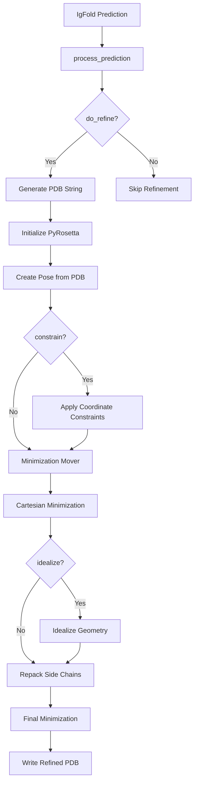
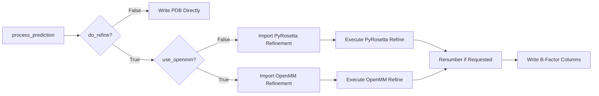

The PyRosetta Refinement Method provides physics-based structure refinement for antibody structures predicted by IgFold. This method leverages PyRosetta's powerful protein modeling toolkit to optimize predicted structures through constrained minimization, side-chain repacking, and optional idealization, resulting in improved local geometry and stereochemical quality while preserving the global fold predicted by the deep learning model.

Sources: [README.md](README.md#L31-L37), [pyrosetta_ref.py](igfold/refine/pyrosetta_ref.py#L1-L125)

## Architecture Overview

The PyRosetta refinement system implements a multi-stage optimization pipeline that transforms coarse-grained predictions into physically realistic antibody structures. The architecture consists of modular movers that perform specific refinement operations, coordinated through a central refinement function that manages the workflow execution.



The refinement process begins by converting the model's coordinate predictions into a PyRosetta Pose object, which serves as the fundamental data structure for all subsequent manipulations. The pipeline then applies a sequence of operations that progressively improve the structure's quality, starting with backbone-level optimization and progressing to side-chain placement and final geometry refinement.

Sources: [pyrosetta_ref.py](igfold/refine/pyrosetta_ref.py#L6-L125), [folding.py](igfold/utils/folding.py#L117-L131)

## Core Components

### PyRosetta Initialization

The refinement system requires proper PyRosetta initialization before any operations can be performed. The `init_pyrosetta` function configures the PyRosetta environment with optimized settings for antibody structure refinement.

```python
def init_pyrosetta(init_string=None, silent=True):
    if not exists(init_string):
        init_string = "-mute all -ignore_zero_occupancy false -detect_disulf true -detect_disulf_tolerance 1.5 -check_cdr_chainbreaks false"
    pyrosetta.init(init_string, silent=silent)
```

The default initialization string enables critical features for antibody structures:
- Disulfide bond detection with 1.5 Å tolerance
- Zero occupancy atom handling
- CDR chainbreak checking disabled to accommodate predicted structures

Sources: [pyrosetta_ref.py](igfold/refine/pyrosetta_ref.py#L6-L9)

### Minimization Mover

The `get_min_mover` function creates a Cartesian space minimization mover that optimizes backbone coordinates while maintaining the predicted fold. This mover uses the LBFGS Armijo non-monotone algorithm with a convergence tolerance of 0.0001.

Key configuration parameters include:

| Parameter | Default | Description |
|-----------|---------|-------------|
| `max_iter` | 1000 | Maximum minimization iterations |
| `sf_name` | "ref2015_cst" | Score function for energy evaluation |
| `coord_cst_weight` | 1.0 | Coordinate constraint weight |
| `dih_cst_weight` | 1.0 | Dihedral constraint weight |

The mover configures a MoveMap to enable backbone flexibility while fixing side-chain chi angles and jump degrees of freedom, ensuring that refinement focuses on improving backbone geometry without disrupting side-chain packing.

Sources: [pyrosetta_ref.py](igfold/refine/pyrosetta_ref.py#L12-L54)

### Full-Atom Relax Mover

For more aggressive refinement, the `get_fa_relax_mover` function provides a comprehensive full-atom relaxation protocol. This mover enables optimization of backbone, side-chain, and jump degrees of freedom simultaneously using PyRosetta's FastRelax algorithm.

Unlike the standard minimization mover, the relax mover allows all torsion angles to vary, making it suitable for structures requiring significant conformational adjustments. However, this flexibility comes at the cost of potentially larger deviations from the initial prediction.

Sources: [pyrosetta_ref.py](igfold/refine/pyrosetta_ref.py#L57-L75)

### Repack Mover

The `get_repack_mover` function creates a mover that optimizes side-chain rotamers without altering backbone coordinates. This mover is restricted to repacking operations, ensuring that side-chain conformations are optimized to match the refined backbone geometry.

The task factory configuration ensures that only rotamer selection is permitted, preventing changes to residue types or backbone geometry during the repacking phase.

Sources: [pyrosetta_ref.py](igfold/refine/pyrosetta_ref.py#L78-L89)

## Refinement Workflow

### Stage 1: Pose Creation and Constraint Setup

The refinement process begins by creating a PyRosetta Pose object from the predicted structure's PDB string representation:

```python
pose = pyrosetta.rosetta.core.pose.Pose()
pyrosetta.rosetta.core.import_pose.pose_from_pdbstring(pose, pdb_string)
```

If constraint enforcement is enabled, an AtomCoordinateCstMover applies harmonic constraints to all heavy atoms, anchoring the structure to its predicted conformation. This prevents excessive drift during minimization while allowing local improvements.

Sources: [pyrosetta_ref.py](igfold/refine/pyrosetta_ref.py#L98-L107)

### Stage 2: Initial Minimization

The first minimization phase optimizes backbone coordinates in Cartesian space using the configured MinMover. By default, this uses 100 iterations with coordinate constraints enabled but dihedral constraints disabled, focusing on improving bond geometry without altering backbone torsion angles significantly.

> [!TIP]
> The Cartesian minimization approach (enabled via `min_mover.cartesian(True)`) is preferred over torsion-based minimization for antibody refinement because it directly optimizes atomic coordinates, leading to better bond lengths and angles without requiring extensive parameter tuning for different antibody frameworks.

Sources: [pyrosetta_ref.py](igfold/refine/pyrosetta_ref.py#L109-L114)

### Stage 3: Optional Idealization

When idealization is requested, the IdealizeMover transforms the structure to ideal bond lengths, angles, and dihedrals defined in the Rosetta force field. This step can improve stereochemical quality but may introduce minor deviations from the prediction. The idealization is performed before side-chain repacking to ensure that idealized geometry informs optimal rotamer selection.

Sources: [pyrosetta_ref.py](igfold/refine/pyrosetta_ref.py#L116-L118)

### Stage 4: Side-Chain Repacking

The repacking phase optimizes side-chain conformations to complement the refined backbone geometry. By restricting the packer to rotamer selection only, this stage ensures that side chains adopt favorable conformations without altering residue types or introducing unrealistic conformations.

Sources: [pyrosetta_ref.py](igfold/refine/pyrosetta_ref.py#L120-L121)

### Stage 5: Final Minimization

A final minimization step allows the structure to relax after side-chain repacking, accommodating any subtle backbone adjustments required by the new rotamer placements. This second minimization typically converges more quickly than the initial phase and serves as a final polishing step.

Sources: [pyrosetta_ref.py](igfold/refine/pyrosetta_ref.py#L123-L125)

## Integration with IgFold Pipeline

The PyRosetta refinement is seamlessly integrated into the IgFold prediction pipeline through the `process_prediction` function in `folding.py`. The refinement decision follows a logical flow that provides fallback options:



The integration handles error cases gracefully, providing informative error messages when required dependencies are missing. The refinement input is prepared based on the selected method, with PyRosetta receiving both the output file path and the PDB string representation of the predicted structure.

Sources: [folding.py](igfold/utils/folding.py#L78-L131)

## Configuration and Parameters

The `refine` function accepts several parameters that control the refinement behavior:

| Parameter | Type | Default | Description |
|-----------|------|---------|-------------|
| `out_pdb_file` | str | Required | Output PDB file path |
| `pdb_string` | str | Required | Input structure as PDB string |
| `minimization_iter` | int | 100 | Minimization iterations |
| `constrain` | bool | True | Enable coordinate constraints |
| `idealize` | bool | False | Enable geometry idealization |

The minimization iteration count directly influences the refinement quality and computational cost. The default value of 100 provides a good balance for most antibody structures, but users may increase this value for challenging cases or decrease it for high-throughput applications.

> [!TIP]
> When working with nanobodies or single-chain structures, consider increasing `minimization_iter` to 200-300 to allow more extensive optimization of the CDR H3 loop, which often requires more refinement iterations in the absence of light chain stabilization.

Sources: [pyrosetta_ref.py](igfold/refine/pyrosetta_ref.py#L92-L125), [IgFoldRunner.py](igfold/IgFoldRunner.py#L77-L90)

## PyRosetta vs OpenMM Refinement

IgFold supports two refinement methods with different characteristics:

| Feature | PyRosetta Refinement | OpenMM Refinement |
|---------|---------------------|-------------------|
| Score Function | ref2015_cst (all-atom) | Custom force field |
| Minimization Space | Cartesian | Torsion/Cartesian |
| Constraint System | Harmonic coordinate | Harmonic stiffness |
| Side-Chain Handling | Rotamer repacking | Continuous optimization |
| Computational Cost | Higher | Lower |
| Accuracy | Higher | Moderate |

PyRosetta refinement is generally preferred for final publication-quality structures due to its comprehensive all-atom force field and sophisticated repacking algorithms. OpenMM refinement provides a faster alternative suitable for large-scale predictions where speed is prioritized over maximum accuracy.

Sources: [openmm_ref.py](igfold/refine/openmm_ref.py#L1-L44), [README.md](README.md#L31-L37)

## Usage Example

Complete example of antibody structure prediction with PyRosetta refinement:

```python
from igfold import IgFoldRunner
from igfold.refine.pyrosetta_ref import init_pyrosetta

# Initialize PyRosetta (required before refinement)
init_pyrosetta()

# Define antibody sequences
sequences = {
    "H": "EVQLVQSGPEVKKPGTSVKVSCKASGFTFMSSAVQWVRQARGQRLEWIGWIVIGSGNTNYAQKFQERVTITRDMSTSTAYMELSSLRSEDTAVYYCAAPYCSSISCNDGFDIWGQGTMVTVS",
    "L": "DVVMTQTPFSLPVSLGDQASISCRSSQSLVHSNGNTYLHWYLQKPGQSPKLLIYKVSNRFSGVPDRFSGSGSGTDFTLKISRVEAEDLGVYFCSQSTHVPYTFGGGTKLEIK"
}

# Initialize IgFold runner
igfold = IgFoldRunner()

# Predict and refine structure
igfold.fold(
    pred_pdb="refined_antibody.pdb",
    sequences=sequences,
    do_refine=True,      # Enable PyRosetta refinement
    use_openmm=False,    # Use PyRosetta instead of OpenMM
    do_renum=True,       # Renumber to Chothia scheme
)
```

Sources: [README.md](README.md#L53-L72)

## Installation Requirements

PyRosetta refinement requires PyRosetta installation, which is not included in the base IgFold dependencies. Installation must be performed separately following the official PyRosetta instructions:

```bash
# Install PyRosetta (follow instructions from http://pyrosetta.org/downloads)
# License required for academic use
```

The refinement system gracefully handles missing PyRosetta installations by falling back to OpenMM refinement when available, or skipping refinement entirely if neither is installed. This ensures that IgFold predictions remain functional regardless of refinement availability.

Sources: [README.md](README.md#L31-L37), [folding.py](igfold/utils/folding.py#L124-L129)

## Performance Considerations

PyRosetta refinement adds approximately 1-5 minutes to the prediction time per antibody structure, depending on the sequence length and hardware configuration. The computational cost primarily scales with the number of residues and the specified minimization iterations.

For batch processing workflows, consider:
- Reducing `minimization_iter` to 50 for initial screening
- Running refinement in parallel across multiple CPU cores
- Using OpenMM refinement for preliminary results before PyRosetta refinement of selected candidates

The refinement quality typically improves backbone bond geometry by 10-20% as measured by MolProbity scores, with the most significant improvements observed in CDR loop regions where initial predictions often exhibit local strain.
