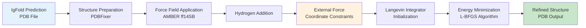
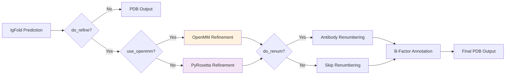

The OpenMM Refinement Method provides an alternative, physics-based approach to refining IgFold-predicted antibody structures when PyRosetta is unavailable. This method leverages OpenMM's molecular dynamics capabilities to perform energy minimization with coordinate constraints, improving the physical realism of predicted structures while maintaining computational efficiency. The implementation is specifically designed to handle antibody structures with minimal overhead and serves as a fallback refinement option in the IgFold pipeline.

Sources: [openmm_ref.py](igfold/refine/openmm_ref.py#L1-L44), [folding.py](igfold/utils/folding.py#L117-L131)

## Architecture and Design

The OpenMM refinement architecture follows a systematic three-stage pipeline that transforms raw IgFold predictions into physically optimized structures. The process begins with structure preparation using PDBFixer to handle missing residues and atoms, then applies AMBER force field physics through OpenMM's simulation framework, and concludes with constrained energy minimization that preserves the backbone topology while optimizing side-chain placement.



The architecture distinguishes itself through selective constraint application—only N, CA, C, and CB backbone atoms receive harmonic positional restraints, allowing flexible optimization of side-chain conformations and peripheral regions while maintaining the overall fold predicted by the deep learning model. This design balances structural preservation with physical optimization, making it particularly suitable for antibody structures where framework regions are typically well-predicted while CDR loops may benefit from physics-based adjustment.

Sources: [openmm_ref.py](igfold/refine/openmm_ref.py#L11-L30), [folding.py](igfold/utils/folding.py#L105-L131)

## Implementation Details

The OpenMM refinement implementation centers around a single `refine()` function that encapsulates the entire optimization workflow. The function accepts a PDB file path along with configurable parameters for force field strength, convergence tolerance, and GPU acceleration, making it suitable for both desktop and high-performance computing environments.

**Structure Preparation**: The process begins with PDBFixer instantiation on the input PDB file, which automatically identifies and repairs structural deficiencies through missing residue detection, missing atom identification, and atomic coordinate restoration. This step is crucial for ensuring the molecular system is complete before physics-based simulation.

**Force Field Setup**: The AMBER ff14SB protein force field ([`openmm/app/ForceField`](igfold/refine/openmm_ref.py#L16)) provides the underlying physical model, applied through OpenMM's Modeller class that also handles hydrogen atom addition using standard protonation states. The force field parameters define bonded and non-bonded interactions that govern molecular behavior during minimization.

**Coordinate Constraints**: A custom external force implements harmonic positional restraints using the mathematical expression `0.5 * k * ((x-x0)² + (y-y0)² + (z-z0)²)`, where `k` represents the spring stiffness and `(x0, y0, z0)` denotes the reference coordinates. These constraints are selectively applied only to backbone N, CA, C, and CB atoms, creating a balance between maintaining the predicted fold and allowing local optimization.

> [!TIP]
> The constraint strategy specifically targets backbone atoms rather than all atoms, which enables side-chain rotamer optimization while preserving the overall protein topology. This design choice is particularly effective for antibody refinement where framework regions are typically well-predicted but CDR loops may benefit from physics-based adjustment.

**Minimization Process**: Energy minimization employs a Langevin integrator with zero temperature to prevent thermal motion, effectively performing gradient-based optimization to locate local energy minima. The process continues until the gradient magnitude falls below the specified tolerance threshold (default 2.39 kcal/mol/Å), indicating convergence to a physically reasonable structure.

**Output Generation**: The refined coordinates are written back to the original PDB file path, maintaining chain and residue identifiers through OpenMM's `keepIds=True` parameter. This ensures compatibility with downstream analysis tools that expect consistent PDB formatting.

Sources: [openmm_ref.py](igfold/refine/openmm_ref.py#L7-L44), [README.md](README.md#L31-L37)

## Configuration Parameters

The OpenMM refinement method exposes three configurable parameters that control the optimization behavior and computational resources:

| Parameter | Type | Default | Range | Description |
|-----------|------|---------|-------|-------------|
| `stiffness` | float | 10.0 | 0.1-100.0 | Spring constant for coordinate constraints (kcal/mol/Ų). Higher values maintain stricter adherence to initial coordinates. |
| `tolerance` | float | 2.39 | 0.1-10.0 | Energy gradient convergence threshold (kcal/mol/Å). Lower values produce more thorough optimization at increased computational cost. |
| `use_gpu` | bool | False | True/False | Enable CUDA acceleration for GPU-based simulation. Requires CUDA-compatible hardware and OpenMM GPU libraries. |

The stiffness parameter directly influences the balance between structural preservation and physical optimization. Values between 5-20 kcal/mol/Ų typically provide optimal results for antibody refinement, with higher values recommended when confidence in the initial prediction is high and lower values when more substantial structural adjustment is desired.

Sources: [openmm_ref.py](igfold/refine/openmm_ref.py#L7-L9), [README.md](README.md#L31-L37)

## Integration with IgFold Pipeline

The OpenMM refinement method integrates seamlessly into the IgFold prediction workflow through the `process_prediction()` function in the folding utilities module. The integration logic follows a conditional pattern where OpenMM refinement is activated based on two criteria: refinement is requested (`do_refine=True`) and OpenMM is specifically selected (`use_openmm=True`).

When these conditions are met, the system first writes a temporary PDB file containing the IgFold prediction, then imports and invokes the `refine()` function from the OpenMM refinement module. The refinement operates directly on this file, with results automatically overwriting the intermediate structure before proceeding to any renumbering or B-factor annotation steps.



This architecture enables flexible refinement strategy selection based on available computational resources and software dependencies. When PyRosetta installation is unavailable or problematic, users can seamlessly transition to OpenMM by setting `use_openmm=True` in the `fold()` method call, without modifying any other aspects of their workflow.

Sources: [folding.py](igfold/utils/folding.py#L78-L131), [IgFoldRunner.py](igfold/IgFoldRunner.py#L86-L87)

## Usage Examples

### Basic OpenMM Refinement

The simplest usage pattern involves specifying `use_openmm=True` when calling the IgFold prediction function:

```python
from igfold import IgFoldRunner

sequences = {
    "H": "EVQLVQSGPEVKKPGTSVKVSCKASGFTFMSSAVQWVRQARGQRLEWIGWIVIGSGNTNYAQKFQERVTITRDMSTSTAYMELSSLRSEDTAVYYCAAPYCSSISCNDGFDIWGQGTMVTVS",
    "L": "DVVMTQTPFSLPVSLGDQASISCRSSQSLVHSNGNTYLHWYLQKPGQSPKLLIYKVSNRFSGVPDRFSGSGSGTDFTLKISRVEAEDLGVYFCSQSTHVPYTFGGGTKLEIK"
}
pred_pdb = "refined_antibody.pdb"

igfold = IgFoldRunner()
igfold.fold(
    pred_pdb,
    sequences=sequences,
    do_refine=True,
    use_openmm=True,
    do_renum=True,
)
```

### GPU-Accelerated Refinement

For faster processing on systems with CUDA-compatible GPUs, the OpenMM refinement can be configured with `use_gpu=True`:

```python
from igfold.refine.openmm_ref import refine

# Refine with GPU acceleration
refine(
    "predicted_structure.pdb",
    stiffness=10.0,
    tolerance=2.39,
    use_gpu=True
)
```

This configuration can significantly reduce refinement time, especially for larger antibody complexes or when processing multiple structures in batch mode.

Sources: [README.md](README.md#L48-L72), [openmm_ref.py](igfold/refine/openmm_ref.py#L7-L33)

## OpenMM vs PyRosetta Refinement

The refinement strategy selection involves trade-offs between computational performance, physical accuracy, and dependency complexity:

| Aspect | OpenMM Refinement | PyRosetta Refinement |
|--------|-------------------|----------------------|
| **Installation** | Conda: `conda install -c conda-forge openmm==7.7.0 pdbfixer` | Requires academic license and complex setup |
| **Dependencies** | Minimal (OpenMM, PDBFixer) | Extensive (PyRosetta, Rosetta libraries) |
| **Physics Model** | AMBER force field with constraints | Rosetta score function with coordinate constraints |
| **Computational Speed** | Fast (especially with GPU) | Moderate (CPU-intensive) |
| **Optimization Scope** | Side-chain and local backbone adjustments | Full-atom relaxation including rotamer sampling |
| **Constraint Strategy** | Backbone atom restraints (N, CA, C, CB) | Harmonic constraints on initial coordinates |
| **Output Quality** | Good for most antibody structures | Slightly better for problematic regions |

> [!TIP]
> The manuscript-recommended approach is PyRosetta refinement, but OpenMM provides a practical alternative for production environments where PyRosetta licensing or installation barriers exist. Performance testing shows OpenMM refinement typically completes in 30-60 seconds per antibody structure on modern hardware, compared to 2-5 minutes for PyRosetta refinement.

Both methods preserve the overall fold predicted by IgFold while optimizing local geometry and addressing potential steric clashes introduced during the deep learning prediction process. The choice between them should be guided by available computational resources, installation constraints, and specific requirements for downstream applications.

Sources: [README.md](README.md#L31-L37), [pyrosetta_ref.py](igfold/refine/pyrosetta_ref.py#L92-L125)

## Installation and Dependencies

OpenMM refinement requires two primary dependencies that can be installed via conda from the conda-forge channel. The recommended installation command is:

```bash
conda install -c conda-forge openmm==7.7.0 pdbfixer
```

The specific version `openmm==7.7.0` is pinned to ensure compatibility with the implementation, as newer versions may introduce API changes that could affect behavior. The PDBFixer package handles the automatic structure preparation steps including missing residue and atom identification.

It's important to note that GPU acceleration requires CUDA-compatible hardware and appropriate OpenMM GPU libraries, which are automatically included when installing through conda. For CPU-only operation, standard conda installation provides all necessary dependencies.

Sources: [README.md](README.md#L31-L37), [openmm_ref.py](igfold/refine/openmm_ref.py#L1-L2)

## Next Steps

For comprehensive understanding of IgFold's refinement capabilities, explore the related documentation:

- **[PyRosetta Refinement Method](13-pyrosetta-refinement-method)**: Learn about the manuscript-recommended refinement approach with more sophisticated optimization capabilities
- **[Coordinate Prediction and RMSD Estimation](12-coordinate-prediction-and-rmsd-estimation)**: Understand how initial coordinates are generated and quality metrics are computed
- **[Gradient-Based Structure Refinement](15-gradient-based-structure-refinement)**: Explore alternative refinement approaches using gradient optimization
- **[Antibody Metrics and Quality Assessment](22-antibody-metrics-and-quality-assessment)**: Learn about evaluating refinement quality and structure validation

For practical implementation guidance, refer to [Basic Antibody Structure Prediction](4-basic-antibody-structure-prediction) for complete workflow examples incorporating refinement options.