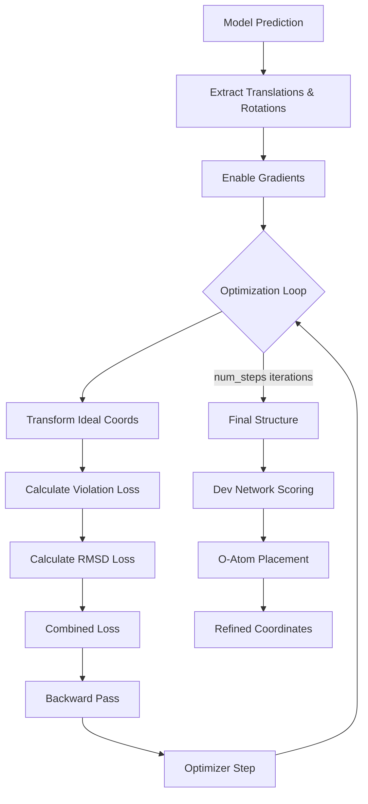

The gradient-based structure refinement in IgFold implements an elegant differentiable optimization approach that improves structural quality through iterative gradient descent on predicted coordinates. This method operates at the model output level, refining the per-residue translations and rotations that define the antibody structure before downstream classical refinement methods. Unlike PyRosetta or OpenMM refinement which work on atomic coordinates through force fields, gradient refinement operates in the learned representation space, making it both efficient and biophysically grounded through learned structural quality metrics.

Sources: [IgFold.py](igfold/model/IgFold.py#L427-L485), [folding.py](igfold/utils/folding.py#L211-L218)

## Architecture Overview

The gradient refinement system operates as a post-processing step that takes the model's predicted per-residue frames (translations and rotations) and iteratively optimizes them to satisfy structural constraints while preserving the initial prediction's geometry. This dual-objective optimization balances structural realism with fidelity to the model's predictions.

The refinement process integrates seamlessly into the prediction pipeline, being applied to each ensemble model before the best structure is selected. This allows gradient refinement to correct local structural violations that may arise from the model's implicit coordinate generation.



Sources: [IgFold.py](igfold/model/IgFold.py#L427-L485), [folding.py](igfold/utils/folding.py#L214-L216)

## Core Optimization Loop

The gradient refinement centers around optimizing the per-residue SE(3) transformations—specifically the translation vectors and rotation matrices— that map idealized local backbone coordinates to their global positions. By treating these transformations as differentiable parameters, IgFold leverages automatic differentiation to minimize structural violations.

The optimization process begins by extracting the model-predicted translations and rotations from the `IgFoldOutput`, detaching them from their computational graph, and creating new `Parameter` objects with gradients enabled. These parameters are optimized using the Adam optimizer with a learning rate of 2e-2, which has been empirically tuned for this optimization task.

Sources: [IgFold.py](igfold/model/IgFold.py#L449-L456), [IgFold.py](igfold/model/IgFold.py#L456)

> [!TIP]
> The use of Adam over SGD is critical here because the parameter space (SE(3) transformations) exhibits different curvature characteristics than standard neural network weights. Adam's adaptive learning rates help navigate the coupling between translational and rotational degrees of freedom more effectively.

In each optimization iteration, the current parameters are transformed through the `transform_ideal_coords` method. This function applies the per-residue rotations to idealized backbone coordinates (N, CA, C, CB atoms) and adds the translation vectors, producing the full 3D structure. The ideal coordinates are derived from [Engh and Huber](igfold/utils/constants.py#L3) standard geometry parameters and remain fixed throughout optimization—only the transformations are learned.

Sources: [IgFold.py](igfold/model/IgFold.py#L405-L425), [coordinates.py](igfold/utils/coordinates.py#L33-L54)

## Structural Quality Loss Functions

The violation loss function combines multiple biophysically-motivated terms that penalize structural violations. This composite loss ensures the refined structure adheres to known protein geometry constraints while maintaining the overall fold predicted by the model.

### Bond Length Loss

Bond length loss enforces that consecutive backbone atoms maintain ideal distances defined by Engh and Huber parameters. The loss computes the absolute difference between predicted bond lengths and ideal values for the N-CA, CA-C, and C-N backbone bonds:

```python
# BL_N_CA = 1.459 Å, BL_CA_C = 1.525 Å, BL_C_N = 1.336 Å
bl_loss = |pred_bond_lens - lit_bond_lens| * mask
```

The loss is masked to only apply within each sequence, ignoring padding and sequence boundaries.

Sources: [training/utils.py](igfold/training/utils.py#L194-L218), [constants.py](igfold/utils/constants.py#L5-L8)

### Bond Angle Loss

Bond angle loss penalizes deviations from ideal bond angles at the CA and C atoms. For each residue (except the first and last), the loss computes the angle between three consecutive atoms and compares it to ideal values:

- BA_CA_C_N = 117.2° (angle at C atom)
- BA_C_N_CA = 121.7° (angle at N atom)

The angular difference is computed using a cosine-based loss that handles the periodicity of angles:

```python
angle_loss = 1 - cos(pred_angle - ideal_angle)
```

This formulation avoids discontinuities at the ±180° boundary.

Sources: [training/utils.py](igfold/training/utils.py#L221-L240), [constants.py](igfold/utils/constants.py#L14-L18)

### Van der Waals Clash Loss

The VDW clash loss prevents atoms from violating steric constraints by ensuring they maintain minimum distances based on their van der Waals radii:

- VDW_N = 1.55 Å
- VDW_C = 1.7 Å

For each pair of atoms, the loss computes the violation as the positive portion of the difference between the sum of VDW radii (plus a tolerance) and the actual distance:

```python
clash = max(0, vdw_radii_sum + tolerance - atomic_distance)
```

The tolerance parameter (default 1.5 Å) allows for slight violations that may be acceptable in the context of computational protein structure prediction.

Sources: [training/utils.py](igfold/training/utils.py#L243-L260), [constants.py](igfold/utils/constants.py#L20-L22)

### Cis-Peptide Loss

The cis-peptide loss prevents the formation of cis-peptide bonds between consecutive residues. In natural proteins, peptide bonds are almost exclusively trans, with cis conformations being rare and usually associated with specific structural motifs (like proline residues preceding certain amino acids).

The loss computes the dihedral angle formed by four consecutive backbone atoms (CA[i], C[i], N[i+1], CA[i+1]) and penalizes deviations from the ideal trans configuration (180°):

```python
dihedral_loss = 1 - cos(dihedral_angle - π)
```

This term is crucial for preventing topological errors that would otherwise require global reorganization to correct.

Sources: [training/utils.py](igfold/training/utils.py#L263-L274)

### Combined Violation Loss

The final violation loss is a weighted sum of all individual components:

```python
violation_loss = bond_len_loss + bond_angle_loss + vdw_clash_loss + cis_peptide_loss
```

This multi-component approach ensures comprehensive structural quality assessment while maintaining differentiability throughout the optimization process.

Sources: [training/utils.py](igfold/training/utils.py#L277-L287)

## RMSD Preservation Term

To prevent the optimization from drifting too far from the model's predictions, the loss includes an RMSD term that maintains structural fidelity. This term computes the Kabsch-aligned mean squared error between the current coordinates and the initial (detached) prediction.

The Kabsch algorithm aligns the target structure to the prediction by finding the optimal rotation and translation that minimizes the RMSD. This alignment is crucial because small deviations in global orientation can otherwise dominate the loss. The masked version ensures only valid atoms contribute to the metric.

```python
rmsd = kabsch_mse(
    flat_coords,
    in_flat_coords,
    align_mask=batch_mask,
    mask=batch_mask,
)
```

The final loss combines both terms:

```python
loss = rmsd + viol_loss
```

> [!TIP]
> The balance between RMSD and violation loss is implicit rather than explicitly weighted. This works because the violation losses are naturally smaller in magnitude than RMSD when violations are rare, allowing the optimizer to focus on correcting genuine structural issues while preserving the overall fold.

Sources: [IgFold.py](igfold/model/IgFold.py#L467-L477), [training/utils.py](igfold/training/utils.py#L100-L136)

## Post-Refinement Processing

After completing the gradient descent iterations, the refined structure undergoes two final processing steps:

### Deviation Network Scoring

A specialized deviation network (`dev_ipa`) evaluates the refined structure's quality. This network processes the refined coordinates along with the BERT embeddings and attention maps to predict per-residue deviation scores (PRMSD). The scoring uses the same Invariant Point Attention architecture but with parameters trained to predict structural confidence rather than generating structures.

The PRMSD values are used in the ensemble selection process—when multiple models are used, the model with the lowest 90th percentile PRMSD is selected as the final output. This provides a principled way to choose among multiple predictions.

Sources: [IgFold.py](igfold/model/IgFold.py#L372-L404), [IgFold.py](igfold/model/IgFold.py#L482-L483)

### Oxygen Atom Placement

The final step places the backbone oxygen (O) atoms using geometric constraints. Since the model only predicts N, CA, C, and CB atoms, the O atoms are reconstructed based on ideal bond geometry using the `place_fourth_atom` function:

- Bond length (C-O): 1.231 Å
- Bond angle (CA-C-O): 2.108 radians (~120.8°)
- Dihedral angle (N[i]-CA[i]-C[i]-O[i]): -3.142 radians (~-180°, trans configuration)

This ensures the complete backbone is present for downstream analysis and refinement methods.

Sources: [IgFold.py](igfold/model/IgFold.py#L484-L485), [coordinates.py](igfold/utils/coordinates.py#L57-L76)

## Integration with Prediction Pipeline

Gradient refinement is automatically applied to each model in the ensemble during the `fold` function. The process occurs with gradients disabled at the model level but enabled specifically for the refinement parameters:

```python
with torch.no_grad():
    for i, model in enumerate(models):
        model_out = model(model_in)
        model_out = model.gradient_refine(model_in, model_out)
        scores.append(model_out.prmsd.quantile(0.9))
        model_outs.append(model_out)
```

This hybrid approach—no gradients for the forward pass, enabled gradients for refinement—ensures computational efficiency while allowing the flexible post-processing of predictions.

Sources: [folding.py](igfold/utils/folding.py#L211-L218)

## Configuration and Hyperparameters

The gradient refinement process uses fixed hyperparameters that have been empirically validated:

| Parameter | Value | Description |
|-----------|-------|-------------|
| `num_steps` | 80 | Number of gradient descent iterations |
| Learning Rate | 2e-2 | Adam optimizer learning rate |
| VDW Tolerance | 1.5 Å | Additional tolerance in VDW clash detection |
| RMSD Clamp | 0 (disabled) | Maximum squared RMSD contribution per atom |

These parameters balance refinement quality with computational cost. The 80-iteration optimization provides sufficient time to resolve most structural violations while keeping the runtime manageable.

Sources: [IgFold.py](igfold/model/IgFold.py#L427-L432), [IgFold.py](igfold/model/IgFold.py#L456), [training/utils.py](igfold/training/utils.py#L243-L244)

## Comparison with Classical Refinement Methods

Gradient-based refinement serves a distinct purpose compared to classical force-field methods like PyRosetta and OpenMM refinement:

| Aspect | Gradient Refinement | PyRosetta | OpenMM |
|--------|---------------------|-----------|--------|
| **Representation** | SE(3) transformations | Atomic coordinates | Atomic coordinates |
| **Objective** | Learned structural constraints | Physics-based energy | Physics-based energy |
| **Computational Cost** | Low (~seconds) | Medium (~minutes) | Medium (~minutes) |
| **Differentiable** | Yes | No | No |
| **Ideal For** | Quick structural correction | Side-chain packing | Molecular dynamics |

Gradient refinement is typically applied before classical methods, providing a quick correction of gross structural violations that classical methods would otherwise struggle to resolve efficiently. After gradient refinement, PyRosetta or OpenMM can perform more detailed optimization including side-chain placement and long-range interactions.

Sources: [IgFold.py](igfold/model/IgFold.py#L427-L485), [folding.py](igfold/utils/folding.py#L117-L131)

## Practical Considerations

The gradient refinement process is fully automatic and requires no user configuration. However, understanding its behavior is important for interpreting results:

- **No-Gradient Mode**: If gradient refinement were disabled, the model would output predictions directly without structural quality optimization. This is not recommended for most use cases.

- **Ensemble Effect**: When using multiple models, gradient refinement is applied independently to each model's prediction before selection. This allows each model to correct its own structural issues.

- **Memory Usage**: The optimization requires storing gradients for translations and rotations, which adds modest memory overhead compared to a pure inference pass.

- **Convergence**: The 80 iterations typically converge to a stable solution. The Adam optimizer's adaptive learning rates help avoid oscillation in the parameter space.
