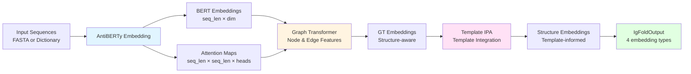
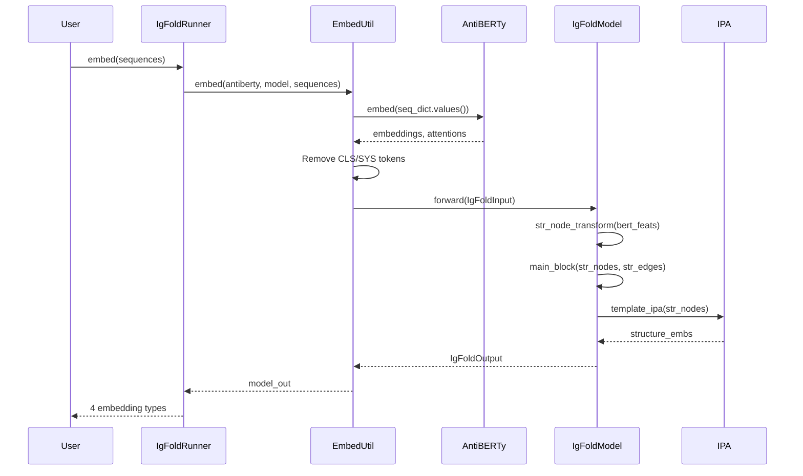

This page explains how to extract and utilize antibody sequence embeddings from IgFold for downstream machine learning tasks. IgFold provides multiple types of embeddings at different levels of representation, from raw sequence embeddings to structure-informed graph representations. These embeddings capture various aspects of antibody biology and can be used for tasks such as antibody property prediction, affinity maturation, and classification.

## Embedding Architecture Overview

IgFold's embedding pipeline combines pre-trained sequence embeddings with graph-based structure representations through a multi-stage transformation process. The pipeline generates four distinct embedding types, each capturing different levels of antibody information.



The embedding generation process leverages **AntiBERTy** for initial sequence representation, then applies graph transformers to create increasingly sophisticated representations that incorporate structural information. This hierarchical approach allows users to select embeddings appropriate for their specific ML tasks.

Sources: [embed.py](igfold/utils/embed.py#L7-L53), [IgFold.py](igfold/model/IgFold.py#L196-L370)

## Embedding Types and Characteristics

IgFold returns four distinct embedding types through the `IgFoldOutput` dataclass, each optimized for different ML applications.

| Embedding Type | Dimensions | Key Features | Best Use Cases |
|---------------|------------|--------------|----------------|
| **bert_embs** | `(batch, seq_len, 768)` | Raw AntiBERTy embeddings with CLS/SYS tokens removed | Sequence-level classification, similarity search |
| **bert_attn** | `(batch, seq_len, seq_len, 12)` | Multi-head attention maps, concatenated across heads | Residue interaction prediction, attention analysis |
| **gt_embs** | `(batch, seq_len, 512)` | Graph transformer features, structure-aware | General antibody property prediction |
| **structure_embs** | `(batch, seq_len, 512)` | Template IPA output, incorporates structural constraints | Structure-aware tasks, binding prediction |

> [!TIP]
> The `bert_embs` embeddings are processed to remove special tokens (CLS/SYS) at the start and end, resulting in per-residue representations that can be directly used for residue-level predictions. The embeddings use dimension 768 by default (AntiBERTy's hidden size), while graph transformer outputs use 512 dimensions by default.

Sources: [interface.py](igfold/model/interface.py#L8-L40), [IgFold.py](igfold/model/IgFold.py#L244-L254)

## Generating Sequence Embeddings

The primary interface for generating embeddings is the `IgFoldRunner.embed()` method, which processes antibody sequences and returns all embedding types in a structured output object.

```python
from igfold import IgFoldRunner

# Initialize the runner (uses default 4-model ensemble)
igfold = IgFoldRunner()

# Define antibody sequences
sequences = {
    "H": "EVQLVQSGPEVKKPGTSVKVSCKASGFTFMSSAVQWVRQARGQRLEWIGWIVIGSGNTNYAQKFQERVTITRDMSTSTAYMELSSLRSEDTAVYYCAAPYCSSISCNDGFDIWGQGTMVTVS",
    "L": "DVVMTQTPFSLPVSLGDQASISCRSSQSLVHSNGNTYLHWYLQKPGQSPKLLIYKVSNRFSGVPDRFSGSGSGTDFTLKISRVEAEDLGVYFCSQSTHVPYTFGGGTKLEIK"
}

# Generate embeddings
model_out = igfold.embed(
    model_idx=0,  # Use first model (default)
    sequences=sequences,
)

# Access different embedding types
bert_embeddings = model_out.bert_embs  # Raw AntiBERTy embeddings
attention_maps = model_out.bert_attn   # Attention maps
gt_embeddings = model_out.gt_embs      # Graph transformer embeddings
structure_embeddings = model_out.structure_embs  # Structure-aware embeddings

print(f"BERT embeddings shape: {bert_embeddings.shape}")
print(f"GT embeddings shape: {gt_embeddings.shape}")
```

The `embed()` method accepts either a dictionary of sequences or a FASTA file path, providing flexibility for batch processing workflows. All embeddings are returned as PyTorch tensors, enabling seamless integration with deep learning pipelines.

Sources: [IgFoldRunner.py](igfold/IgFoldRunner.py#L126-L158), [embed.py](igfold/utils/embed.py#L7-L53)

## Embedding Pipeline Internals

The embedding generation process follows a structured pipeline that transforms raw sequences into multi-scale representations.



The pipeline begins with **AntiBERTy embedding generation**, which produces contextualized sequence representations. These embeddings are preprocessed to remove special tokens and padded for uniform batch processing. The embeddings then flow through the graph transformer backbone, where node features capture residue-level information and edge features encode pairwise relationships.

The **template IPA (Invariant Point Attention)** module incorporates structural constraints from template structures when available, producing the final `structure_embs` that integrate sequence and structural information. This module uses rotation and translation representations to maintain SE(3) invariance, critical for structural modeling tasks.

Sources: [embed.py](igfold/utils/embed.py#L15-L35), [IgFold.py](igfold/model/IgFold.py#L215-L253)

## Embedding Dimensions and Shapes

Understanding the dimensional structure of each embedding type is essential for designing downstream ML architectures.

### BERT Embeddings (bert_embs)
- **Shape**: `(batch_size, total_seq_len, 768)`
- **Structure**: Per-residue representations concatenated across chains
- **Characteristics**: Purely sequence-based, no structural information

### Attention Maps (bert_attn)
- **Shape**: `(batch_size, total_seq_len, total_seq_len, 12)`
- **Structure**: Pairwise residue attention from 12 concatenated heads
- **Characteristics**: Captures residue-residue relationships learned during pretraining

### Graph Transformer Embeddings (gt_embs)
- **Shape**: `(batch_size, total_seq_len, 512)`
- **Structure**: After graph transformer main block processing
- **Characteristics**: Incorporates graph structure from attention maps

### Structure Embeddings (structure_embs)
- **Shape**: `(batch_size, total_seq_len, 512)`
- **Structure**: After template IPA integration
- **Characteristics**: Structure-aware, incorporates template information if available

> [!TIP]
> For multi-chain antibodies (e.g., paired heavy-light chains), the `total_seq_len` equals the sum of individual chain lengths. The embeddings maintain the chain order from the input dictionary, enabling downstream analysis of specific chains by indexing into the appropriate sequence range.

Sources: [IgFold.py](igfold/model/IgFold.py#L209-L253), [interface.py](igfold/model/interface.py#L12-L40)

## Practical ML Applications

### Residue-Level Property Prediction
Use `bert_embs` or `gt_embs` for per-residue classification tasks such as paratope identification or epitope prediction:

```python
import torch
import torch.nn as nn

class ParatopePredictor(nn.Module):
    def __init__(self, input_dim=768, hidden_dim=256):
        super().__init__()
        self.classifier = nn.Sequential(
            nn.Linear(input_dim, hidden_dim),
            nn.ReLU(),
            nn.Dropout(0.3),
            nn.Linear(hidden_dim, 1),
            nn.Sigmoid()
        )
    
    def forward(self, embeddings):
        return self.classifier(embeddings).squeeze(-1)

# Use with IgFold embeddings
igfold = IgFoldRunner()
model_out = igfold.embed(sequences=sequences)
predictor = ParatopePredictor()
paratope_scores = predictor(model_out.bert_embs)
```

### Antibody Similarity and Clustering
Leverage attention maps or embeddings for antibody similarity analysis:

```python
from sklearn.metrics.pairwise import cosine_similarity

# Compare two antibodies
seq1 = {"H": "EVQLVQSGPEVKKPGTSVKVSCKASGFTFMSSAVQWVRQARGQRLEWIGWIVIGSGNTNYAQKFQERVTITRDMSTSTAYMELSSLRSEDTAVYYCAAPYCSSISCNDGFDIWGQGTMVTVS", "L": "DVVMTQTPFSLPVSLGDQASISCRSSQSLVHSNGNTYLHWYLQKPGQSPKLLIYKVSNRFSGVPDRFSGSGSGTDFTLKISRVEAEDLGVYFCSQSTHVPYTFGGGTKLEIK"}
seq2 = {"H": "EVQLVESGGGLVQPGGSLRLSCAASGFTFSSYGMHWVRQAPGKGLEWVSAISGSGGSTYYADSVKGRFTISRDNAKNTLYLQMNSLRAEDTAVYYCARWGQGTTVTVSS", "L": "DVVMTQTPLSLPVSLGDQASISCRSSQSLVHSNGNTYLHWYLQKPGQSPKLLIYKVSNRFSGVPDRFSGSGSGTDFTLKISRVEAEDLGVYFCSQSTHVPYTFGGGTKLEIK"}

out1 = igfold.embed(sequences=seq1)
out2 = igfold.embed(sequences=seq2)

# Mean-pool embeddings to get antibody-level representations
emb1 = out1.bert_embs.mean(dim=1)  # (batch, 768)
emb2 = out2.bert_embs.mean(dim=1)  # (batch, 768)

# Compute cosine similarity
similarity = cosine_similarity(emb1.detach().numpy(), emb2.detach().numpy())
print(f"Antibody similarity: {similarity[0,0]:.3f}")
```

### Binding Affinity Regression
Use `structure_embs` for tasks requiring structural awareness:

```python
class AffinityPredictor(nn.Module):
    def __init__(self):
        super().__init__()
        self.aggregator = nn.AdaptiveAvgPool1d(1)
        self.regressor = nn.Sequential(
            nn.Linear(512, 256),
            nn.ReLU(),
            nn.Linear(256, 1)
        )
    
    def forward(self, structure_embs):
        # Global average pooling
        pooled = self.aggregator(structure_embs.transpose(1, 2)).squeeze(-1)
        return self.regressor(pooled)
```

Sources: [IgFoldRunner.py](igfold/IgFoldRunner.py#L126-L158), [interface.py](igfold/model/interface.py#L8-L40)

## Batch Processing for Large Datasets

For large-scale embedding generation, process multiple antibodies efficiently using FASTA files:

```python
from pathlib import Path

# Create FASTA file with multiple antibodies
fasta_content = """>antibody_1
EVQLVQSGPEVKKPGTSVKVSCKASGFTFMSSAVQWVRQARGQRLEWIGWIVIGSGNTNYAQKFQERVTITRDMSTSTAYMELSSLRSEDTAVYYCAAPYCSSISCNDGFDIWGQGTMVTVS
DVVMTQTPFSLPVSLGDQASISCRSSQSLVHSNGNTYLHWYLQKPGQSPKLLIYKVSNRFSGVPDRFSGSGSGTDFTLKISRVEAEDLGVYFCSQSTHVPYTFGGGTKLEIK
>antibody_2
QVQLQESGGGLVQAGGSLTLSCAVSGLTFSNYAMGWFRQAPGKEREFVAAITWDGGNTYYTDSVKGRFTISRDNAKNTVFLQMNSLKPEDTAVYYCAAKLLGSSRYELALAGYDYWGQGTQVTVS
"""

fasta_path = "antibodies.fasta"
Path(fasta_path).write_text(fasta_content)

# Process embeddings (Note: embed() currently processes one antibody at a time)
igfold = IgFoldRunner()

# For multiple antibodies, loop through them or use sequence dictionaries
all_embeddings = {}
for antibody_id in ["antibody_1", "antibody_2"]:
    # Extract specific sequences from FASTA or process separately
    model_out = igfold.embed(fasta_file=fasta_path, sequences={...})
    all_embeddings[antibody_id] = model_out.bert_embs
```

For truly large-scale processing, consider implementing batch embedding by modifying the input preparation to handle multiple sequences simultaneously, leveraging the existing batch processing capabilities in the model.

Sources: [embed.py](igfold/utils/embed.py#L8-L20), [folding.py](igfold/utils/folding.py)

## Template Integration in Embeddings

When template structures are provided, the embedding pipeline incorporates structural information through the template IPA module, enhancing embeddings for structure-aware tasks:

```python
# Generate embeddings with template guidance
model_out = igfold.embed(
    sequences=sequences,
    template_pdb="template_structure.pdb",  # Optional template structure
    ignore_cdrs=["H3"],  # Optionally ignore specific CDRs in template
    ignore_chain=None
)

# The structure_embs will now incorporate template information
print(f"Structure embeddings (with template): {model_out.structure_embs.shape}")
```

The template integration process extracts coordinate features from the provided PDB structure and aligns them with the target sequence. Template coordinates are centered and masked appropriately, with CDR regions optionally excluded if specified. This allows the model to leverage homologous structure information when available while maintaining flexibility for novel antibodies.

Sources: [embed.py](igfold/utils/embed.py#L10-L15), [IgFold.py](igfold/model/IgFold.py#L114-L143)

## Performance Considerations

- **Embedding Dimensionality**: BERT embeddings (768-dim) contain richer sequence information than graph transformer outputs (512-dim), but require more memory
- **Computation Overhead**: Structure embeddings require additional IPA processing; use `bert_embs` for purely sequence-based tasks to reduce computation
- **Batch Size**: The model processes embeddings with shape `(batch, seq_len, dim)`. For long antibodies (>500 residues), consider using smaller batch sizes or gradient accumulation
- **GPU Memory**: Attention maps (`bert_attn`) scale quadratically with sequence length (`seq_len²`). For very long sequences, consider using only embeddings or extracting attention for specific regions

Sources: [IgFold.py](igfold/model/IgFold.py#L209-L220)

## Next Steps

To deepen your understanding of IgFold's embedding capabilities and applications:

- **Learn how embeddings are generated from sequences**: [Sequence Input and Embedding Pipeline](9-sequence-input-and-embedding-pipeline)
- **Understand the graph transformer architecture**: [Graph Transformer Components](7-graph-transformer-components)
- **Explore the IPA mechanism for structure embeddings**: [Invariant Point Attention (IPA) Implementation](8-invariant-point-attention-ipa-implementation)
- **Use embeddings in large-scale workflows**: [Large-Scale Batch Prediction](18-large-scale-batch-prediction)
- **Combine multiple model predictions**: [Multi-Model Ensemble Prediction](17-multi-model-ensemble-prediction)
