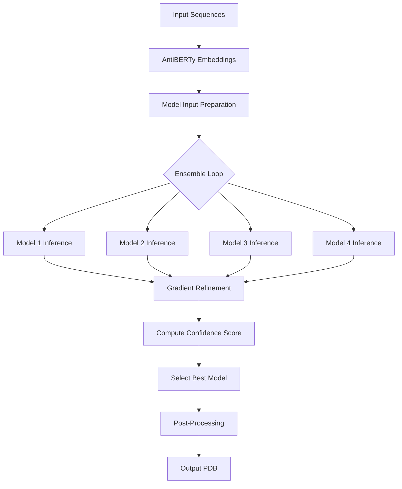

IgFold employs a robust ensemble prediction strategy that leverages multiple independently trained models to improve structural prediction reliability and confidence estimation. This approach enables **model diversity** through different training initializations while maintaining efficient inference through selective model usage, providing developers with a flexible framework for antibody structure prediction.

## Ensemble Architecture and Configuration

The ensemble system is implemented through the `IgFoldRunner` class, which manages loading and orchestration of multiple pre-trained IgFold models. By default, IgFold loads **4 ensemble models** (configurable range 1-4), each trained independently to capture diverse structural patterns in antibody data. The ensemble system supports two configuration modes: using the default pre-trained model set or providing **custom checkpoint paths** via the `model_ckpts parameter`. When using default models, the system automatically discovers checkpoint files from the `trained_models/IgFold/*.ckpt` directory pattern and sorts them for consistent loading.

Sources: [igfold/IgFoldRunner.py](igfold/IgFoldRunner.py#L26-L65)

The ensemble initialization process validates the `num_models parameter` (enforcing 1-4 range) and loads each model into GPU memory if available, storing them in the `self.models` list for sequential inference. Each model operates independently in **inference mode** (`.eval()`), sharing the same AntiBERTy embedding model that provides sequence representations as input to the structure prediction pipeline.

Sources: [igfold/IgFoldRunner.py](igfold/IgFoldRunner.py#L66-L76)

```python
# Ensemble configuration example
from igfold import IgFoldRunner

# Default 4-model ensemble
igfold = IgFoldRunner(num_models=4)

# Custom model checkpoints
igfold = IgFoldRunner(
    model_ckpts=["model1.ckpt", "model2.ckpt", "model3.ckpt"]
)

# Single model for faster inference
igfold = IgFoldRunner(num_models=1)
```

## Ensemble Inference Pipeline

The core ensemble inference executes in the `fold()` function within `igfold/utils/folding.py`, implementing a **best-of-N selection strategy** based on confidence metrics. Each ensemble model generates complete structure predictions, including gradient-based refinement, producing independent structural hypotheses with associated confidence scores.

Sources: [igfold/utils/folding.py](igfold/utils/folding.py#L208-L219)

The inference process follows this sequential pattern:



Each model processes the **same input representation** (AntiBERTy embeddings and attention patterns) but generates independent structural predictions due to learned weight differences from separate training runs. This diversity captures alternative plausible conformations for challenging antibody regions, particularly CDR loops where structural uncertainty is highest.

Sources: [igfold/utils/folding.py](igfold/utils/folding.py#L153-L219)

## Confidence-Based Model Selection

The ensemble employs a **quantile-based confidence metric** to select the optimal prediction among ensemble members. Each model produces per-residue predicted RMSD (`prmsd`) values through the structure scoring network, which estimates local coordinate error. The system computes the **90th percentile quantile** of these per-residue predictions, representing a conservative estimate of overall model confidence. The model with the minimum quantile score is selected as the final output.

Sources: [igfold/utils/folding.py](igfold/utils/folding.py#L217-L219)

> [!TIP]
> The 90th percentile quantile selection strategy prioritizes robust performance by focusing on the worst-case local errors rather than average metrics. This approach is particularly valuable for antibody applications where regional accuracy (e.g., CDR loops) matters more than global fit to experimental structures.

The selection algorithm:

```python
# From igfold/utils/folding.py
model_outs, scores = [], []
with torch.no_grad():
    for i, model in enumerate(models):
        model_out = model(model_in)
        model_out = model.gradient_refine(model_in, model_out)
        scores.append(model_out.prmsd.quantile(0.9))  # 90th percentile
        model_outs.append(model_out)

best_model_i = scores.index(min(scores))
model_out = model_outs[best_model_i]
```

Sources: [igfold/utils/folding.py](igfold/utils/folding.py#L208-L223)

## Gradient-Based Refinement Integration

Each ensemble model includes **individual gradient refinement** before scoring, ensuring that confidence metrics reflect optimized rather than raw predictions. The gradient refinement process (80 steps of Adam optimization) treats translations and rotations as learnable parameters, minimizing violation loss while maintaining proximity to initial predictions. This refinement is applied to **all ensemble members equally**, ensuring fair comparison during model selection.

Sources: [igfold/model/IgFold.py](igfold/model/IgFold.py#L427-L488)

The refinement objective combines two loss components:
- **Kabsch MSE**: Maintains alignment with initial coordinate predictions
- **Violation loss**: Penalizes structural steric clashes and geometric violations

Sources: [igfold/model/IgFold.py](igfold/model/IgFold.py#L456-L466)

<CgxTip>Since each model undergoes independent gradient refinement from different initializations, ensemble diversity is preserved even after optimization. The refinement process converges to local minima specific to each model's structural prior, resulting in multiple refined hypotheses rather than converged identical structures.</cgp_tip>

## Configuration Options and Trade-offs

The ensemble system offers configurable model counts to balance accuracy against computational resources:

| Configuration | Models | Inference Speed | Accuracy | Memory | Use Case |
|--------------|--------|----------------|----------|---------|----------|
| num_models=1 | 1 | Fastest | Baseline | Lowest | Quick screening, resource-constrained |
| num_models=2 | 2 | Fast | Improved | Low | Standard prediction |
| num_models=3 | 3 | Moderate | Better | Medium | High-throughput quality prediction |
| num_models=4 | 4 | Slowest | Best | Highest | Production-quality predictions |

Sources: [igfold/IgFoldRunner.py](igfold/IgFoldRunner.py#L30-L43)

For production applications, the default 4-model ensemble provides the most robust predictions through maximum model diversity. For large-scale batch processing scenarios, reducing to 2-3 models offers a favorable trade-off between throughput and accuracy. The 1-model configuration is primarily useful for debugging or rapid prototyping where prediction speed takes priority over confidence optimization.

Sources: [igfold/IgFoldRunner.py](igfold/IgFoldRunner.py#L30-L43)

## Accessing Ensemble Results

While the system automatically selects the best model for output, developers can modify the inference pipeline to access all ensemble predictions if desired for downstream applications. The current implementation returns only the selected model output through the `fold()` method, with the selected model's per-residue RMSD predictions stored in the B-factor column of the output PDB file.

Sources: [igfold/utils/folding.py](igfold/utils/folding.py#L220-L232)

For applications requiring ensemble analysis (such as uncertainty quantification across models), developers can modify the `fold()` function to return all `model_outs` and `scores` rather than just the selected best model. This enables custom selection strategies or ensemble averaging approaches tailored to specific use cases.

Sources: [igfold/utils/folding.py](igfold/utils/folding.py#L208-L232)

## Next Steps

The ensemble prediction system integrates with several advanced IgFold features for complete antibody structure workflows:

- **PyRosetta Refinement Method** - Apply physics-based refinement after ensemble selection for further structural optimization
- **OpenMM Refinement Method** - Alternative physics-based refinement using OpenMM force fields
- **Large-Scale Batch Prediction** - Efficiently process multiple antibody sequences using ensemble predictions
- **Antibody Metrics and Quality Assessment** - Evaluate predicted structures using domain-specific quality metrics