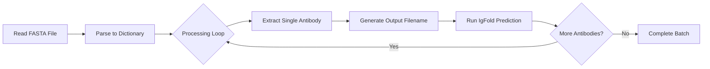

Large-scale batch prediction enables efficient structural analysis of thousands to millions of antibody sequences, essential for antibody library screening, repertoire analysis, and drug discovery pipelines. This guide explains how to implement scalable prediction workflows using IgFold's modular architecture, covering batch processing strategies, performance optimization, and practical implementation patterns for processing massive antibody sequence datasets.

Sources: [README.md](README.md#L189-L200)

## Batch Processing Architecture

IgFold's architecture supports large-scale prediction through iterative processing of individual antibody structures. The core `IgFoldRunner` class provides the fundamental `fold()` and `embed()` methods that handle single structures, which can be orchestrated through external scripting to process batches efficiently. The runner loads multiple pre-trained models (up to 4) and selects predictions based on the lowest predicted RMSD (90th percentile of per-residue RMSD), enabling high-throughput applications with quality assurance built-in.


Sources: [IgFoldRunner.py](igfold/IgFoldRunner.py#L26-L76), [folding.py](igfold/utils/folding.py#L212-L230)

## FASTA File Parsing for Batch Processing

Efficient batch processing begins with parsing multiple antibody sequences from FASTA format files. The `get_fasta_chain_dict()` utility function extracts all sequences from a FASTA file, returning a dictionary mapping chain identifiers to amino acid sequences. Each entry in the FASTA file can represent either paired antibodies (H and L chains) or single-chain antibodies (H chain for nanobodies or L chain alone), providing flexibility for diverse antibody formats in large-scale applications.

```python
from igfold.utils.fasta import get_fasta_chain_dict
from Bio import SeqIO

# Parse multiple antibodies from a multi-record FASTA file
seq_dict = get_fasta_chain_dict("large_antibody_library.fasta")
# Returns: {"H:AB001": "EVQLV...TVS", "L:AB001": "DVVMT...KIK", "H:AB002": "...", ...}
```

Sources: [fasta.py](igfold/utils/fasta.py#L13-L18)

## Sequential Batch Processing Strategy

The simplest approach to batch prediction involves iterating through antibody sequences and processing them sequentially. This method provides minimal overhead and maximum control over individual predictions. Each iteration creates a separate PDB file using the antibody identifier from the FASTA header, with options to skip refinement and renumbering for faster processing in exploratory phases of large-scale analysis.



```python
from igfold import IgFoldRunner
from igfold.utils.fasta import get_fasta_chain_dict
import os

# Initialize IgFold once for all predictions
igfold = IgFoldRunner(num_models=2)  # Use 2 models for faster batch processing

# Parse all sequences from batch file
seq_dict = get_fasta_chain_dict("antibody_batch.fasta")

# Process each antibody
for record_id, seq in seq_dict.items():
    # Extract chain and antibody identifier
    parts = record_id.split(":")
    chain_id = parts[0] if len(parts) > 1 else "H"
    antibody_id = parts[1] if len(parts) > 1 else record_id
    
    # Create chain-specific dictionary
    chain_dict = {chain_id: seq}
    
    # Generate output filename
    output_pdb = f"predictions/{antibody_id}_{chain_id}.pdb"
    os.makedirs("predictions", exist_ok=True)
    
    # Run prediction (skip refinement for speed)
    try:
        igfold.fold(
            output_pdb,
            sequences=chain_dict,
            do_refine=False,  # Faster for large batches
            do_renum=False,
        )
        print(f"Completed: {antibody_id}")
    except Exception as e:
        print(f"Failed: {antibody_id} - {str(e)}")
```

Sources: [IgFoldRunner.py](igfold/IgFoldRunner.py#L77-L124), [folding.py](igfold/utils/folding.py#L168-L189)

## Parallel Batch Processing with Multiprocessing

For optimal throughput on multi-core systems, parallel processing leverages Python's multiprocessing to distribute predictions across CPU cores. Each worker process initializes its own `IgFoldRunner` instance to avoid thread safety issues with model loading and GPU access. This approach scales linearly with core count (up to GPU saturation) and is ideal for large-scale batches where processing time dominates overhead.

> [!TIP]
> When implementing parallel processing with GPU acceleration, ensure each worker process either uses CPU-only mode or coordinates GPU access to prevent memory contention. Set `try_gpu=False` for CPU-only workers or implement GPU serialization for efficient multi-process GPU utilization.

```python
from igfold import IgFoldRunner
from igfold.utils.fasta import get_fasta_chain_dict
from multiprocessing import Pool, cpu_count
import os

def predict_antibody(args):
    """Worker function for parallel processing"""
    chain_id, seq, antibody_id = args
    
    # Initialize worker-specific IgFold instance
    try_gpu = os.getenv("WORKER_GPU", "False").lower() == "true"
    igfold = IgFoldRunner(num_models=2, try_gpu=try_gpu)
    
    output_pdb = f"predictions/{antibody_id}_{chain_id}.pdb"
    os.makedirs("predictions", exist_ok=True)
    
    try:
        igfold.fold(
            output_pdb,
            sequences={chain_id: seq},
            do_refine=False,
            do_renum=False,
        )
        return antibody_id, "success"
    except Exception as e:
        return antibody_id, f"failed: {str(e)}"

# Prepare batch data
seq_dict = get_fasta_chain_dict("large_antibody_library.fasta")
tasks = []
for record_id, seq in seq_dict.items():
    parts = record_id.split(":")
    chain_id = parts[0] if len(parts) > 1 else "H"
    antibody_id = parts[1] if len(parts) > 1 else record_id
    tasks.append((chain_id, seq, antibody_id))

# Run parallel predictions
num_workers = min(cpu_count() - 1, len(tasks))
with Pool(processes=num_workers) as pool:
    results = pool.map(predict_antibody, tasks)

# Report results
for antibody_id, status in results:
    print(f"{antibody_id}: {status}")
```

Sources: [IgFoldRunner.py](igfold/IgFoldRunner.py#L30-L75), [IgFoldRunner.py](igfold/IgFoldRunner.py#L77-L124)

## Performance Optimization Parameters

Large-scale batch processing requires careful parameter tuning to balance prediction accuracy with computational efficiency. The following table summarizes key optimization parameters and their impact on throughput and quality:

| Parameter | Options | Throughput Impact | Quality Impact | Recommended for Large Batches |
|-----------|---------|------------------|----------------|------------------------------|
| `num_models` | 1-4 | Linear decrease | Higher with ensembles | 1-2 for screening, 4 for final selection |
| `do_refine` | True/False | 3-5x faster | Improved geometry | False for initial screening |
| `do_renum` | True/False | Minimal impact | No structural change | False unless Chothia numbering required |
| `use_openmm` | True/False | Comparable to PyRosetta | Different refinement philosophy | True if PyRosetta unavailable |
| `try_gpu` | True/False | 2-3x GPU vs CPU | No impact | True if available |

```python
# Fast screening mode (millions of antibodies)
igfold_fast = IgFoldRunner(num_models=1, try_gpu=True)
igfold_fast.fold(output_pdb, sequences=seqs, do_refine=False, do_renum=False)

# High-quality mode (thousands of antibodies)
igfold_quality = IgFoldRunner(num_models=4, try_gpu=True)
igfold_quality.fold(output_pdb, sequences=seqs, do_refine=True, do_renum=True)
```

Sources: [IgFoldRunner.py](igfold/IgFoldRunner.py#L30-L75), [folding.py](igfold/utils/folding.py#L153-L167)

## Batch Embedding for Machine Learning Workflows

Beyond structure prediction, large-scale batch processing supports sequence embedding extraction for machine learning applications. The `embed()` method generates three types of representations: AntiBERTy embeddings from the language model (512 dimensions), graph transformer embeddings after geometric processing (64 dimensions), and structure embeddings incorporating template information (64 dimensions). These embeddings can be efficiently computed in batches for downstream ML pipelines.

```python
from igfold import IgFoldRunner
from igfold.utils.fasta import get_fasta_chain_dict
import numpy as np

igfold = IgFoldRunner(num_models=1, try_gpu=True)
seq_dict = get_fasta_chain_dict("antibody_batch.fasta")

# Storage for embeddings
all_bert_embs = []
all_gt_embs = []
all_structure_embs = []

# Batch embed sequences
for record_id, seq in seq_dict.items():
    parts = record_id.split(":")
    chain_id = parts[0] if len(parts) > 1 else "H"
    
    # Get embedding from single chain
    emb = igfold.embed(sequences={chain_id: seq})
    
    # Extract embeddings (squeeze batch dimension)
    all_bert_embs.append(emb.bert_embs.squeeze(0).detach().cpu().numpy())
    all_gt_embs.append(emb.gt_embs.squeeze(0).detach().cpu().numpy())
    all_structure_embs.append(emb.structure_embs.squeeze(0).detach().cpu().numpy())

# Save embeddings for ML pipeline
np.savez("antibody_embeddings.npz",
         bert_embs=all_bert_embs,
         gt_embs=all_gt_embs,
         structure_embs=all_structure_embs,
         record_ids=list(seq_dict.keys()))
```

Sources: [IgFoldRunner.py](igfold/IgFoldRunner.py#L126-L158), [embed.py](igfold/utils/embed.py#L7-L17)

## Error Handling and Recovery Strategies

Robust large-scale batch processing requires comprehensive error handling to manage prediction failures gracefully. Common failure modes include invalid sequences, memory limitations, and refinement tool incompatibilities. Implementing retry logic, logging, and checkpointing ensures batch jobs can resume from interruptions and track problematic sequences for subsequent analysis.

> [!TIP]
> Implement a CSV-based checkpoint system that records processed antibody IDs and their status. This enables batch jobs to resume from interruptions without reprocessing completed antibodies, critical for multi-day prediction campaigns on large datasets.

```python
from igfold import IgFoldRunner
from igfold.utils.fasta import get_fasta_chain_dict
import csv
import os
import time

# Checkpoint file
checkpoint_file = "batch_checkpoint.csv"

def load_checkpoint():
    """Load processed antibody IDs from checkpoint"""
    processed = set()
    if os.path.exists(checkpoint_file):
        with open(checkpoint_file, "r") as f:
            reader = csv.reader(f)
            next(reader)  # Skip header
            for row in reader:
                if row[1] == "success":
                    processed.add(row[0])
    return processed

def save_checkpoint(antibody_id, status):
    """Update checkpoint with antibody status"""
    with open(checkpoint_file, "a", newline="") as f:
        writer = csv.writer(f)
        writer.writerow([antibody_id, status, time.strftime("%Y-%m-%d %H:%M:%S")])

def predict_with_retry(igfold, antibody_id, chain_dict, output_pdb, max_retries=3):
    """Predict antibody with retry logic"""
    for attempt in range(max_retries):
        try:
            igfold.fold(
                output_pdb,
                sequences=chain_dict,
                do_refine=False,
                do_renum=False,
            )
            return "success"
        except RuntimeError as e:
            if "CUDA out of memory" in str(e):
                time.sleep(30)  # Wait for GPU memory to clear
                continue
            return f"failed: {str(e)}"
        except Exception as e:
            return f"failed: {str(e)}"
    return "failed: max retries exceeded"

# Initialize checkpoint
processed = load_checkpoint()
if not os.path.exists(checkpoint_file):
    with open(checkpoint_file, "w", newline="") as f:
        writer = csv.writer(f)
        writer.writerow(["antibody_id", "status", "timestamp"])

# Process batch with checkpointing
igfold = IgFoldRunner(num_models=1, try_gpu=True)
seq_dict = get_fasta_chain_dict("large_antibody_library.fasta")

for record_id, seq in seq_dict.items():
    parts = record_id.split(":")
    chain_id = parts[0] if len(parts) > 1 else "H"
    antibody_id = parts[1] if len(parts) > 1 else record_id
    
    # Skip if already processed
    if antibody_id in processed:
        continue
    
    # Process antibody
    chain_dict = {chain_id: seq}
    output_pdb = f"predictions/{antibody_id}_{chain_id}.pdb"
    os.makedirs("predictions", exist_ok=True)
    
    status = predict_with_retry(igfold, antibody_id, chain_dict, output_pdb)
    save_checkpoint(antibody_id, status)
    
    print(f"{antibody_id}: {status}")
```

Sources: [IgFoldRunner.py](igfold/IgFoldRunner.py#L77-L124), [folding.py](igfold/utils/folding.py#L153-L232)

## Real-World Large-Scale Applications

IgFold has been validated on massive antibody datasets, demonstrating scalability to millions of structures. The original work predicted 104,000 non-redundant paired antibody sequences from the Observed Antibody Space (OAS) database and 1.3 million unique paired antibodies from four human donors in the Jaffe et al. study. These large-scale predictions serve as valuable resources for structural antibody repertoire analysis and epitope mapping studies, accessible through public data repositories.

```bash
# Download pre-computed large-scale prediction datasets
wget https://data.graylab.jhu.edu/OAS_paired.tar.gz  # 104K structures
wget https://data.graylab.jhu.edu/Jaffe2022.tar.gz  # 1.3M structures
```

These pre-computed datasets provide benchmarks for evaluating batch processing implementations and serve as training data for downstream machine learning models.
