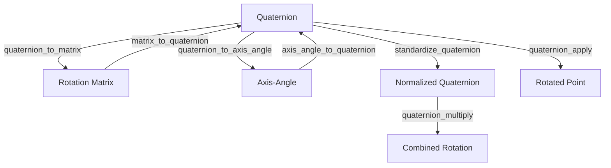
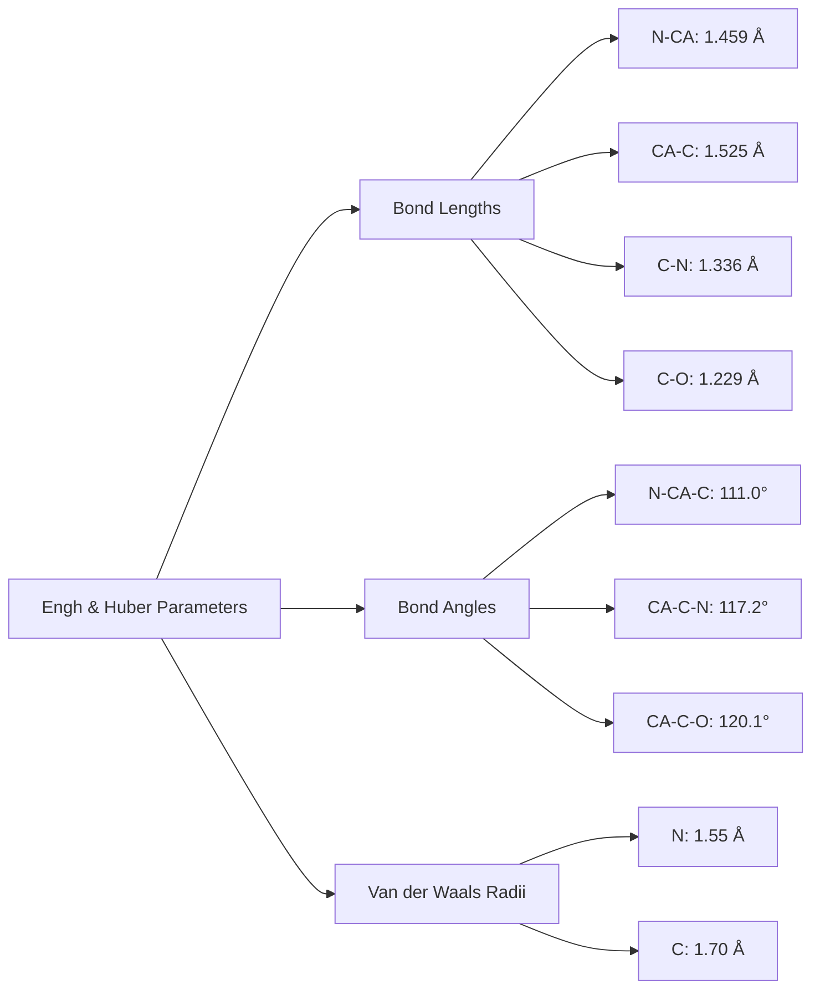

This page provides a comprehensive overview of IgFold's coordinate geometry and transformation infrastructure. The geometric utilities form the foundation for antibody structure prediction, enabling precise manipulation of 3D atomic coordinates, internal coordinate calculations, and rotation transformations essential for backbone and side-chain positioning. These functions operate on PyTorch tensors, supporting both batched and single-structure computations while maintaining numerical stability through careful epsilon handling.

Sources: [coordinates.py](igfold/utils/coordinates.py#L1-L76), [geometry.py](igfold/utils/geometry.py#L1-L77), [transforms.py](igfold/utils/transforms.py#L1-L521)

## Geometric Primitives

The geometric primitives module provides fundamental operations for 3D vector mathematics, all designed with batch processing capabilities and numerical stability through epsilon (EPS=1e-6) handling. These functions operate on tensors with arbitrary leading dimensions, making them suitable for processing multiple structures simultaneously.

### Vector Normalization

The `normed_vec` function normalizes vectors while handling potential numerical instabilities through epsilon addition to prevent division by zero. It computes the Euclidean norm across the last dimension and returns unit vectors in the same shape as the input.

Sources: [geometry.py](igfold/utils/geometry.py#L7-L14)

### Distance Calculations

Two primary distance functions serve different use cases: `dist` computes pairwise Euclidean distance between two point sets, while `dist_mat` generates pairwise distance matrices between collections of points. The distance matrix operation is particularly useful for spatial relationship analysis in protein structures.

Sources: [geometry.py](igfold/utils/geometry.py#L23-L37)

### Angular Measurements

The geometric framework includes robust angle and dihedral angle calculations:

- **`angle`**: Computes the angle between three points (x₁-x₂-x₃) using the arccosine of the dot product between normalized vectors, returning values in radians
- **`dihedral`**: Calculates the torsion angle through four points using the cross-product method, which provides better numerical stability than direct arccosine calculations

The dihedral angle calculation constructs two normal vectors to adjacent planes and uses atan2 for unambiguous angle determination across the full [−π, π] range.

Sources: [geometry.py](igfold/utils/geometry.py#L38-L59)

## Coordinate Frame Transformations

The `coords_to_frame` function establishes local coordinate systems for each residue based on backbone atoms. This transformation is critical for invariant point attention and structure-aware operations. Given N, CA, C, and O backbone atoms, it constructs an orthonormal basis where:

- n₁ points from CA to N (normalized)
- n₂ is the cross product of n₁ and CA→C (normalized), representing the plane normal
- n₃ is the cross product of n₁ and n₂, completing the right-handed coordinate system

The function returns both the CA atom positions (origin points) and the rotation matrices defining each residue's local frame. For 3D input tensors with shape (batch, seq, 4, 3), it automatically restructures coordinates to the expected (batch, seq, atoms, 3) format.

Sources: [geometry.py](igfold/utils/geometry.py#L61-L77)

> [!TIP]
> The coordinate frame transformation is fundamental to IgFold's ability to process structure information in a rotation-invariant manner. By converting absolute coordinates to residue-local frames, the model can focus on relative orientations rather than absolute positions.

## Internal Coordinate Placement

IgFold supports internal coordinate representation, enabling reconstruction of atomic positions from bond lengths, bond angles, and dihedral angles. This approach is essential for:

1. Generating idealized backbone conformations
2. Placing missing atoms (oxygen in backbone)
3. Constructing coordinate-aware inputs for the neural network

### Fourth Atom Placement

The `place_fourth_atom` function implements the classic internal coordinate reconstruction algorithm. Given three existing atomic positions (a_coord, b_coord, c_coord) plus geometric parameters (length, planar angle, dihedral angle), it computes the position of a fourth atom through the following mathematical procedure:

1. Normalize the BC vector as the primary axis
2. Construct a normal vector using the cross product of (b→a) and BC
3. Build an orthonormal basis [bc_vec, n_vec×bc_vec, n_vec]
4. Compute the displacement vector in this basis using spherical coordinates
5. Add the displacement to c_coord to obtain the final position

This function handles batched inputs, enabling efficient reconstruction of multiple atoms simultaneously.

Sources: [coordinates.py](igfold/utils/coordinates.py#L4-L31)

### Ideal Backbone Coordinates

The `get_ideal_coords` function generates an idealized protein backbone fragment using standard bond lengths and angles from Engh and Huber parameters. Starting from an N atom at (0, 0, −1.458), it constructs:

- N at origin-relative position
- A (CA) at (0, 0, 0) as the reference
- C using internal coordinates (length=2.460 Å, planar=0.615 rad, dihedral=-2.143 rad)
- B (CB) at (0, 1.426, 0.531)

The optional `center` parameter shifts coordinates to have zero mean, useful for training invariant representations.

Sources: [coordinates.py](igfold/utils/coordinates.py#L33-L55)

### Oxygen Atom Placement

The `place_o_coords` function adds backbone oxygen atoms to coordinate tensors. For each residue, it positions the O atom based on the preceding residue's N atom and the current residue's C and CA atoms, using standard geometric parameters (length=1.231 Å, planar=2.108 rad, dihedral=-3.142 rad). The function processes batched tensors of shape (batch, seq, 3, 3) and expands them to (batch, seq, 4, 3) by appending the calculated O coordinates.

Sources: [coordinates.py](igfold/utils/coordinates.py#L57-L76)

## Rotation Representations

The transforms module provides a comprehensive suite of rotation representation conversions, essential for manipulating molecular orientations. These representations serve different purposes:

- **Rotation Matrices**: Standard 3×3 orthogonal matrices, intuitive but over-parameterized
- **Quaternions**: 4D representations with smooth gradients, free of gimbal lock
- **Euler Angles**: Intuitive but suffer from discontinuities and gimbal lock
- **Axis-Angle**: Natural representation for rotations around arbitrary axes
- **6D Rotations**: Continuous representation ideal for neural network training

### Quaternion Operations

Quaternions form the backbone of the rotation conversion system, offering robust mathematical properties for 3D rotations:



The `quaternion_to_matrix` function implements the standard quaternion-to-matrix conversion, handling batched tensors with shape (..., 4). The inverse operation, `matrix_to_quaternion`, employs a robust method that selects the best-conditioned quaternion from four candidates to minimize numerical error.

Sources: [transforms.py](igfold/utils/transforms.py#L37-L66), [transforms.py](igfold/utils/transforms.py#L97-L147)

### Euler Angle Conversions

Euler angle conversions support arbitrary conventions (XYZ, XZY, YXZ, etc.), with validation to prevent invalid configurations. The `euler_angles_to_matrix` function constructs rotation matrices by composing three individual axis rotations, while `matrix_to_euler_angles` extracts angles using the atan2 method for numerical stability.

Sources: [transforms.py](igfold/utils/transforms.py#L153-L294)

### 6D Rotation Representation

The 6D rotation representation, introduced by Zhou et al., addresses the continuity issues of other rotation representations in neural network training. This method stores the first two rows of a rotation matrix, reconstructing the third via Gram-Schmidt orthogonalization:

- **Conversion to Matrix**: Uses Gram-Schmidt to orthonormalize the two rows, then computes the cross product for the third row
- **Conversion from Matrix**: Simply extracts the first two rows

This representation provides continuous gradients and is particularly effective for gradient-based structure refinement tasks.

Sources: [transforms.py](igfold/utils/transforms.py#L480-L521)

### Quaternion Arithmetic

The module includes quaternion arithmetic operations:

- **`standardize_quaternion`**: Ensures quaternions have unit norm with consistent sign
- **`quaternion_multiply`**: Composes two rotations by quaternion multiplication
- **`quaternion_invert`**: Computes the inverse rotation
- **`quaternion_apply`**: Rotates points using quaternion-vector multiplication

These operations are essential for combining rotations and applying transformations to coordinate tensors.

Sources: [transforms.py](igfold/utils/transforms.py#L295-L367)

## Transformation Matrix Conventions

The transforms module follows a specific convention for transformation matrices that requires careful attention when applying transformations:

```python
# For column vectors (3 x 1)
points = [[0], [1], [2]]
transformed = R @ points  # Post-multiply

# For row vectors (1 x 3)  
points = [[0, 1, 2]]
transformed = points @ R.T  # Pre-multiply with transpose
```

The rotation matrix R is structured as:
```
R = [
    [Rxx, Rxy, Rxz],
    [Ryx, Ryy, Ryz],
    [Rzx, Rzy, Rzz]
]  # Shape: (3, 3)
```

This convention ensures consistency across all transformation operations and aligns with standard linear algebra conventions for transformation composition.

Sources: [transforms.py](igfold/utils/transforms.py#L12-L34)

## Tensor Operations

The tensor utilities provide essential functionality for handling variable-sized structures in batched operations, a common requirement in protein structure prediction.

### Shape Management

The `max_shape` function computes the maximum dimension across all tensors in a list, enabling uniform batch creation. This is particularly useful for padding sequences of varying lengths to create consistent batch tensors.

Sources: [tensor.py](igfold/utils/tensor.py#L5-L12)

### Batch Padding

The `pad_data_to_same_shape` function handles the complex task of padding tensors to uniform dimensions while preserving the original data structure. Key features include:

- Automatic computation of target shape from all tensors
- Right-side padding on all dimensions
- Support for arbitrary padding values
- Preservation of tensor device and dtype

The function uses PyTorch's `F.pad` with dynamic padding specification based on the difference between target and actual shapes.

Sources: [tensor.py](igfold/utils/tensor.py#L14-L43)

## Geometric Constants

The coordinate geometry system uses carefully selected constants derived from the Engh and Huber standard geometry parameters:



These constants ensure that generated coordinates conform to realistic molecular geometry and are used throughout the coordinate placement and ideal coordinate generation functions.

Sources: [constants.py](igfold/utils/constants.py#L1-L22)

## Usage Patterns

### Typical Workflow

A common workflow for processing coordinates in IgFold involves:

1. **Load and structure coordinates**: Import PDB coordinates as tensors
2. **Compute geometric properties**: Calculate distances, angles, and dihedrals
3. **Transform to local frames**: Use `coords_to_frame` for residue-local representations
4. **Apply transformations**: Use rotation conversions for orientation manipulation
5. **Batch processing**: Use tensor utilities for efficient batched operations

```python
import torch
from igfold.utils.geometry import dist, angle, dihedral, coords_to_frame

# Compute geometric properties
distances = dist(coords1, coords2)
angles = angle(n_coords, ca_coords, c_coords)
dihedrals = dihedral(phi1, phi2, phi3, phi4)

# Transform to local frames
ca_pos, rotation_matrices = coords_to_frame(coords)
```

Sources: [geometry.py](igfold/utils/geometry.py#L1-L77)

## Comparison of Rotation Representations

| Representation | Parameters | Continuity | Use Case | Pros | Cons |
|----------------|------------|------------|----------|------|------|
| **Rotation Matrix** | 9 | Discontinuous | General transformations | Intuitive composition | Over-parameterized, constraints |
| **Quaternion** | 4 | Continuous | Optimization | Efficient, no gimbal lock | Less intuitive |
| **Euler Angles** | 3 | Discontinuous | Human interpretation | Intuitive | Gimbal lock, singularities |
| **Axis-Angle** | 3 | Continuous | Single rotations | Natural for rotations | Composition complexity |
| **6D Rotation** | 6 | Continuous | Neural networks | Stable gradients | Not unique, requires reconstruction |

Sources: [transforms.py](igfold/utils/transforms.py#L1-L521)

## Next Steps

To deepen your understanding of IgFold's coordinate handling:

- **[PDB File Processing and Output](20-pdb-file-processing-and-output)** - Learn how coordinates are written to and read from PDB format files
- **[Ideal Coordinate Transformation](25-ideal-coordinate-transformation)** - Understand how ideal coordinates are used in the model's prediction pipeline
- **[Coordinate Prediction and RMSD Estimation](12-coordinate-prediction-and-rmsd-estimation)** - See how coordinate geometry is applied in structure prediction
