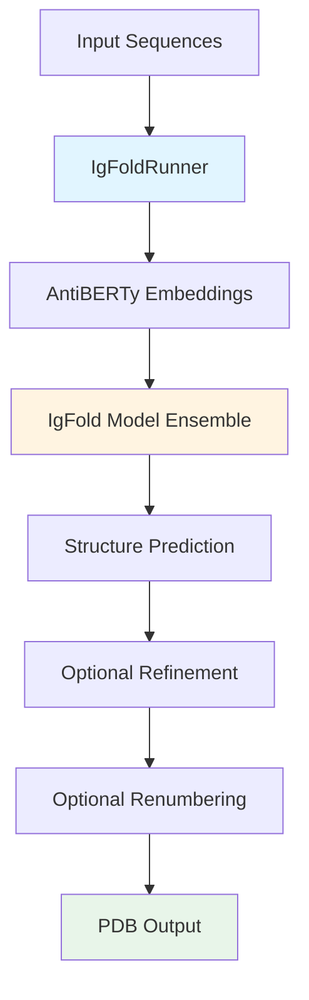
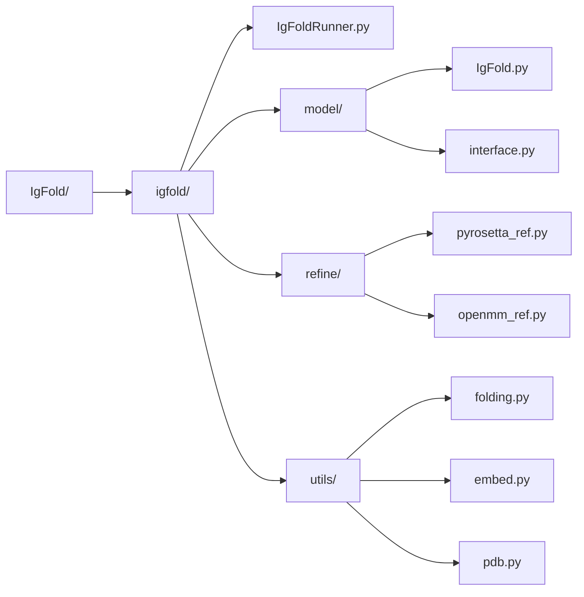
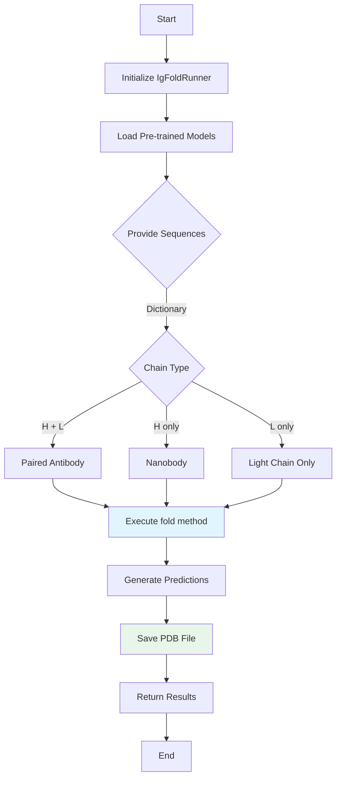

Get up and running with IgFold's fast antibody structure prediction in minutes. This guide will walk you through the essential steps to predict your first antibody structure from sequence data.


## Understanding IgFold's Architecture

IgFold is a deep learning framework specifically designed for predicting antibody 3D structures from amino acid sequences. The system leverages pre-trained models that have learned structural patterns from millions of natural antibody sequences, enabling rapid and accurate predictions.

The architecture centers around three core components:



The **IgFoldRunner** class serves as your primary interface, managing model loading, prediction execution, and output generation. By default, it uses an ensemble of 4 pre-trained models for robust predictions, though this can be configured based on your needs.

**Sources**: [README.md](README.md#L1-L30), [IgFoldRunner.py](igfold/IgFoldRunner.py#L30-L60)

## Project Structure

Before diving into usage, it's helpful to understand how the IgFold repository is organized:



**Sources**: [README.md](README.md#L1-L10)

## Installation

Install IgFold via pip for the quickest setup:

```bash
pip install igfold
```

For development or access to the latest features, clone the repository:

```bash
git clone git@github.com:Graylab/IgFold.git
pip install IgFold
```

> [!TIP]
> For beginners, the pip installation is recommended as it automatically handles core dependencies. Additional optional features (refinement and renumbering) require separate package installations described later.

**Sources**: [README.md](README.md#L28-L42)

## Your First Antibody Structure Prediction

The most common use case is predicting an antibody structure from paired heavy and light chain sequences. Here's a complete working example:

```python
from igfold import IgFoldRunner

# Define your antibody sequences
sequences = {
    "H": "EVQLVQSGPEVKKPGTSVKVSCKASGFTFMSSAVQWVRQARGQRLEWIGWIVIGSGNTNYAQKFQERVTITRDMSTSTAYMELSSLRSEDTAVYYCAAPYCSSISCNDGFDIWGQGTMVTVS",
    "L": "DVVMTQTPFSLPVSLGDQASISCRSSQSLVHSNGNTYLHWYLQKPGQSPKLLIYKVSNRFSGVPDRFSGSGSGTDFTLKISRVEAEDLGVYFCSQSTHVPYTFGGGTKLEIK"
}
pred_pdb = "my_antibody.pdb"

# Initialize the predictor
igfold = IgFoldRunner()

# Predict structure
igfold.fold(
    pred_pdb,
    sequences=sequences,
    do_refine=False,
    do_renum=False
)
```

**Sources**: [README.md](README.md#L48-L78), [IgFoldRunner.py](igfold/IgFoldRunner.py#L52-L80)

## Understanding the Prediction Process

The workflow for predicting antibody structures follows these key steps:



When you call the `fold()` method, IgFold:

1. **Processes your sequences** through the AntiBERTy language model to generate embeddings
2. **Predicts 3D coordinates** using the graph transformer architecture
3. **Estimates per-residue RMSD** (recorded in the PDB B-factor column)
4. **Writes the structure** to your specified PDB file path
5. **Returns an IgFoldOutput object** containing predictions and confidence metrics

**Sources**: [IgFoldRunner.py](igfold/IgFoldRunner.py#L82-L100), [interface.py](igfold/model/interface.py#L24-L40)

## Key Configuration Options

The `fold()` method accepts several parameters to customize your prediction workflow:

| Parameter | Type | Default | Description |
|-----------|------|---------|-------------|
| `sequences` | dict | None | Dictionary mapping chain names to amino acid sequences |
| `do_refine` | bool | True | Enable structural refinement (requires PyRosetta or OpenMM) |
| `use_openmm` | bool | False | Use OpenMM instead of PyRosetta for refinement |
| `do_renum` | bool | True | Renumber residues using Chothia scheme (requires AbNumber) |
| `num_models` | int | 4 | Number of ensemble models to use (1-4) |
| `template_pdb` | str | None | Optional template structure for guided prediction |

**Sources**: [IgFoldRunner.py](igfold/IgFoldRunner.py#L52-L80)

## Prediction Use Cases

### Paired Antibody Prediction

For traditional antibodies with both heavy and light chains:

```python
sequences = {
    "H": "EVQLVQSGPEVKKPGTSVKVSCKASGFTFMSSAVQWVRQARGQRLEWIGWIVIGSGNTNYAQKFQERVTITRDMSTSTAYMELSSLRSEDTAVYYCAAPYCSSISCNDGFDIWGQGTMVTVS",
    "L": "DVVMTQTPFSLPVSLGDQASISCRSSQSLVHSNGNTYLHWYLQKPGQSPKLLIYKVSNRFSGVPDRFSGSGSGTDFTLKISRVEAEDLGVYFCSQSTHVPYTFGGGTKLEIK"
}
```

### Nanobody Prediction

For single-domain antibodies (VHH), provide only the heavy chain:

```python
sequences = {
    "H": "QVQLQESGGGLVQAGGSLTLSCAVSGLTFSNYAMGWFRQAPGKEREFVAAITWDGGNTYYTDSVKGRFTISRDNAKNTVFLQMNSLKPEDTAVYYCAAKLLGSSRYELALAGYDYWGQGTQVTVS"
}
```

### Individual Chain Prediction

You can also predict single chains by providing just "H" or "L" sequences.

**Sources**: [README.md](README.md#L79-L108)

## Accessing Prediction Results

The `fold()` method returns an `IgFoldOutput` object containing detailed predictions:

```python
out = igfold.fold(
    pred_pdb,
    sequences=sequences,
    do_refine=False,
    do_renum=False
)

# Access predicted RMSD values per residue
# Shape: (1, sequence_length, 4) for N, CA, C, CB atoms
print(out.prmsd)
```

The predicted RMSD values are also written to the **B-factor column** of your output PDB file, allowing you to visualize confidence in your molecular viewer.

**Sources**: [README.md](README.md#L115-L128), [interface.py](igfold/model/interface.py#L24-L40)

> [!TIP]
> Lower RMSD values indicate higher prediction confidence. Regions with high RMSD (typically CDR loops) may benefit from additional refinement or template-based prediction.

## Optional Feature Installation

### Structural Refinement

For improved local geometry, install either PyRosetta or OpenMM:

**PyRosetta (Recommended):**
```bash
# Follow instructions at http://pyrosetta.org/downloads
# Then initialize in Python:
from igfold.refine.pyrosetta_ref import init_pyrosetta
init_pyrosetta()
```

**OpenMM (Alternative):**
```bash
conda install -c conda-forge openmm==7.7.0 pdbfixer
```

### Antibody Renumbering

For standardized Chothia numbering:
```bash
conda install -c bioconda abnumber
```

**Sources**: [README.md](README.md#L43-L50), [README.md](README.md#L177-L190)

## Quick Reference Cheat Sheet

```python
# Basic prediction (no refinement or renumbering)
from igfold import IgFoldRunner
igfold = IgFoldRunner()
igfold.fold("output.pdb", sequences={"H": "your_sequence"})

# Full-featured prediction
from igfold.refine.pyrosetta_ref import init_pyrosetta
init_pyrosetta()
igfold = IgFoldRunner(num_models=4)
out = igfold.fold(
    "output.pdb",
    sequences={"H": "...", "L": "..."},
    do_refine=True,
    do_renum=True
)
```

## Next Steps

Now that you've completed your first prediction, explore these advanced topics:

- **Installation**: Learn about detailed environment setup and dependency management in [Installation and Environment Setup](3-installation-and-environment-setup)
- **Basic Prediction**: Dive deeper into configuration options and troubleshooting in [Basic Antibody Structure Prediction](4-basic-antibody-structure-prediction)
- **Special Cases**: Learn about predicting nanobodies and single-chain structures in [Predicting Nanobody and Single Chain Structures](5-predicting-nanobody-and-single-chain-structures)
- **Model Architecture**: Understand how IgFold works internally in [IgFold Model Architecture](6-igfold-model-architecture)
- **Input Processing**: Learn about embedding generation in [Sequence Input and Embedding Pipeline](9-sequence-input-and-embedding-pipeline)

**Sources**: [README.md](README.md#L1-L227)