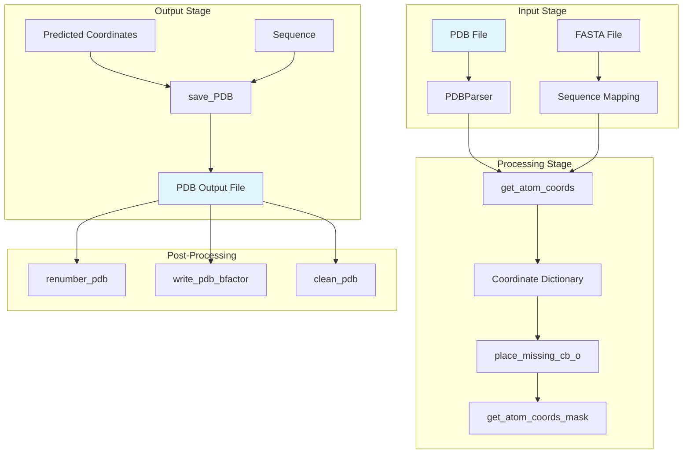
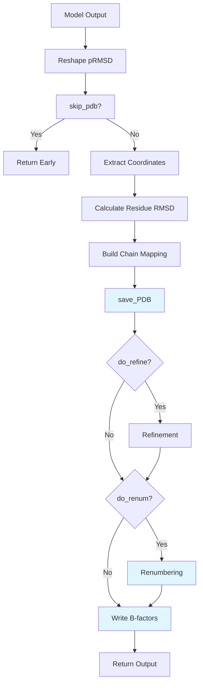

The PDB file processing pipeline in IgFold provides comprehensive utilities for reading, manipulating, and writing protein structure data in PDB format. This module serves as the critical interface between raw structural data and the deep learning models, handling coordinate extraction, file generation, and structural analysis operations essential for antibody structure prediction workflows.

Sources: [igfold/utils/pdb.py](igfold/utils/pdb.py#L1-L20)

## Architecture Overview

The PDB processing system is built upon BioPython's structural biology tools and integrates seamlessly with PyTorch tensors for efficient coordinate manipulation. The architecture follows a modular design where reading, processing, and writing operations are cleanly separated, enabling flexible integration with both prediction and refinement stages of the pipeline.



The system supports multi-chain structures with automatic chain segmentation, enabling proper handling of antibody heavy (H) and light (L) chains through delimiter-based coordinate organization. Key design priorities include robust handling of missing atoms, geometric validation of backbone connectivity, and seamless integration with tensor-based machine learning workflows.

Sources: [igfold/utils/pdb.py](igfold/utils/pdb.py#L194-L252)

## Reading and Parsing PDB Files

### Structure Parsing

PDB file parsing leverages BioPython's PDBParser to extract hierarchical structural information from ATOM records. The parser creates a structure object containing models, chains, and residues that can be navigated programmatically for coordinate extraction.

The `get_atom_coords` function provides comprehensive coordinate extraction, optionally aligning PDB residues with FASTA sequences for proper indexing:

Sources: [igfold/utils/pdb.py](igfold/utils/pdb.py#L194-L252)

```python
def get_atom_coords(pdb_file, fasta_file=None):
    p = PDBParser()
    file_name = splitext(basename(pdb_file))[0]
    structure = p.get_structure(
        file_name,
        pdb_file,
    )
    # ... processing logic
```

When a FASTA file is provided, the system performs sophisticated residue mapping to handle cases where PDB residue numbering may not align with sequence positions. This is particularly important for antibody structures where insertions and deletions are common.

### Continuous Range Detection

The system identifies continuous peptide connectivity through geometric validation:

Sources: [igfold/utils/pdb.py](igfold/utils/pdb.py#L139-L157)

| Parameter | Value | Description |
|-----------|-------|-------------|
| Minimum peptide bond length | 1.2 Å | Lower threshold for valid C-N bond |
| Maximum peptide bond length | 1.45 Å | Upper threshold for valid C-N bond |
| Detection method | Euclidean distance | Computed between Cᵢ and Nᵢ₊₁ atoms |

The `get_continuous_ranges` function returns tuples of indices representing connected segments, which is essential for handling chain breaks or missing regions in template structures.

### Missing Atom Handling

Glycine residues lack CB atoms by definition, and other residues may have missing O or CB atoms in experimental structures. The system implements geometric reconstruction using the `place_missing_cb_o` function:

Sources: [igfold/utils/pdb.py](igfold/utils/pdb.py#L160-L192)

```python
def place_missing_cb_o(atom_coords):
    cb_coords = place_fourth_atom(
        atom_coords['C'],
        atom_coords['N'],
        atom_coords['CA'],
        torch.tensor(1.522),  # Bond length
        torch.tensor(1.927),  # Angle parameter
        torch.tensor(-2.143), # Dihedral parameter
    )
    # ... similar logic for O atom placement
```

This geometric reconstruction uses bond lengths and angles from the Engh and Huber parameter set, ensuring chemically realistic placement of missing atoms. The operation only applies when all required backbone atoms (N, CA, C) are present, as defined by the mask validation logic.

Sources: [igfold/utils/constants.py](igfold/utils/constants.py#L1-L22)

> [!TIP]
> The masking system identifies valid coordinates by checking both for non-zero values and absence of NaN values. This dual validation ensures robust handling of both placeholder coordinates and numerical artifacts from downstream processing.

## Coordinate Extraction and Validation

### Atom Coordinate Dictionary

The primary data structure for coordinate storage is a dictionary mapping atom types to PyTorch tensors:

Sources: [igfold/utils/pdb.py](igfold/utils/pdb.py#L234-L248)

| Atom Type | Tensor Shape | Purpose |
|-----------|--------------|---------|
| N | (L,) | Amide nitrogen, backbone |
| CA | (L,) | Alpha carbon, backbone |
| C | (L,) | Carbonyl carbon, backbone |
| O | (L,) | Carbonyl oxygen, backbone |
| CB | (L,) | Beta carbon, side chain |
| CBCA | (L,) | CB fallback to CA for Gly |

Where L is the number of residues. This design enables efficient tensor operations while maintaining clear semantic separation between atom types.

### Mask Generation

Coordinate masks are generated to identify valid vs. placeholder coordinates:

Sources: [igfold/utils/pdb.py](igfold/utils/pdb.py#L254-L265)

```python
def get_atom_coords_mask(coords):
    mask = torch.ByteTensor([1 if sum(_) != 0 else 0 for _ in coords])
    mask = mask & (1 - torch.any(torch.isnan(coords), dim=1).byte())
    return mask
```

The mask combines two checks: non-zero coordinate sum and absence of NaN values. This dual validation prevents issues arising from both placeholder zeros and numerical errors in downstream operations.

### Special Coordinate Accessors

Utility functions provide robust coordinate access with fallback behavior:

Sources: [igfold/utils/pdb.py](igfold/utils/pdb.py#L120-L137)

| Function | Behavior |
|----------|----------|
| `get_atom_coord(residue, atom_type)` | Returns atom coordinates or [0,0,0] if missing |
| `get_cb_or_ca_coord(residue)` | Returns CB if present, else CA, else [0,0,0] |

These functions enable graceful degradation when atoms are missing, allowing pipeline components to handle incomplete data without explicit error checking at each access point.

## Generating PDB Output from Predictions

### The save_PDB Function

The core function for PDB generation converts PyTorch coordinate tensors into properly formatted PDB files:

Sources: [igfold/utils/pdb.py](igfold/utils/pdb.py#L428-L478)

```python
def save_PDB(
    out_pdb: str,
    coords: torch.Tensor,
    seq: str,
    chains: List[str] = None,
    error: torch.Tensor = None,
    delim: Union[int, List[int]] = None,
    atoms=['N', 'CA', 'C', 'O', 'CB'],
    write_pdb=True,
) -> None:
```

Key features include automatic chain segmentation using delimiters, B-factor encoding for confidence metrics, and proper formatting according to PDB specification standards. The function handles glycine CB omission and multi-chain structures with TER records inserted at chain boundaries.

### Parameter Configuration

| Parameter | Type | Default | Description |
|-----------|------|---------|-------------|
| `out_pdb` | str | required | Output PDB file path |
| `coords` | Tensor | required | Coordinates of shape (L, A, 3) |
| `seq` | str | required | Amino acid sequence string |
| `chains` | List[str] | ["H", "L"] | Chain identifiers |
| `error` | Tensor | zeros(L,) | Per-residue error/RMSD values |
| `delim` | int/List[int] | -1 | Chain boundary positions |
| `atoms` | List[str] | backbone+CB | Atom types to output |
| `write_pdb` | bool | True | Whether to write file or return string |

### Chain Segmentation Logic

The delimiter system enables proper multi-chain output:

Sources: [igfold/utils/pdb.py](igfold/utils/pdb.py#L455-L470)

```python
for r, residue in enumerate(coords):
    AA = _aa_1_3_dict[seq[r]]
    for a, atom in enumerate(residue):
        chain_num = np.where(np.array(delim) - r > 0)[0][0]
        chain_id = chains[chain_num]
        # ... atom writing logic
        
    if r + 1 == delim[chain_num]:
        pdb_string += "TER   %5d      %3s %s%4d\n" % (
            k + 1, AA, chain_id, r + 1)
```

For a typical antibody with heavy and light chains, the delimiter list would contain the length of the heavy chain, causing residue indexing to automatically switch chain IDs when crossing the boundary. This enables seamless handling of arbitrary chain configurations without manual indexing logic.

### Confidence Encoding

Error values are encoded in the B-factor column of ATOM records, enabling visualization of prediction confidence directly in molecular viewers. This is particularly useful for identifying low-confidence regions in predicted structures, typically CDR loops with sparse template coverage.

Sources: [igfold/utils/folding.py](igfold/utils/folding.py#L97-L115)

## Integration with Prediction Workflow

### The process_prediction Function

PDB generation is integrated into the main folding pipeline through the `process_prediction` function:

Sources: [igfold/utils/folding.py](igfold/utils/folding.py#L78-L151)



This function coordinates the transformation from raw model output to a fully annotated PDB file, handling chain segmentation, refinement integration, and post-processing operations. The conditional execution allows skipping PDB operations during embedding-only workflows.

### Refinement Integration

After initial PDB generation, the file can be refined using either PyRosetta or OpenMM:

Sources: [igfold/utils/folding.py](igfold/utils/folding.py#L117-L132)

| Refinement Method | Integration | Input |
|-------------------|-------------|-------|
| PyRosetta | `refine([pdb_file, pdb_string])` | File path + string |
| OpenMM | `refine([pdb_file])` | File path only |

The refinement engines read the generated PDB file, apply force-field based optimization, and write the refined structure back to the same file path. This design allows the refinement step to be optional while maintaining a simple interface.

### Renumbering Post-Processing

Antibody structures are conventionally numbered using the Chothia scheme for consistency across databases and tools. The `renumber_pdb` function handles this conversion through the AbNum web service:

Sources: [igfold/utils/pdb.py](igfold/utils/pdb.py#L21-L59)

```python
response = requests.post(
    'http://www.bioinf.org.uk/abs/abnum/abnumpdb.cgi',
    params={
        "plain": "1",
        "output": "-HL",
        "scheme": "-c"
    },
    files={"pdb": f},
)
```

The function includes retry logic with exponential backoff to handle network issues, and prints a warning if the renumbering fails due to connection problems rather than interrupting the workflow.

### B-factor Annotation

After refinement and renumbering, the system annotates each residue's B-factor with its predicted RMSD value:

Sources: [igfold/utils/folding.py](igfold/utils/folding.py#L144-L148), [igfold/utils/pdb.py](igfold/utils/pdb.py#L481-L506)

```python
write_pdb_bfactor(
    pdb_file,
    pdb_file,
    bfactor=res_rmsd,
)
```

This enables visual assessment of prediction confidence directly in standard molecular visualization tools, with higher B-factors indicating lower confidence regions.

## PDB File Manipulation Utilities

### Chain Reordering

The `reorder_pdb_chains` function enables arbitrary chain ordering while preserving structural integrity:

Sources: [igfold/utils/pdb.py](igfold/utils/pdb.py#L71-L118)

| Feature | Implementation |
|---------|---------------|
| Validation | Checks chain count matches order specification |
| Case handling | Converts chain IDs to uppercase |
| Atom numbering | Sequential across all chains |
| Residue numbering | Preserved from original structure |

This utility is particularly useful when comparing structures with different chain ordering conventions or preparing structures for tools with specific chain ordering requirements.

### Chain Counting

Simple utility for counting chains in a PDB file:

Sources: [igfold/utils/pdb.py](igfold/utils/pdb.py#L61-L68)

```python
def count_pdb_chains(pdb_file):
    parser = PDBParser()
    with warnings.catch_warnings(record=True):
        structure = parser.get_structure("_", pdb_file)
    l = len(list(structure.get_chains()))
    return l
```

This function suppresses BioPython warnings during parsing, providing a clean interface for chain enumeration.

### PDB Cleaning

The `clean_pdb` function removes non-ATOM records, creating a minimal PDB file containing only structural data:

Sources: [igfold/utils/pdb.py](igfold/utils/pdb.py#L508-L515)

```python
def clean_pdb(pdb_file):
    with open(pdb_file, "r") as f:
        lines = f.readlines()
    
    with open(pdb_file, "w") as f:
        for l in lines:
            if "ATOM" in l:
                f.write(l)
```

This is useful for removing HEADER, REMARK, and other metadata records that may interfere with downstream processing tools.

## Sequence Conversion and Analysis

### PDB to FASTA Conversion

The `pdb2fasta` function extracts amino acid sequences from ATOM records:

Sources: [igfold/utils/pdb.py](igfold/utils/pdb.py#L268-L291)

```python
def pdb2fasta(pdb_file, num_chains=None):
    """Converts a PDB file to a fasta formatted string using its ATOM data"""
    pdb_id = basename(pdb_file).split('.')[0]
    parser = PDBParser()
    structure = parser.get_structure(pdb_id, pdb_file)
    
    fasta = ''
    for chain in structure.get_chains():
        id_ = chain.id
        seq = seq1(''.join([residue.resname for residue in chain]))
        fasta += '>{}:{}\t{}\n'.format(pdb_id, id_, len(seq))
        # ... line wrapping logic
    return fasta
```

This conversion includes chain identifiers and sequence lengths in the FASTA headers, enabling proper tracking of multi-chain structures.

### Chain-Specific Sequence Extraction

The `get_pdb_chain_seq` function retrieves sequences for individual chains:

Sources: [igfold/utils/pdb.py](igfold/utils/pdb.py#L294-L311)

```python
def get_pdb_chain_seq(pdb_file, chain_id):
    p = PDBParser()
    file_name = splitext(basename(pdb_file))[0]
    structure = p.get_structure(file_name, pdb_file)
    
    pdb_seq = None
    for chain in structure.get_chains():
        if chain.id == chain_id:
            pdb_seq = "".join([seq1(r.get_resname()) for r in chain.get_residues()])
    return pdb_seq
```

This utility is used throughout the pipeline for sequence alignment and validation tasks.

## CDR-Specific Operations

### CDR Index Extraction

The `cdr_indices` function identifies the start and end positions of specific CDR loops using Chothia numbering:

Sources: [igfold/utils/pdb.py](igfold/utils/pdb.py#L314-L378)

| CDR | Chothia Range | Chain |
|-----|---------------|-------|
| H1 | 26-32 | H |
| H2 | 52-56 | H |
| H3 | 95-102 | H |
| L1 | 24-34 | L |
| L2 | 50-56 | L |
| L3 | 89-97 | L |

The function uses binary search to efficiently locate the CDR boundaries within the residue numbering, automatically handling offset calculations for light chain indices in the full sequence context.

> [!TIP]
> CDR extraction requires Chothia-numbered PDB files. If working with structures in other numbering schemes, apply the `renumber_pdb` function before CDR extraction to ensure correct boundary identification.

### CDR Range Dictionary

The `get_cdr_range_dict` function generates a complete dictionary of all CDR ranges:

Sources: [igfold/utils/pdb.py](igfold/utils/pdb.py#L381-L404)

```python
def get_cdr_range_dict(
    chothia_pdb_file,
    heavy_only=False,
    light_only=False,
    offset_heavy=True,
):
```

This provides a convenient interface for bulk CDR analysis, supporting filtering by chain type and optional offset application for light chain indices.

## Error Handling and Robustness

The PDB processing module implements multiple layers of error handling:

### Network Resilience

The renumbering function includes retry logic with exponential backoff for HTTP requests:

Sources: [igfold/utils/pdb.py](igfold/utils/pdb.py#L26-L48)

| Retry Attempt | Wait Time |
|---------------|-----------|
| 1 | 5 seconds |
| 2 | 10 seconds |
| 3 | 15 seconds |
| ... | ... |
| 10 | 50 seconds |

If all retries fail, the function prints a descriptive warning rather than raising an exception, allowing the pipeline to continue with non-renumbered structures.

### Parsing Error Suppression

Several functions use warning suppression during BioPython parsing:

Sources: [igfold/utils/pdb.py](igfold/utils/pdb.py#L63-L65)

```python
with warnings.catch_warnings(record=True):
    structure = parser.get_structure("_", pdb_file)
```

This prevents non-critical warnings from cluttering output while still allowing the code to execute successfully.

### Graceful Degradation

Coordinate accessors return default values ([0, 0, 0]) when atoms are missing rather than raising exceptions. This design allows downstream components to handle missing data uniformly without explicit error checking at each access point.

## Best Practices

### Input Validation

- Always validate chain counts using `count_pdb_chains` before processing
- Use FASTA files alongside PDB files when sequence numbering may be inconsistent
- Verify continuous ranges when working with template structures that may have breaks

### Output Generation

- Provide delimiter values for multi-chain structures to ensure proper chain segmentation
- Include error values in `save_PDB` calls to enable confidence visualization
- Consider the `write_pdb=False` option for testing or when PDB string output is sufficient

### Post-Processing

- Apply renumbering as the final step after refinement to maintain numbering consistency
- Use B-factor annotation for quality assessment rather than as a filter criterion
- Clean PDB files before submission to tools that expect minimal ATOM records

### Performance Considerations

- Batch coordinate extraction operations when processing multiple structures
- Cache parsed structures when performing multiple operations on the same PDB file
- Consider using tensor operations rather than loops for coordinate transformations

The PDB processing module provides a robust foundation for antibody structure prediction workflows, handling the complex conversion between tensor-based model outputs and standard structural biology formats while maintaining chemical accuracy and computational efficiency.

Sources: [igfold/utils/pdb.py](igfold/utils/pdb.py#L1-L515), [igfold/utils/folding.py](igfold/utils/folding.py#L78-L151)

## Next Steps

For deeper understanding of related systems, explore:

- **[Coordinate Geometry and Transformations](19-coordinate-geometry-and-transformations)** - Mathematical foundations for coordinate operations and geometric transformations
- **[Coordinate Prediction and RMSD Estimation](12-coordinate-prediction-and-rmsd-estimation)** - How coordinates are generated and confidence metrics are computed
- **[Antibody Metrics and Quality Assessment](22-antibody-metrics-and-quality-assessment)** - Evaluation metrics for assessing structure quality
- **[FASTA File Handling](21-fasta-file-handling)** - Sequence file processing and integration with PDB workflows