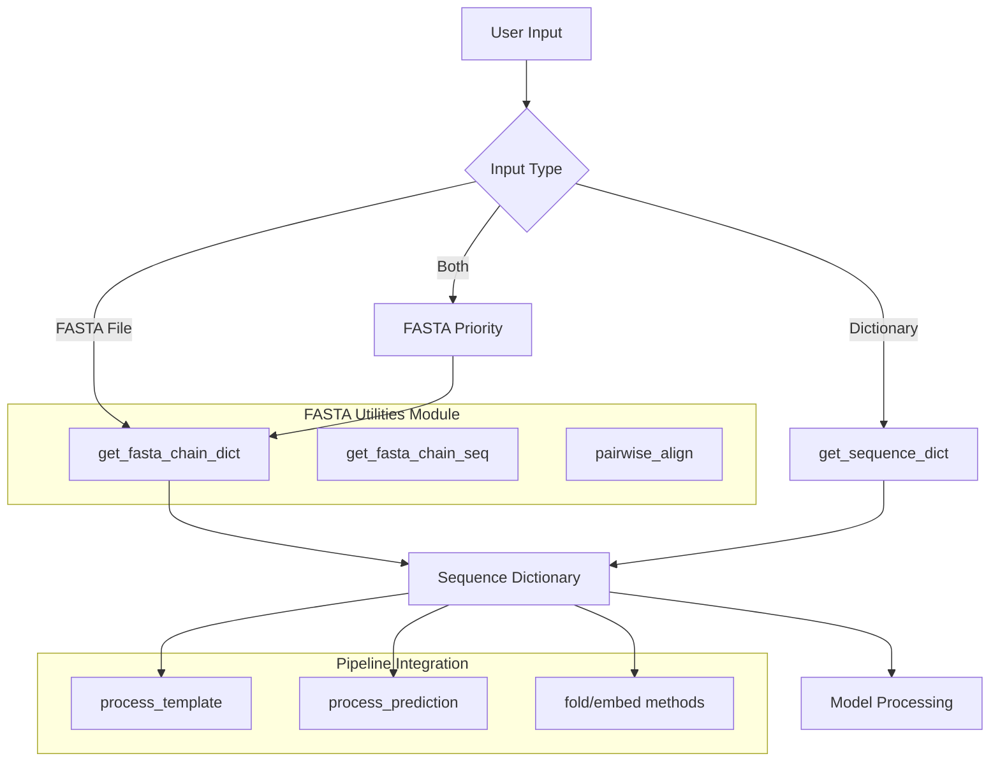

FASTA file handling in IgFold provides a flexible mechanism for loading antibody sequences for structure prediction and embedding operations. This system supports both single-chain and multi-chain antibody formats, enabling seamless integration with the IgFold prediction pipeline while maintaining compatibility with standard bioinformatics workflows.

## Architecture Overview

The FASTA handling system is built on three core abstraction layers that work together to provide robust sequence input processing:

The architecture prioritizes simplicity and reliability while supporting advanced use cases like template-based predictions and chain masking operations.

## Core FASTA Parsing Functions

The FASTA parsing functionality resides in `igfold/utils/fasta.py` and provides three primary functions for sequence extraction and manipulation.

### Chain-Specific Sequence Extraction

The `get_fasta_chain_seq()` function enables targeted retrieval of individual antibody chain sequences using flexible chain identification patterns. This function scans the FASTA file headers and matches against chain IDs embedded in the description line, supporting formats like `>description:chain_id` or simple `>chain_id` patterns. The implementation leverages Biopython's `SeqIO.parse()` for robust parsing and returns sequences as plain strings for downstream processing.

Sources: [fasta.py](igfold/utils/fasta.py#L4-L11)

### Complete FASTA Dictionary Parsing

The `get_fasta_chain_dict()` function provides comprehensive FASTA file parsing, converting all entries into a dictionary mapping sequence identifiers to their corresponding amino acid sequences. This is the primary entry point for loading antibody sequences, automatically extracting both heavy (H) and light (L) chains in standard paired antibody predictions. The function iterates through all FASTA records, preserving the original header as the dictionary key and converting BioPython sequence objects to strings for compatibility with the model pipeline.

Sources: [fasta.py](igfold/utils/fasta.py#L13-L18)

### Pairwise Sequence Alignment

The `pairwise_align()` function implements the Needleman-Wunsch global alignment algorithm using Biopython's `pairwise2.align.globalxx()` method. This algorithm is particularly useful for sequence comparison tasks, template matching operations, and validation scenarios. The function returns a list of tuples representing aligned segments, where each tuple contains `(start_pos_seq1, end_pos_seq1, start_pos_seq2, end_pos_seq2)` coordinates. This detailed alignment information enables precise mapping between sequences for downstream operations like coordinate transfer or structural validation.

Sources: [fasta.py](igfold/utils/fasta.py#L21-L43)

## Input Resolution and Priority Handling

The `get_sequence_dict()` function in the folding pipeline implements intelligent conflict resolution when users provide both FASTA files and direct sequence dictionaries. The resolution follows a clear priority hierarchy to ensure predictable behavior across different usage scenarios.

### Priority Resolution Logic

The function implements a four-branch decision tree that handles all possible input combinations:

1. **Both inputs provided**: FASTA file takes priority with a warning message
2. **Only FASTA provided**: FASTA file is parsed directly
3. **Only sequences provided**: Dictionary is used unchanged
4. **Neither provided**: Error message triggers program termination

This design ensures reproducibility by explicitly defining precedence while maintaining flexibility for different workflow preferences. The warning mechanism alerts users when their explicit sequence dictionary is being overridden, preventing silent failures or unexpected behavior in automated pipelines.

Sources: [folding.py](igfold/utils/folding.py#L13-L27)

> [!TIP]
> When working with large-scale batch predictions, prefer FASTA files over sequence dictionaries for better memory management and easier debugging. The file-based approach enables easier version control and audit trails compared to hard-coded sequence dictionaries.

## Integration with Prediction Pipeline

FASTA sequences integrate with multiple stages of the IgFold prediction pipeline, serving as the foundation for both template processing and final output generation.

### Template Processing and Chain Masking

The `process_template()` function utilizes FASTA files to determine chain boundaries when performing template-based structure prediction. This is particularly important when using `ignore_chain` parameters to mask specific antibody domains. The function extracts sequence lengths for each chain (heavy and light) from the FASTA dictionary, then applies coordinate masking based on the specified chain to ignore. For example, ignoring the heavy chain (`ignore_chain="H"`) disables all template coordinates corresponding to the heavy chain length, allowing the model to predict those regions de novo while using template information for the light chain.

Sources: [folding.py](igfold/utils/folding.py#L30-L75)

### Output Structure Generation

The `process_prediction()` function uses FASTA-derived sequence information to generate properly formatted PDB output files. This involves concatenating sequences from all chains in order, calculating chain boundary positions, and passing this information to the PDB writing utilities. The function retrieves the sequence dictionary from the FASTA file, constructs a full sequence string by concatenating all values in order, and computes cumulative length offsets to determine where each chain begins and ends in the final structure. This boundary information is essential for correct chain labeling in the output PDB file and enables downstream tools to properly parse multi-chain antibody structures.

Sources: [folding.py](igfold/utils/folding.py#L78-L115)

## FASTA File Format Requirements

IgFold expects FASTA files to follow standard bioinformatics conventions with specific considerations for antibody structure prediction.

### Chain Identification Format

Sequence identifiers should include chain information to enable proper multi-chain processing. The supported formats include:

- **Simple format**: `>H` for heavy chain, `>L` for light chain
- **Descriptive format**: `>my_antibody:H` with optional description prefix
- **Extended format**: Any header containing `:H` or `:L` pattern

The parsing logic searches for the chain ID pattern (`:H`, `:L`, etc.) anywhere in the header line, providing flexibility for different annotation conventions. This design accommodates various FASTA generation tools while maintaining backward compatibility with simple formats.

Sources: [fasta.py](igfold/utils/fasta.py#L8-L10)

### Multi-Chain Support

For paired antibody predictions, FASTA files should contain entries for all relevant chains (typically H and L). The order of chains in the file determines their order in the output structure, though explicit chain labeling in the PDB output is controlled by the key names from the parsed dictionary. This enables support for non-standard antibody formats like nanobodies (single chain) or bispecific antibodies (multiple heavy/light pairs) without requiring code modifications.

Sources: [folding.py](igfold/utils/folding.py#L100-L103)

## API Usage Patterns

The FASTA handling system integrates seamlessly with both high-level and low-level APIs, supporting various workflow requirements from interactive notebooks to large-scale batch processing.

### High-Level IgFoldRunner API

The `IgFoldRunner` class provides a simplified interface that abstracts away FASTA parsing details. Both the `fold()` and `embed()` methods accept `fasta_file` parameters as alternatives to direct sequence dictionaries. This design enables users to switch between input formats without changing their prediction code, supporting scenarios where sequences are stored in different formats across different projects.

The API automatically delegates to the `get_sequence_dict()` function for input resolution, ensuring consistent behavior across all entry points. Error handling propagates from the underlying utilities, providing clear feedback when FASTA files cannot be parsed or contain invalid sequences.

Sources: [IgFoldRunner.py](igfold/IgFoldRunner.py#L77-L125), [IgFoldRunner.py](igfold/IgFoldRunner.py#L126-L158)

### Low-Level Pipeline Integration

For advanced users requiring custom pipeline modifications, the low-level `fold()` function in `utils/folding.py` provides direct access to FASTA processing. This enables integration with custom preprocessing steps, alternative template handling strategies, or experimental features that may not be exposed through the high-level API. The function maintains the same input resolution logic as the high-level interface, ensuring compatibility with existing workflows while providing additional flexibility for research applications.

Sources: [folding.py](igfold/utils/folding.py#L153-L180)

## Comparison with Alternative Input Methods

IgFold supports two primary input methods for antibody sequences, each with distinct advantages for different use cases.

| Feature | FASTA File | Sequence Dictionary |
|---------|------------|---------------------|
| **Memory Efficiency** | High (streaming read) | Medium (in-memory) |
| **Version Control** | Excellent (text file) | Good (code integration) |
| **Batch Processing** | Optimal | Requires iteration |
| **Interactive Use** | Requires file creation | Most convenient |
| **Audit Trail** | Built-in | Requires documentation |
| **Chain Order Control** | File order | Dictionary order |
| **Metadata Support** | Full headers | Limited keys |

Sources: [folding.py](igfold/utils/folding.py#L17-L26)

## Error Handling and Validation

The FASTA handling system implements comprehensive error detection to provide clear feedback for common issues.

### Input Validation

The system validates input presence and accessibility before attempting parsing operations. When neither FASTA file nor sequences dictionary is provided, the system exits with a clear error message indicating the required input format. This prevents cryptic downstream errors and guides users toward correct usage patterns. Similarly, when optional features like renumbering are requested but required dependencies (AbNumber) are not installed, the system provides specific installation instructions.

Sources: [folding.py](igfold/utils/folding.py#L24-L25)

### Fallback and Warning Behavior

When users provide both FASTA file and sequence dictionary, the system prioritizes the FASTA file while emitting a warning message. This behavior ensures that users understand which input source is being used, preventing confusion when predictions differ from expected results. The warning mechanism strikes a balance between helpful user feedback and non-intrusive operation in automated workflows.

Sources: [folding.py](igfold/utils/folding.py#L17-L19)

## Next Steps

To deepen your understanding of the complete IgFold pipeline, explore these related topics:

- **[Sequence Input and Embedding Pipeline](9-sequence-input-and-embedding-pipeline)**: Learn how FASTA-derived sequences are converted to embeddings for model input
- **[Template-Based Structure Prediction](10-template-based-structure-prediction)**: Understand how FASTA sequences guide template processing
- **[PDB File Processing and Output](20-pdb-file-processing-and-output)**: See how sequence information translates to structural output
- **[Large-Scale Batch Prediction](18-large-scale-batch-prediction)**: Discover how FASTA files enable efficient batch processing workflows