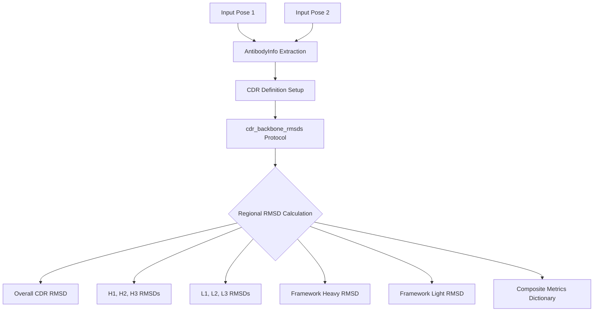
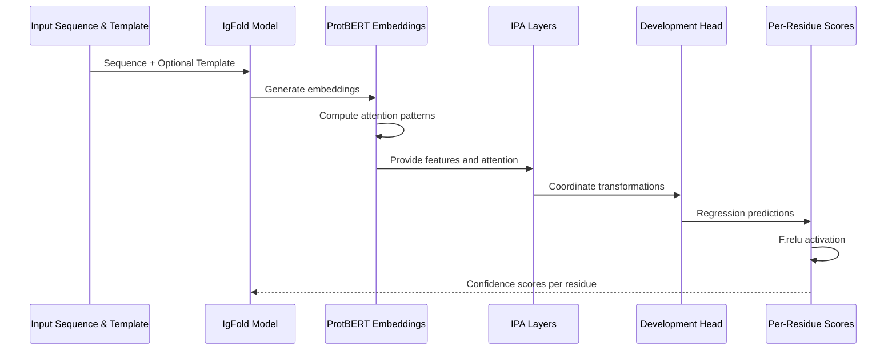
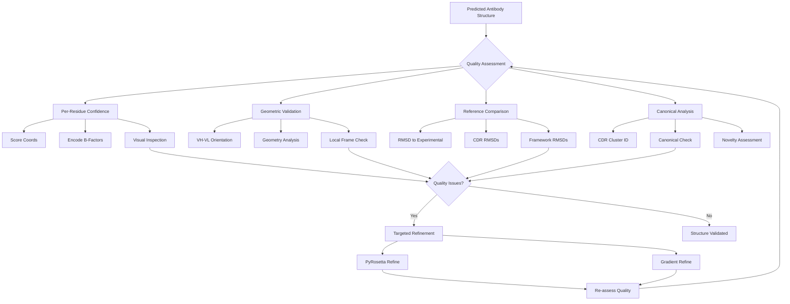

The IgFold framework provides a comprehensive suite of tools for assessing antibody structure quality, ranging from geometric measurements to structural validation metrics. These tools enable developers to evaluate prediction accuracy, compare alternative structures, and identify potential structural issues in antibody models.

## Antibody-Specific Structural Metrics

IgFold implements specialized metrics through PyRosetta's antibody protocols to quantify structural characteristics critical to antibody function and stability. The primary interface for these measurements is provided in [`ab_metrics.py`](igfold/utils/ab_metrics.py), which exposes three core analysis functions:

- **VH-VL orientation metrics**: Quantify the relative positioning and angular relationship between heavy and light chain variable domains
- **CDR backbone RMSDs**: Measure structural deviations across complementarity-determining regions and framework regions
- **CDR structural clustering**: Classify CDR loops into canonical structural categories

### VH-VL Orientation Analysis

The variable heavy-light chain orientation is fundamental to antibody paratope formation and antigen binding. IgFold provides `get_vh_vl_orientation()` to extract four key geometric parameters that describe this critical interface. These metrics are calculated using PyRosetta's antibody protocol which performs a rigorous geometric analysis of the relative domain placement.

| Metric | Description | Physical Significance |
|--------|-------------|----------------------|
| **vl-vh_distance** | Distance between VL and VH domain centers | Overall domain separation |
| **opening_angle** | Angle measuring domain opening/closure | Paratope conformational state |
| **opposite_angle** | Angular measurement in perpendicular plane | Domain twist/orientation |
| **packing_angle** | Angle describing domain packing density | Interface compactness |

The orientation analysis requires a PyRosetta pose object and leverages `AntibodyInfo` to identify domain boundaries before computing geometric relationships through `vl_vh_orientation_coords()`.

**Usage Example**:
```python
from igfold.utils.ab_metrics import get_vh_vl_orientation

# Assuming 'pose' is a PyRosetta Pose object
orientation_metrics = get_vh_vl_orientation(pose)
print(f"VH-VL distance: {orientation_metrics['vl-vh_distance']:.2f} Å")
print(f"Opening angle: {orientation_metrics['opening_angle']:.2f}°")
```
Sources: [ab_metrics.py](igfold/utils/ab_metrics.py#L4-L19)

### CDR and Framework RMSD Comparison

The `get_ab_metrics()` function provides comprehensive structural comparison capabilities between two antibody poses, calculating RMSD values for nine distinct structural regions. This function is particularly valuable for comparing predictions to experimental structures, evaluating refinement results, or assessing ensemble diversity.



The nine metrics computed provide a hierarchical view of structural differences:

| Metric | Region | Use Case |
|--------|--------|----------|
| **ocd** | Overall CDR RMSD | Global paratope quality assessment |
| **frh_rms** | Heavy chain framework | Heavy domain backbone accuracy |
| **h1_rms, h2_rms, h3_rms** | Heavy CDR loops | Individual heavy loop structure validation |
| **frl_rms** | Light chain framework | Light domain backbone accuracy |
| **l1_rms, l2_rms, l3_rms** | Light CDR loops | Individual light loop structure validation |

**Implementation details**:
```python
from igfold.utils.ab_metrics import get_ab_metrics

# Compare predicted structure to reference
metrics = get_ab_metrics(predicted_pose, reference_pose)
print(f"H3 RMSD: {metrics['h3_rms']:.2f} Å")  # Critical for binding
print(f"Overall CDR RMSD: {metrics['ocd']:.2f} Å")  # Paratope quality
```
Sources: [ab_metrics.py](igfold/utils/ab_metrics.py#L22-L44)

### CDR Canonical Cluster Identification

The `get_pose_cdr_clusters()` function classifies each CDR loop into canonical structural families using the North CDR definition scheme. This classification provides insights into the structural repertoire and helps identify unusual or non-canonical conformations that may warrant closer inspection.

The function maps CDR names to North scheme cluster definitions:
- Heavy chain: H1, H2, H3
- Light chain: L1, L2, L3

Each CDR is classified based on its structural conformation into established clusters (e.g., H1-1, H2-3, L1-1, etc.), which correlate with specific sequence and structure patterns observed across antibody databases.

> [!TIP]
> CDR clustering results are particularly valuable when combined with RMSD metrics—a non-canonical cluster assignment combined with high RMSD may indicate a prediction error or a genuinely novel paratope conformation requiring experimental validation.

Sources: [ab_metrics.py](igfold/utils/ab_metrics.py#L47-L60)

## Per-Residue Quality Scoring

Beyond geometric metrics, IgFold provides confidence estimation for individual residues through its internal quality scoring mechanism. The model's `score_coords()` method generates per-atom confidence scores that reflect the model's certainty about predicted atomic positions.

### Scoring Architecture

The scoring system operates through a dedicated development pathway in the model architecture:



The scoring process leverages the learned representations from the Invariant Point Attention (IPA) layers, applying a development pathway that extracts geometric confidence information. The scores are computed by:

1. Transforming BERT embeddings and attention through development layers
2. Using the predicted translations and rotations from the main pathway
3. Applying a linear projection followed by ReLU activation
4. Reshaping from atom-level to residue-level scores

**Technical implementation**:
```python
# In IgFold model context
dev_pred = self.score_coords(input, output)
# dev_pred shape: [batch_size, sequence_length * 4]
# Can be aggregated to per-residue: [batch_size, sequence_length]
```

### B-Factor Encoding

Per-residue confidence scores can be encoded directly into PDB output files using the B-factor field, enabling visual quality assessment in molecular visualization tools like PyMOL or ChimeraX. The [`save_PDB()`](igfold/utils/pdb.py#L428-L478) function accepts an optional `error` tensor that gets written to the B-factor column for each atom.

**Writing PDB with confidence scores**:
```python
import torch
from igfold.utils.pdb import save_PDB

# Coordinates shape: [L, 5, 3] where 5 atoms = N, CA, C, O, CB
# Confidence shape: [L] per-residue scores
coords = predicted_coords
confidence = dev_pred.mean(dim=-1)  # Aggregate atom scores if needed

save_PDB(
    out_pdb="output_with_confidence.pdb",
    coords=coords,
    seq=sequence,
    error=confidence,  # Written to B-factor column
    delim=delimiter,
    write_pdb=True
)
```

The B-factor values provide an immediate visual cue for structure quality—regions with low confidence (high error values) appear with thicker cartoon representations or different colors in visualization tools, helping focus refinement efforts on uncertain regions.

Sources: [IgFold.py](igfold/model/IgFold.py#L372-L403), [pdb.py](igfold/utils/pdb.py#L428-L478)

## Geometric Analysis Utilities

The [`geometry.py`](igfold/utils/geometry.py) module provides fundamental geometric operations that form the basis for many quality assessments. These functions operate on coordinate tensors and enable custom metric calculations.

### Core Geometric Primitives

The geometry library implements six fundamental operations for analyzing protein structures:

| Function | Operation | Mathematical Basis | Common Applications |
|----------|-----------|-------------------|-------------------|
| **normed_vec** | Vector normalization | v/‖v‖ | Direction calculations |
| **normed_cross** | Cross product of normalized vectors | (v₁/‖v₁‖) × (v₂/‖v₂‖) | Plane normal computation |
| **dist** | Euclidean distance | √(x₁-x₂)² + (y₁-y₂)² + (z₁-z₂)² | Length measurements |
| **dist_mat** | Distance matrix | Broadcasted distance computation | Contact map analysis |
| **angle** | Bond angle | arccos((a·b)/(‖a‖‖b‖)) | Backbone geometry |
| **dihedral** | Torsion angle | atan2(n₁×b₂,n₁·n₂) | Rotamer analysis |

> [!TIP]
> The `dist_mat` function is particularly useful for creating contact maps or analyzing residue-residue distances in predicted structures, enabling rapid identification of potential steric clashes or abnormal inter-residue distances.

### Local Reference Frame Construction

The `coords_to_frame()` function establishes a local coordinate system from backbone atoms (N, CA, C), which is essential for comparing structures in alignment-independent contexts. This function constructs an orthonormal basis:

- **n1**: Normalized CA→N vector
- **n2**: Cross product of n1 and normalized CA→C
- **n3**: Cross product of n1 and n2

This local frame representation is used throughout IgFold for rotation-invariant comparisons and enables robust structural alignment regardless of global orientation.

**Example usage**:
```python
from igfold.utils.geometry import angle, dihedral, dist_mat

# Analyze backbone angles at a specific position
N, CA, C, O = backbone_atoms[i-1], backbone_atoms[i], backbone_atoms[i+1], backbone_atoms[i+2]
bond_angle = angle(N, CA, C)  # Expected ~110° for alpha-helix
torsion = dihedral(N, CA, C, O)  # Phi/Psi angle context

# Compute all pairwise distances for contact analysis
contact_distances = dist_mat(coords, coords)  # Shape: [L, L]
```

Sources: [geometry.py](igfold/utils/geometry.py#L1-L77)

## Refinement-Based Quality Assessment

Structure refinement procedures provide additional quality metrics through energy-based scoring functions. The PyRosetta refinement pipeline ([`pyrosetta_ref.py`](igfold/refine/pyrosetta_ref.py)) integrates coordinate constraints with the `ref2015_cst` score function, offering physics-based structure validation.

### Score Function Components

The refinement pipeline employs a customized version of the `ref2015` score function with specific weights optimized for antibody structure refinement:

| Score Term | Weight in Refinement | Purpose |
|------------|---------------------|---------|
| **cart_bonded** | 1.0 | Bond length and angle quality |
| **pro_close** | 0.0 | Disabled for antibodies (special case) |
| **coordinate_constraint** | 1.0 (configurable) | Maintains input structure proximity |
| **dihedral_constraint** | 0.0 (default) | Secondary structure maintenance |

The refinement process involves multiple stages:
1. **Coordinate constraints**: Maintains structural fidelity during initial minimization
2. **Cartesian minimization**: Optimizes geometry with respect to energy function
3. **Repacking**: Optimizes side chain rotamer placements
4. **Final minimization**: Polishes the refined structure

### Quality Metrics from Refinement

While the refinement process primarily improves structure quality, it also generates diagnostic information:

- **Total score**: Overall energy of the refined structure
- **Constraint violation**: Magnitude of deviation from input coordinates
- **Convergence behavior**: Stability of minimization across iterations

> [!TIP]
> Monitor constraint violation values during refinement—large violations may indicate conflicts between predicted structure and physical constraints, suggesting regions where the initial prediction may be unreliable.

Sources: [pyrosetta_ref.py](igfold/refine/pyrosetta_ref.py#L12-L125)

## Practical Quality Assessment Workflow

A comprehensive quality assessment workflow combines multiple metrics to provide robust validation of antibody structures. The following diagram illustrates a recommended assessment pipeline:



This workflow enables comprehensive quality assessment by addressing multiple dimensions of structural quality. For structures with identified issues, the pipeline directs you to [PyRosetta Refinement Method](13-pyrosetta-refinement-method) or [Gradient-Based Structure Refinement](15-gradient-based-structure-refinement) for targeted improvement.

### Integration Example

A complete assessment script demonstrates the integration of multiple metrics:

```python
import pyrosetta
from igfold.utils.ab_metrics import get_vh_vl_orientation, get_ab_metrics, get_pose_cdr_clusters
from igfold.utils.pdb import save_PDB
from igfold.utils.geometry import dist_mat

# Initialize PyRosetta
pyrosetta.init("-mute all")

# Load structures
predicted_pose = pyrosetta.pose_from_file("predicted.pdb")
reference_pose = pyrosetta.pose_from_file("reference.pdb")

# 1. Check VH-VL orientation
orientation = get_vh_vl_orientation(predicted_pose)
if orientation['vl-vh_distance'] > 12.0:
    print("WARNING: Abnormal VH-VL distance detected")

# 2. Compare to reference
rmsd_metrics = get_ab_metrics(predicted_pose, reference_pose)
print(f"H3 RMSD: {rmsd_metrics['h3_rms']:.2f} Å")

# 3. Check CDR canonical classes
clusters = get_pose_cdr_clusters(predicted_pose)
print(f"H3 cluster: {clusters['h3']}")

# 4. Analyze geometry (if coordinates available as tensor)
# contact_distances = dist_mat(coords, coords)
# Identify unusually short distances (steric clashes)
```

## Summary of Assessment Tools

The following table summarizes all available antibody metrics and quality assessment tools in IgFold:

| Assessment Type | Function/Metric | Input Required | Output | Primary Use Case |
|-----------------|-----------------|----------------|--------|------------------|
| **Orientation** | `get_vh_vl_orientation()` | PyRosetta pose | Dictionary with 4 values | Domain arrangement validation |
| **Comparison** | `get_ab_metrics()` | Two PyRosetta poses | Dictionary with 9 RMSDs | Prediction accuracy evaluation |
| **Classification** | `get_pose_cdr_clusters()` | PyRosetta pose | CDR cluster assignments | Canonical conformation verification |
| **Confidence** | `IgFold.score_coords()` | Model input/output | Per-atom confidence scores | Uncertainty quantification |
| **Geometry** | `geometry.py` functions | Coordinate tensors | Angles, distances, frames | Custom structural analysis |
| **Energy** | PyRosetta refinement | PDB string | Energy scores, constraint violations | Physics-based quality check |

For more information on model architecture and scoring mechanisms, see [Structure Scoring and Loss Functions](24-structure-scoring-and-loss-functions). To learn about coordinate generation and geometric transformations, refer to [Coordinate Prediction and RMSD Estimation](12-coordinate-prediction-and-rmsd-estimation).