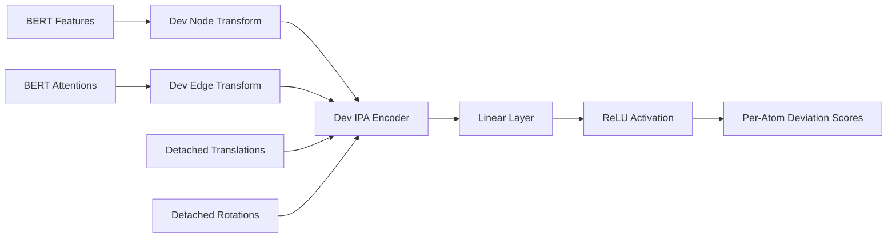
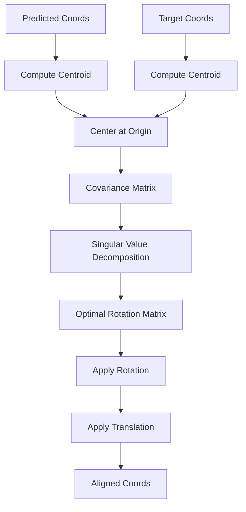
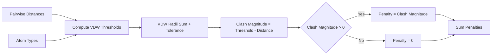
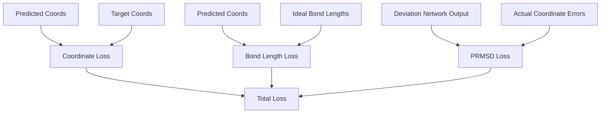
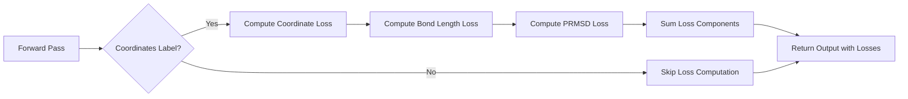

The structure scoring and loss function framework in IgFold implements a multi-objective optimization strategy that combines geometric accuracy metrics with structural validity constraints. This dual approach enables the model to learn coordinate representations that are both structurally accurate to experimental structures and physically realistic according to fundamental biochemical principles. The scoring system operates at two complementary levels: per-residue deviation prediction during inference for quality estimation, and comprehensive loss computation during training for gradient-based optimization.

## Structure Scoring Network

IgFold employs a dedicated deviation prediction module that operates as a parallel inference pathway to estimate structural quality. The `score_coords` method implements a separate Invariant Point Attention (IPA) encoder network that processes the same input representations used for coordinate prediction, but produces per-atom deviation estimates rather than coordinates themselves. This network receives detached coordinates from the main prediction pipeline to prevent gradient interference during inference [IgFold.py#L372-L403](igfold/model/IgFold.py#L372-L403).

The deviation predictor architecture mirrors the structural prediction pathway but operates with a distinct parameter set (`dev_ipa_depth`, `dev_ipa_heads`) configured independently in the model initialization [IgFold.py#L90-L112](igfold/model/IgFold.py#L90-L112). The network outputs a four-dimensional tensor per residue corresponding to N, CA, C, and O atoms, which is flattened to match the coordinate format and returned as the `prmsd` field in the output [IgFold.py#L401-L403](igfold/model/IgFold.py#L401-L403). During training, these predicted deviations are directly compared against actual coordinate errors through the `bb_prmsd_l1` loss, teaching the network to recognize structural quality patterns from sequence and attention patterns alone.

> [!TIP]
> The deviation scoring network uses detached translations and rotations from the coordinate prediction pipeline, ensuring that gradient signals from the loss backpropagation only affect the deviation prediction weights rather than the coordinate generation parameters, maintaining orthogonality between the two learning objectives.

## Coordinate Alignment Loss

The foundation of IgFold's coordinate accuracy assessment is the Kabsch-aligned mean squared error loss. Before computing loss values, predicted and target structures are aligned using the Kabsch algorithm, which finds the optimal rigid body transformation (rotation and translation) that minimizes the root-mean-square deviation between coordinate sets [training/utils.py#L11-L75](igfold/training/utils.py#L11-L75). This alignment is crucial because protein structures can be arbitrarily rotated and translated in space without changing their physical conformation.

The alignment process centers both coordinate sets at the origin by subtracting their centroids, then computes the covariance matrix between the two point clouds. Singular value decomposition extracts the optimal rotation matrix, with special handling for reflection cases to ensure proper handedness [training/utils.py#L33-L50](igfold/training/utils.py#L33-L50). The `do_kabsch` function extends this core algorithm to support selective alignment through masking, where only specified residues contribute to determining the optimal transformation [training/utils.py#L78-L97](igfold/training/utils.py#L78-L97).

The `kabsch_mse` function computes the mean squared error between predicted coordinates and Kabsch-aligned target coordinates, with optional clamping to prevent outliers from dominating the loss [training/utils.py#L100-L136](igfold/training/utils.py#L100-L136). When an `align_mask` is provided, only masked residues participate in alignment determination, though all masked residues contribute to the final MSE computation weighted by the mask. This design is particularly valuable for antibody structures where CDR loops may be prioritized over framework regions. The loss supports an optional `clamp` parameter that caps individual squared errors, and a `sqrt` flag that returns RMSD values rather than MSE.

## Geometric Validity Constraints

Beyond coordinate accuracy, IgFold enforces structural validity through multiple loss components that ensure predicted structures conform to fundamental biochemical constraints. These losses operate on physical constants derived from Engh and Huber's structure quality parameters, which define standard bond lengths, bond angles, and atomic radii [utils/constants.py#L3-L22](igfold/utils/constants.py#L3-L22).

### Backbone Bond Length Loss

The bond length constraint enforces proper connectivity between sequential backbone atoms. The `bond_len_loss` function computes absolute deviations between predicted interatomic distances and ideal bond lengths for N-CA, CA-C, and C-N connections [training/utils.py#L194-L218](igfold/training/utils.py#L194-L218). This loss operates specifically on backbone atoms (N, CA, C) and handles sequence length boundaries by masking positions where bonds would extend beyond valid residues. The distance calculations use Euclidean norms computed through the `dist` utility function [utils/geometry.py#L23-L27](igfold/utils/geometry.py#L23-L27), which includes epsilon protection against numerical instability.

The loss computation involves rearranging the coordinate tensor to expose sequential atom pairs, then computing differences between predicted bond lengths and ideal values defined in constants (`BL_N_CA = 1.459Å`, `BL_CA_C = 1.525Å`, `BL_C_N = 1.336Å`). Results are weighted by the intersection mask of valid atoms at both bond endpoints, ensuring only physically meaningful bonds contribute to the gradient signal.

### Backbone Bond Angle Loss

Bond angle constraints enforce the proper three-dimensional geometry of peptide backbone connectivity. The `bond_angle_loss` function computes deviations for two critical angles: CA-C-N and C-N-CA [training/utils.py#L221-L240](igfold/training/utils.py#L221-L240). The angle calculation uses the `angle` utility function which computes the arccosine of normalized dot products between vectors formed by three atoms [utils/geometry.py#L38-L43](igfold/utils/geometry.py#L38-L43).

Rather than computing angular differences directly, the loss uses `1 - cos(angle_diff)` as the objective, which provides better gradient behavior around small angular deviations and avoids singularities when angles approach zero. The ideal bond angles (`BA_CA_C_N = 117.2°`, `BA_C_N_CA = 121.7°`) are converted from degrees to radians for consistent computation. This loss is particularly important for maintaining proper peptide plane geometry and preventing backbone distortions that would violate steric feasibility.

### Van der Waals Clash Loss

Steric validity is enforced through the `vdw_clash_loss` function, which penalizes atomic overlaps that violate Van der Waals radii constraints [training/utils.py#L243-L260](igfold/training/utils.py#L243-L260). The loss computes pairwise distances between all atoms in the structure and compares them against the sum of their Van der Waals radii (N=1.55Å, C=1.7Å from constants). A tolerance parameter (`tol=1.5Å`) allows for minor violations, with the loss being the rectified linear (ReLU) difference between the allowed distance and actual distance.

The implementation computes all-to-all atomic distances efficiently through tensor broadcasting, then applies the VDW radius thresholds computed from atom type indices. The mask ensures only valid atoms contribute to the loss calculation, with normalization by the total number of valid atom pairs to maintain consistent scale across different structure sizes.

### Cis Peptide Loss

The `cis_peptide_loss` function enforces trans peptide bond configuration, which is the dominant conformation in naturally occurring proteins [training/utils.py#L263-L274](igfold/training/utils.py#L263-L274). Cis peptide bonds (ω angle ≈ 0°) are rare (~0.03% frequency) and generally indicative of structural problems in most protein contexts. The loss computes the dihedral angle defined by CA-C-N-CA atoms across the peptide bond using the `dihedral` utility function [utils/geometry.py#L46-L58](igfold/utils/geometry.py#L46-L58).

The dihedral calculation involves constructing four normalized vectors along the backbone and computing the angle between two normal vectors to the planes defined by triples of atoms. The loss uses `1 - cos(dih - π)` formulation, which penalizes deviations from 180° (trans conformation) without singularities near the target. This provides a critical constraint for maintaining proper peptide bond geometry and preventing unrealistic kinks in the protein backbone.

> [!TIP]
> The violation loss function aggregates bond length, bond angle, VDW clash, and cis peptide constraints into a single term, providing a comprehensive structural validity score. During training, this ensures that gradient descent directions simultaneously optimize for both coordinate accuracy and physical realism.

## Combined Loss Architecture

The complete training loss in IgFold integrates coordinate accuracy metrics with structural validity constraints through a weighted sum formulation. The `violation_loss` function combines individual geometric validity terms into a unified penalty [training/utils.py#L277-L287](igfold/training/utils.py#L277-L287), which can be applied as either a training loss term or a structural quality metric during evaluation.

The primary training loss combines three components when ground truth coordinates are available:

1. **Coordinate Loss (`coords_loss`)**: Kabsch-aligned MSE between predicted and target structures, with optional clamping to prevent outlier dominance [IgFold.py#L293-L299](igfold/model/IgFold.py#L293-L299)
2. **Bond Length Loss (`bondlen_loss`)**: L1 loss on backbone bond length deviations from ideal values [IgFold.py#L307-L311](igfold/model/IgFold.py#L307-L311)
3. **Per-Residue pRMSD Loss (`prmsd_loss`)**: L1 loss comparing the deviation network's predictions to actual coordinate errors computed on backbone atoms [IgFold.py#L313-L335](igfold/model/IgFold.py#L313-L335)

The per-residue pRMSD loss is computed separately for each sequence in the batch using chain-specific alignment masks, ensuring that multi-chain predictions are evaluated independently. For each chain, the backbone deviation between predicted and aligned target structures is compared against the deviation network's output using L1 loss [training/utils.py#L159-L192](igfold/training/utils.py#L159-L192). This teaches the network to estimate local structural quality from sequence and attention patterns alone, enabling its use for quality assessment during inference when ground truth structures are unavailable.

The final loss is computed as the sum of these three components [IgFold.py#L344](igfold/model/IgFold.py#L344), with each component properly normalized by sequence length and masked to ensure only valid residues contribute to the gradient. This multi-objective formulation balances global structural accuracy with local geometric constraints, producing models that generate predictions that are both accurate to experimental structures and physically realistic.

## Loss Computation Flow

The complete loss computation pipeline integrates with the forward pass through the IgFold model. When coordinate labels are provided, the forward method computes all loss terms and returns them as part of the `IgFoldOutput` data structure [IgFold.py#L355-L368](igfold/model/IgFold.py#L355-L368). The batch processing requires careful handling of sequence boundaries, particularly for multi-chain predictions where each chain must be aligned and evaluated independently.

The coordinate loss computation uses the `kabsch_mse` function with optional RMSD clamping to stabilize training, particularly in early epochs when predictions may be far from optimal [IgFold.py#L292-L299](igfold/model/IgFold.py#L292-L299). The bond length loss operates on backbone atoms only, with appropriate masking to exclude terminal residues where bond definitions would be invalid [IgFold.py#L301-L311](igfold/model/IgFold.py#L301-L311).

The deviation prediction network is evaluated during both training and inference, with the difference being that during training its predictions are supervised by actual coordinate errors, while during inference they serve as standalone quality estimates. This dual use enables the model to learn a robust internal quality metric that can guide downstream decisions about structure reliability without requiring external validation structures.

The modular architecture of the loss computation allows for flexible modification of individual components without affecting the overall training framework. Researchers can add new geometric constraints, adjust the relative weighting of existing terms, or replace loss functions with alternatives while maintaining the existing gradient propagation pathways through the model.