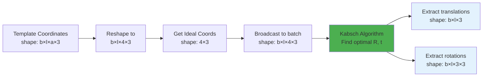
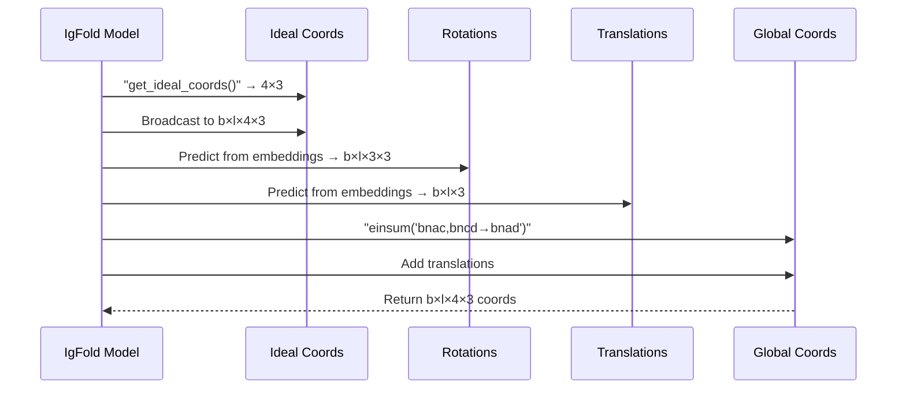
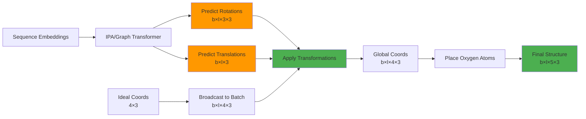

Ideal Coordinate Transformation represents a fundamental geometric technique in IgFold's structure prediction pipeline. By transforming idealized residue conformations with learned rotations and translations, the model generates accurate 3D antibody structures while preserving correct bond geometry and stereochemistry. This approach decouples local backbone geometry from global positioning, enabling the neural network to focus on predicting transformation parameters rather than absolute coordinates.

## Ideal Coordinate Representation

IgFold constructs ideal backbone coordinates using standard peptide bond geometry derived from the Engh and Huber parameter set. These coordinates establish a canonical reference frame for each amino acid residue, capturing the correct bond lengths, bond angles, and dihedral relationships for a trans-peptide conformation.

The `get_ideal_coords()` function generates a template with four backbone atoms (N, CA, C, CB) positioned in a local coordinate system:

```python
N = torch.tensor([[0, 0, -1.458]], dtype=float)  # Nitrogen atom
A = torch.tensor([[0, 0, 0]], dtype=float)       # CA atom (origin)
B = torch.tensor([[0, 1.426, 0.531]], dtype=float)  # CB atom (beta-carbon)
```

Sources: [coordinates.py](/igfold/utils/coordinates.py#L34-L36)

The C atom is placed using `place_fourth_atom()`, which implements internal coordinate calculations. Given three reference atoms (B, A, N), the function computes the fourth atom's position using bond length (2.460 Å), planar angle (0.615 radians ≈ 35.2°), and dihedral angle (-2.143 radians ≈ -122.8°). These parameters correspond to standard trans-peptide geometry.

Sources: [coordinates.py](/igfold/utils/coordinates.py#L37-L44)

> [!TIP]
> The ideal coordinates are computed once and reused across all residues in the batch. This optimization eliminates redundant geometry calculations and ensures consistent stereochemistry throughout the predicted structure.

### Internal Coordinate Construction

The `place_fourth_atom()` function implements a classic internal coordinate algorithm that converts bond lengths, angles, and dihedrals into Cartesian coordinates. This method is numerically stable and preserves exact geometric relationships:

Sources: [coordinates.py](/igfold/utils/coordinates.py#L4-L30)

```mermaid
flowchart TD
    A[Input: 3 coords + length + planar + dihedral] --> B[Compute BC unit vector]
    B --> C[Compute normal vector N]
    C --> D[Construct orthonormal basis<br/>m = [bc_vec, n×bc_vec, n]]
    D --> E[Express displacement vector d<br/>in basis m]
    E --> F[Final coord = C + Σ mi·di]
    
    style B fill:#e3f2fd
    style D fill:#e3f2fd
    style F fill:#4caf50
```

The algorithm constructs an orthonormal basis from the three input atoms, then expresses the new atom's displacement vector in this basis. The displacement components are computed as:
- d₁ = length × cos(planar)
- d₂ = length × sin(planar) × cos(dihedral)
- d₃ = -length × sin(planar) × sin(dihedral)

Sources: [coordinates.py](/igfold/utils/coordinates.py#L21-L26)

### Oxygen Atom Placement

After backbone coordinates are generated, oxygen atoms are added using `place_o_coords()`. This function positions each O atom relative to the current residue's CA and C atoms, and the next residue's N atom. The oxygen is placed with a bond length of 1.231 Å, planar angle of 2.108 radians (120.8°), and dihedral of -3.142 radians (-180°), forming the characteristic carbonyl group.

Sources: [coordinates.py](/igfold/utils/coordinates.py#L57-L74)

## Transformation Estimation Pipeline

The transformation estimation process computes the optimal rotation and translation that align ideal coordinates with template or predicted structures. This is accomplished through the Kabsch algorithm, which finds the optimal rigid transformation minimizing the RMSD between two point sets.

Sources: [IgFold.py](/igfold/model/IgFold.py#L114-L143)

The `get_coords_tran_rot()` method orchestrates this process:



The function reshapes template coordinates from `b × (l×a) × 3` to `b × l × 4 × 3` where b is batch size, l is sequence length, and a=4 is atoms per residue. The ideal coordinates are then broadcast to match the batch dimensions.

Sources: [IgFold.py](/igfold/model/IgFold.py#L120-L131)

The Kabsch algorithm returns rotation matrices (shape `b × l × 3 × 3`) and translation vectors (shape `b × l × 1 × 3`), which represent the per-residue transformations needed to align each ideal backbone conformation with the target structure.

Sources: [IgFold.py](/igfold/model/IgFold.py#L132-L136)

> [!TIP]
> Per-residue transformations allow local conformational flexibility while maintaining correct bond geometry. The model learns these transformations from sequence embeddings and template information, enabling accurate prediction of diverse antibody structures.

## Coordinate Transformation Application

Once rotations and translations are predicted, the `transform_ideal_coords()` method applies these transformations to generate final atomic coordinates. This step converts local ideal coordinates to global 3D positions through batched matrix operations.

Sources: [IgFold.py](/igfold/model/IgFold.py#L405-L425)

The transformation follows a standard rigid-body transformation:

```
points_global = R × points_local + t
```

Where R is the rotation matrix, t is the translation vector, and points_local are the ideal backbone coordinates. The implementation uses Einstein summation for efficient batch computation:

```python
points_global = torch.einsum(
    'b n a c, b n c d -> b n a d',
    ideal_coords,
    rotations,
) + rearrange(translations, "b l d -> b l () d")
```

Sources: [IgFold.py](/igfold/model/IgFold.py#L416-L423)

The ideal coordinates have shape `b × l × 4 × 3`, rotations have shape `b × l × 3 × 3`, and translations have shape `b × l × 3`. The einsum operation performs batched matrix multiplication, applying each residue's rotation to its four atoms. The translation is then added to produce the final global coordinates.

### Batched Transformation Workflow



This batched approach enables simultaneous processing of multiple sequences, maximizing GPU utilization and minimizing memory overhead through vectorized operations.

Sources: [IgFold.py](/igfold/model/IgFold.py#L409-L415)

## Local Reference Frames

The `coords_to_frame()` function converts atomic coordinates into local reference frames, providing an alternative representation useful for structure analysis and downstream processing. Each frame consists of a translation (CA atom position) and a rotation matrix defining the residue's orientation.

Sources: [geometry.py](/igfold/utils/geometry.py#L61-L77)

The reference frame is constructed from the N-CA-C backbone atoms:

```python
N, CA, C, _ = coords.unbind(-2)
CA_N = normed_vec(N - CA, eps=eps)
CA_C = normed_vec(C - CA, eps=eps)
n1 = CA_N
n2 = normed_cross(n1, CA_C, eps=eps)
n3 = normed_cross(n1, n2, eps=eps)
rot = torch.stack([n1, n2, n3], -1)
```

Sources: [geometry.py](/igfold/utils/geometry.py#L69-L75)

The rotation matrix columns form an orthonormal basis:
- n₁: N → CA direction (points from CA to N)
- n₂: Perpendicular to both CA-N and CA-C (defined via cross product)
- n₃: Perpendicular to n₁ and n₂ (completes right-handed coordinate system)

This local frame representation is invariant to global translations and rotations, making it suitable for comparing local geometries across different structures.

Sources: [geometry.py](/igfold/utils/geometry.py#L7-L11)

## Geometric Utility Functions

The coordinate transformation system relies on several fundamental geometric primitives for distance, angle, and dihedral calculations.

### Vector Operations

The `normed_vec()` function normalizes vectors with numerical stability, adding an epsilon term to prevent division by zero:

Sources: [geometry.py](/igfold/utils/geometry.py#L7-L12)

```python
mag_sq = torch.sum(vec**2, dim=-1, keepdim=True)
mag = torch.sqrt(mag_sq + eps)
vec = vec / mag
```

The `normed_cross()` function computes normalized cross products, useful for constructing perpendicular vectors and local coordinate systems.

Sources: [geometry.py](/igfold/utils/geometry.py#L15-L20)

### Angle Calculations

The `angle()` function computes the bond angle between three atoms (x₁-x₂-x₃) using the dot product of normalized direction vectors:

Sources: [geometry.py](/igfold/utils/geometry.py#L38-L43)

The `dihedral()` function calculates torsion angles between four atoms (x₁-x₂-x₃-x₄), which is essential for peptide backbone conformation analysis:

Sources: [geometry.py](/igfold/utils/geometry.py#L46-L58)

```python
b1 = normed_vec(x_1 - x_2)
b2 = normed_vec(x_2 - x_3)
b3 = normed_vec(x_3 - x_4)
n1 = normed_cross(b1, b2)
n2 = normed_cross(b2, b3)
m1 = normed_cross(n1, b2)
x = (n1 * n2).sum(-1)
y = (m1 * n2).sum(-1)
dih = torch.atan2(y, x)
```

This implementation uses the two-argument arctangent function to provide the correct quadrant and handle the -π to π range of dihedral angles.

## Integration with Model Architecture

The ideal coordinate transformation system is tightly integrated with IgFold's forward pass and gradient-based refinement. During training, the model predicts rotations and translations from sequence embeddings, which are then applied to ideal coordinates. The resulting structures are scored against ground truth coordinates using coordinate losses, bond length losses, and torsion angle losses.

Sources: [IgFold.py](/igfold/model/IgFold.py#L196-L371)

The `IgFoldOutput` dataclass captures the transformation parameters alongside the final coordinates:

```python
@dataclass
class IgFoldOutput():
    coords: torch.FloatTensor              # b × (l×a) × 3
    prmsd: torch.FloatTensor                # Per-residue RMSD estimates
    translations: torch.FloatTensor        # b × l × 3
    rotations: torch.FloatTensor           # b × l × 3 × 3
    # ... additional loss terms
```

Sources: [interface.py](/igfold/model/interface.py#L22-L35)

The translations and rotations are stored for downstream analysis, debugging, and potential iterative refinement through gradient descent.

### Prediction to Structure Pipeline



This architecture separates geometric constraints (enforced by ideal coordinates) from conformational diversity (learned through rotations and translations), enabling the model to predict accurate antibody structures while maintaining chemically valid backbone geometry.

Sources: [IgFold.py](/igfold/model/IgFold.py#L1-L15)

For deeper understanding of the coordinate prediction and RMSD estimation mechanisms, see [Coordinate Prediction and RMSD Estimation](12-coordinate-prediction-and-rmsd-estimation). To explore how gradients refine these transformed structures, refer to [Gradient-Based Structure Refinement](15-gradient-based-structure-refinement).