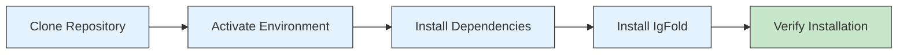

This page provides comprehensive guidance for installing IgFold and configuring your environment for antibody structure prediction. IgFold supports multiple installation methods and optional components for structure refinement and renumbering.

## Installation Options Overview

IgFold offers flexible installation approaches depending on your use case and development environment. The following table compares the available installation methods:


| Installation Method | Best For | Difficulty | Version Control |
|---------------------|----------|------------|-----------------|
| **PyPI via pip** | Quick deployment, production use | Easy | PyPI releases |
| **Git clone** | Latest features, development, customization | Moderate | Main branch access |
| **Google Colab** | Testing, educational use, no local setup | Very Easy | Pre-configured |

## System Requirements

IgFold requires Python 3.7 or higher with specific hardware and software dependencies:

**Hardware Requirements:**
- **CPU**: Multi-core processor recommended for batch processing
- **GPU**: CUDA-compatible GPU with 4GB+ VRAM (optional but strongly recommended)
- **RAM**: Minimum 8GB, 16GB+ recommended for large-scale predictions
- **Disk Space**: ~500MB for core installation, additional space for model weights

**Software Prerequisites:**
- Python 3.7-3.10
- pip or conda package manager
- CUDA Toolkit (if using GPU): 11.0+ for PyTorch compatibility

## Quick Installation via PyPI

The fastest way to get started with IgFold is through PyPI. This method installs the stable release with all core dependencies:

```bash
# Create a dedicated conda environment (recommended)
conda create -n igfold python=3.8 -y
conda activate igfold

# Install IgFold via pip
pip install igfold
```

The installation automatically resolves and installs required dependencies including PyTorch, PyTorch Lightning, BioPython, and antibody embedding libraries.
Sources: [setup.cfg](setup.cfg#L1-L15), [pyproject.toml](pyproject.toml#L1-L3)

## Installation from Source

For access to the latest development features and custom modifications, installing from source provides complete control:



Execute the following commands step by step:

```bash
# 1. Clone the repository
git clone https://github.com/Graylab/IgFold.git
cd IgFold

# 2. Create and activate conda environment
conda create -n igfold python=3.8 -y
conda activate igfold

# 3. Install IgFold in development mode
pip install -e .
```

This installation method keeps your installation linked to the source directory, allowing you to pull updates immediately.
Sources: [README.md](README.md#L30-L33)

## Core Dependencies

IgFold depends on several scientific computing packages that are automatically installed:

| Package | Purpose | Minimum Version |
|---------|---------|-----------------|
| **torch** | Deep learning framework | ≥1.7.1 |
| **pytorch-lightning** | Training/inference orchestration | ≥1.5.10, <1.9.0 |
| **biopython** | PDB file parsing and biological data | ≥1.79 |
| **einops** | Tensor manipulation operations | ≥0.3.0 |
| **antiberty** | Antibody sequence embeddings | ≥0.1.1 |

These dependencies ensure compatibility with the IgFold model architecture and input processing pipeline.
Sources: [setup.cfg](setup.cfg#L8-L12), [requirements.txt](requirements.txt#L1-L13)

## Optional Refinement Installation

IgFold supports two structure refinement methods to improve prediction accuracy. Refinement is optional but recommended for high-quality results.

### PyRosetta Refinement (Recommended)

PyRosetta provides comprehensive structure refinement following the methodology described in the IgFold publication. Installation requires an academic license:

```bash
# Follow PyRosetta installation instructions at http://pyrosetta.org/downloads
# Typical installation for Python 3.8:
pip install pyrosetta-installer
pyrosetta-installer install python3.8 --license academic
```

Once installed, PyRosetta is initialized in your code before prediction:

```python
from igfold.refine.pyrosetta_ref import init_pyrosetta
init_pyrosetta()
```

Sources: [README.md](README.md#L34-L38), [igfold/refine/pyrosetta_ref.py](igfold/refine/pyrosetta_ref.py#L1-L10)

### OpenMM Refinement (Alternative)

If PyRosetta is unavailable, OpenMM provides molecular dynamics-based refinement as a fallback option:

```bash
conda install -c conda-forge openmm==7.7.0 pdbfixer
```

OpenMM refinement is automatically used when PyRosetta is not installed during prediction.
Sources: [README.md](README.md#L38-L40), [igfold/refine/openmm_ref.py](igfold/refine/openmm_ref.py#L1-L10)

## Optional Antibody Renumbering

Antibody renumbering standardizes residue numbering schemes for analysis and comparison. This requires the AbNumber package:

```bash
conda install -c bioconda abnumber
```

Renumbering uses the Chothia scheme by default, which is widely adopted in antibody engineering and analysis. This feature is optional but recommended for integrating predictions with other antibody analysis tools.
Sources: [README.md](README.md#L42-L44)

## Google Colab Quick Start

For immediate experimentation without local installation, use the pre-configured Google Colab notebook:

```python
# Open the notebook in your browser
https://colab.research.google.com/github/Graylab/IgFold/blob/main/IgFold.ipynb
```

The Colab environment includes all dependencies and provides interactive examples for antibody, nanobody, and single-chain structure prediction.
Sources: [README.md](README.md#L10-L12)

## Installation Verification

After installation, verify your setup with a quick test:

```python
from igfold import IgFoldRunner

# Initialize the runner
igfold = IgFoldRunner()

# Test sequence
sequences = {
    "H": "EVQLVQSGPEVKKPGTSVKVSCKASGFTFMSSAVQWVRQARGQRLEWIGWIVIGSGNTNYAQKFQERVTITRDMSTSTAYMELSSLRSEDTAVYYCAAPYCSSISCNDGFDIWGQGTMVTVS"
}

# Predict structure
igfold.fold(
    "test_antibody.pdb",
    sequences=sequences,
    do_refine=False,  # Skip refinement for quick test
    do_renum=False    # Skip renumbering for quick test
)

print("IgFold installation verified successfully!")
```

This test downloads required model weights (~200MB) on first run and generates a test structure prediction.
Sources: [igfold/IgFoldRunner.py](igfold/IgFoldRunner.py#L30-L36), [igfold/IgFoldRunner.py](igfold/IgFoldRunner.py#L77-L90)

## Troubleshooting Common Issues

> [!TIP]
> When experiencing CUDA errors, ensure your PyTorch version matches your CUDA installation. The default installation includes CPU-only PyTorch; install GPU-enabled PyTorch with `pip install torch torchvision --index-url https://download.pytorch.org/whl/cu118` for CUDA 11.8 support.

| Issue | Possible Cause | Solution |
|-------|----------------|----------|
| **ImportError: No module named 'igfold'** | Installation in different environment | Verify `conda activate igfold` and installation location |
| **CUDA out of memory** | GPU has insufficient VRAM | Use `try_gpu=False` in IgFoldRunner or process sequences individually |
| **PyRosetta initialization fails** | Missing academic license | Register and install proper PyRosetta license from pyrosetta.org |
| **Model download hangs** | Network connectivity issues | Check internet connection; model weights download on first use only |
| **AbNumber not found** | Bioconda channel not configured | Use `conda config --add channels bioconda` before installation |

> [!TIP]
> Model weights are automatically downloaded from the Hugging Face hub on first prediction. Ensure you have internet connectivity during the first run; subsequent predictions use cached weights.

## Environment Configuration Summary

The recommended production environment configuration combines all optional features:

```bash
# Complete environment setup with all features
conda create -n igfold python=3.8 -y
conda activate igfold

# Core installation
pip install igfold

# Refinement (PyRosetta - recommended)
pip install pyrosetta-installer
pyrosetta-installer install python3.8 --license academic

# Alternative refinement (OpenMM)
conda install -c conda-forge openmm==7.7.0 pdbfixer

# Renumbering support
conda install -c bioconda abnumber

# GPU support (if available)
pip install torch torchvision --index-url https://download.pytorch.org/whl/cu118
```

This configuration provides access to all IgFold features including structure prediction, refinement options, and antibody renumbering capabilities.
Sources: [setup.cfg](setup.cfg#L1-L15), [requirements.txt](requirements.txt#L1-L13)

## Next Steps

After successful installation, proceed to the [Basic Antibody Structure Prediction](4-basic-antibody-structure-prediction) page to learn how to use IgFold for predicting antibody structures from sequence data. For understanding the underlying model architecture, see [IgFold Model Architecture](6-igfold-model-architecture) in the Deep Dive section.