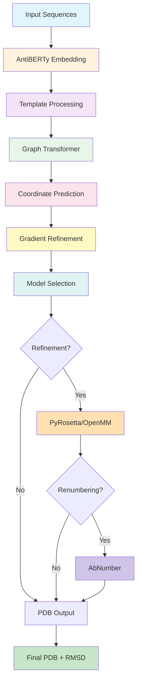
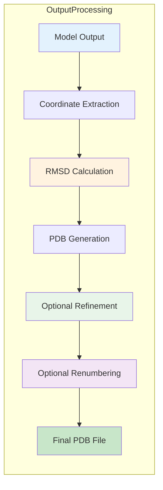

Basic antibody structure prediction with IgFold enables fast, accurate generation of 3D antibody models directly from amino acid sequences. IgFold leverages deep learning trained on massive datasets of natural antibody structures, achieving prediction times of under one minute while maintaining high accuracy comparable to experimental structures. The system supports paired heavy-light chain antibodies, nanobodies, and individual chains through a unified interface that handles sequence embedding, structural prediction, optional refinement, and standardized output formatting.

## Architecture Overview

IgFold's prediction pipeline follows a modular architecture where sequence inputs are processed through a language model, transformed by a graph neural network, and optionally refined with physics-based methods. The system uses ensemble prediction across multiple pre-trained models, selecting the best output based on predicted RMSD confidence scores. This design balances computational efficiency with structural accuracy while providing flexible configuration options for different use cases.



Sources: [igfold/IgFoldRunner.py](/igfold/IgFoldRunner.py#L26-L125), [igfold/utils/folding.py](/igfold/utils/folding.py#L153-L232), [igfold/model/interface.py](/igfold/model/interface.py#L6-L40)

## Core Prediction Workflow

The `IgFoldRunner` class serves as the primary interface for structure prediction, initializing multiple pre-trained models and the AntiBERTy sequence encoder automatically. When instantiated, the runner loads up to four ensemble models from the trained_models directory, along with the AntiBERTy language model for sequence embedding. The system automatically detects and uses GPU acceleration when available through CUDA, falling back to CPU processing otherwise. Models are loaded in evaluation mode with all four pre-trained checkpoints available for ensemble prediction by default.


The prediction process begins by loading the models and language encoder onto the appropriate device, then processing input sequences through several stages. Sequences can be provided as dictionaries mapping chain names to amino acid strings, through FASTA files, or both. The system automatically generates FASTA files if not provided, ensuring consistent input processing across all components. Each model in the ensemble produces independent predictions with confidence estimates, and the runner selects the highest-quality output based on predicted RMSD quantile scores.

Sources: [igfold/IgFoldRunner.py](/igfold/IgFoldRunner.py#L30-L75), [igfold/utils/folding.py](/igfold/utils/folding.py#L153-L221)

## Sequence Input Configuration

Input sequences must follow standard antibody notation with chain identifiers. Paired antibodies use "H" for heavy chains and "L" for light chains, while nanobodies or single chains use any single-letter identifier. The system automatically validates sequence length and composition during processing. Sequences are provided as Python dictionaries where keys represent chain IDs and values contain the amino acid sequences as strings.

```python
from igfold import IgFoldRunner

# Paired heavy-light chain antibody
sequences = {
    "H": "EVQLVQSGPEVKKPGTSVKVSCKASGFTFMSSAVQWVRQARGQRLEWIGWIVIGSGNTNYAQKFQERVTITRDMSTSTAYMELSSLRSEDTAVYYCAAPYCSSISCNDGFDIWGQGTMVTVS",
    "L": "DVVMTQTPFSLPVSLGDQASISCRSSQSLVHSNGNTYLHWYLQKPGQSPKLLIYKVSNRFSGVPDRFSGSGSGTDFTLKISRVEAEDLGVYFCSQSTHVPYTFGGGTKLEIK"
}

# Initialize prediction runner
igfold = IgFoldRunner(num_models=4)
```

Alternative input methods include FASTA files, which provide standardized sequence formatting and enable batch processing. When FASTA files are specified without sequences, the system extracts chain information from sequence headers. This approach integrates seamlessly with existing bioinformatics pipelines and facilitates processing multiple antibodies in a single operation.

Sources: [igfold/utils/folding.py](/igfold/utils/folding.py#L13-L29), [igfold/utils/folding.py](/igfold/utils/folding.py#L168-L188)

## Template-Based Prediction

IgFold supports template-based structure prediction where known structures guide the folding process. Template structures are provided as PDB files and are processed to extract backbone atom coordinates (N, CA, C, CB) for each residue. The system aligns templates to target sequences and generates masks indicating which template positions are valid for use during prediction. This approach improves accuracy for antibodies with known structural homologs while maintaining the ability to predict novel sequences without templates.

Template processing includes automatic filtering based on quality criteria, including removal of coordinates with missing or invalid data. The system supports selective template usage through the `ignore_cdrs` parameter, which allows excluding specific complementarity determining regions (h1, h2, h3, l1, l2, l3) from template constraints. Additionally, entire chains can be ignored through the `ignore_chain` parameter, enabling hybrid predictions where only certain chains use template information.

Sources: [igfold/utils/folding.py](/igfold/utils/folding.py#L30-L75), [igfold/IgFoldRunner.py](/igfold/IgFoldRunner.py#L77-L104)

## Model Prediction Pipeline

The core prediction pipeline transforms sequence embeddings into 3D atomic coordinates through a multi-stage neural network process. AntiBERTy generates initial sequence embeddings and attention maps from input sequences, capturing evolutionary and structural information. These embeddings are trimmed to remove special start/end tokens and formatted for batch processing. The graph transformer network then processes these representations through multiple layers of invariant point attention, generating intermediate structural representations that incorporate both sequence and template information when available.

Each ensemble model performs independent forward passes, producing coordinate predictions along with corresponding predicted RMSD values for each residue atom position. The models automatically apply gradient-based refinement during prediction, optimizing coordinates through 80 refinement steps to improve local geometry. The ensemble's predictions are ranked by their 90th percentile predicted RMSD values, with the lowest-scoring model selected as the final output. This ensemble approach improves prediction robustness and provides built-in confidence estimation.

> [!TIP]
> The ensemble model selection uses the 90th percentile of predicted RMSD values (prmsd.quantile(0.9)) as the quality metric, ensuring selection of models with the most consistent coordinate predictions across the entire structure.

Sources: [igfold/utils/folding.py](/igfold/utils/folding.py#L190-L220), [igfold/model/IgFold.py](/igfold/model/IgFold.py#L196-L371)

## Output Processing and Confidence Estimation

Predicted coordinates undergo post-processing to generate PDB-formatted output files with per-residue confidence estimates. The system calculates root-mean-square deviation predictions for each residue's N, CA, C, and CB atoms, which serve as quality indicators for local structural accuracy. These RMSD values are written to the B-factor column of the output PDB file, enabling visualization of prediction confidence through standard molecular viewers that color structures by B-factor values.



The output structure includes full backbone atoms (N, CA, C, CB, O) with chain assignments based on input sequences. When FASTA files contain multiple sequences, the system automatically assigns chain identifiers and handles residue numbering across chain boundaries. The generated PDB files follow standard formatting conventions and can be directly used in downstream applications including structural analysis, docking studies, and computational design workflows.

Sources: [igfold/utils/folding.py](/igfold/utils/folding.py#L78-L115), [igfold/utils/folding.py](/igfold/utils/folding.py#L144-L150)

## Configuration Parameters

The `fold()` method provides extensive configuration options for customizing the prediction process to specific requirements. These parameters control input handling, template usage, post-processing steps, and output formatting. Understanding these options enables users to balance prediction speed, accuracy, and computational resources according to their needs.

| Parameter | Type | Default | Description |
|-----------|------|---------|-------------|
| `pdb_file` | str | Required | Output PDB file path for predicted structure |
| `fasta_file` | str | Optional | Input FASTA file containing antibody sequences |
| `sequences` | dict | Optional | Dictionary mapping chain names to amino acid sequences |
| `template_pdb` | str | Optional | Template PDB file for homology-based prediction |
| `ignore_cdrs` | list/bool/str | None | CDR regions to exclude from template (e.g., ["h3"]) |
| `ignore_chain` | str | None | Chain identifier to exclude from template usage |
| `skip_pdb` | bool | False | Skip PDB file writing and return model output directly |
| `do_refine` | bool | True | Perform PyRosetta or OpenMM refinement on prediction |
| `use_openmm` | bool | False | Use OpenMM instead of PyRosetta for refinement |
| `do_renum` | bool | True | Renumber output PDB to Chothia scheme using AbNumber |
| `truncate_sequences` | bool | False | Truncate sequences to framework regions only |

Sources: [igfold/IgFoldRunner.py](/igfold/IgFoldRunner.py#L77-L104), [igfold/IgFoldRunner.py](/igfold/IgFoldRunner.py#L91-L104)

## Complete Prediction Example

A complete antibody structure prediction workflow includes initialization, sequence specification, prediction execution, and output handling. This example demonstrates prediction with PyRosetta refinement and Chothia renumbering enabled, representing the recommended configuration for high-quality structural models.

```python
from igfold import IgFoldRunner
from igfold.refine.pyrosetta_ref import init_pyrosetta

# Initialize PyRosetta for refinement (required if do_refine=True)
init_pyrosetta()

# Define antibody sequences (heavy and light chains)
sequences = {
    "H": "EVQLVQSGPEVKKPGTSVKVSCKASGFTFMSSAVQWVRQARGQRLEWIGWIVIGSGNTNYAQKFQERVTITRDMSTSTAYMELSSLRSEDTAVYYCAAPYCSSISCNDGFDIWGQGTMVTVS",
    "L": "DVVMTQTPFSLPVSLGDQASISCRSSQSLVHSNGNTYLHWYLQKPGQSPKLLIYKVSNRFSGVPDRFSGSGSGTDFTLKISRVEAEDLGVYFCSQSTHVPYTFGGGTKLEIK"
}

# Specify output file
pred_pdb = "my_antibody.pdb"

# Initialize runner with default 4-model ensemble
igfold = IgFoldRunner()

# Execute prediction with refinement and renumbering
out = igfold.fold(
    pred_pdb,              # Output PDB file path
    sequences=sequences,    # Antibody heavy and light chain sequences
    do_refine=True,        # Apply PyRosetta refinement
    do_renum=True,         # Renumber to Chothia scheme
)

# Access predicted RMSD values (shape: 1, num_residues, 4)
predicted_rmsd = out.prmsd
```

The model output object contains comprehensive prediction data including atomic coordinates, predicted RMSD values, and optional embedding representations. Predicted RMSD values provide per-residue confidence estimates that can be used to assess local model quality and guide interpretation of structural features.

Sources: [README.md](/README.md#L49-L72), [README.md](/README.md#L115-L140), [igfold/IgFoldRunner.py](/igfold/IgFoldRunner.py#L77-L124)

## Prediction Without Refinement

For applications requiring maximum speed or when high-resolution refinement is unnecessary, predictions can be generated without physics-based refinement. This approach reduces prediction time to under 30 seconds while still providing accurate backbone coordinates suitable for many downstream applications including epitope mapping, structural comparison, and initial screening.

```python
from igfold import IgFoldRunner

sequences = {
    "H": "EVQLVQSGPEVKKPGTSVKVSCKASGFTFMSSAVQWVRQARGQRLEWIGWIVIGSGNTNYAQKFQERVTITRDMSTSTAYMELSSLRSEDTAVYYCAAPYCSSISCNDGFDIWGQGTMVTVS",
    "L": "DVVMTQTPFSLPVSLGDQASISCRSSQSLVHSNGNTYLHWYLQKPGQSPKLLIYKVSNRFSGVPDRFSGSGSGTDFTLKISRVEAEDLGVYFCSQSTHVPYTFGGGTKLEIK"
}

igfold = IgFoldRunner()
out = igfold.fold(
    "fast_prediction.pdb",
    sequences=sequences,
    do_refine=False,  # Skip refinement for faster prediction
    do_renum=True,    # Still apply renumbering for standardized output
)
```

> [!TIP]
> Predictions without refinement maintain RMSD confidence estimates in B-factor columns, enabling quality assessment without the computational overhead of physics-based optimization. The gradient-based refinement applied during model forward passes already provides substantial local geometry improvement.

Sources: [README.md](/README.md#L96-L113), [igfold/model/IgFold.py](/igfold/model/IgFold.py#L427-L453)

## Next Steps

After mastering basic antibody structure prediction, explore advanced features and specialized applications:

- **[IgFold Model Architecture](6-igfold-model-architecture)** - Understand the graph transformer and invariant point attention mechanisms powering predictions
- **[PyRosetta Refinement Method](13-pyrosetta-refinement-method)** - Learn detailed configuration options for physics-based structure optimization
- **[OpenMM Refinement Method](14-openmm-refinement-method)** - Alternative refinement approach when PyRosetta is unavailable
- **[Predicting Nanobody and Single Chain Structures](5-predicting-nanobody-and-single-chain-structures)** - Specialized workflows for single-domain antibodies
- **[Coordinate Prediction and RMSD Estimation](12-coordinate-prediction-and-rmsd-estimation)** - Detailed explanation of confidence metrics and coordinate generation