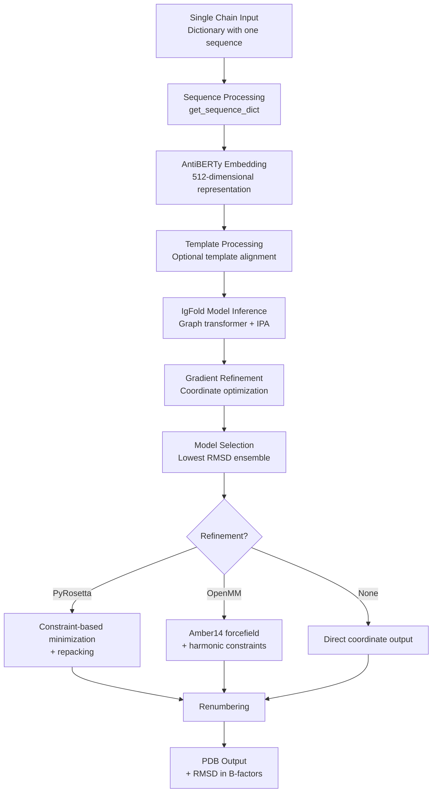

IgFold provides robust capabilities for predicting nanobody (single-domain antibody) and single chain antibody structures using the same deep learning framework designed for conventional paired antibodies. The model handles single-chain inputs seamlessly, leveraging AntiBERTy embeddings and graph transformer architectures to generate accurate 3D coordinate predictions. Nanobodies, being approximately 12-15 kDa single-domain proteins derived from heavy-chain-only antibodies, present unique structural characteristics that IgFold's architecture effectively captures.

## Architecture Overview


The prediction pipeline for nanobodies and single chains follows the same computational architecture as paired antibodies, with the key distinction being the input sequence format. The `IgFoldRunner` serves as the primary interface, managing model loading, inference, and post-processing across single-chain scenarios.

Sources: [IgFoldRunner.py](igfold/IgFoldRunner.py#L26-L29), [folding.py](igfold/utils/folding.py#L153-L167)



## Single Chain Prediction Workflow

The core prediction logic resides in the `fold` function within `igfold/utils/folding.py`, which processes sequence input through a multi-stage pipeline. For nanobodies, you provide a single sequence dictionary rather than paired heavy and light chains. The system automatically handles the single-chain case without requiring special configuration beyond the input format.

Sources: [folding.py](igfold/utils/folding.py#L153-L232)

The sequence input is normalized through `get_sequence_dict`, which accepts either a dictionary mapping chain identifiers to sequences or a FASTA file path. For nanobodies, you typically use a heavy chain identifier ("H") with the nanobody sequence:

```python
sequences = {
    "H": "QVQLQESGGGLVQAGGSLTLSCAVSGLTFSNYAMGWFRQAPGKEREFVAAITWDGGNTYYTDSVKGRFTISRDNAKNTVFLQMNSLKPEDTAVYYCAAKLLGSSRYELALAGYDYWGQGTQVTVS"
}
```

The embedding generation stage uses AntiBERTy to create sequence representations, with the CLS and SEP tokens removed (indices 0 and -1) before passing to the structure prediction model. Template processing is optional but can improve accuracy for nanobodies with structural homologs.

Sources: [folding.py](igfold/utils/folding.py#L174-L184), [fasta.py](igfold/utils/fasta.py#L4-L29)

> [!TIP]
> When predicting nanobody structures, ensure your sequence includes the complete C-terminal region. Nanobodies have characteristic conserved motifs in FR4 and CDR3 that are crucial for accurate prediction—truncating these regions can significantly impact structural accuracy.

## Configuration Parameters and Options

The `IgFoldRunner.fold` method provides comprehensive control over the prediction pipeline. The following parameters are particularly relevant for nanobody and single chain predictions:

| Parameter | Type | Default | Description | Nanobody Notes |
|-----------|------|---------|-------------|----------------|
| `sequences` | dict | None | Dictionary mapping chain IDs to sequences | Use single entry with "H" key for nanobodies |
| `fasta_file` | str | None | Alternative input via FASTA file | Single chain sequence in file |
| `do_refine` | bool | True | Enable post-prediction refinement | Recommended for nanobodies |
| `use_openmm` | bool | False | Use OpenMM instead of PyRosetta | Alternative if PyRosetta unavailable |
| `do_renum` | bool | True | Renumber with Chothia scheme | Ensures consistent numbering |
| `template_pdb` | str | None | Template structure for guidance | Useful for related nanobodies |
| `truncate_sequences` | bool | False | Truncate with AbNumber | Use if sequence includes non-variable regions |

Sources: [IgFoldRunner.py](igfold/IgFoldRunner.py#L77-L90), [README.md](README.md#L75-L90)

## Input Format Specifications

Nanobody and single chain sequences must be provided in a specific format compatible with IgFold's processing pipeline. The system accepts two primary input methods:

### Dictionary Input

The preferred method for programmatic usage is a Python dictionary where keys are chain identifiers and values are amino acid sequences as strings:

```python
from igfold import IgFoldRunner
from igfold.refine.pyrosetta_ref import init_pyrosetta

init_pyrosetta()

sequences = {
    "H": "QVQLQESGGGLVQAGGSLTLSCAVSGLTFSNYAMGWFRQAPGKEREFVAAITWDGGNTYYTDSVKGRFTISRDNAKNTVFLQMNSLKPEDTAVYYCAAKLLGSSRYELALAGYDYWGQGTQVTVS"
}
pred_pdb = "my_nanobody.pdb"

igfold = IgFoldRunner()
igfold.fold(
    pred_pdb,
    sequences=sequences,
    do_refine=True,
    do_renum=True,
)
```

Sources: [README.md](README.md#L61-L80)

### FASTA File Input

For batch processing or file-based workflows, sequences can be provided in FASTA format. The `get_fasta_chain_dict` function parses FASTA files into the required dictionary format:

```python
# nanobody.fasta
# >H
# QVQLQESGGGLVQAGGSLTLSCAVSGLTFSNYAMGWFRQAPGKEREFVAAITWDGGNTYYTDSVKGRFTISRDNAKNTVFLQMNSLKPEDTAVYYCAAKLLGSSRYELALAGYDYWGQGTQVTVS
```

Sources: [fasta.py](igfold/utils/fasta.py#L13-L20)

## Refinement Methods for Single Chains

IgFold offers two distinct refinement approaches optimized for nanobody and single chain structures. Both methods preserve the global backbone fold while improving local geometry and atomic packing.

### PyRosetta Refinement

The default refinement method uses PyRosetta's constraint-based minimization framework. The process involves:

1. **Coordinate Constraints**: Backbone atoms (N, CA, C) are harmonically constrained to predicted positions using `AtomCoordinateCstMover`, maintaining the global fold
2. **Backbone Minimization**: Cartesian minimization with `lbfgs_armijo_nonmonotone` optimizer, allowing backbone movement within constraint weights
3. **Sidechain Repacking**: Rotamer optimization using `PackRotamersMover` with `RestrictToRepacking` to improve sidechain packing
4. **Final Minimization**: Second minimization pass with updated sidechain positions

The PyRosetta refinement uses the `ref2015_cst` score function with coordinated constraints weighted at 1.0 and dihedral constraints disabled to prioritize backbone fidelity.

Sources: [pyrosetta_ref.py](igfold/refine/pyrosetta_ref.py#L96-L125)

### OpenMM Refinement

OpenMM provides an alternative refinement approach using molecular mechanics forcefields:

1. **System Preparation**: `pdbfixer` adds missing atoms and hydrogens using the amber14/protein.ff14SB force field
2. **Harmonic Constraints**: Custom external force applied to backbone atoms (N, CA, C, CB) with stiffness parameter controlling constraint strength (default: 10.0 kcal/mol/Ų)
3. **Energy Minimization**: Langevin integrator minimization with specified tolerance (default: 2.39 kcal/mol)
4. **Platform Selection**: Supports both CPU and CUDA GPU acceleration

The OpenMM method is particularly useful when PyRosetta is unavailable or when GPU acceleration is desired for large-scale predictions.

Sources: [openmm_ref.py](igfold/refine/openmm_ref.py#L6-L44)

> [!TIP]
> For nanobody refinement, PyRosetta generally produces superior results due to its sophisticated rotamer library and constraint handling, but OpenMM provides a viable fallback. If using OpenMM, consider increasing the stiffness parameter (e.g., 15-20) for tighter constraints on nanobody frameworks where structural conservation is high.

## Output Interpretation and Quality Metrics

The prediction output includes both structural coordinates and quality assessment metrics:

### Predicted RMSD Values

IgFold estimates per-residue prediction accuracy and stores these values in the B-factor column of the output PDB file. These predictions cover four atoms per residue (N, CA, C, CB) and are accessible programmatically:

```python
out = igfold.fold(
    "nanobody.pdb",
    sequences=sequences,
    do_refine=True,
)

out.prmsd  # Tensor of shape (1, sequence_length, 4)
# Contains predicted RMSD for N, CA, C, CB atoms per residue
```

Lower RMSD values indicate higher prediction confidence. Framework regions typically show lower RMSD (<1.5Å) compared to CDR loops, especially CDR3 which is highly variable in nanobodies.

Sources: [IgFoldRunner.py](igfold/IgFoldRunner.py#L109-L125), [README.md](README.md#L102-L114)

### Model Ensemble Selection

When using multiple models (default: 4), IgFold automatically selects the best prediction based on the 90th percentile of predicted RMSD values. This ensemble approach improves robustness, particularly for challenging CDR3 conformations in nanobodies.

Sources: [folding.py](igfold/utils/folding.py#L190-L195)

## Renumbering and Structural Standards

Antibody renumbering ensures consistent residue numbering across structures using the Chothia scheme. For nanobodies, this process:

1. **Chain Identification**: Automatically identifies heavy chains using `is_heavy_chain()` logic from AbNumber
2. **Position Mapping**: Aligns sequence to standardized numbering positions
3. **Insertion Handling**: Properly codes insertion residues (e.g., 100A, 100B) in CDR regions

Renumbering is performed after refinement and is recommended for downstream applications requiring structural comparison or analysis.

Sources: [abnumber_.py](igfold/utils/abnumber_.py#L9-L13), [abnumber_.py](igfold/utils/abnumber_.py#L37-L81)

## Practical Code Examples

### Basic Nanobody Prediction

```python
from igfold import IgFoldRunner
from igfold.refine.pyrosetta_ref import init_pyrosetta

# Initialize PyRosetta for refinement
init_pyrosetta()

# Nanobody sequence (VHH domain)
sequences = {
    "H": "QVQLQESGGGLVQAGGSLTLSCAVSGLTFSNYAMGWFRQAPGKEREFVAAITWDGGNTYYTDSVKGRFTISRDNAKNTVFLQMNSLKPEDTAVYYCAAKLLGSSRYELALAGYDYWGQGTQVTVS"
}

# Initialize IgFold with default settings
igfold = IgFoldRunner(num_models=4)

# Predict structure with refinement and renumbering
out = igfold.fold(
    pdb_file="nanobody_prediction.pdb",
    sequences=sequences,
    do_refine=True,
    do_renum=True,
)

# Access quality metrics
predicted_rmsd = out.prmsd.mean().item()
print(f"Average predicted RMSD: {predicted_rmsd:.2f} Å")
```

### OpenMM Refinement Alternative

```python
from igfold import IgFoldRunner

sequences = {
    "H": "QVQLQESGGGLVQAGGSLTLSCAVSGLTFSNYAMGWFRQAPGKEREFVAAITWDGGNTYYTDSVKGRFTISRDNAKNTVFLQMNSLKPEDTAVYYCAAKLLGSSRYELALAGYDYWGQGTQVTVS"
}

igfold = IgFoldRunner()

# Use OpenMM for refinement instead of PyRosetta
out = igfold.fold(
    pdb_file="nanobody_openmm.pdb",
    sequences=sequences,
    do_refine=True,
    use_openmm=True,  # Enable OpenMM refinement
    do_renum=True,
)
```

### Template-Guided Prediction

When a homologous structure is available, template guidance can improve prediction accuracy:

```python
from igfold import IgFoldRunner

sequences = {
    "H": "QVQLQESGGGLVQAGGSLTLSCAVSGLTFSNYAMGWFRQAPGKEREFVAAITWDGGNTYYTDSVKGRFTISRDNAKNTVFLQMNSLKPEDTAVYYCAAKLLGSSRYELALAGYDYWGQGTQVTVS"
}

igfold = IgFoldRunner()

# Provide template structure for guidance
out = igfold.fold(
    pdb_file="nanobody_guided.pdb",
    sequences=sequences,
    template_pdb="related_nanobody.pdb",  # Template structure
    do_refine=True,
    do_renum=True,
)
```

## Best Practices for Nanobody Prediction

1. **Sequence Quality**: Ensure nanobody sequences include the complete variable domain from FR1 to FR4. Truncated sequences or those missing conserved framework regions can reduce prediction accuracy.

2. **Refinement Selection**: Use PyRosetta refinement (default) for optimal results, particularly for nanobodies with long CDR3 loops. OpenMM provides a viable alternative when PyRosetta is unavailable.

3. **Ensemble Models**: Maintain the default 4-model ensemble for robust predictions, especially for nanobodies with unusual CDR3 lengths or non-canonical structures.

4. **Template Utilization**: When available, use structurally related nanobodies as templates to guide prediction, particularly for framework regions where nanobodies show high conservation.

5. **Quality Assessment**: Examine predicted RMSD values in the output PDB B-factors to identify potentially unreliable regions, typically in CDR3 loops with high sequence variability.

Sources: [README.md](README.md#L61-L114), [folding.py](igfold/utils/folding.py#L153-L232)

## Integration with Downstream Analysis

The output structures can be integrated with various computational biology workflows:

- **Docking Studies**: Nanobody structures are suitable for protein-protein docking simulations using tools like HADDOCK or RosettaDock
- **Affinity Maturation**: Structure-guided mutagenesis based on predicted CDR conformations
- **Library Design**: Framework scaffolds for synthetic nanobody library construction
- **Biophysical Property Calculation**: Surface properties, electrostatics, and solvation energy analysis

Sources: [README.md](README.md#L116-L140)

## Next Steps

To deepen your understanding of IgFold's capabilities, explore these related topics:

- [IgFold Model Architecture](6-igfold-model-architecture) - Understand the graph transformer and IPA components underlying nanobody predictions
- [Sequence Input and Embedding Pipeline](9-sequence-input-and-embedding-pipeline) - Learn how AntiBERTy processes single-chain sequences
- [PyRosetta Refinement Method](13-pyrosetta-refinement-method) - Detailed exploration of the constraint-based refinement approach
- [OpenMM Refinement Method](14-openmm-refinement-method) - In-depth coverage of the molecular mechanics refinement strategy
- [Antibody Metrics and Quality Assessment](22-antibody-metrics-and-quality-assessment) - Comprehensive guide to interpreting prediction confidence metrics
