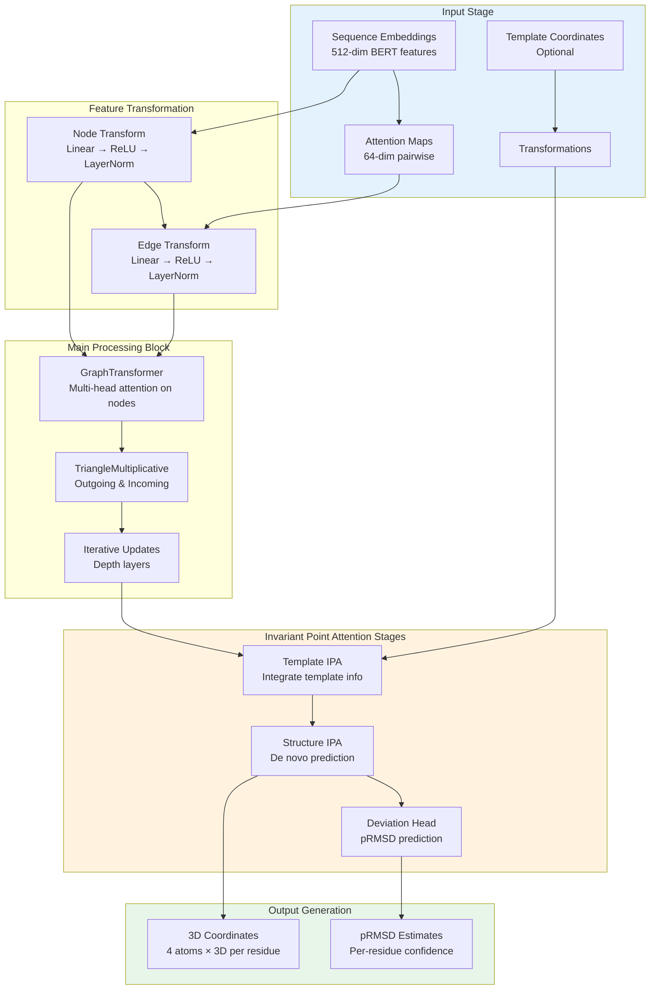

The IgFold model architecture represents a sophisticated deep learning system specifically designed for antibody structure prediction. Built on the principles of Invariant Point Attention (IPA) and Graph Transformers, the model transforms sequence embeddings into accurate 3D atomic coordinates through a carefully orchestrated three-stage pipeline. This architecture achieves high-accuracy predictions while maintaining computational efficiency, enabling rapid structure generation for massive antibody datasets.

## Core Design Philosophy

IgFold's architecture embodies a **sequence-to-structure transformation pipeline** that leverages both evolutionary information (from pretrained protein language models) and geometric constraints specific to antibody molecules. The design centers on three fundamental principles: **rotational invariance** for 3D coordinate prediction, **pairwise representation learning** for capturing inter-residue relationships, and **modular processing stages** that progressively refine structural representations. The model operates on a fixed 4-atom representation per residue (N, CA, C, O backbone atoms), enabling consistent output formats suitable for downstream structural analysis.

Sources: [IgFold.py](igfold/model/IgFold.py#L19-L48), [interface.py](igfold/model/interface.py#L6-L40)

## Architecture Overview



The model processes input through **five major computational stages**, each with distinct responsibilities. The input transformation stage adapts pretrained embeddings to the model's internal dimensionality, followed by iterative refinement through the TriangleGraphTransformer block. Template information integration (when available) occurs through the template IPA module, while the structure IPA module performs the primary coordinate prediction task. The deviation head provides confidence estimates for each predicted residue, enabling quality assessment without requiring experimental structures.

Sources: [IgFold.py](igfold/model/IgFold.py#L196-L370), [TriangleGraphTransformer.py](igfold/model/components/TriangleGraphTransformer.py#L8-L45)

## Component Architecture Details

### Input Representation Layer

The **feature transformation layer** converts pretrained BERT embeddings into the model's working representation space. BERT features (512-dimensional) pass through a three-stage transformation pipeline: linear projection to node dimension, ReLU activation, and layer normalization. Simultaneously, attention maps (64-dimensional) undergo similar transformation to produce edge representations. This dual-pathway design ensures that both sequence-level features (nodes) and pairwise relationships (edges) are appropriately scaled for subsequent processing.

```python
self.str_node_transform = nn.Sequential(
    nn.Linear(512, self.node_dim),  # Feature dimension reduction
    nn.ReLU(),
    nn.LayerNorm(self.node_dim),
)
self.str_edge_transform = nn.Sequential(
    nn.Linear(64, self.node_dim),   # Attention map expansion
    nn.ReLU(),
    nn.LayerNorm(self.node_dim),
)
```

The node dimension is configurable but typically set to accommodate the complexity of antibody structures. These transformed representations form the foundation for the graph-based processing that follows.

Sources: [IgFold.py](igfold/model/IgFold.py#L50-L65)

### Main TriangleGraphTransformer Block

The **TriangleGraphTransformer** represents the core innovation in IgFold's architecture, combining two complementary mechanisms for capturing both **node-node interactions** and **edge-edge relationships**. Each layer consists of three components executed sequentially: a GraphTransformer for updating node representations based on edge information, an outgoing triangle multiplicative module for capturing edge relationships in one direction, and an incoming triangle multiplicative module for the opposite direction.

| Component | Primary Function | Input | Output |
|-----------|------------------|-------|--------|
| GraphTransformer | Node aggregation using edges | Nodes, Edges | Updated nodes |
| Triangle Outgoing | Edge-outgoing edge relationships | Edges | Edge updates |
| Triangle Incoming | Edge-incoming edge relationships | Edges | Edge updates |

This architecture enables the model to learn **rich pairwise representations** that capture geometric constraints essential for accurate structure prediction. The iterative nature (configurable depth) allows progressive refinement of both node and edge features.

Sources: [TriangleGraphTransformer.py](igfold/model/components/TriangleGraphTransformer.py#L9-L45)

> [!TIP]
> The TriangleMultiplicativeModule implements **axial attention** over edge representations, enabling efficient O(N²) processing of pairwise relationships. This is critical for capturing the geometric constraints that define protein backbone conformations without incurring O(N³) complexity associated with full 3D graph operations.

### Invariant Point Attention (IPA) Modules

The **IPA architecture** comprises two specialized instances serving different purposes: the Template IPA (IPAEncoder) and Structure IPA (IPATransformer). Both modules leverage **Invariant Point Attention**, a mechanism that performs attention operations in a rotationally invariant space, making them ideal for 3D structure prediction tasks.

The **Template IPA** integrates structural information from homologous templates when available. It operates on node representations from the main block, combining them with pairwise edge representations and template coordinates (expressed as rotations and translations). This enables the model to leverage evolutionary structural information while maintaining the ability to predict de novo structures when templates are unavailable.

The **Structure IPA** performs the primary coordinate prediction task. Starting from the refined node representations, it iteratively updates both the internal representation space and the 3D coordinates through alternating attention and coordinate update steps. The module outputs both atomic coordinates (4 atoms per residue: N, CA, C, O) and the frame transformations (translations and rotations) used during prediction.

Sources: [IPABlock.py](igfold/model/components/IPABlock.py#L34-L248), [IPATransformer.py](igfold/model/components/IPATransformer.py#L16-L175)

### Deviation Prediction Head

The **deviation prediction head** provides per-residue quality estimates in the form of predicted RMSD (pRMSD) values. This auxiliary task runs parallel to coordinate prediction, taking a separate pathway through the feature space. Deviation nodes pass through their own transformation layers, undergo IPA processing using the structure predictions (with detached gradients to prevent feedback), and ultimately produce 4-dimensional outputs per residue representing confidence estimates. These values correlate with the expected structural accuracy, enabling users to identify potentially unreliable regions in predictions.

```python
dev_nodes = self.dev_node_transform(bert_feats)
dev_edges = self.dev_edge_transform(bert_attn)
dev_out_feats = self.dev_ipa(
    dev_nodes,
    translations=ipa_translations.detach(),  # Prevent gradient flow
    rotations=ipa_rotations.detach(),
    pairwise_repr=dev_edges,
)
dev_pred = F.relu(self.dev_linear(dev_out_feats))  # 4D per residue
```

Sources: [IgFold.py](igfold/model/IgFold.py#L90-L112), [IgFold.py](igfold/model/IgFold.py#L265-L275)

## Configuration and Parameters

The model architecture is highly configurable through a configuration dictionary, enabling adaptation to different computational budgets and accuracy requirements. Key parameters control the dimensionality of representations and the depth of processing stages.

| Parameter | Description | Typical Value |
|-----------|-------------|---------------|
| `node_dim` | Internal node/edge dimensionality | 256 |
| `depth` | TriangleGraphTransformer layers | 4-8 |
| `gt_depth` | GraphTransformer depth per layer | 1 |
| `gt_heads` | GraphTransformer attention heads | 8 |
| `temp_ipa_depth` | Template IPA layers | 4 |
| `str_ipa_depth` | Structure IPA layers | 4 |
| `dev_ipa_depth` | Deviation head IPA layers | 4 |

The modular design allows **trade-offs between accuracy and speed**—shallower networks reduce computation time while deeper networks capture more complex structural patterns. All IPA modules use multiple attention heads (typically 8) to capture diverse geometric relationships.

Sources: [IgFold.py](igfold/model/IgFold.py#L35-L48)

## Data Flow and Processing Pipeline

The forward pass executes a carefully orchestrated sequence of transformations:

1. **Input preparation**: Sequence embeddings and attention maps are concatenated from multiple chains, template coordinates are processed into rotation/translation representations, and batch masks are constructed for multi-chain processing.

2. **Feature transformation**: BERT features and attentions are projected to the model's working dimensionality through node and edge transforms.

3. **Graph refinement**: The TriangleGraphTransformer iteratively refines node and edge representations through alternating GraphTransformer and triangle multiplicative operations.

4. **Template integration**: If templates are available, the Template IPA incorporates structural information while maintaining geometric consistency.

5. **Coordinate prediction**: The Structure IPA generates 3D coordinates through iterative updates, producing both atom positions and frame transformations.

6. **Quality estimation**: The deviation head generates confidence scores based on the predicted structure.

7. **Output assembly**: Predicted coordinates, confidence estimates, and optional intermediate embeddings are packaged into an `IgFoldOutput` object for downstream use.

The pipeline maintains **rotational and translational invariance** throughout, ensuring that predictions depend only on the intrinsic structure of the antibody rather than its absolute position or orientation in space.

Sources: [IgFold.py](igfold/model/IgFold.py#L196-L370), [interface.py](igfold/model/interface.py#L22-L40)

> [!TIP]
> The model uses a **4-atom backbone representation** (N, CA, C, O atoms) rather than full atomic coordinates. This design choice reduces computational complexity while preserving the essential geometric information needed for antibody structure determination, enabling predictions that are both accurate and computationally efficient.

## Architectural Innovations

IgFold introduces several key architectural innovations that distinguish it from general protein structure prediction models:

**Triangular update mechanisms** capture the multi-scale nature of protein folding by considering both residue-residue interactions (through GraphTransformer) and relationship relationships (through TriangleMultiplicativeModule). This dual-level attention enables the model to learn **hierarchical geometric constraints** critical for antibody structure.

**Decomposed IPA stages** separate template integration from de novo prediction, allowing the model to leverage evolutionary information when available while maintaining strong performance on novel sequences. The three-stage pipeline (main block → template IPA → structure IPA) enables **progressive refinement** of structural hypotheses.

**Parallel confidence prediction** provides immediate quality assessment without requiring additional structural analyses or comparison to experimental structures. The deviation head learns to predict per-residue accuracy, enabling users to identify reliable regions for downstream applications.

These innovations collectively enable IgFold to achieve **high accuracy predictions** (median backbone RMSD < 1.0 Å) while maintaining computational efficiency suitable for large-scale antibody library analysis.

Sources: [IgFold.py](igfold/model/IgFold.py#L67-L88), [TriangleGraphTransformer.py](igfold/model/components/TriangleGraphTransformer.py#L8-L45)

## Next Steps

To deepen your understanding of the IgFold architecture, explore the detailed mechanisms of its key components:

- Learn about the **Graph Transformer components** that enable efficient node and edge representation learning in [Graph Transformer Components](7-graph-transformer-components)

- Dive into the **Invariant Point Attention** mechanism that enables rotationally invariant 3D coordinate prediction in [Invariant Point Attention (IPA) Implementation](8-invariant-point-attention-ipa-implementation)

- Understand how **sequence embeddings are generated** and transformed for model input in [Sequence Input and Embedding Pipeline](9-sequence-input-and-embedding-pipeline)

- Examine the complete **forward pass implementation** and coordinate generation process in [IgFold Model Forward Pass](23-igfold-model-forward-pass)