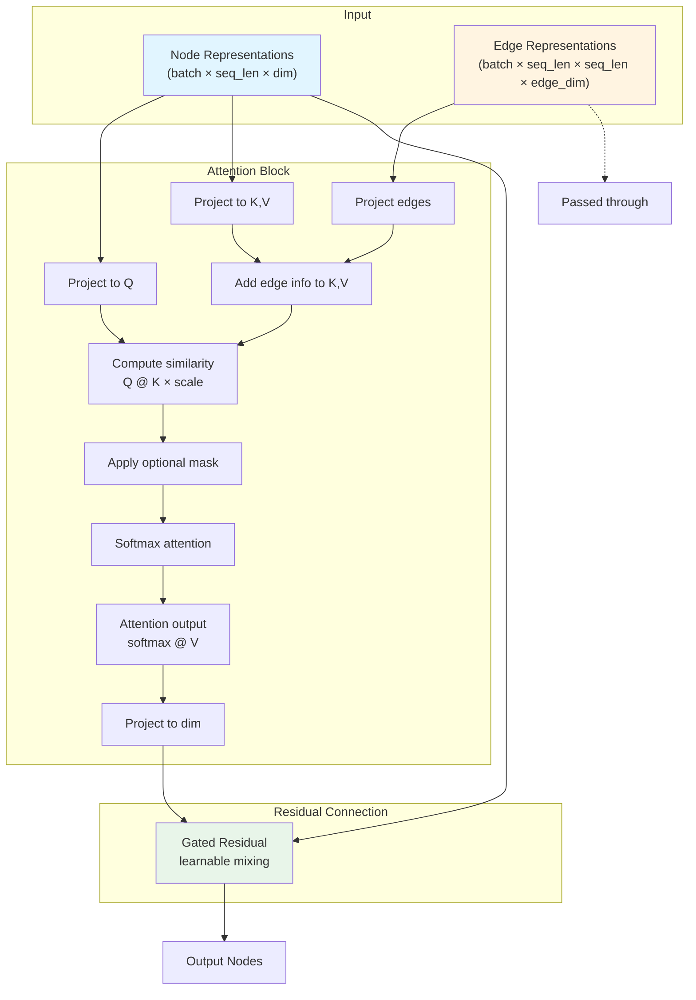

The graph transformer architecture in IgFold represents a sophisticated integration of node-based and edge-based attention mechanisms, specifically designed to capture both local and long-range interactions in antibody sequences. These components form the core feature extraction pipeline that processes BERT embeddings before structure prediction via Invariant Point Attention (IPA). The architecture combines three specialized components: a graph attention mechanism for node-wise information aggregation, a triangle multiplicative module for edge-wise updates, and a transformer that orchestrates their interactions.

## Graph Transformer Architecture

The GraphTransformer implements a multi-head attention mechanism that operates on graph-structured data, where nodes represent residues and edges represent pairwise relationships between residues. Unlike standard transformers, this architecture explicitly incorporates edge features into the attention computation through the Attention class [GraphTransformer.py](igfold/model/components/GraphTransformer.py#L70-L178). The architecture consists of stacked layers, each containing attention and optional feedforward blocks [GraphTransformer.py](igfold/model/components/GraphTransformer.py#L187-L255).

The attention mechanism follows a standard query-key-value pattern with edge augmentation. Queries, keys, and values are projected from node representations, while edge representations are projected and added to keys and values [GraphTransformer.py](igfold/model/components/GraphTransformer.py#L106-L131). This edge-aware design allows pairwise relationships (such as coevolutionary signals or distance potentials) to directly influence attention weights.

The following diagram illustrates the data flow through a single GraphTransformer layer:

The key architectural components include:

- **Attention Layer**: Implements multi-head attention with dimension `dim_head` (default 64), configurable number of heads (default 8), and optional edge dimension [GraphTransformer.py](igfold/model/components/GraphTransformer.py#L70-L106). The similarity computation uses scaled dot-product: `sim = q @ k / sqrt(dim_head)` with edge augmentation [GraphTransformer.py](igfold/model/components/GraphTransformer.py#L135-L144).

- **PreNorm Wrapper**: Applies layer normalization before the function computation rather than after, which stabilizes training in deep networks [GraphTransformer.py](igfold/model/components/GraphTransformer.py#L14-L30).

- **GatedResidual**: Implements a learnable residual connection that weights the contribution of the input and the residual using a learned gate computed from the concatenation of the input, residual, and their difference [GraphTransformer.py](igfold/model/components/GraphTransformer.py#L50-L62).

- **FeedForward Block**: Optional two-layer MLP with GELU activation, configurable via the `with_feedforwards` parameter [GraphTransformer.py](igfold/model/components/GraphTransformer.py#L179-L185).

> [!TIP]
> The gated residual connection is particularly important for graph transformers operating on biological sequences. By learning to dynamically balance new information against existing representations, the model can prevent catastrophic forgetting during training and maintain stable gradients through deep stacks.

## Triangle Multiplicative Module

The TriangleMultiplicativeModule implements edge-to-edge attention, a mechanism critical for capturing triadic relationships in residue graphs. Unlike standard attention which operates node-to-node, this module updates each edge representation by aggregating information from all edges that share a common node [TriangleMultiplicativeModule.py](igfold/model/components/TriangleMultiplicativeModule.py#L12-L109).

The module supports two mixing modes controlled by the `mix` parameter:

- **'outgoing'**: For edge (i,j), aggregates over all edges (j,k) — focuses on residue j's outgoing connections
- **'ingoing'**: For edge (i,j), aggregates over all edges (k,i) — focuses on residue i's incoming connections [TriangleMultiplicativeModule.py](igfold/model/components/TriangleMultiplicativeModule.py#L54-L57)

The operation uses a batched einsum expression: for outgoing mode `'... i k d, ... j k d -> ... i j d'` and for ingoing mode `'... k j d, ... k i d -> ... i j d'` [TriangleMultiplicativeModule.py](igfold/model/components/TriangleMultiplicativeModule.py#L54-L57). This effectively performs a matrix multiplication along the shared dimension (the central node of the triangle).

The module incorporates three learned gating mechanisms initialized to identity functions:

- **Left Gate**: Modulates the left projection input [TriangleMultiplicativeModule.py](igfold/model/components/TriangleMultiplicativeModule.py#L41-L42)
- **Right Gate**: Modulates the right projection input [TriangleMultiplicativeModule.py](igfold/model/components/TriangleMultiplicativeModule.py#L43-L44)
- **Output Gate**: Modulates the final aggregated output [TriangleMultiplicativeModule.py](igfold/model/components/TriangleMultiplicativeModule.py#L46-L47)

The complete forward pass includes layer normalization, projection through separate linear layers, sigmoid gating, triadic aggregation via einsum, final normalization and projection, and output gating [TriangleMultiplicativeModule.py](igfold/model/components/TriangleMultiplicativeModule.py#L76-L109).

This module is inspired by the triangle multiplicative update mechanism from AlphaFold2, which proved essential for capturing residue-residue interaction patterns in protein structure prediction.

## Triangle Graph Transformer

The TriangleGraphTransformer serves as the primary integration point, combining the GraphTransformer and TriangleMultiplicativeModule into a unified architecture that updates both node and edge representations simultaneously [TriangleGraphTransformer.py](igfold/model/components/TriangleGraphTransformer.py#L8-L63).

Each layer in the stack consists of three components applied sequentially:

1. **GraphTransformer**: Updates node representations using edge-aware attention [TriangleGraphTransformer.py](igfold/model/components/TriangleGraphTransformer.py#L14-L23)
2. **Outgoing Triangle Update**: Updates edge representations using outgoing triangle multiplicative aggregation [TriangleGraphTransformer.py](igfold/model/components/TriangleGraphTransformer.py#L24-L28)
3. **Ingoing Triangle Update**: Updates edge representations using ingoing triangle multiplicative aggregation [TriangleGraphTransformer.py](igfold/model/components/TriangleGraphTransformer.py#L29-L33)

The forward pass iterates through each layer, applying the three operations in sequence. Edge updates use additive residual connections, allowing information to accumulate across layers [TriangleGraphTransformer.py](igfold/model/components/TriangleGraphTransformer.py#L45-L56). Masking is applied symmetrically to edge representations using the pairwise mask derived from node masks: `tri_mask = mask.unsqueeze(-2) & mask.unsqueeze(-1)` [TriangleGraphTransformer.py](igfold/model/components/TriangleGraphTransformer.py#L51-L52].

The following table summarizes the key parameters and their default values:

| Parameter | Type | Default | Description |
|-----------|------|---------|-------------|
| `dim` | int | - | Dimension of node representations |
| `edge_dim` | int | - | Dimension of edge representations |
| `depth` | int | - | Number of TriangleGraphTransformer layers to stack |
| `gt_depth` | int | 1 | Number of GraphTransformer layers per TriangleGraphTransformer layer |
| `gt_dim_head` | int | 32 | Dimension per attention head in GraphTransformer |
| `gt_heads` | int | 8 | Number of attention heads in GraphTransformer |
| `tri_dim_hidden` | int | `2 * edge_dim` | Hidden dimension for triangle projections |

## Integration in IgFold Architecture

In the complete IgFold model, the TriangleGraphTransformer serves as the central feature extraction component, positioned between initial BERT embedding processing and subsequent structure prediction stages [IgFold.py](igfold/model/IgFold.py#L53-L68).

The data flow follows this pattern:

1. **Input Transformation**: BERT features (512-dim) and attention maps (64-dim) are transformed to the model's node dimension through sequential linear layers [IgFold.py](igfold/model/IgFold.py#L41-L52)

2. **Main Block Processing**: The TriangleGraphTransformer processes the transformed nodes and edges, producing refined representations that capture both local and long-range sequence relationships [IgFold.py](igfold/model/IgFold.py#L242-L246)

3. **Template IPA Integration**: The refined node representations, along with pairwise edge representations, are passed to an IPA encoder that incorporates template structure information via quaternions and translations [IgFold.py](igfold/model/IgFold.py#L247-L252)

4. **Structure IPA Prediction**: The structure-specific IPA transformer predicts atomic coordinates directly from the graph transformer outputs, using the same edge representations for pairwise attention [IgFold.py](igfold/model/IgFold.py#L253-L259)

5. **Deviation Prediction**: A parallel pathway predicts local coordinate deviations for uncertainty estimation, using detached coordinates to prevent gradient interference [IgFold.py](igfold/model/IgFold.py#L261-L270)

The architecture creates a powerful pipeline where graph transformers extract structural features that guide both template integration and de novo structure prediction. The edge representations computed by the triangle module serve as a unified pairwise encoding that propagates through all subsequent IPA stages.

> [!TIP]
> The hierarchical design—transforming BERT embeddings through graph transformers before passing to IPA—creates a natural separation of concerns. The graph transformers specialize in extracting sequence-structure relationships from the language model embeddings, while IPA specializes in geometric transformations. This modularity allows each component to focus on what it does best while sharing information through the edge representations.

## Component Interaction Patterns

The graph transformer components exhibit several key interaction patterns that enable effective antibody structure prediction:

**Node-Edge Coevolution**: Unlike standard architectures that process nodes and edges independently, TriangleGraphTransformer explicitly models their interdependence. Each node update depends on current edge information through edge-augmented attention, while each edge update depends on current node information through the projections used in triangle multiplicative updates.

**Progressive Refinement**: The multi-layer stacking (controlled by `depth`) allows progressive refinement of representations. Early layers capture local interactions (neighboring residues), while deeper layers integrate information across the full sequence length through repeated attention and aggregation steps.

**Gated Information Flow**: Three different gating mechanisms control information propagation:
- GatedResidual in GraphTransformer [GraphTransformer.py](igfold/model/components/GraphTransformer.py#L50-L62)
- Output gates in TriangleMultiplicativeModule [TriangleMultiplicativeModule.py](igfold/model/components/TriangleMultiplicativeModule.py#L46-L47)
- Post-norm patterns in IPABlock (used in subsequent stages) [IPABlock.py](igfold/model/components/IPABlock.py#L238-L248]

These gates allow the model to learn when to incorporate new information versus preserving existing representations, a critical capability for handling variable-length antibody sequences with diverse CDR loop configurations.

The graph transformer components thus provide a robust foundation for extracting structure-relevant features from sequence embeddings, enabling accurate antibody structure prediction through careful design of node and edge representations and their interactions.