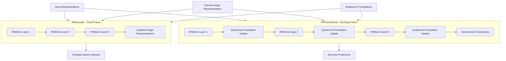
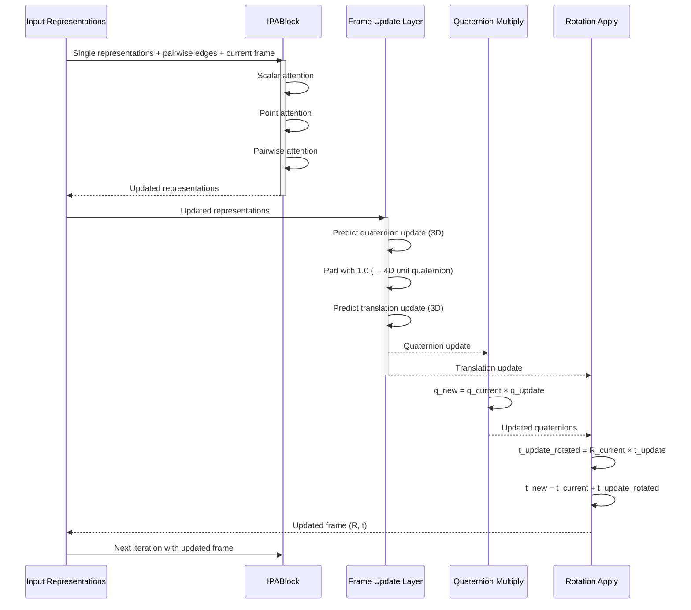
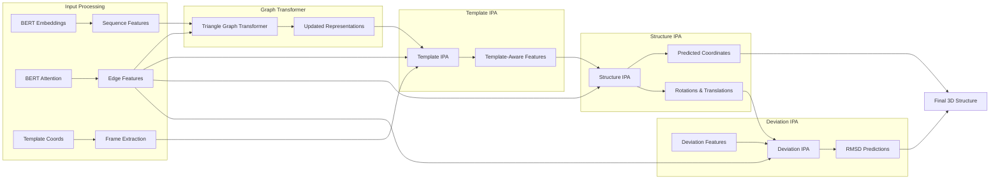

Invariant Point Attention represents a **geometric deep learning breakthrough** designed specifically for protein structure prediction, enabling the model to reason about 3D spatial relationships while maintaining SE(3) invariance—the mathematical property of being unchanged by rotations and translations in 3D space. This documentation explores IgFold's IPA implementation, which adapts the original AlphaFold2 architecture for antibody-specific structure prediction tasks.

## Architectural Foundation

The IPA implementation in IgFold consists of four hierarchical components that work together to process sequence information, template structures, and pairwise relationships into accurate 3D coordinate predictions. The core attention mechanism operates through two complementary pathways: a **scalar attention pathway** for sequence-level information and a **point attention pathway** for geometric relationships between atoms in 3D space.

Sources: [IPABlock.py](igfold/model/components/IPABlock.py#L34-L248), [IPATransformer.py](igfold/model/components/IPATransformer.py#L16-L175)

## Invariant Point Attention Core Mechanism

The `InvariantPointAttention` class implements a multi-modal attention mechanism that simultaneously processes three types of information: scalar representations from protein sequences, point representations from 3D coordinates, and pairwise representations encoding residue-residue relationships. This design enables the model to leverage **sequence-structure synergy**—learning patterns that connect amino acid sequences with their 3D conformations.

The mechanism begins by projecting input representations into queries, keys, and values for both scalar and point attention pathways. For scalar attention, standard linear projections create `q_scalar`, `k_scalar`, and `v_scalar` with dimension `scalar_key_dim * heads` for queries/keys and `scalar_value_dim * heads` for values. For point attention, each head projects to `point_key_dim * heads * 3` dimensions, where the factor of 3 accounts for the three spatial coordinates (x, y, z).

Sources: [IPABlock.py](igfold/model/components/IPABlock.py#L34-L101)

### Frame Transformation and Point Attention

A critical innovation in IPA is the **transformation of local point representations to a global frame** before computing attention. Each residue maintains a local coordinate frame defined by its current rotation matrix and translation vector. The queries, keys, and values for point attention are first rotated into this global frame using einsum operations: `q_point = einsum('b n d c, b n c r -> b n d r', q_point, rotations) + translations`. This transformation ensures that attention computed in the global frame remains **invariant to local frame rotations**, as all points are expressed in a consistent coordinate system.

Point attention logits are derived from the squared Euclidean distance between transformed query and key points: `point_dist = (point_qk_diff ** 2).sum(dim = -2)`, where `point_qk_diff = rearrange(q_point, 'b i d c -> b i () d c') - rearrange(k_point, 'b j d c -> b () j d c')`. The attention mechanism learns a set of per-head weights that scale these distance measurements, enabling different attention heads to focus on different spatial scales. The final point attention logits incorporate these learned weights: `attn_logits_points = -0.5 * (point_dist * point_weights * self.point_attn_logits_scale).sum(dim = -1)`.

Sources: [IPABlock.py](igfold/model/components/IPABlock.py#L119-L145)

> [!TIP]
> The point attention mechanism's negative distance formulation means that attention weights decay exponentially with distance, creating a locality bias similar to convolution operations but with adaptive, learned receptive fields determined by the point_weights parameters.

### Attention Aggregation and Local Frame Recovery

After computing attention weights from the sum of scalar, point, and pairwise logits, the aggregation process diverges for scalar and point values. Scalar values are aggregated using standard attention-weighted summation: `results_scalar = einsum('b i j, b j d -> b i d', attn, v_scalar)`. Point values require a more sophisticated approach: they are first aggregated in the global frame, then **transformed back to local frames** to maintain consistency across attention layers.

The local frame recovery step applies the inverse transformation: `results_points = einsum('b n d c, b n c r -> b n d r', results_points - translations, rotations.transpose(-1, -2))`. By subtracting translations first, then applying the transpose of the rotation matrix, the aggregated points are expressed relative to each residue's local coordinate frame. The model also computes the norm of these local frame points: `results_points_norm = torch.sqrt(torch.square(results_points).sum(dim=-1) + eps)`, providing a scalar measure of spatial extent that contributes to the final output.

Sources: [IPABlock.py](igfold/model/components/IPABlock.py#L147-L192)

| **Attention Component** | **Input Dimension** | **Output Dimension** | **Role** |
|------------------------|---------------------|----------------------|----------|
| Scalar QKV | `dim` | `scalar_key_dim/value_dim * heads` | Sequence-based attention patterns |
| Point QKV | `dim` | `point_key_dim/value_dim * heads * 3` | Spatial relationships in 3D |
| Pairwise Bias | `pairwise_repr_dim` | `heads` | Residue-residue edge information |
| Combined Output | `heads * (scalar + pairwise + point * 4)` | `dim` | Integrated representation |

## IPABlock: Transformer Layer with Geometric Awareness

The `IPABlock` class packages the InvariantPointAttention mechanism into a complete transformer layer following the pre-norm/post-norm conventions established in the transformer literature. Each block consists of an attention sub-layer and a feedforward sub-layer, each with its own LayerNorm and residual connection. IgFold implements **post-layer normalization** as the default, matching the original AlphaFold2 architecture, but also provides pre-norm as an alternative for training stability.

The feedforward network employs a **three-layer architecture** with configurable hidden dimension expansion: `FeedForward(dim, mult = ff_mult, num_layers = ff_num_layers)`. This design provides more capacity than the standard two-layer feedforward networks in vanilla transformers, enabling the model to learn more complex transformations of the learned representations. Each layer includes a ReLU activation except for the final layer, which projects directly to the output dimension.

Sources: [IPABlock.py](igfold/model/components/IPABlock.py#L200-L248)

### Pre-norm vs Post-norm Architectures

The normalization strategy fundamentally affects gradient flow and training dynamics. In post-norm architecture (default), the normalization is applied after the residual connection: `x = self.attn(attn_input, **kwargs) + x; x = self.attn_norm(x) if post_norm else x`. This matches the original transformer paper but can lead to vanishing gradients in very deep networks. Pre-norm architecture applies normalization before the attention operation: `attn_input = x if post_norm else self.attn_norm(x)`, which generally provides better gradient flow for deeper networks but may require careful tuning of learning rates.

Sources: [IPABlock.py](igfold/model/components/IPABlock.py#L219-L248)

## IPAEncoder and IPATransformer: Hierarchical Processing

The implementation provides two higher-level abstractions for different use cases. `IPAEncoder` maintains **fixed coordinate frames** throughout processing, making it suitable for template integration and deviation prediction where the coordinate frame should remain stable. In contrast, `IPATransformer` progressively updates rotation and translation parameters through the network depth, enabling **iterative refinement** of predicted structures.

Both architectures share the same underlying IPABlock components but differ in how they handle coordinate frames. The encoder simply propagates representations through multiple IPABlocks without modifying the geometric parameters, while the transformer interleaves attention with frame updates to gradually improve coordinate predictions.

Sources: [IPATransformer.py](igfold/model/components/IPATransformer.py#L16-L54)

### Iterative Frame Updates in IPATransformer

The `IPATransformer` implements an elegant mechanism for updating coordinate frames using the learned representations. After each IPABlock, a linear layer predicts updates to both quaternions (4D rotation representations) and translation vectors (3D): `quaternion_update, translation_update = to_update(x).chunk(2, dim = -1)`. The quaternion update is padded with a constant 1.0 in the first dimension to maintain unit quaternion constraint: `quaternion_update = F.pad(quaternion_update, (1, 0), value = 1.)`.

The quaternion update is applied through quaternion multiplication: `quaternions = quaternion_multiply(quaternions, quaternion_update)`, which composes the current rotation with the predicted incremental rotation. Translation updates are rotated into the current frame before being added to the translations: `translations = translations + einsum('b n c, b n c r -> b n r', translation_update, rotations)`. This ensures that translation updates are expressed in the correct coordinate frame.

Sources: [IPATransformer.py](igfold/model/components/IPATransformer.py#L55-L145)

> [!TIP]
> The quaternion-based rotation updates maintain the SO(3) manifold constraint naturally, as quaternion multiplication of unit quaternions always produces unit quaternions, avoiding the numerical instability issues that can arise with direct rotation matrix parameterization.

## Coordinate Generation from Ideal Frames

The IPATransformer's final step converts learned quaternions and translations into atomic coordinates using an **idealized backbone template**. The `get_ideal_coords()` function defines a canonical backbone conformation with N, CA, C, and CB atoms at idealized positions based on average protein geometry. These coordinates are then repeated for each residue in each batch, creating a template of shape `(batch_size, seq_len, 4, 3)`.

The final coordinate generation applies the learned transformations to these ideal coordinates. First, quaternions are converted to rotation matrices using the `quaternion_to_matrix()` function, which implements the standard quaternion-to-rotation-matrix conversion. Then the ideal coordinates are transformed using batched matrix multiplication: `points_global = einsum('b n a c, b n c d -> b n a d', ideal_coords, rotations) + rearrange(translations, "b l d -> b l () d")`. This operation applies the rotation to each atom's coordinates, then adds the translation, moving the entire residue's local frame to its predicted global position.

Sources: [IPATransformer.py](igfold/model/components/IPATransformer.py#L146-L175), [coordinates.py](igfold/utils/coordinates.py#L33-L56)

### Oxygen Atom Placement

After generating the backbone coordinates, the model places oxygen atoms using the `place_o_coords()` function. This function computes the oxygen atom position using internal coordinates (bond length, angle, and dihedral) relative to the backbone atoms. The implementation uses the `place_fourth_atom()` function, which constructs a local coordinate frame from three atoms and places the fourth atom using specified internal coordinates. The oxygen is placed with a bond length of 1.231 Å, planar angle of 2.108 radians (approximately 121°), and dihedral angle of -3.142 radians (approximately -180°), creating the expected carbonyl geometry.

Sources: [coordinates.py](igfold/utils/coordinates.py#L57-L76)

## Integration in IgFold Architecture

IgFold employs three distinct IPA modules, each serving a specific purpose in the structure prediction pipeline. The **template IPA** (`self.template_ipa`) integrates template structure information into the sequence representations, using rotation and translation parameters derived from template coordinates. This enables the model to leverage known structural information while learning to predict accurate conformations for the target sequence.

The **structure IPA** (`self.structure_ipa`) performs the core coordinate prediction task, starting from scratch (identity rotations and zero translations) and iteratively refining the coordinate frames through multiple layers. This module generates the final 3D coordinates for all backbone atoms. The **deviation IPA** (`self.dev_ipa`) operates on the learned representations to predict per-residue RMSD scores, providing confidence estimates for the predicted structure.

Sources: [IgFold.py](igfold/model/IgFold.py#L69-L112)

### Template Coordinate Frame Extraction

The template IPA requires initial rotation and translation parameters derived from template structures. The `get_coords_tran_rot()` method computes these parameters by aligning template backbone atoms to a standard frame. This involves computing the centroid of the template coordinates and extracting rotation matrices that align the template coordinates to an idealized frame. These frame parameters provide the geometric foundation for integrating template information into the IPA attention mechanism.

Sources: [IgFold.py](igfold/model/IgFold.py#L114-L143)

## Configuration and Hyperparameters

The IPA modules are configured through a hierarchical parameter system that allows control over depth, head count, and attention dimensions. The configuration includes separate settings for each IPA module:

- `temp_ipa_depth`, `temp_ipa_heads`: Controls the template IPA's capacity
- `str_ipa_depth`, `str_ipa_heads`: Controls the structure IPA's capacity  
- `dev_ipa_depth`, `dev_ipa_heads`: Controls the deviation IPA's capacity

Each module uses the same underlying `node_dim` for the representation dimension, ensuring consistency across the architecture. The attention mechanism's internal dimensions (scalar and point key/value dimensions) use sensible defaults but can be customized if needed.

Sources: [IgFold.py](igfold/model/IgFold.py#L37-L48)

| **Module** | **Depth Parameter** | **Heads Parameter** | **Primary Function** |
|------------|---------------------|----------------------|----------------------|
| Template IPA | `temp_ipa_depth` | `temp_ipa_heads` | Integrate template structural information |
| Structure IPA | `str_ipa_depth` | `str_ipa_heads` | Generate 3D coordinates from sequence |
| Deviation IPA | `dev_ipa_depth` | `dev_ipa_heads` | Predict per-residue confidence scores |

> [!TIP]
> The stop_rotation_grad parameter in IPATransformer allows detaching rotation gradients during training, which can improve stability by preventing large rotation updates from destabilizing the optimization process in early training stages.

## Next Steps

Having explored the IPA implementation, you may want to understand:

- [Sequence Input and Embedding Pipeline](9-sequence-input-and-embedding-pipeline) - Learn how sequence embeddings are generated and prepared for the IPA modules
- [Coordinate Prediction and RMSD Estimation](12-coordinate-prediction-and-rmsd-estimation) - Understand how the IPA output coordinates are processed and scored
- [IgFold Model Forward Pass](23-igfold-model-forward-pass) - See how all components integrate in the complete model forward pass