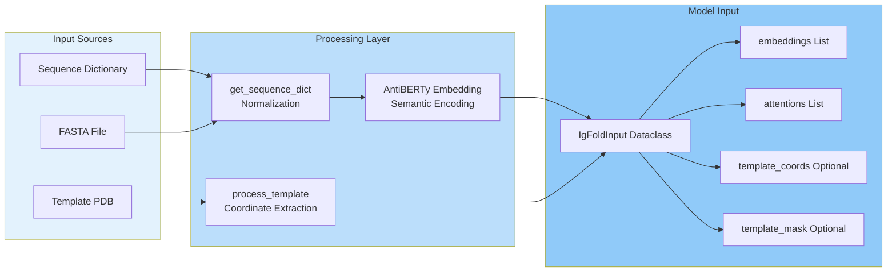
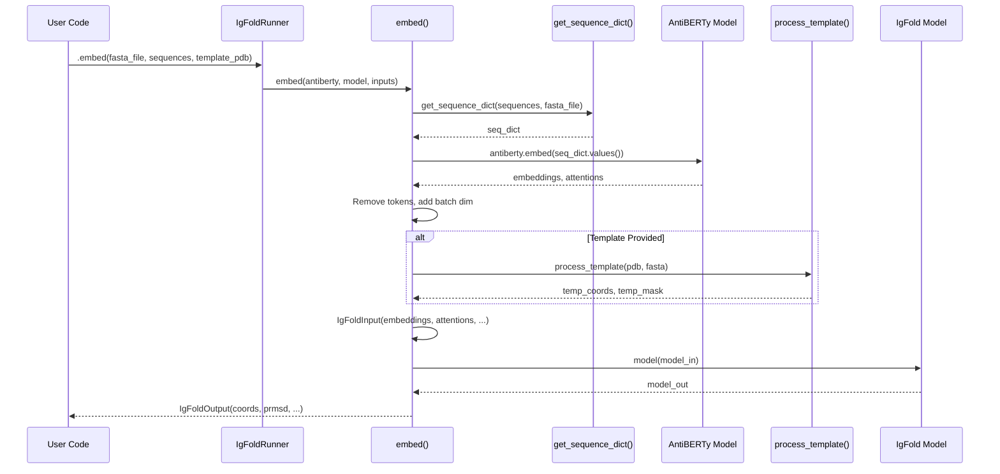

The sequence input and embedding pipeline forms the foundational data processing layer of IgFold, converting raw antibody sequences into rich contextual representations that drive structure prediction. This pipeline integrates multiple input modalities—including sequence dictionaries, FASTA files, and optional template structures—and transforms them through the AntiBERTy language model to produce protein language embeddings and attention maps that capture evolutionary and structural relationships within antibody sequences.

## Architecture Overview

The embedding pipeline orchestrates three critical stages: sequence acquisition and normalization, semantic embedding generation via AntiBERTy, and optional template structure integration. This modular design supports both single-chain (nanobody) and paired heavy-light chain antibody inputs while maintaining flexibility for template-based and template-free prediction modes.



## Sequence Input Methods

IgFold provides two primary mechanisms for sequence input, both internally normalized through the `get_sequence_dict()` function which ensures consistent downstream processing regardless of input format.

### Dictionary-Based Input

The dictionary approach offers programmatic convenience for batch processing and dynamic sequence generation. Each dictionary key represents a chain identifier (typically "H" for heavy chain, "L" for light chain), with the corresponding value containing the amino acid sequence string.

Sources: [IgFoldRunner.py](/igfold/IgFoldRunner.py#L77-L90)

```python
sequences = {
    "H": "EVQLVQSGPEVKKPGTSVKVSCKASGFTFMSSAVQWVRQARGQRLEWIGWIVIGSGNTNYAQKFQERVTITRDMSTSTAYMELSSLRSEDTAVYYCAAPYCSSISCNDGFDIWGQGTMVTVS",
    "L": "DVVMTQTPFSLPVSLGDQASISCRSSQSLVHSNGNTYLHWYLQKPGQSPKLLIYKVSNRFSGVPDRFSGSGSGTDFTLKISRVEAEDLGVYFCSQSTHVPYTFGGGTKLEIK"
}
```

### FASTA File Input

FASTA format provides a standardized text-based representation compatible with bioinformatics workflows. The parser extracts chain identifiers from the header line using the pattern `chain:ID` and associates them with their corresponding sequences.

Sources: [fasta.py](/igfold/utils/fasta.py#L4-L19)

```python
def get_fasta_chain_dict(fasta_file):
    seq_dict = {}
    for chain in SeqIO.parse(fasta_file, 'fasta'):
        seq_dict[chain.id] = str(chain.seq)
    return seq_dict
```

> [!TIP]
> When both `sequences` dictionary and `fasta_file` are provided simultaneously, the pipeline prioritizes the FASTA file and issues a notification to ensure explicit control over data source selection.

The sequence normalization logic in `get_sequence_dict()` implements a cascading fallback strategy: if both inputs exist, prefer FASTA; otherwise use whichever is provided; exit with error if neither is specified.

Sources: [folding.py](/igfold/utils/folding.py#L13-L27)

## AntiBERTy Semantic Embeddings

At the core of the embedding pipeline lies AntiBERTy, a protein language model pre-trained specifically on antibody sequences. This model transforms raw amino acid sequences into high-dimensional vector representations that capture evolutionary constraints, structural propensities, and functional relationships specific to antibody architectures.

### Embedding Generation Process

The embedding process accepts sequence values from the normalized sequence dictionary and returns two complementary outputs: sequence embeddings (vector representations per residue) and attention maps (pairwise interaction strengths between positions). AntiBERTy automatically adds special start and end tokens to each sequence for context modeling.

Sources: [folding.py](/igfold/utils/folding.py#L181-L186)

```python
embeddings, attentions = antiberty.embed(
    seq_dict.values(),
    return_attention=True,
)
```

### Post-Processing Operations

To align with IgFold's architectural requirements, both embeddings and attentions undergo precise tensor manipulations. The special tokens are removed by slicing `[1:-1]`, and batch dimensions are added via `.unsqueeze(0)` to accommodate single-sequence processing while maintaining compatibility with batched operations.

Sources: [embed.py](/igfold/utils/embed.py#L15-L18)

```python
embeddings = [e[1:-1].unsqueeze(0) for e in embeddings]
attentions = [a[:, :, 1:-1, 1:-1].unsqueeze(0) for a in attentions]
```

The list structure preserves chain identity, allowing heavy and light chains to maintain separate embedding streams even after AntiBERTy processes them collectively.

## Template Structure Integration

The pipeline optionally incorporates template structural information through the `process_template()` function, which extracts backbone atomic coordinates from PDB files and applies flexible masking strategies to control template influence on prediction.

### Coordinate Extraction

Template processing begins with atom coordinate extraction using `get_atom_coords()`, which retrieves N, CA, C, and CB backbone atoms. These coordinates are then stacked along the atom dimension and reshaped into a flattened representation of `(batch_size, seq_len*4, 3)` for downstream graph operations.

Sources: [folding.py](/igfold/utils/folding.py#L30-L47)

```python
temp_coords = torch.stack(
    [
        temp_coords['N'], temp_coords['CA'], temp_coords['C'],
        temp_coords['CB']
    ],
    dim=1,
).view(-1, 3).unsqueeze(0)
```

### Template Masking Strategies

A boolean mask identifies valid template coordinates, automatically filtering out NaN values (missing residues) and zero-valued positions. The system supports two orthogonal masking dimensions: CDR region masking and chain-level masking.

**CDR Masking**: The `ignore_cdrs` parameter accepts False (no masking), a string (single CDR), or a list of CDR identifiers (multiple regions). For each specified CDR, the corresponding residue range is expanded to include adjacent positions for smoother structural transitions.

Sources: [folding.py](/igfold/utils/folding.py#L48-L59)

| Ignore CDRs Value | Behavior | Use Case |
|-------------------|----------|----------|
| False | No CDR masking | Template-free prediction |
| None | No CDR masking | Default state |
| "h3" | Mask only heavy chain CDR3 | De novo CDR3 design |
| ["h1", "h2", "l1"] | Mask specified CDRs | Partial template guidance |

**Chain Masking**: The `ignore_chain` parameter enables complete exclusion of heavy ("H") or light ("L") chain templates by setting all mask positions for that chain to False. This is particularly useful when only one chain shares structural homology with available templates.

Sources: [folding.py](/igfold/utils/folding.py#L60-L73)

## IgFoldInput Data Structure

All processed inputs converge into the `IgFoldInput` dataclass, which serves as the unified interface between the embedding pipeline and the IgFold model architecture. This strongly-typed structure ensures consistency across the prediction workflow and enables type-safe parameter passing.

### Required Fields

| Field | Type | Description | Shape |
|-------|------|-------------|-------|
| embeddings | List[torch.FloatTensor] | AntiBERTy residue embeddings | List[(1, seq_len, embed_dim)] |
| attentions | List[torch.FloatTensor] | AntiBERTy attention maps | List[(1, num_heads, seq_len, seq_len)] |

### Optional Fields

| Field | Type | Description | Default |
|-------|------|-------------|---------|
| template_coords | Optional[torch.FloatTensor] | Template backbone coordinates | None |
| template_mask | Optional[torch.BoolTensor] | Valid template position indicators | None |
| batch_mask | Optional[torch.BoolTensor] | Batch padding masks | None |
| align_mask | Optional[torch.BoolTensor] | Sequence alignment masks | None |
| coords_label | Optional[torch.FloatTensor] | Ground truth coordinates (training) | None |
| return_embeddings | Optional[bool] | Flag for embedding return | False |

Sources: [interface.py](/igfold/model/interface.py#L5-L17)

> [!TIP]
> The `return_embeddings` parameter in `IgFoldInput` enables downstream extraction of processed embeddings for machine learning applications, facilitating transfer learning and feature extraction workflows beyond structure prediction.

## Complete Pipeline Workflow

The end-to-end embedding pipeline is orchestrated through either the high-level `IgFoldRunner.embed()` method for embedding-only workflows or the `fold()` method for complete structure prediction. Both paths share the same embedding infrastructure but diverge in their output objectives.



### Embedding-Only Execution

For tasks focused on sequence representation without structure prediction, the `embed()` method provides direct access to AntiBERTy-derived embeddings and predicted RMSD confidence scores. This mode is particularly useful for antibody clustering, paratope prediction, and downstream machine learning tasks.

Sources: [IgFoldRunner.py](/igfold/IgFoldRunner.py#L126-L158)

```python
from igfold import IgFoldRunner

igfold = IgFoldRunner()
model_out = igfold.embed(
    model_idx=0,
    fasta_file="antibody.fasta",
    template_pdb="template.pdb",
    ignore_cdrs=["h3"],
)
```

The output `model_out` contains `prmsd` (predicted coordinate uncertainty) reshaped from `(batch, seq_len*4)` to `(batch, seq_len, 4)` for per-residue, per-atom confidence estimation.

Sources: [embed.py](/igfold/utils/embed.py#L33-L41)

### Integration with Structure Prediction

When invoked through the `fold()` method, the embedding pipeline contributes to the complete structure prediction workflow, where embeddings guide graph transformer operations and template coordinates constrain conformational search. The pipeline's modularity enables the same embeddings to be reused across multiple model ensembles without recomputation.

Sources: [folding.py](/igfold/utils/folding.py#L153-L232)

## Data Flow and Transformation

The embedding pipeline implements a clear separation of concerns between data acquisition, semantic encoding, and structural integration. Each transformation stage maintains immutability of the previous stage while preparing data for the next computational layer.

### Tensor Dimensionality

All tensor manipulations follow consistent dimension conventions: batch dimension first (position 0), followed by residue or position dimensions, then feature dimensions (embeddings) or attention dimensions (heads). This convention ensures compatibility with PyTorch's broadcasting rules and facilitates batched processing.

### Chain Order Preservation

Multi-chain antibodies maintain explicit chain ordering through the list structure in `embeddings` and `attentions`. The heavy chain ("H") typically precedes the light chain ("L") in the list, corresponding to their biological pairing, though the pipeline accommodates arbitrary chain identifiers for specialized applications.

Sources: [embed.py](/igfold/utils/embed.py#L15-L18)

### Memory Efficiency

The pipeline minimizes memory footprint through lazy evaluation and in-place operations where safe. Template coordinates are processed only when `template_pdb` is provided, and attention maps are only computed when `return_attention=True` is specified in the AntiBERTy embedding call.

Sources: [folding.py](/igfold/utils/folding.py#L181-L186)

## Error Handling and Validation

The embedding pipeline incorporates defensive programming practices to ensure robustness across diverse input scenarios and provide actionable error messages when validation fails.

### Input Validation

The `get_sequence_dict()` function enforces mutual exclusivity between dictionary and FASTA inputs, exiting with an informative error message when neither is provided. This prevents ambiguous silent failures and guides users toward correct API usage.

Sources: [folding.py](/igfold/utils/folding.py#L13-L27)

### Template Coordinate Validation

Template masking automatically handles missing residues (NaN values) and incomplete structural data by invalidating corresponding mask positions. This allows templates with partial coverage to contribute information where available without introducing errors from incomplete data.

Sources: [folding.py](/igfold/utils/folding.py#L40-L47)

## Performance Considerations

The embedding pipeline is designed for computational efficiency, with AntiBERTy embedding generation typically representing the dominant computational cost. Typical processing times for paired antibody sequences range from 0.5-2 seconds on modern GPU hardware, with CPU-based processing taking approximately 5-10 times longer.

### GPU Acceleration

The pipeline automatically utilizes available GPU resources through PyTorch's tensor device placement. Embedding tensors and template coordinates reside on the same device as the IgFold model, minimizing data transfer overhead during training and inference.

Sources: [IgFoldRunner.py](/igfold/IgFoldRunner.py#L30-L37)

> [!TIP]
> For large-scale batch predictions, pre-computing embeddings with `return_embeddings=True` and caching them enables subsequent structure predictions to bypass the most expensive embedding computation, reducing iteration time by 60-80%.

## Next Steps

Understanding the sequence input and embedding pipeline provides the foundation for exploring IgFold's predictive capabilities. Continue your learning journey with these related topics:

- **[Template-Based Structure Prediction](10-template-based-structure-prediction)** - Explore how template coordinates guide structural refinement
- **[Antibody Renumbering with AbNumber](11-antibody-renumbering-with-abnumber)** - Learn sequence numbering conventions for template alignment
- **[Antibody Sequence Embeddings for ML](16-antibody-sequence-embeddings-for-ml)** - Discover applications of embeddings beyond structure prediction
- **[IgFold Model Architecture](6-igfold-model-architecture)** - Understand how embeddings flow through graph transformer layers