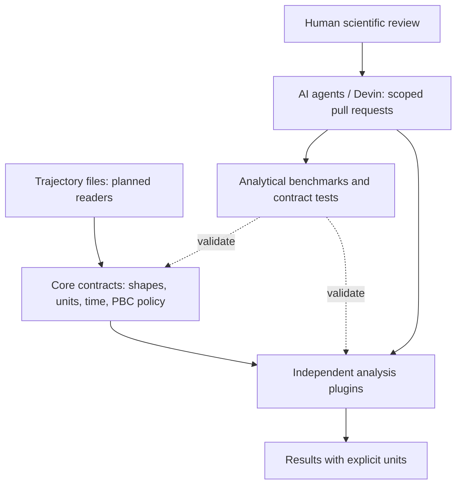

# md-traj-kit

An early-stage open-source toolkit for modular molecular dynamics (MD) trajectory analysis, developed with AI assistance and human review.

## Goal

Use strict low-level interfaces and physical benchmark tests as guardrails, and keep analysis modules decoupled as plugins. AI coding agents can then implement focused analysis tasks within explicit contracts.

用严格的底层接口和物理基准测试做护栏，将具体分析模块设计为解耦插件，让 AI 在明确约束内协助编写可靠的 MD 轨迹分析代码。

## Architecture



## Current implementation

- Validated NumPy trajectory container: positions in angstrom, time in ps, stable atom ordering, explicit unwrapped-coordinate requirement.
- Time-origin averaged MSD function with an initial callable plugin protocol.
- Synthetic constant-velocity example; analytical tests for stationary atoms, ballistic motion and translation invariance; invalid input checks.
- Package configuration and a GitHub Actions test workflow.

This is a project scaffold, not a production analysis suite. File readers, automatic unit conversion, PBC unwrapping, plugin registration and diffusion fitting are not implemented. The unwrapped flag is a caller assertion; the code cannot infer whether input coordinates were unwrapped correctly.

## Quick start

Requires Python 3.10+. From the repository root:

```sh
python -m pip install -e ".[dev]"
python -m pytest
python examples/synthetic_msd.py
```

The example moves every atom at 2 angstrom/ps along x. Expected MSD is 4 times lag-time squared (0, 4, 16, 36, 64, 100 angstrom squared). MSD averages all atoms and valid time origins, includes center-of-mass drift, and requires equally spaced frames.

## Roadmap and planned Devin collaboration

Devin use is planned; no existing Devin integration or completed Devin work is claimed. Each task should specify input/output contracts, scientific assumptions, reference cases and acceptance tests.

- [x] Initial trajectory contract and synthetic MSD example.
- [x] Analytical physics tests and CI configuration.
- [ ] Strengthen immutable data ownership, metadata and result contracts.
- [ ] Readers/adapters for common trajectory formats, beginning with XYZ; explicit units and atom identity checks.
- [ ] Orthorhombic PBC handling and unwrapping, with boundary-crossing fixtures; triclinic cells later.
- [ ] Plugin registration and isolated module interfaces.
- [ ] Radial distribution functions with ideal-gas normalization benchmarks.
- [ ] Coordination numbers and bond-angle distributions with synthetic geometry tests.
- [ ] MSD extensions: atom selections, drift policy, streaming and diffusion fitting with documented statistical limits.
- [ ] Reproducible CLI reports, provenance and performance checks.

AI agents are intended to implement one bounded module per pull request, add independent tests and document assumptions. A maintainer reviews physical validity and merges changes after the checks pass.

## Data and contribution policy

All included examples are generated synthetically. No simulation trajectories, unpublished research results, credentials or manuscript files are included. Do not commit confidential or unlicensed third-party data. For a new analysis, document units, coordinate/PBC assumptions, mathematical definition and an independently checkable reference case.

## License

MIT; see [LICENSE](https://github.com/Love-sea/md-traj-kit/blob/HEAD/LICENSE).
