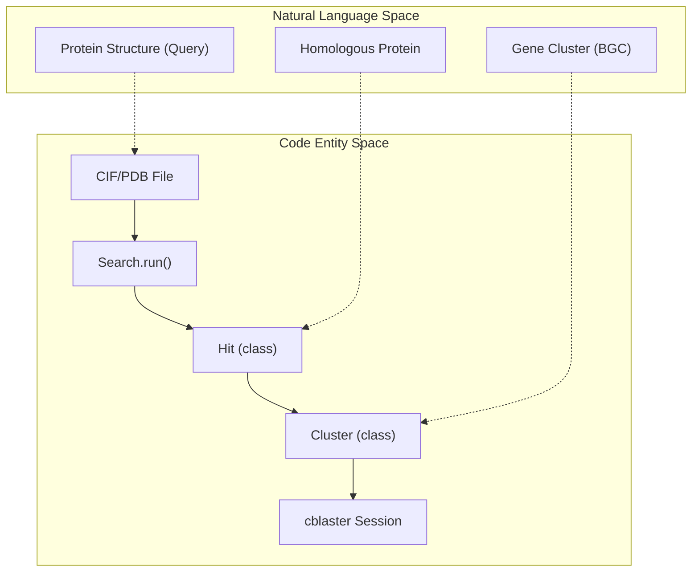
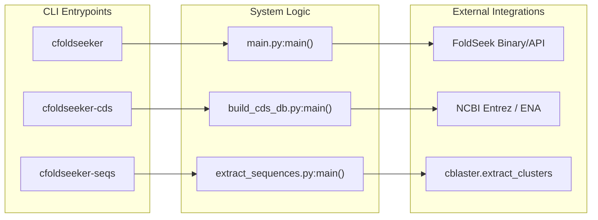

# cfoldseeker Overview

Relevant source files

The following files were used as context for generating this wiki page:

- [LICENSE](LICENSE)
- [README.md](README.md)
- [docs/index.rst](docs/index.rst)
- [env.yml](env.yml)
- [pyproject.toml](pyproject.toml)
- [workflow.png](workflow.png)
- [workflow.svg](workflow.svg)

`cfoldseeker` is a technical framework designed to identify homologous gene clusters by leveraging protein structural similarity rather than primary sequence alone [README.md:9-10](). By utilizing `foldseek`, it searches for structural homologs of query protein models and reconstructs their genomic context to identify colocalized hits [README.md:10-11]().

As the structural discovery engine of the **csuite** toolbox, `cfoldseeker` integrates with `cblaster` for downstream analysis and `clinker` for cluster visualization [README.md:12-15]().

### Core Search Strategies
The system operates in three primary modes to balance sensitivity, speed, and resource availability:

| Mode | Description | Key Components |
| :--- | :--- | :--- |
| **Remote** | Searches AlphaFoldDB via the FoldSeek webserver. | `RemoteSearch`, `communication.py` |
| **Local** | Searches a user-provided FoldSeek database on local hardware. | `LocalSearch`, `cfoldseeker-cds` |
| **Local-Clustered** | Optimized local search using MMseqs2-preclustered representatives. | `LocalClusteredSearch`, `MMseqs2` |

For detailed information on these modes, see [Search Modes](#3).

---

### System Integration & Workflow
`cfoldseeker` bridges the gap between 3D protein structures (CIF/PDB files) and genomic coordinates. It translates structural hits into genomic clusters that can be visualized as gene arrows.

#### Structural to Genomic Mapping
This diagram illustrates how the system maps entities from the "Natural Language Space" (biological concepts) to the "Code Entity Space" (classes and functions).

**Sources:** [cfoldseeker/classes.py:1-100](), [README.md:10-12]()

#### Toolchain Architecture
The following diagram maps the command-line utilities to their internal entry points and primary responsibilities.

**Sources:** [pyproject.toml:46-50](), [README.md:26-30]()

---

### Child Pages
This documentation is organized into several detailed sections:

*   **[Getting Started: Installation and Environment Setup](#1.1)**
    Covers installation via Bioconda, Pip, or Docker, and setting up the required environment for `foldseek` and `kegg-pull` [pyproject.toml:24-32](), [env.yml:1-15]().
*   **[Tutorial: End-to-End Thioalbamide Example](#1.2)**
    A practical walkthrough using the thioalbamide dataset, demonstrating the transition from `cfoldseeker-cds` database building to cluster identification [docs/index.rst:35-36]().

### Downstream Utilities
*   **`cfoldseeker-cds`**: A pre-processing utility that builds a local SQLite/CSV database of genomic coordinates (CDS) from GenBank files or NCBI datasets [README.md:29](), [pyproject.toml:48]().
*   **`cfoldseeker-seqs`**: A post-processing utility to extract nucleotide or protein sequences from identified clusters for further analysis [README.md:29](), [pyproject.toml:49]().

### Citations and License
`cfoldseeker` is released under the **MIT License** [LICENSE:1-21](). If you use this tool, please cite the primary manuscript and the underlying technologies: `foldseek`, `cblaster`, and `kegg_pull` [README.md:35-48]().

**Sources:**
- [README.md:1-53]()
- [pyproject.toml:1-52]()
- [env.yml:1-15]()
- [docs/index.rst:1-45]()
- [LICENSE:1-21]()

---