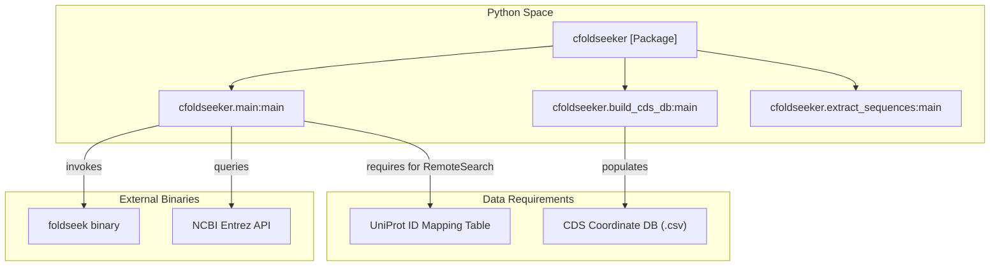
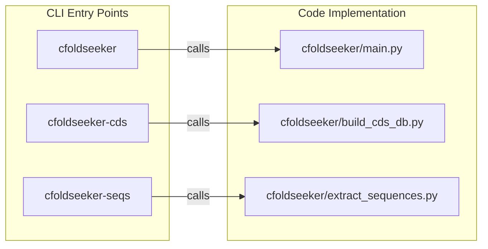

# Getting Started: Installation and Environment Setup

<details>
<summary>Relevant source files</summary>

The following files were used as context for generating this wiki page:

- [bioconda_recipe/meta.yaml](bioconda_recipe/meta.yaml)
- [docker/Dockerfile](docker/Dockerfile)
- [docs/guide/install.rst](docs/guide/install.rst)
- [env.yml](env.yml)
- [pyproject.toml](pyproject.toml)

</details>


This page provides technical instructions for installing `cfoldseeker` and configuring the necessary environment for structural biosynthetic gene cluster (BGC) mining. `cfoldseeker` requires a specific Python environment (3.12+) and several non-Python binary dependencies, most notably **FoldSeek**.

## 1. Installation Methods

`cfoldseeker` can be installed via Bioconda, Docker, or Pip. The Bioconda and Docker methods are preferred as they automatically handle the `foldseek` binary dependency.

### Bioconda (Recommended)
Installation via Bioconda ensures that all dependencies defined in the recipe `[bioconda_recipe/meta.yaml:28-37]()` are met, including the `foldseek` binary.

```bash
# Create a fresh environment with cfoldseeker
conda create -n cfoldseeker -c bioconda -c conda-forge cfoldseeker

# Alternatively, use the provided environment file
conda env create -f env.yml
conda activate cfoldseeker
```
**Sources:** `[docs/guide/install.rst:14-33]()`, `[env.yml:1-15]()`, `[bioconda_recipe/meta.yaml:23-37]()`.

### Docker
For Windows users (via WSL) or containerized workflows, a Docker image is provided. The image is built on a Miniconda base and installs `cfoldseeker` into a internal Conda environment `[docker/Dockerfile:1-11]()`.

```bash
docker pull lucodevro/cfoldseeker

# Run command with volume mapping
docker run -v $(pwd):/data lucodevro/cfoldseeker cfoldseeker -i /data/query.cif ...
```
**Sources:** `[docs/guide/install.rst:35-49]()`, `[docker/Dockerfile:1-11]()`.

### Pip (Advanced)
Installing via PyPi or GitHub requires manual installation of `foldseek`.
```bash
# From GitHub (Development version)
pip install .

# From PyPi
pip install cfoldseeker
```
**Sources:** `[docs/guide/install.rst:50-70]()`, `[pyproject.toml:1-52]()`.

---

## 2. Environment Dependencies

The system relies on a specific stack of bioinformatics libraries and external binaries.

### Dependency Graph: Code to System Entities
The following diagram maps the `cfoldseeker` installation requirements to their roles within the codebase.

**Installation Entity Map**

**Sources:** `[pyproject.toml:46-49]()`, `[bioconda_recipe/meta.yaml:15-18]()`, `[docs/guide/install.rst:9-11]()`.

---

## 3. Mandatory External Data: UniProt ID Mapping

When running in **Remote Mode**, `cfoldseeker` performs a multi-tier cross-referencing of structural hits. To resolve KEGG and GenPept identifiers, the tool requires a local copy of the UniProt ID mapping table `[docs/guide/install.rst:9-11]()`.

| Data Component | Requirement | Purpose |
| :--- | :--- | :--- |
| **Mapping Table** | `uniprot_kegg_genpept.gz` | Translates UniProt accessions to KEGG/GenPept for genomic context retrieval. |
| **FoldSeek Binary** | `foldseek` | Executes structural alignments in Local and Local-Clustered modes. |
| **CDS Database** | Created via `cfoldseeker-cds` | Provides local genomic coordinates for structure hits. |

**Sources:** `[docs/guide/install.rst:9-11]()`, `[pyproject.toml:48]()`.

---

## 4. Implementation Details: Entry Points

`cfoldseeker` registers three primary CLI commands via `setuptools` entry points. These are the interfaces users interact with after a successful installation.

**CLI Entry Point Architecture**


| Entry Point | Target Function | Source File |
| :--- | :--- | :--- |
| `cfoldseeker` | `main()` | `[cfoldseeker/main.py]()` |
| `cfoldseeker-cds` | `main()` | `[cfoldseeker/build_cds_db.py]()` |
| `cfoldseeker-seqs` | `main()` | `[cfoldseeker/extract_sequences.py]()` |

**Sources:** `[pyproject.toml:46-49]()`, `[bioconda_recipe/meta.yaml:15-18]()`.

---

## 5. Verification

To verify the installation and the presence of the `foldseek` binary, run the following command:

```bash
cfoldseeker -h
```
This confirms the environment is active and the `cfoldseeker` package is correctly installed in the Python path `[bioconda_recipe/meta.yaml:39-41]()`.

**Sources:** `[bioconda_recipe/meta.yaml:39-41]()`.

---