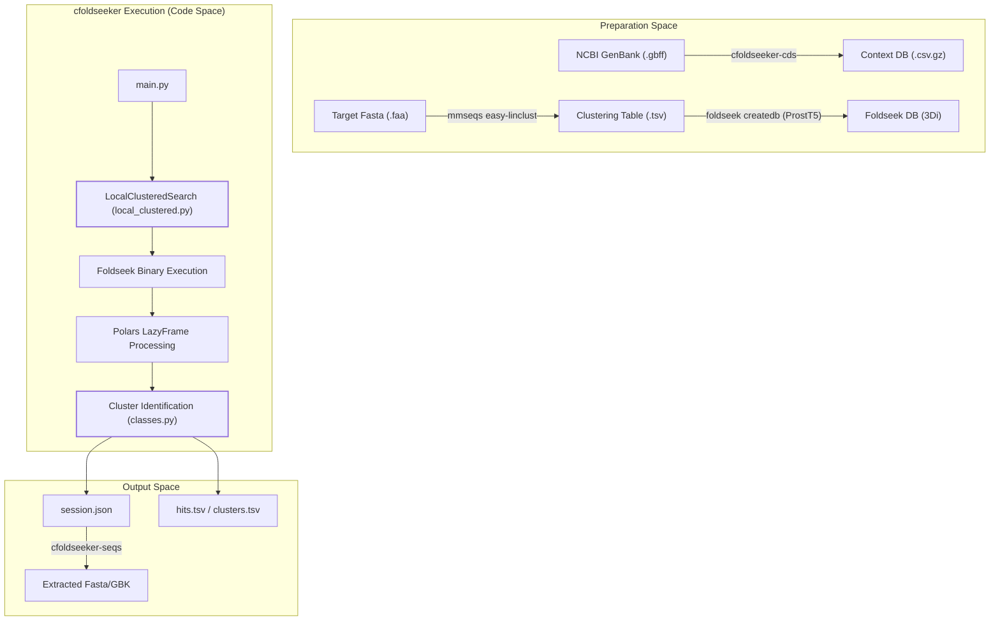

# Tutorial: End-to-End Thioalbamide Example

<details>
<summary>Relevant source files</summary>

The following files were used as context for generating this wiki page:

- [docs/guide/tutorial.rst](docs/guide/tutorial.rst)
- [example/cfoldseeker_search/binary.txt](example/cfoldseeker_search/binary.txt)
- [example/cfoldseeker_search/clusters.tsv](example/cfoldseeker_search/clusters.tsv)
- [example/cfoldseeker_search/foldseek_result.txt](example/cfoldseeker_search/foldseek_result.txt)
- [example/cfoldseeker_search/hits.tsv](example/cfoldseeker_search/hits.tsv)
- [example/cfoldseeker_search/session.json](example/cfoldseeker_search/session.json)
- [example/cfoldseeker_search/summary.txt](example/cfoldseeker_search/summary.txt)
- [example/query_models/WP_020634191.1.cif](example/query_models/WP_020634191.1.cif)
- [example/thioalbamide.faa](example/thioalbamide.faa)

</details>


This tutorial provides a technical walkthrough for running a `cfoldseeker` search using the `local_clustered` mode. This workflow is designed for comprehensive genomic mining, utilizing structural alignments to identify Biosynthetic Gene Clusters (BGCs) across large-scale genomic datasets.

The example focuses on searching for the **thioalbamide** BGC from *Amycolatopsis alba* DSM 44262 (GCF_000384215.1) against a target database of all *Bacillaceae* proteomes.

## Workflow Overview

The process transitions from raw sequence data to identified structural gene clusters through four primary stages:
1.  **Query Preparation**: Generating 3D models (CIF) for the thioalbamide proteins.
2.  **Context DB Construction**: Building a coordinate database (`cfoldseeker-cds`) from NCBI GenBank files.
3.  **Target DB Construction**: Clustering target sequences (MMseqs2) and generating structural encodings (Foldseek/ProstT5).
4.  **Search & Extraction**: Running `cfoldseeker` and extracting candidate sequences.

### System Data Flow

The following diagram illustrates the relationship between the CLI tools and the underlying data structures.

**Data Flow: From Raw Genomes to Structural Clusters**

Sources: [docs/guide/tutorial.rst:4-88](), [cfoldseeker/main.py:1-50]()

---

## 1. Building the Genomic Context Database

To map structural hits back to their genomic neighborhood, `cfoldseeker` requires a compressed CDS database.

**Command:**
```bash
cfoldseeker-cds -i gbff_package -m ncbi-package -o bacillaceae_cds.gz -gz
```

**Implementation Detail:**
The `cfoldseeker-cds` tool (implemented in `build_cds_db.py`) parses NCBI GenBank packages using a `Polars` ETL pipeline. It extracts `CDS` features, normalizes coordinates (handling multi-exon genes), and resolves taxon names via NCBI Entrez if necessary [docs/guide/tutorial.rst:49-54]().

Sources: [docs/guide/tutorial.rst:49-54](), [cfoldseeker/build_cds_db.py:1-100]()

---

## 2. Preparing the Target Structural Database

Generating 3D structures for millions of proteins is computationally expensive. This workflow uses **ProstT5**, a Large Language Model (LLM) that translates amino acid sequences directly into Foldseek's 3Di alphabet [docs/guide/tutorial.rst:89-94]().

### Pre-clustering with MMseqs2
To reduce redundancy, sequences are clustered at 90% identity:
```bash
mmseqs easy-linclust faas/* clustered tmp --min-seq-id 0.9 -c 0.9
```
This produces `clustered_cluster.tsv`, which `LocalClusteredSearch` uses to expand hits from representative sequences to all cluster members [docs/guide/tutorial.rst:81-87]().

### Foldseek Database Creation
Generate 3Di encodings for representative sequences:
```bash
foldseek createdb clustered_rep_seq.fasta DB/Bacillaceae --gpu 1 --prostt5-model weights/
```
Sources: [docs/guide/tutorial.rst:81-110](), [cfoldseeker/local_clustered.py:10-40]()

---

## 3. Running the Search

The search is executed using the `local_clustered` mode. This mode inherits from `LocalSearch` but adds logic to join Foldseek results with the MMseqs2 clustering table.

**Command:**
```bash
cfoldseeker -q query_models/ \
            -db DB/Bacillaceae \
            -cds bacillaceae_cds.gz \
            -m local_clustered \
            --mmseqs clustered_cluster.tsv \
            -o cfoldseeker_search \
            --require WP_020634196.1 \
            -t 14
```

### Execution Logic
1.  **Structural Alignment**: The `LocalSearch.run()` method invokes the `foldseek easy-search` binary [cfoldseeker/local.py:65-90]().
2.  **Cluster Expansion**: `LocalClusteredSearch.expand_sequence_clusters()` uses a Polars `join` to map representative hits to all sequences in the `clustered_cluster.tsv` file [cfoldseeker/local_clustered.py:45-65]().
3.  **Genomic Mapping**: Hits are joined against the `bacillaceae_cds.gz` database to retrieve scaffold coordinates [cfoldseeker/local.py:110-130]().
4.  **Spatial Clustering**: The `Search.identify_clusters()` method uses a `NetworkX` graph to group hits within 10kb (default) of each other [cfoldseeker/classes.py:280-320]().

Sources: [docs/guide/tutorial.rst:123-130](), [cfoldseeker/local.py:65-130](), [cfoldseeker/local_clustered.py:45-65](), [cfoldseeker/classes.py:280-320]()

---

## 4. Interpreting Results

The search produces several output files in the `cfoldseeker_search` directory.

### Key Output Files

| File | Description | Technical Entity |
| :--- | :--- | :--- |
| `hits.tsv` | Individual structural alignments with genomic coordinates. | `Hit` class [cfoldseeker/classes.py:15-60]() |
| `clusters.tsv` | Grouped BGC candidates with aggregate scores. | `Cluster` class [cfoldseeker/classes.py:65-150]() |
| `session.json` | A `cblaster`-compatible session file for visualization. | `Search.generate_session()` [cfoldseeker/classes.py:330-360]() |
| `binary.txt` | A presence/absence matrix of query proteins across clusters. | `Search.generate_output()` [cfoldseeker/classes.py:250-270]() |

**Example `clusters.tsv` Snippet:**
```text
number  hits                                            start   end     score   scaff
1       WP_251174786.1,WP_251174788.1,WP_251174792.1    65904   72536   2460    NZ_JAMAWE010000007.1
```
[example/cfoldseeker_search/clusters.tsv:1-2]()

Sources: [example/cfoldseeker_search/clusters.tsv:1-10](), [example/cfoldseeker_search/hits.tsv:1-10](), [cfoldseeker/classes.py:15-150]()

---

## 5. Sequence Extraction

After identifying candidate clusters, use `cfoldseeker-seqs` to retrieve the underlying protein or nucleotide sequences for downstream analysis (e.g., `clinker` or `BigScape`).

**Command:**
```bash
cfoldseeker-seqs -i cfoldseeker_search/session.json -o extracted_sequences --protein
```

**Implementation:**
The `cfoldseeker-seqs` utility (implemented in `extract_sequences.py`) loads the `session.json`, parses the `Hit` and `Cluster` objects, and uses the `thread_map` function to fetch sequences in parallel from the local GenBank files or NCBI [cfoldseeker/extract_sequences.py:50-120]().

Sources: [docs/guide/tutorial.rst:130-140](), [cfoldseeker/extract_sequences.py:50-120]()

---