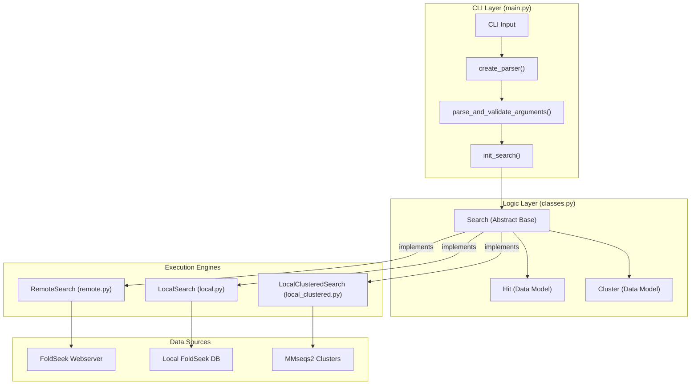
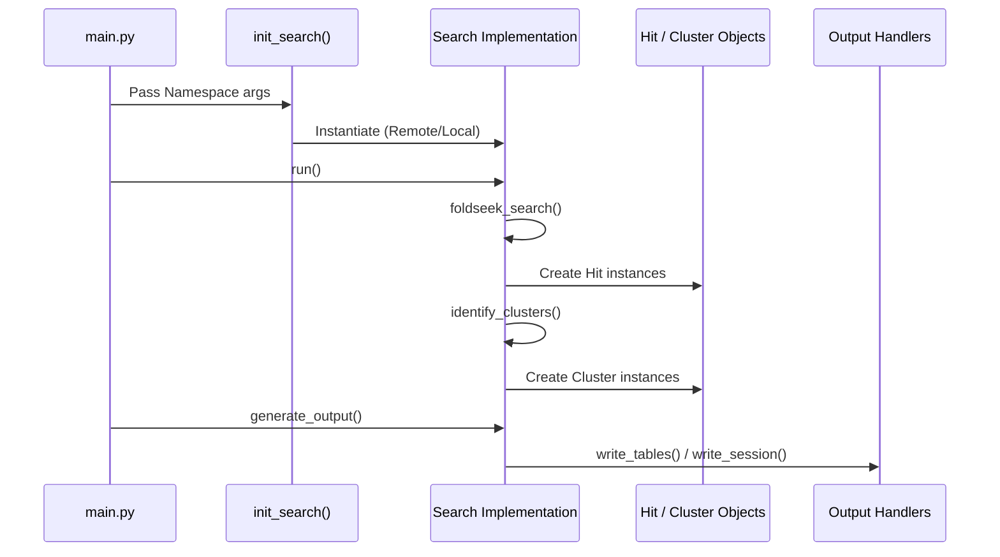

# Core Architecture

Relevant source files

The following files were used as context for generating this wiki page:

- [cfoldseeker/__init__.py](cfoldseeker/__init__.py)
- [cfoldseeker/classes.py](cfoldseeker/classes.py)
- [cfoldseeker/main.py](cfoldseeker/main.py)
- [cfoldseeker/remote_parsers.py](cfoldseeker/remote_parsers.py)

`cfoldseeker` is designed to bridge the gap between protein structural similarity and genomic context analysis. The architecture follows a modular **Command pattern**, where a centralized entry point orchestrates specialized search engines that share a common data model and lifecycle.

## System Overview

The system operates by taking protein structure files (typically in `.cif` or `.pdb` format) and performing a two-step discovery process:
1.  **Structural Search**: Utilizing **FoldSeek** to identify homologous structures in either remote (AlphaFold DB) or local databases.
2.  **Genomic Contextualization**: Mapping structural hits back to their genomic coordinates to identify colocalized gene clusters.

### Code-to-Entity Mapping
The following diagram illustrates how high-level system operations map to specific classes and functions within the codebase.

**Figure 1: System Entity Mapping**

**Sources:** [cfoldseeker/main.py:28-52](), [cfoldseeker/main.py:127-148](), [cfoldseeker/classes.py:21-46](), [cfoldseeker/classes.py:440-455]()

---

## Workflow Orchestration

The workflow is managed by `cfoldseeker/main.py`. It handles the transition from raw user arguments to an initialized search object and manages the lifecycle of the search, including temporary file cleanup and logging.

For details, see [CLI Entrypoint and Workflow Orchestration (main.py)](#2.1).

### The Search Lifecycle
All search modes follow a standardized lifecycle defined in the `Search` base class:
1.  **Initialization**: Validation of paths and parameters.
2.  **Execution (`run()`)**: Performing the FoldSeek search and gathering hits.
3.  **Clustering (`identify_clusters()`)**: Using `networkx` to find colocalized genes based on `max_gap` and `max_length` parameters.
4.  **Output Generation**: Writing results to TSV, JSON (cblaster compatible), or visual plots.

**Figure 2: Data Flow and Component Interaction**

**Sources:** [cfoldseeker/main.py:151-189](), [cfoldseeker/classes.py:534-555](), [cfoldseeker/classes.py:657-690]()

---

## Core Data Models

The internal representation of data is centered around two primary classes in `cfoldseeker/classes.py`:
*   **`Hit`**: Stores FoldSeek metrics (e-value, score, coverage) alongside genomic metadata (scaffold ID, exon coordinates, strand).
*   **`Cluster`**: A collection of `Hit` objects that satisfy spatial constraints (colocalization).

For details, see [Core Data Models: Hit, Cluster, and Search Base Class (classes.py)](#2.2).

### Key Integration Points
*   **FoldSeek**: The primary engine for structural alignment.
*   **Polars**: Used for high-performance data manipulation, especially in `LocalSearch` and `LocalClusteredSearch` for joining large coordinate databases.
*   **NetworkX**: Used within `Search.identify_clusters()` to treat genomic hits as nodes in a graph, where edges represent proximity within the `max_gap` threshold.
*   **cblaster/clinker**: The system exports data in formats compatible with the `csuite` ecosystem for downstream visualization and cluster comparison.

**Sources:** [cfoldseeker/classes.py:8-15](), [cfoldseeker/classes.py:768-790](), [cfoldseeker/local.py:7-10]()

---