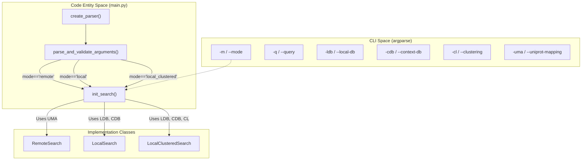
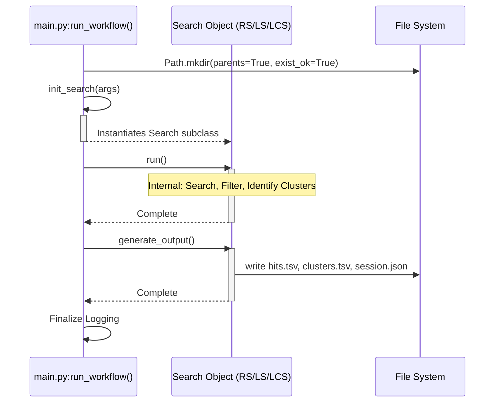

# CLI Entrypoint and Workflow Orchestration (main.py)

Relevant source files

The following files were used as context for generating this wiki page:

- [cfoldseeker/main.py](cfoldseeker/main.py)
- [docs/guide/usage.rst](docs/guide/usage.rst)

The `cfoldseeker/main.py` file serves as the central entrypoint for the application. It is responsible for initializing the runtime environment, parsing command-line arguments, configuring logging, and orchestrating the high-level workflow execution. It acts as a factory for the different search modes (Remote, Local, and Local-Clustered) and manages the lifecycle of the search process, including the cleanup of temporary resources.

### CLI Argument Parsing and Validation

The command-line interface is built using the standard `argparse` library. The implementation is split into two primary phases: definition and validation.

#### Argument Definition: `create_parser()`
The `create_parser()` function [cfoldseeker/main.py:28-150]() organizes CLI options into logical groups:
*   **General**: Mode selection (`-m`), CPU core allocation (`-c`), and verbosity control (`-vv`).
*   **Inputs and Outputs**: Paths for query CIF files (`-q`), output directory (`-o`), and temporary storage (`-t`), as well as flags for various output formats (cblaster sessions, clinker plots, etc.).
*   **Search Options**: Thresholds for FoldSeek hits (e-value, bitscore, coverage) and genomic cluster constraints (maximum intergenic gap, minimum hits).
*   **Remote-specific**: Databases (e.g., `afdb50`), taxon filters, and the UniProt ID mapping table path.
*   **Local-specific**: Paths to the FoldSeek database (`-ldb`), the CDS context database (`-cdb`), and clustering files (`-cl`).

#### Argument Validation: `parse_and_validate_arguments()`
After parsing, `parse_and_validate_arguments()` [cfoldseeker/main.py:153-228]() ensures the integrity of the provided parameters:
1.  **Output Directory**: Checks if the output directory exists. If it does and the `--force` flag is not set, the program exits to prevent data loss [cfoldseeker/main.py:171-176]().
2.  **Mode-specific Checks**: 
    *   For `local` or `local_clustered` modes, it verifies that the FoldSeek database (`-ldb`) and CDS database (`-cdb`) are provided [cfoldseeker/main.py:186-193]().
    *   For `local_clustered`, it additionally requires the clustering file (`-cl`) [cfoldseeker/main.py:195-200]().
    *   For `remote`, it ensures the UniProt mapping table exists [cfoldseeker/main.py:202-207]().
3.  **Path Resolution**: Converts all input strings into absolute `Path` objects.

**Sources:** [cfoldseeker/main.py:28-228]()

---

### Logging Strategy

`cfoldseeker` uses a centralized logging configuration established at the module level.
*   **Implementation**: A `logging.StreamHandler` is directed to `sys.stdout` [cfoldseeker/main.py:23]().
*   **Verbosity**: The `-vv` flag maps integers (0-4) to standard logging levels (CRITICAL to DEBUG) within `run_workflow` [cfoldseeker/main.py:288-292]().
*   **Format**: Logs include timestamp, level, filename, function name, and the message [cfoldseeker/main.py:21]().

**Sources:** [cfoldseeker/main.py:18-25](), [cfoldseeker/main.py:288-292]()

---

### Search Initialization Factory: `init_search()`

The `init_search()` function serves as a factory that returns an instance of a `Search` subclass based on the user-selected mode.

| Mode | Class Instantiated | Logic Summary |
| :--- | :--- | :--- |
| `remote` | `RemoteSearch` | Validates existence of the mapping table and query folder. |
| `local` | `LocalSearch` | Validates FoldSeek DB and CDS DB files. |
| `local_clustered` | `LocalClusteredSearch` | Validates FoldSeek DB, CDS DB, and MMseqs2 clustering TSV. |

**Sources:** [cfoldseeker/main.py:231-278](), [cfoldseeker/main.py:12-14]()

---

### Workflow Orchestration Lifecycle

The lifecycle of a `cfoldseeker` run is managed by `run_workflow(args)` [cfoldseeker/main.py:281-326](). This function encapsulates the entire execution flow from directory creation to instance cleanup.

#### Workflow Execution Steps
1.  **Setup**: The output and temporary directories are created [cfoldseeker/main.py:294-301]().
2.  **Instantiation**: Calls `init_search()` to create the appropriate search object [cfoldseeker/main.py:304]().
3.  **Execution**: Invokes the `run()` method of the search object. This is an abstract method in the `Search` base class implemented by specific modes [cfoldseeker/main.py:307]().
4.  **Reporting**: Calls `generate_output()` to write TSV tables, sessions, and plots to the output directory [cfoldseeker/main.py:310]().
5.  **Teardown**: The `__del__` method (or explicit cleanup) is implicitly handled as the object goes out of scope, but the folder management is robust against failures via the entry point logic [cfoldseeker/main.py:313-326]().

**Sources:** [cfoldseeker/main.py:281-326]()

---

### Logic and Data Flow Diagrams

#### CLI to Search Object Association
This diagram bridges the Natural Language CLI arguments to the specific Python Class entities that handle them.

**Sources:** [cfoldseeker/main.py:28-150](), [cfoldseeker/main.py:231-278]()

#### Workflow Lifecycle: `run_workflow()`
This diagram illustrates the operational flow of `main.py` and how it interacts with search objects.

**Sources:** [cfoldseeker/main.py:281-311]()

### Summary of Key Functions

| Function | Purpose |
| :--- | :--- |
| `create_parser()` | Defines the CLI structure and help strings. |
| `parse_and_validate_arguments()` | Ensures input paths exist and mandatory parameters for specific modes are provided. |
| `init_search()` | Returns a `RemoteSearch`, `LocalSearch`, or `LocalClusteredSearch` instance. |
| `run_workflow()` | Top-level function executing the full stack: Setup -> Init -> Run -> Output. |

**Sources:** [cfoldseeker/main.py:1-326]()

---