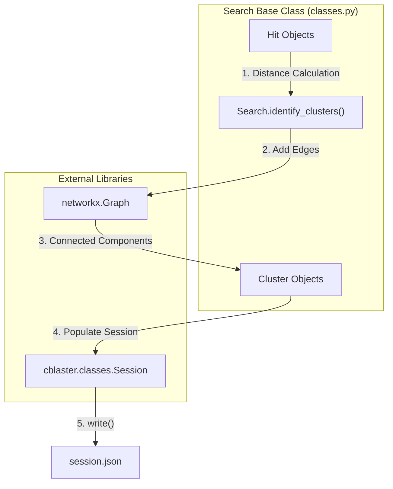
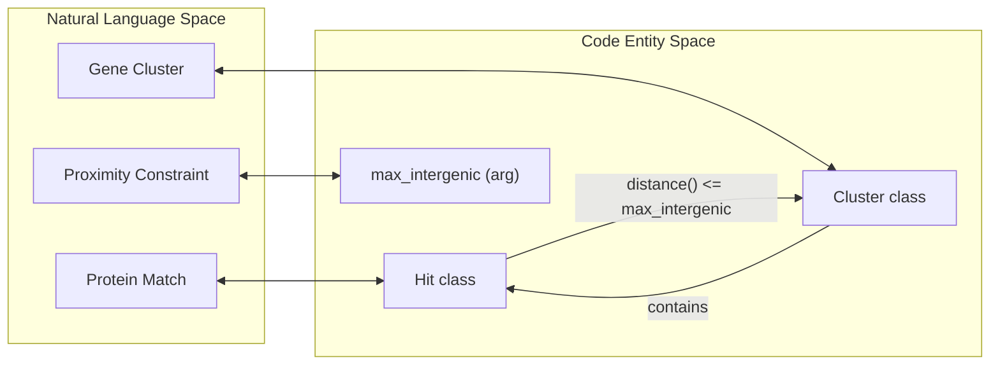

# Core Data Models: Hit, Cluster, and Search Base Class (classes.py)

Relevant source files

The following files were used as context for generating this wiki page:

- [cfoldseeker/classes.py](cfoldseeker/classes.py)

This page provides a technical deep dive into `cfoldseeker/classes.py`, which defines the foundational data structures and abstract logic for the cfoldseeker workflow. It covers the representation of structural hits, the logic for grouping hits into Biosynthetic Gene Clusters (BGCs) using graph theory, and the lifecycle of a search operation.

## The Hit Object

The `Hit` class is the primary container for a single protein structure match identified by FoldSeek. It encapsulates structural metrics, genomic coordinates, and taxonomic metadata [cfoldseeker/classes.py:21-46]().

### Genomic Coordinate Handling
Unlike simple BLAST hits, `Hit` objects support multi-exon gene structures. Coordinates are stored as a list of integer pairs [cfoldseeker/classes.py:94](). The class provides helper methods to abstract the complexity of these coordinates:
*   **`start()` / `end()`**: Return the absolute minimum and maximum coordinates across all exons [cfoldseeker/classes.py:130-160]().
*   **`distance()`**: Calculates the intergenic distance between two hits on the same scaffold. It determines the gap between the end of the upstream hit and the start of the downstream hit [cfoldseeker/classes.py:166-189]().

### Cross-Referencing Metadata
A `Hit` tracks how it was resolved from a FoldSeek structural ID to a genomic location via the `crossref_method` attribute (e.g., `KEGG`, `GenPept`, or `local`) [cfoldseeker/classes.py:80]().

Sources: [cfoldseeker/classes.py:21-189]()

---

## The Cluster Object

The `Cluster` class represents a spatially proximal group of `Hit` objects on a genomic scaffold. It is responsible for calculating aggregate scores and validating cluster composition against search parameters.

### Scoring and Metrics
A cluster's significance is determined by several calculated properties:
*   **`score`**: The sum of all individual FoldSeek alignment scores within the cluster [cfoldseeker/classes.py:228-230]().
*   **`avg_evalue`**: The arithmetic mean of E-values for all hits in the cluster [cfoldseeker/classes.py:232-234]().
*   **`coverage`**: The number of unique query proteins represented in the cluster divided by the total number of queries in the search session [cfoldseeker/classes.py:248-250]().

### Validation Logic
The `is_valid()` method filters clusters based on user-defined thresholds for minimum hits and minimum unique query coverage [cfoldseeker/classes.py:252-263]().

Sources: [cfoldseeker/classes.py:192-263]()

---

## The Search Base Class

`Search` is an abstract base class (ABC) that defines the template for all search modes (`RemoteSearch`, `LocalSearch`, `LocalClusteredSearch`). It orchestrates the transition from raw FoldSeek results to structured `Cluster` objects.

### Lifecycle Methods
Subclasses must implement the following abstract methods:
*   **`run()`**: The entry point for executing the specific FoldSeek search logic [cfoldseeker/classes.py:321-323]().
*   **`generate_output()`**: Handles the writing of results to disk [cfoldseeker/classes.py:325-327]().

### Cluster Identification (NetworkX Integration)
The `identify_clusters()` method implements a graph-based approach to identify BGCs. It uses `networkx` to model hits as nodes and spatial proximity as edges.

| Step | Logic |
| :--- | :--- |
| **Grouping** | Hits are grouped by scaffold (`scaff`) [cfoldseeker/classes.py:365-366](). |
| **Sorting** | Hits on each scaffold are sorted by their `start()` coordinate [cfoldseeker/classes.py:368](). |
| **Graph Building** | An edge is created between two hits if their `distance()` is $\le$ `max_intergenic` [cfoldseeker/classes.py:372-374](). |
| **Component Analysis** | `nx.connected_components()` is called to extract clusters [cfoldseeker/classes.py:376](). |

### Mapping Code Entities to Search Logic
The following diagram illustrates how the `Search` class methods interact with the data models and external libraries.

**Search Logic and Data Flow**

Sources: [cfoldseeker/classes.py:266-415]()

---

## Downstream Integration

### cblaster Session Generation
`cfoldseeker` is designed to be compatible with the `cblaster` ecosystem. The `Search` class contains logic to convert internal `Cluster` and `Hit` objects into a `cblaster.classes.Session` object [cfoldseeker/classes.py:387-415](). This enables:
1.  **Visualization**: Generating cluster maps via `plot_clusters()` [cfoldseeker/classes.py:449-455]().
2.  **Session Persistence**: Saving results to `session.json` for later inspection or use with `cblaster` CLI tools [cfoldseeker/classes.py:423-424]().

### Data Transformation Workflow
The diagram below maps the natural language requirements of BGC identification to the specific code entities in `classes.py`.

**From Genomic Hits to BGC Clusters**

Sources: [cfoldseeker/classes.py:21-25](), [cfoldseeker/classes.py:166-170](), [cfoldseeker/classes.py:192-195](), [cfoldseeker/classes.py:372-374]()

---