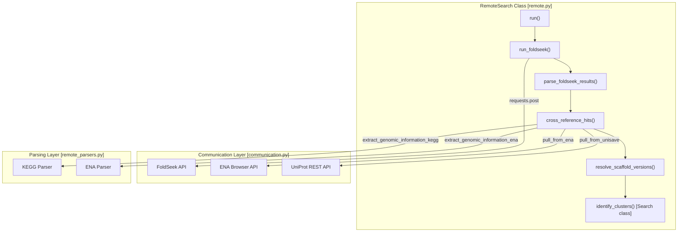
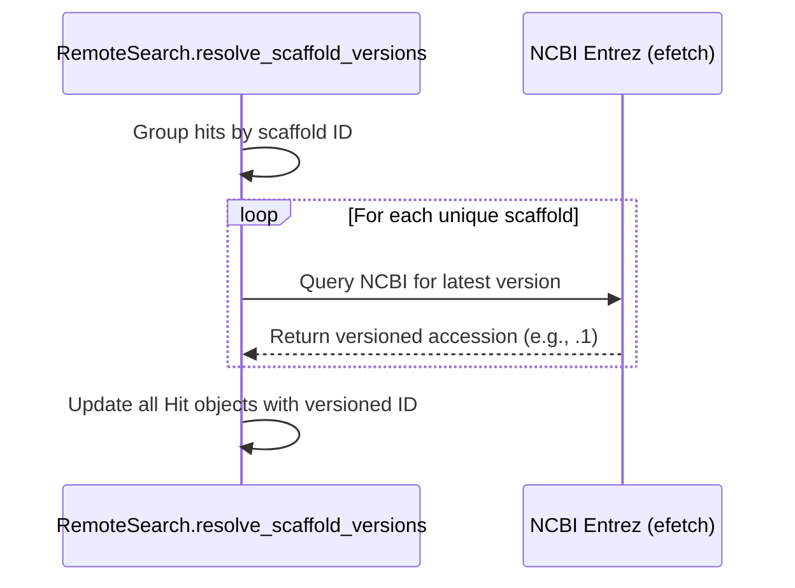

# Remote Search Mode (remote.py)

Relevant source files

The following files were used as context for generating this wiki page:

- [cfoldseeker/__init__.py](cfoldseeker/__init__.py)
- [cfoldseeker/communication.py](cfoldseeker/communication.py)
- [cfoldseeker/remote.py](cfoldseeker/remote.py)
- [cfoldseeker/remote_parsers.py](cfoldseeker/remote_parsers.py)

The `RemoteSearch` mode facilitates gene cluster identification by querying the FoldSeek webserver. It is designed for users who do not have local structural databases and wish to leverage public repositories (e.g., AFDB, PDB). This mode implements a complex three-tier cross-referencing hierarchy to resolve protein hits into genomic coordinates, utilizing `KEGG`, `ENA`, and `UniProt` APIs.

### System Architecture and Data Flow

The `RemoteSearch` class extends the base `Search` class `[cfoldseeker/remote.py:28-46]()`. It manages the lifecycle of a remote query, from submission to the final identification of genomic clusters.

#### Code Entity Map: Remote Search Workflow
The following diagram maps the high-level workflow to the specific functions and classes in the codebase.

**Sources:** `[cfoldseeker/remote.py:28-80]()`, `[cfoldseeker/communication.py:15-131]()`, `[cfoldseeker/remote_parsers.py:12-127]()`.

---

### FoldSeek Webserver Communication

Remote search begins by submitting structural queries to the FoldSeek API via `submit_foldseek_query` `[cfoldseeker/communication.py:15-76]()`.

1.  **Submission**: Queries are sent in parallel using `thread_map` `[cfoldseeker/remote.py:158-160]()`.
2.  **Polling**: The system monitors job status via `check_query_status` `[cfoldseeker/communication.py:78-98]()`.
3.  **Retrieval**: Once "COMPLETE", results are downloaded as JSON `[cfoldseeker/communication.py:101-129]()`.
4.  **Parsing**: `parse_foldseek_results` converts the JSON hits into internal `Hit` objects, capturing metrics like E-value, TM-score, and RMSD `[cfoldseeker/remote.py:177-226]()`.

**Sources:** `[cfoldseeker/remote.py:154-226]()`, `[cfoldseeker/communication.py:15-129]()`.

---

### Three-Tier Cross-Referencing Hierarchy

The core challenge of remote structural search is that FoldSeek results often lack genomic coordinates. `RemoteSearch` resolves this through `cross_reference_hits` `[cfoldseeker/remote.py:323-456]()` using a prioritized fallback strategy.

| Tier | Source | Logic | Code Reference |
| :--- | :--- | :--- | :--- |
| **1** | **KEGG** | Joins hits against a local UniProt mapping table to find KEGG Gene IDs. Pulls records via `kegg_pull`. | `[cfoldseeker/remote.py:343-376]()` |
| **2** | **ENA/GenPept** | If KEGG fails, attempts to find EMBL-CDS IDs in the mapping table and pulls GenPept records from ENA. | `[cfoldseeker/remote.py:378-406]()` |
| **3** | **UniSave/WGS** | Fallback for UniProt IDs. Pulls historical records from UniSave or searches WGS-GenPept. | `[cfoldseeker/remote.py:408-444]()` |

#### Hit Sanitisation
Because a single UniProt ID may map to multiple genomic locations (e.g., identical proteins in different strains), the `_sanitise_hit_attr` method standardizes the hit list `[cfoldseeker/remote.py:87-152]()`. If a hit has multiple cross-references, the method "explodes" it into multiple `Hit` instances, each representing a unique genomic locus `[cfoldseeker/remote.py:118-129]()`.

**Sources:** `[cfoldseeker/remote.py:87-152]()`, `[cfoldseeker/remote.py:323-456]()`.

---

### Scaffold Version Resolution

Genomic coordinates retrieved from remote sources often reference accessions without version numbers (e.g., `CP000001` instead of `CP000001.1`). To ensure compatibility with downstream tools like `cblaster`, `RemoteSearch` performs scaffold resolution.

This process uses `Bio.Entrez` to fetch the correct versioned accession `[cfoldseeker/remote.py:537-586]()`. To optimize performance, queries are batched and executed concurrently using `thread_map` `[cfoldseeker/remote.py:557-558]()`.

**Sources:** `[cfoldseeker/remote.py:537-586]()`.

---

### Key Functions Reference

| Function | Role | Source |
| :--- | :--- | :--- |
| `__init__` | Loads the UniProt mapping table as a Polars `LazyFrame`. | `[cfoldseeker/remote.py:48-80]()` |
| `run_foldseek` | Orchestrates parallel submission and retrieval of FoldSeek jobs. | `[cfoldseeker/remote.py:154-175]()` |
| `cross_reference_hits` | The main engine for resolving protein IDs to genomic coordinates. | `[cfoldseeker/remote.py:323-456]()` |
| `extract_genomic_information_kegg` | Parses KEGG text records for `POSITION` and `strand`. | `[cfoldseeker/remote_parsers.py:12-50]()` |
| `extract_genomic_information_ena` | Parses ENA EMBL records using `Bio.SeqIO`. | `[cfoldseeker/remote_parsers.py:99-127]()` |
| `resolve_scaffold_versions` | Updates hit scaffolds to include NCBI version suffixes. | `[cfoldseeker/remote.py:537-586]()` |

**Sources:** `[cfoldseeker/remote.py:1-586]()`, `[cfoldseeker/remote_parsers.py:1-127]()`.

---