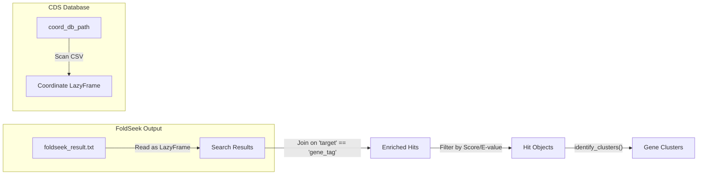

# Local Search Mode (local.py)

<details>
<summary>Relevant source files</summary>

The following files were used as context for generating this wiki page:

- [cfoldseeker/local.py](cfoldseeker/local.py)

</details>


The `LocalSearch` mode is designed for structural homology searches against user-provided local FoldSeek databases. It leverages the `foldseek easy-search` binary to compare query protein structures (CIF format) against a target database, subsequently cross-referencing hits with a pre-built CDS coordinate database to enable genomic context analysis.

### System Overview and Code Mapping

The following diagram maps the logical components of a local search to their respective implementations in `cfoldseeker/local.py`.

**Local Search Entity Map**
```mermaid
graph TD
    subgraph "Natural Language Space"
        "Search Execution"
        "Output Parsing"
        "Coordinate Lookup"
        "Result Filtering"
    end

    subgraph "Code Entity Space"
        "Search Execution" --> FS_RUN["LocalSearch.run_foldseek()"]
        "Output Parsing" --> FS_PARSE["LocalSearch.parse_foldseek_results()"]
        "Coordinate Lookup" --> COORD_JOIN["LocalSearch.coord_db (Polars LazyFrame)"]
        "Result Filtering" --> HIT_FILT["LocalSearch.identify_hits()"]
        
        FS_RUN --> STR_READ["_stream_reader()"]
        FS_PARSE --> PARSE_COORDS["LocalSearch._parse_coordinate_string()"]
    end

    FS_RUN -- "Invokes via Subprocess" --> B_FS["foldseek easy-search"]
    COORD_JOIN -- "Reads from" --> TSV_DB["CDS TSV Database"]
```
Sources: [cfoldseeker/local.py:47-62](), [cfoldseeker/local.py:107-127](), [cfoldseeker/local.py:186-200]()

---

### Implementation Details

#### 1. FoldSeek Execution and Stream Handling
The search begins by invoking the `foldseek` binary via `subprocess.Popen` [cfoldseeker/local.py:155-155](). To ensure the application remains responsive and logs are captured in real-time without blocking the main thread, the module implements a threaded stream reader.

*   **`_stream_reader`**: A utility function that continuously reads binary chunks from a pipe, decodes them as UTF-8, and passes them to a logging callback [cfoldseeker/local.py:18-45]().
*   **Command Configuration**: The `easy-search` command is configured with `--exhaustive-search 1` to ensure sensitivity [cfoldseeker/local.py:150-150]() and outputs a specific TSV format containing `query, target, qstart, qend, tstart, tend, pident, qcov, tcov, evalue, bits` [cfoldseeker/local.py:145-145]().

Sources: [cfoldseeker/local.py:18-45](), [cfoldseeker/local.py:138-151]()

#### 2. Data Flow and Coordinate Integration
A key feature of `LocalSearch` is the integration of structural hits with genomic metadata. This is achieved through a `Polars` join operation.

**Data Flow: From Structure Hit to Genomic Hit**

Sources: [cfoldseeker/local.py:95-99](), [cfoldseeker/local.py:202-230]()

*   **Lazy Loading**: The CDS database is scanned using `pl.scan_csv`, which creates a `LazyFrame`. This allows `cfoldseeker` to handle massive coordinate databases (e.g., whole-genome collections) without high memory overhead [cfoldseeker/local.py:87-99]().
*   **Coordinate Parsing**: The `_parse_coordinate_string` method handles the conversion of string-based genomic coordinates (e.g., `100-500,600-800`) into a sorted list of integer tuples `[(100, 500), (600, 800)]`, accounting for strand orientation [cfoldseeker/local.py:269-307]().

Sources: [cfoldseeker/local.py:96-99](), [cfoldseeker/local.py:269-307]()

#### 3. Result Parsing and Filtering
After the join, results are processed in `parse_foldseek_results()` [cfoldseeker/local.py:186-267]().

| Step | Action | Code Reference |
| :--- | :--- | :--- |
| **Loading** | Read FoldSeek TSV with defined schema. | [cfoldseeker/local.py:202-212]() |
| **Joining** | Inner join with `self.coord_db` on the gene identifier. | [cfoldseeker/local.py:221-222]() |
| **Filtering** | Apply `min_score` and `min_coverage` thresholds. | [cfoldseeker/local.py:224-227]() |
| **Instantiation** | Convert Polars rows into `Hit` class instances. | [cfoldseeker/local.py:240-264]() |

Sources: [cfoldseeker/local.py:202-264]()

### Key Methods

#### `run(self)`
The primary entry point that orchestrates the workflow:
1.  Calls `run_foldseek()` to generate the raw structural alignment file [cfoldseeker/local.py:176-176]().
2.  Calls `parse_foldseek_results()` to link structures to genomic coordinates [cfoldseeker/local.py:177-177]().
3.  Executes `identify_clusters()` (inherited from `Search`) to group hits based on intergenic distance [cfoldseeker/local.py:178-178]().

#### `_parse_coordinate_string(self, coord_str, strand)`
Handles the transformation of genomic location data. It uses regex `(\d+)-(\d+)` to extract start and end positions from the database string [cfoldseeker/local.py:288-288](). If the strand is negative (`-`), it ensures the internal representation maintains sorted order for downstream distance calculations [cfoldseeker/local.py:293-303]().

Sources: [cfoldseeker/local.py:173-184](), [cfoldseeker/local.py:269-307]()

---