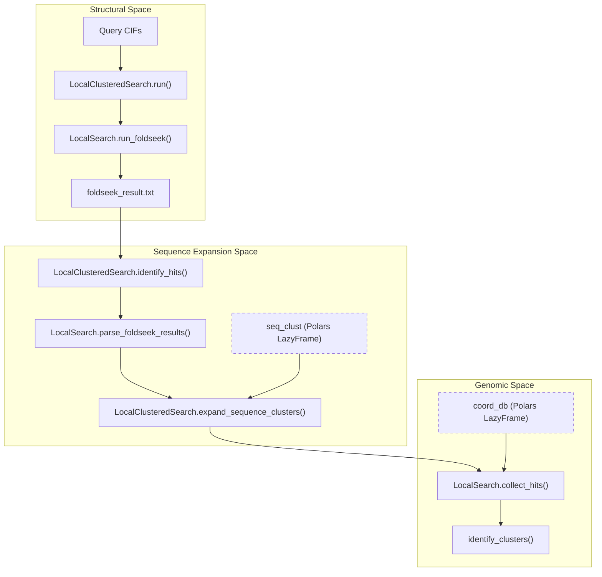
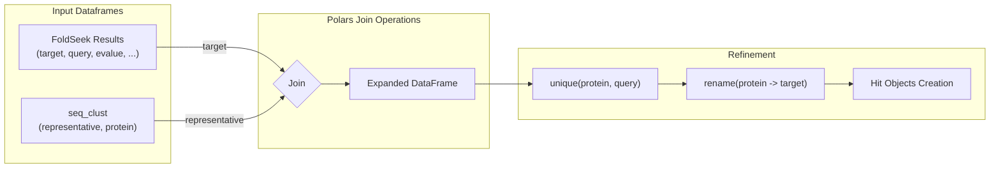

# Local-Clustered Search Mode (local_clustered.py)

Relevant source files

The following files were used as context for generating this wiki page:

- [cfoldseeker/local.py](cfoldseeker/local.py)
- [cfoldseeker/local_clustered.py](cfoldseeker/local_clustered.py)

The `LocalClusteredSearch` mode is a specialized structural search strategy designed for efficiency when dealing with massive target databases. Instead of searching every individual protein structure, it performs a FoldSeek search against a database of **sequence cluster representatives** and then expands the resulting hits to include all members of those clusters. This approach significantly reduces the structural search space while maintaining sensitivity by leveraging sequence-level redundancy.

### Implementation Overview

The `LocalClusteredSearch` class [cfoldseeker/local_clustered.py:14-38]() inherits from `LocalSearch` [cfoldseeker/local.py:47-62](). It extends the standard local search workflow by introducing a sequence expansion step between the FoldSeek result parsing and the final hit collection.

#### Data Flow: Representative-First Search

1.  **Structural Search**: FoldSeek `easy-search` is executed against a database containing only representative structures [cfoldseeker/local.py:107-151]().
2.  **Clustering Join**: The search results (representatives) are joined with an MMseqs2 clustering TSV to identify all related sequence members [cfoldseeker/local_clustered.py:84-123]().
3.  **Genomic Context Retrieval**: The expanded hit set is joined against the CDS coordinate database (`coord_db`) to obtain genomic locations [cfoldseeker/local_clustered.py:147]().
4.  **Cluster Identification**: The standard graph-based spatial clustering logic is applied to the expanded hits.

### System Mapping: Logic to Code Entities

The following diagram maps the logical steps of the clustered search to the specific class methods and data structures used in the implementation.

**Clustered Search Workflow Mapping**

**Sources:** [cfoldseeker/local_clustered.py:126-158](), [cfoldseeker/local.py:96-99](), [cfoldseeker/local_clustered.py:74-75]()

### Sequence Expansion Logic

The core of this mode is the `expand_sequence_clusters` method. It uses the **Polars** library to perform high-performance joins between the structural hits and the sequence clustering data.

#### The MMseqs2 Clustering Table
The class expects an MMseqs2 clustering TSV (loaded as `self.seq_clust`). This table is scanned as a `LazyFrame` with two columns: `representative` and `protein` [cfoldseeker/local_clustered.py:74-75]().

#### Join and Deduplication Process
The expansion follows a strict pipeline to ensure data integrity and performance:
1.  **Prefiltering**: The large `seq_clust` table is filtered to only include rows where the `representative` column matches a hit found in the FoldSeek results [cfoldseeker/local_clustered.py:105-109]().
2.  **Materialization**: The filtered table is collected into memory (`.collect()`) to optimize the subsequent join [cfoldseeker/local_clustered.py:110]().
3.  **Inner Join**: The hits are joined with the cluster members. Every member of a cluster inherits the structural metrics (E-value, Score, Coverage) of its representative [cfoldseeker/local_clustered.py:114]().
4.  **Deduplication**: Duplicate protein/query pairs are dropped using `.unique(subset=['protein', 'query'])` to handle cases where identical labels might appear in different assemblies [cfoldseeker/local_clustered.py:118]().

**Data Transformation Architecture**

**Sources:** [cfoldseeker/local_clustered.py:84-123]()

### Inherited Hit Identification

After expansion, `LocalClusteredSearch` leverages the `collect_hits()` method from `LocalSearch` [cfoldseeker/local_clustered.py:147](). This method:
1.  Joins the expanded hit table with the `coord_db` (CDS coordinates) [cfoldseeker/local.py:96-99]().
2.  Instantiates `Hit` objects for every valid sequence/coordinate pair [cfoldseeker/local.py:207-220]().
3.  Feeds these `Hit` objects into the `identify_clusters()` method (inherited from the `Search` base class) to perform spatial grouping of genes on contigs [cfoldseeker/classes.py:533-548]().

### Key Functions and Classes

| Entity | Role | Source |
| :--- | :--- | :--- |
| `LocalClusteredSearch` | Main class for clustered search orchestration. | [cfoldseeker/local_clustered.py:14]() |
| `expand_sequence_clusters()` | Joins structural hits with sequence cluster members. | [cfoldseeker/local_clustered.py:84]() |
| `identify_hits()` | Overridden method to include the expansion step. | [cfoldseeker/local_clustered.py:126]() |
| `seq_clust` | `pl.LazyFrame` containing MMseqs2 representative/member mappings. | [cfoldseeker/local_clustered.py:74]() |
| `coord_db` | `pl.LazyFrame` containing genomic coordinates for all proteins. | [cfoldseeker/local.py:96]() |

**Sources:** [cfoldseeker/local_clustered.py:1-158](), [cfoldseeker/local.py:47-101]()

---