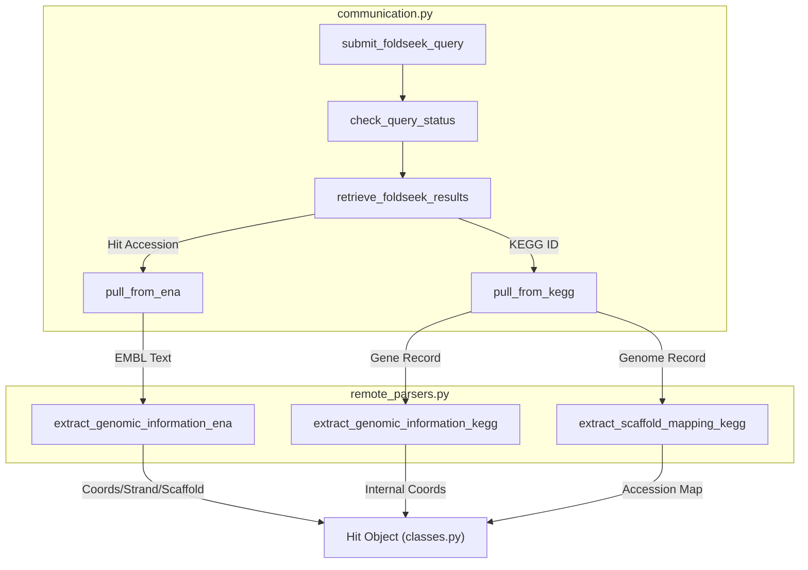
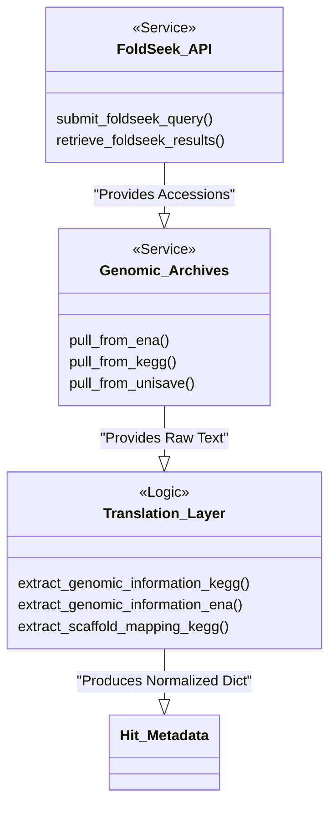

# External Communication Layer (communication.py and remote_parsers.py)

Relevant source files

The following files were used as context for generating this wiki page:

- [cfoldseeker/__init__.py](cfoldseeker/__init__.py)
- [cfoldseeker/communication.py](cfoldseeker/communication.py)
- [cfoldseeker/remote_parsers.py](cfoldseeker/remote_parsers.py)

The External Communication Layer serves as the stateless HTTP gateway and data translation engine for `cfoldseeker`. It manages all interactions with remote bioinformatics services—primarily the FoldSeek webserver, KEGG, ENA, and UniProt—while providing robust error handling, rate-limit management, and coordinate normalization.

## Stateless HTTP Gateway (communication.py)

The `communication.py` module encapsulates the logic for interacting with external REST APIs. It implements a ticket-based lifecycle for FoldSeek searches and a retrieval system for genomic metadata.

### FoldSeek Ticket Lifecycle
Remote searches follow a three-step process: submission, status polling, and result retrieval. This is managed by `submit_foldseek_query`, `check_query_status`, and `retrieve_foldseek_results`.

| Function | Endpoint | Description |
| :--- | :--- | :--- |
| `submit_foldseek_query` | `/api/ticket` | Posts a `.cif` or `.pdb` file with DB and taxfilter parameters. Returns a job ID. |
| `check_query_status` | `/api/ticket/{job_id}` | Polls the API to check if the status is "COMPLETE". |
| `retrieve_foldseek_results` | `/api/result/{job_id}/0` | Downloads the final JSON payload once the job is finished. |

**Sources:** [`cfoldseeker/communication.py:15-36`](), [`cfoldseeker/communication.py:78-98`](), [`cfoldseeker/communication.py:101-129`]()

### Remote Metadata Retrieval
To reconstruct genomic contexts for remote hits, `cfoldseeker` pulls sequence records from multiple archives.

*   **ENA (European Nucleotide Archive):** `pull_from_ena` fetches EMBL/GenPept records via the ENA Browser API [`cfoldseeker/communication.py:132-176`]().
*   **UniSave:** `pull_from_unisave` retrieves historical UniProt entries [`cfoldseeker/communication.py:179-222`]().
*   **KEGG:** `pull_from_kegg` fetches Gene and Genome records [`cfoldseeker/communication.py:225-265`]().
*   **NCBI Entrez:** `pull_from_entrez` is used to resolve scaffold versions for accessions that lack them [`cfoldseeker/communication.py:268-311`]().

### Rate-Limit and Retry Logic
All HTTP requests are wrapped in retry loops to handle network instability and API rate limits (HTTP 429).
*   **Retry Mechanism:** Functions typically allow up to 3 attempts [`cfoldseeker/communication.py:153-154`]().
*   **Backoff:** Upon receiving a 429 status code, the system waits 5 seconds before retrying [`cfoldseeker/communication.py:60-63`]().

**Sources:** [`cfoldseeker/communication.py:53-75`](), [`cfoldseeker/communication.py:153-176`]()

---

## Remote Parser Translation Layer (remote_parsers.py)

The `remote_parsers.py` module acts as a translation layer, converting raw text responses from various biological databases into a standardized dictionary format containing genomic coordinates and scaffold identifiers.

### KEGG Record Parsing
KEGG requires a two-step parsing approach because Gene records often use internal scaffold identifiers that must be mapped back to GenBank/RefSeq accessions using the Genome record.

*   **`extract_genomic_information_kegg`**: Parses the `POSITION` line of a KEGG Gene record. It uses regex `\d+\.\.\d+` to extract exon boundaries and identifies the strand by checking for the `complement` keyword [`cfoldseeker/remote_parsers.py:12-50`]().
*   **`extract_scaffold_mapping_kegg`**: Parses the `CHROMOSOME` and `PLASMID` fields of a KEGG Genome record to create a lookup table between internal IDs and public accessions [`cfoldseeker/remote_parsers.py:53-96`]().

### ENA EMBL Parsing
`extract_genomic_information_ena` utilizes `Bio.SeqIO` to process EMBL-formatted records. It specifically targets the `CDS` feature and handles multi-part locations (exons) [`cfoldseeker/remote_parsers.py:99-127`]().

### Data Normalization
A critical role of this layer is coordinate normalization. For instance, BioPython's 0-based start coordinates are incremented by 1 to maintain consistency with standard 1-based genomic notations used elsewhere in the pipeline [`cfoldseeker/remote_parsers.py:112`]().

**Sources:** [`cfoldseeker/remote_parsers.py:32-43`](), [`cfoldseeker/remote_parsers.py:108-112`]()

---

## Data Flow: From Remote Hit to Genomic Context

The following diagram illustrates how the `communication.py` and `remote_parsers.py` entities interact to transform a remote FoldSeek hit into a structured `Hit` object.

### Interaction Logic: Remote Data Retrieval

**Sources:** [`cfoldseeker/communication.py:101-129`](), [`cfoldseeker/remote_parsers.py:12-50`](), [`cfoldseeker/remote_parsers.py:99-127`]()

---

## Entity Mapping: Code to Natural Language

This diagram maps specific code entities to their functional roles in the external communication lifecycle.

### Code Entity Space to Natural Language Space

**Sources:** [`cfoldseeker/communication.py:15-129`](), [`cfoldseeker/communication.py:132-265`](), [`cfoldseeker/remote_parsers.py:12-127`]()

## Key Functions Summary

| File | Function | Role |
| :--- | :--- | :--- |
| `communication.py` | `submit_foldseek_query` | Entry point for remote search; handles `multipart/form-data` upload [`cfoldseeker/communication.py:15-59`](). |
| `communication.py` | `pull_from_entrez` | Resolves `scaffold_version` for NCBI accessions via E-utils [`cfoldseeker/communication.py:268-311`](). |
| `remote_parsers.py` | `extract_genomic_information_kegg` | Regex-based parser for KEGG `POSITION` lines; handles `complement()` and `join()` [`cfoldseeker/remote_parsers.py:12-50`](). |
| `remote_parsers.py` | `extract_genomic_information_ena` | BioPython-based parser for ENA EMBL files; extracts multi-exon coordinates [`cfoldseeker/remote_parsers.py:99-127`](). |

**Sources:** [`cfoldseeker/communication.py:15-311`](), [`cfoldseeker/remote_parsers.py:12-127`]()

---