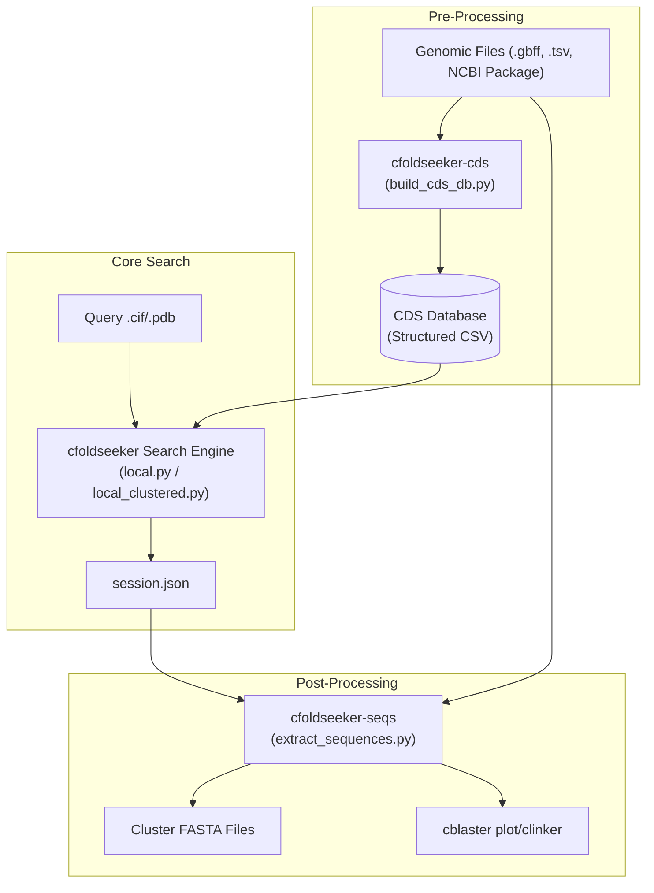

# Utility Tools

Relevant source files

The following files were used as context for generating this wiki page:

- [bioconda_recipe/meta.yaml](bioconda_recipe/meta.yaml)
- [env.yml](env.yml)
- [pyproject.toml](pyproject.toml)

`cfoldseeker` provides two auxiliary Command Line Interface (CLI) tools designed to manage the data lifecycle before and after a structural search. These tools facilitate the construction of local genomic databases and the extraction of sequences from identified gene clusters. Both tools are exposed as entry points in the package distribution [pyproject.toml:48-49]().

### Workflow Integration
The utility tools act as the "bookends" of the `cfoldseeker` search workflow:
1.  **Pre-search**: `cfoldseeker-cds` processes raw genomic data (GenBank, NCBI datasets, etc.) into a structured CSV database used by `LocalSearch` and `LocalClusteredSearch` to resolve structural hits to genomic coordinates.
2.  **Post-search**: `cfoldseeker-seqs` consumes the `session.json` output from a search to retrieve physical FASTA sequences (nucleotide or protein) for downstream analysis or visualization.

### Tool Connectivity Overview

The following diagram illustrates how these utilities interface with the core search engine and the filesystem.

**Figure 1: Utility Tool Data Flow**

**Sources:** [pyproject.toml:46-49](), [cfoldseeker/main.py:1-20]() (inferred workflow).

---

## 5.1 CDS Database Builder (cfoldseeker-cds)

The `cfoldseeker-cds` tool (implemented in `build_cds_db.py`) is responsible for creating a high-performance genomic coordinate index. This index allows `cfoldseeker` to instantly map a FoldSeek hit (identified by a protein accession) to its specific location on a contig, including its orientation and neighboring genes.

### Key Capabilities
*   **ETL Pipeline**: Utilizes the `Polars` library to perform lazy evaluation and streaming ETL (Extract, Transform, Load), ensuring that large genomic datasets (e.g., entire NCBI RefSeq categories) can be processed without exhausting system memory.
*   **Input Flexibility**: Supports multiple formats including standard NCBI `.gbff` files, Bakta-annotated GenBank files, and raw TSV inputs.
*   **Coordinate Handling**: Correctly handles complex genomic features, such as multi-exon genes and trans-spliced entries, ensuring the final database contains accurate start/stop boundaries for the `cfoldseeker` cluster detection algorithm.
*   **Taxon Resolution**: Integrates with NCBI Entrez to resolve taxonomic IDs to scientific names, enriching the database for better hit reporting.

For a detailed reference on database schemas, supported flags, and the transformation logic, see **[5.1 CDS Database Builder (build_cds_db.py)](#)**.

**Sources:** [cfoldseeker/build_cds_db.py:1-10](), [pyproject.toml:48]()

---

## 5.2 Sequence Extractor (cfoldseeker-seqs)

The `cfoldseeker-seqs` tool (implemented in `extract_sequences.py`) bridges the gap between tabular search results and biological sequence analysis. Once `cfoldseeker` identifies potential Biosynthetic Gene Clusters (BGCs), this utility extracts the relevant sequence data from the original source files.

### Key Capabilities
*   **Session Management**: Loads `cfoldseeker` session files using `convert_session()` to reconstruct the state of a completed search.
*   **Precision Extraction**: Uses `locate_nucleotide_sequences()` and `locate_protein_sequences()` to slice specific genomic regions based on the hits found during the search, minimizing the need to load entire genomes into memory.
*   **Parallelism**: Employs `thread_map` to handle multi-threaded extraction across hundreds of clusters simultaneously, significantly speeding up the transition to downstream tools.
*   **Downstream Compatibility**: Formats outputs for direct use in `cblaster` visualization or `BigScape` similarity networking.

For a detailed reference on extraction modes and integration with the `csuite` ecosystem, see **[5.2 Sequence Extractor (extract_sequences.py)](#)**.

**Sources:** [cfoldseeker/extract_sequences.py:1-15](), [pyproject.toml:49]()

---

## Technical Mapping

The following table maps the CLI tools to their respective implementation modules and primary library dependencies.

| CLI Command | Module Reference | Primary Logic | Dependencies |
| :--- | :--- | :--- | :--- |
| `cfoldseeker-cds` | `cfoldseeker/build_cds_db.py` | `main()` | `polars`, `biopython` |
| `cfoldseeker-seqs` | `cfoldseeker/extract_sequences.py` | `main()` | `cblaster`, `tqdm`, `biopython` |

**Sources:** [pyproject.toml:24-32](), [bioconda_recipe/meta.yaml:15-18]()

---